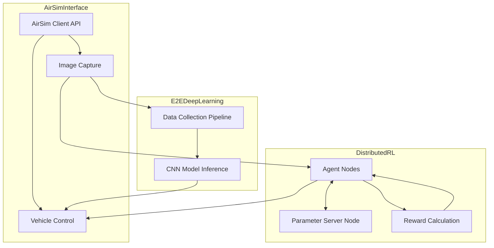
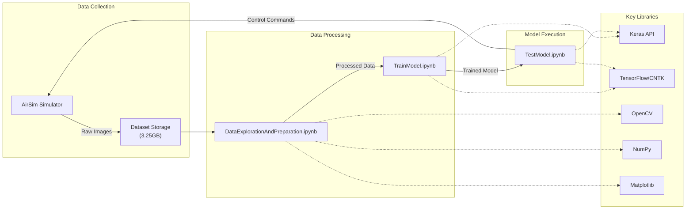
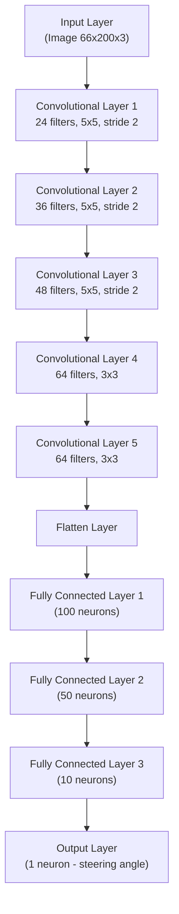
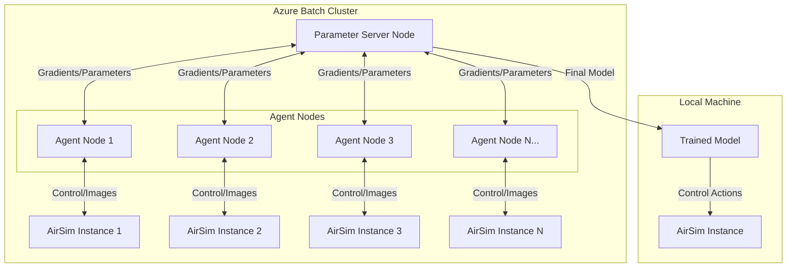
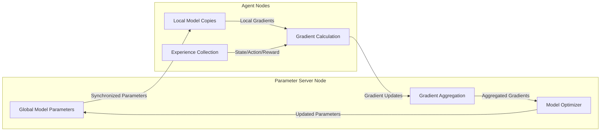
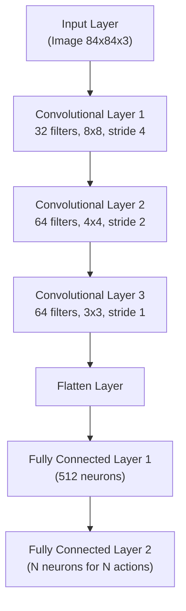
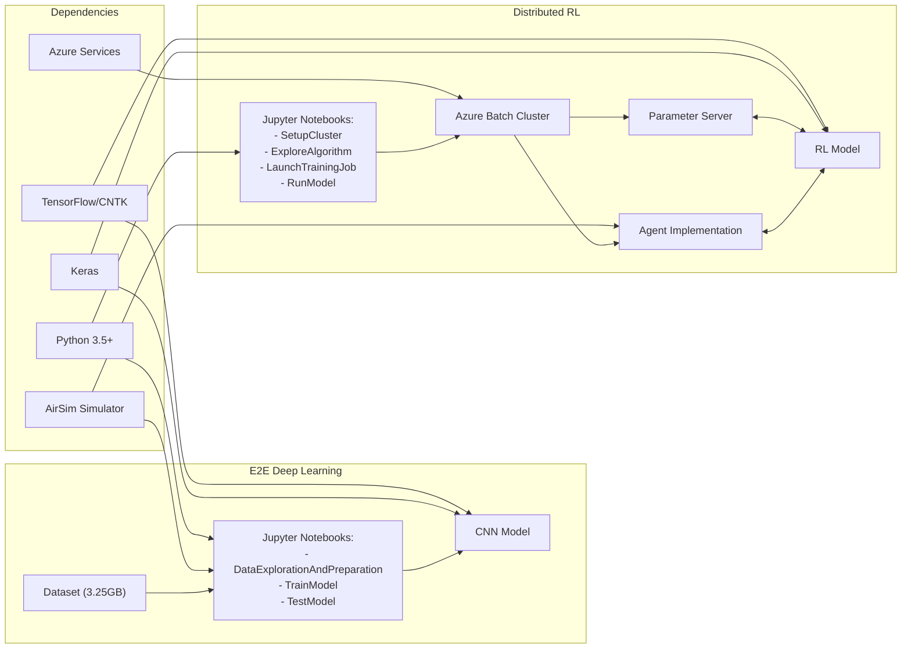

<!-- source: DeepWiki mcp.deepwiki.com · repo microsoft/AutonomousDrivingCookbook · page 4 Technical Deep Dive · fetched 2026-10-26 -->

# Technical Deep Dive

Relevant source files

The following files were used as context for generating this wiki page:

- [AirSimE2EDeepLearning/.gitignore](AirSimE2EDeepLearning/.gitignore)
- [AirSimE2EDeepLearning/README.md](AirSimE2EDeepLearning/README.md)
- [DistributedRL/README.md](DistributedRL/README.md)
- [README.md](README.md)

## Purpose and Scope

This document provides a detailed technical analysis of the key architectural components, implementation details, and technical considerations for the autonomous driving systems in the Microsoft Autonomous Driving Cookbook. It covers the internal workings of both the End-to-End Deep Learning and Distributed Reinforcement Learning approaches, focusing on system design, data flow, model architectures, and the technical integration with the AirSim simulator.

For an overview of the entire project, see [Overview](#1). For tutorial-specific information, see [End-to-End Deep Learning for Autonomous Driving](#2) and [Distributed Reinforcement Learning](#3).

Sources: [README.md:1-54](), [AirSimE2EDeepLearning/README.md:1-82](), [DistributedRL/README.md:1-94]()

## System Integration with AirSim

The Autonomous Driving Cookbook utilizes the AirSim simulation environment as the foundation for both tutorials. Here we examine how the two different approaches integrate with AirSim and the technical differences in their implementation.

### AirSim Communication Architecture

**Diagram: AirSim Integration Architecture**

Sources: [AirSimE2EDeepLearning/README.md:9-19](), [DistributedRL/README.md:12-22]()

Both tutorial approaches communicate with AirSim through similar interfaces but use the data differently:

1. **End-to-End Deep Learning**: Focuses on a supervised learning approach where data is first collected, then processed, and finally used to train a model offline.

2. **Distributed Reinforcement Learning**: Uses an online learning approach where multiple agents interact with different instances of the simulator simultaneously, sharing learning updates through a parameter server.

## End-to-End Deep Learning Technical Architecture

The End-to-End Deep Learning tutorial demonstrates training a convolutional neural network to predict steering angles directly from camera images. This section details the technical components of this system.

### Data Pipeline Architecture

**Diagram: E2E Data Flow Architecture**

Sources: [AirSimE2EDeepLearning/README.md:19-31](), [AirSimE2EDeepLearning/README.md:59-77]()

### E2E Model Technical Details

The End-to-End Deep Learning approach uses a CNN architecture based on NVIDIA's end-to-end driving model, adapted for the AirSim environment:

**Diagram: CNN Architecture**

Sources: [AirSimE2EDeepLearning/README.md:19-31]()

Key technical aspects of the E2E implementation:

1. **Image Processing Pipeline**:
   - Images are captured from AirSim at resolution of 256x256
   - Preprocessing includes resizing to 66x200, normalization, and cropping
   - Each image is paired with a steering label for supervised learning

2. **Training Configuration**:
   - Uses Adam optimizer with learning rate of 1e-4
   - Loss function: Mean squared error (MSE)
   - Training typically requires a GPU for reasonable training time (~45 minutes on NVIDIA GTX970)

3. **Dataset Characteristics**:
   - 3.25GB dataset containing images from the AirSim Mountain/Landscape environment
   - Images are stored with associated steering angles for supervised learning

## Distributed Reinforcement Learning Technical Architecture

The Distributed RL tutorial demonstrates a more complex architecture designed to train models at scale using multiple virtual machines. This section examines the technical implementation details of this distributed system.

### Distributed Agent Architecture

**Diagram: Distributed Training Architecture**

Sources: [DistributedRL/README.md:12-21](), [DistributedRL/README.md:73-94]()

### Parameter Server Implementation

The parameter server is a critical component in the distributed training architecture:

**Diagram: Parameter Server Data Flow**

Sources: [DistributedRL/README.md:22-57]()

Key technical aspects of the distributed RL implementation:

1. **Azure Batch Integration**:
   - Uses Azure Batch to manage VM clusters with NV6 machines (GPU-enabled)
   - Parameters are shared via network communication between nodes
   - Scales horizontally by adding more agent nodes

2. **Reinforcement Learning Details**:
   - Uses Q-learning approach with epsilon-greedy exploration
   - Reward function based on track progress, collision penalties, and speed
   - Experience replay for improved training stability

3. **Training Efficiency**:
   - With 4 nodes (3 agents + 1 parameter server): ~3 days for training from scratch
   - With transfer learning: ~6 hours on same configuration
   - For local training without distribution: ~5 days from scratch

## Neural Network Model Architectures

Both tutorials employ different model architectures tailored to their respective learning approaches.

### End-to-End Deep Learning Model vs. Reinforcement Learning Model

| Aspect | E2E CNN Model | Distributed RL Model |
|--------|---------------|----------------------|
| Input | Single front camera image (66x200x3) | Front camera image (84x84x3) |
| Output | Single continuous value (steering angle) | Q-values for discrete actions |
| Loss Function | Mean Squared Error | Huber Loss (smoother L1) |
| Training Data | Offline dataset (3.25GB) | Online generated experiences |
| Training Type | Supervised batch training | Reinforcement learning with experience replay |
| Architecture | 5 convolutional layers + 3 fully connected | 3 convolutional layers + 2 fully connected |
| Framework | Keras with TensorFlow/CNTK backend | Keras with TensorFlow backend |
| Optimization | Adam optimizer | RMSprop optimizer |
| Training Time | ~45 minutes on single GPU | ~3 days on 4-node cluster |

Sources: [AirSimE2EDeepLearning/README.md:42-77](), [DistributedRL/README.md:66-74]()

**Diagram: RL Model Architecture**

Sources: [DistributedRL/README.md:12-21]()

## Technical Implementation Considerations

### Transfer Learning Approach

The distributed RL implementation supports transfer learning, which significantly reduces training time:

1. **Pre-trained Base**: Starting with a model pre-trained on similar tasks
2. **Fine-tuning**: Adjusting the model for the specific environment
3. **Training Acceleration**: Reducing training time from days to hours

### Performance Comparisons

| Metric | E2E Deep Learning | Distributed RL (Transfer Learning) | Distributed RL (From Scratch) |
|--------|-------------------|-----------------------------------|------------------------------|
| Training Time | ~45 minutes | ~6 hours | ~3 days |
| Resource Usage | Single GPU | 4-node cluster (NV6 VMs) | 4-node cluster (NV6 VMs) |
| Training Stability | Stable (supervised) | Variable (depends on exploration) | Variable (depends on exploration) |
| Adaptability | Limited to training data | Can adapt to new scenarios | Can adapt to new scenarios |
| Azure Cost | Low (local training) | Medium | High |

Sources: [DistributedRL/README.md:66-74](), [AirSimE2EDeepLearning/README.md:69-77]()

## Simulator Integration Technical Details

Both tutorials use a standalone build of the AirSim simulation environment but operate in different environments:

1. **E2E Deep Learning**: Utilizes the Mountain/Landscape environment
   - Command: `.\AD_Cookbook_Start_AirSim.ps1 landscape`

2. **Distributed RL**: Operates in the Neighborhood environment
   - Command: `.\AD_Cookbook_Start_AirSim.ps1 neighborhood`

This technical difference impacts model training as the visual inputs and driving conditions vary between environments.

Sources: [AirSimE2EDeepLearning/README.md:59-65](), [DistributedRL/README.md:56-63]()

**Diagram: System Components and Environment Interactions**

Sources: [AirSimE2EDeepLearning/README.md:30-50](), [DistributedRL/README.md:35-54](), [DistributedRL/README.md:73-94]()

## Summary of Key Technical Differentiators

1. **Learning Approach**:
   - E2E: Supervised learning with pre-collected dataset
   - RL: Reinforcement learning with online data collection

2. **System Architecture**:
   - E2E: Single-machine pipeline (data collection → training → testing)
   - RL: Distributed architecture with parameter server and multiple agents

3. **Training Efficiency**:
   - E2E: Quick training on single GPU 
   - RL: Longer training time but with more adaptive capabilities

4. **Implementation Complexity**:
   - E2E: Simpler implementation, focused on image processing and model training
   - RL: More complex distributed system with network communication, synchronization, and reward engineering

Sources: [README.md:16-28](), [AirSimE2EDeepLearning/README.md:9-31](), [DistributedRL/README.md:12-57]()

---

