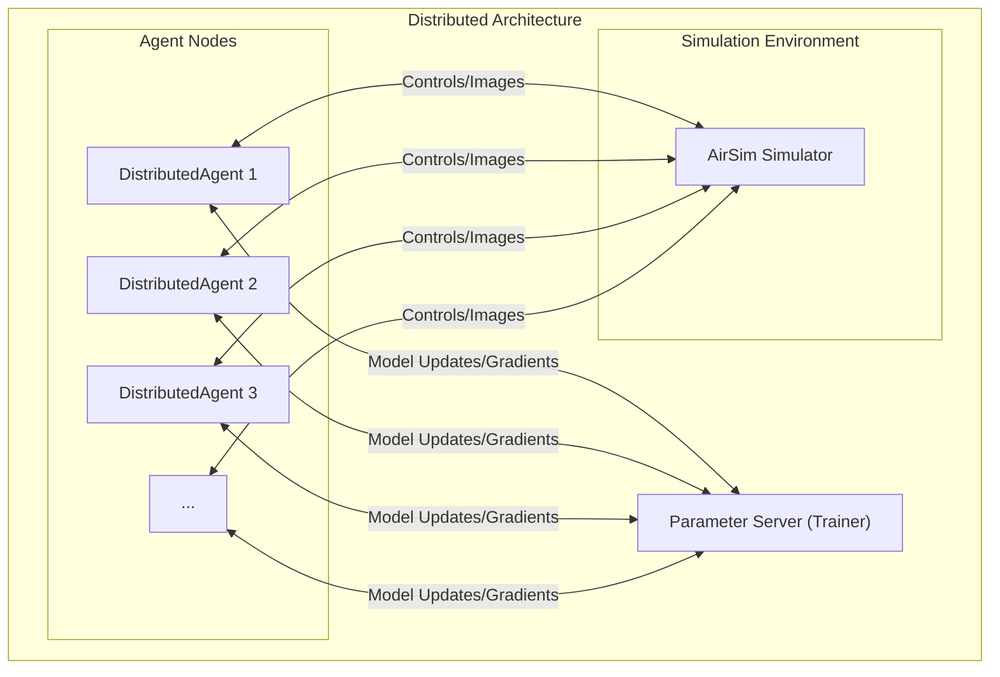
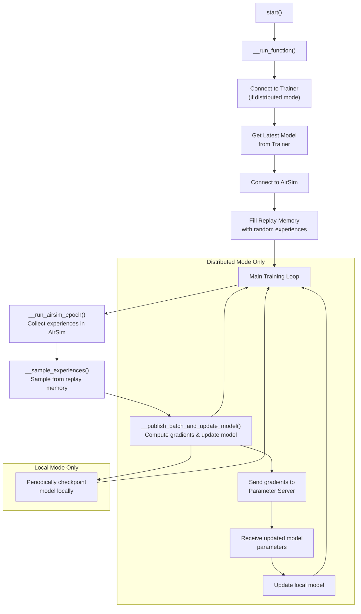
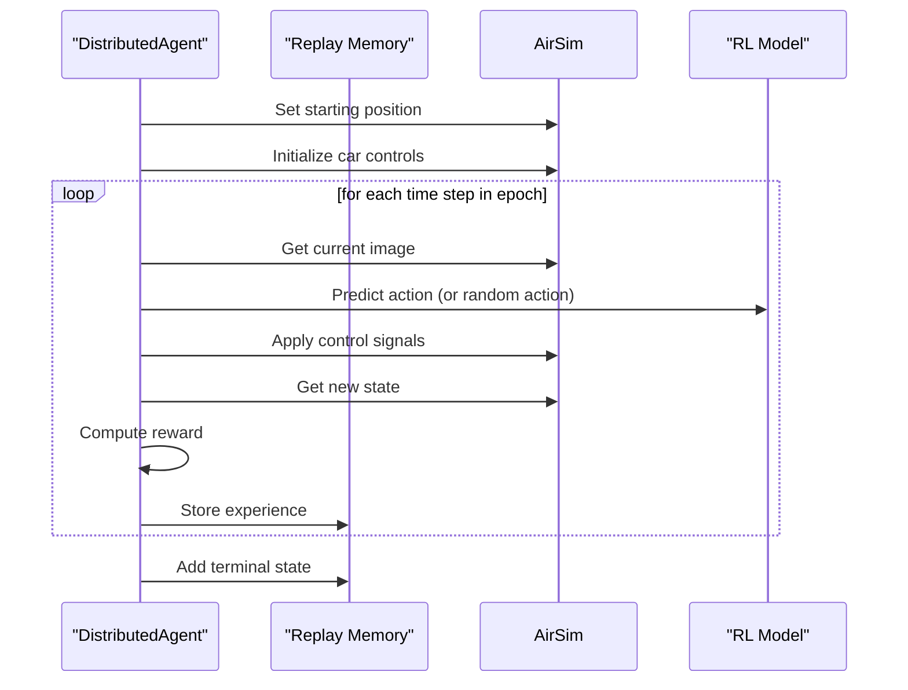
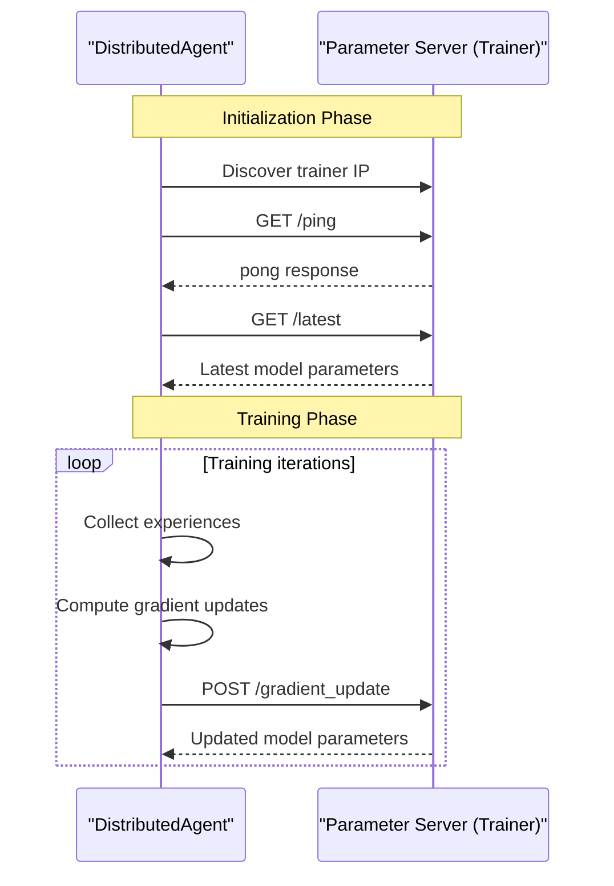
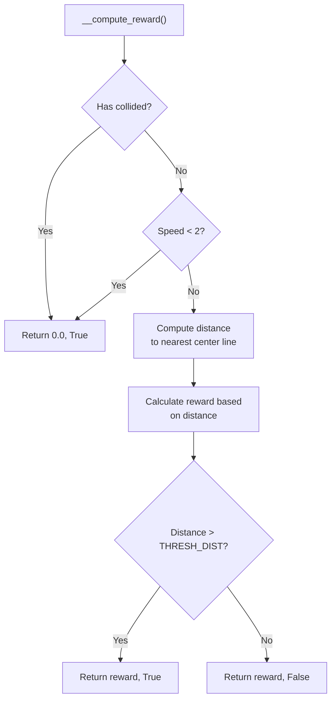

<!-- source: DeepWiki mcp.deepwiki.com · repo microsoft/AutonomousDrivingCookbook · page 4.1 Distributed Agent Architecture · fetched 2026-10-26 -->

# Distributed Agent Architecture

<details>
<summary>Relevant source files</summary>

The following files were used as context for generating this wiki page:

- [DistributedRL/Share/scripts_downpour/app/distributed_agent.py](DistributedRL/Share/scripts_downpour/app/distributed_agent.py)

</details>


## Purpose and Scope

This document provides a technical deep dive into the distributed agent architecture used in the DistributedRL tutorial of the Autonomous Driving Cookbook. It focuses on how individual agents collect experiences in the AirSim environment, train local models, and coordinate with a central parameter server in a distributed reinforcement learning setup. For details on the parameter server implementation, see [Parameter Server Implementation](#4.2).

## Overview

The Distributed Agent Architecture implements a distributed reinforcement learning system that follows the downpour stochastic gradient descent approach. Multiple agents collect experiences independently through interaction with the AirSim simulator, compute gradient updates locally, and communicate these updates to a central parameter server that aggregates them.



Sources: [DistributedRL/Share/scripts_downpour/app/distributed_agent.py:18-19](), [DistributedRL/Share/scripts_downpour/app/distributed_agent.py:84-123](), [DistributedRL/Share/scripts_downpour/app/distributed_agent.py:396-422]()

## Agent Components and Structure

The `DistributedAgent` class is the core component of this architecture. Each agent maintains:

1. A local RL model for action selection and gradient computation
2. A replay memory buffer to store experiences
3. Communication channels with the parameter server
4. Connection to the AirSim simulator

```mermaid
classDiagram
    class DistributedAgent {
        -RlModel __model
        -__experiences (replay memory)
        -__epsilon (exploration rate)
        -__car_client (AirSim connection)
        -__car_controls
        -__trainer_ip_address
        +start()
        -__run_function()
        -__run_airsim_epoch()
        -__sample_experiences()
        -__publish_batch_and_update_model()
        -__get_latest_model()
        -__compute_reward()
    }
    
    class RlModel {
        +predict_state()
        +get_random_state()
        +state_to_control_signals()
        +get_gradient_update_from_batches()
        +from_packet()
        +to_packet()
    }
    
    DistributedAgent --> RlModel : uses
    DistributedAgent --> "AirSim" : interacts with
    DistributedAgent --> "Parameter Server" : communicates with
```

Sources: [DistributedRL/Share/scripts_downpour/app/distributed_agent.py:19-68](), [DistributedRL/Share/scripts_downpour/app/distributed_agent.py:2]()

## Agent Workflow

The agent follows a well-defined workflow that includes initialization, collecting experiences, training, and model synchronization.



Sources: [DistributedRL/Share/scripts_downpour/app/distributed_agent.py:78-182](), [DistributedRL/Share/scripts_downpour/app/distributed_agent.py:396-447]()

## Experience Collection

The agent collects experiences by interacting with AirSim. An experience consists of:
- Pre-state (observations before action)
- Action taken
- Reward received
- Post-state (observations after action)
- Whether the state is terminal



Sources: [DistributedRL/Share/scripts_downpour/app/distributed_agent.py:220-352](), [DistributedRL/Share/scripts_downpour/app/distributed_agent.py:354-361]()

## Agent-Trainer Communication

In distributed mode, the agent communicates with a central parameter server (trainer) to send gradient updates and receive the latest model parameters.



Sources: [DistributedRL/Share/scripts_downpour/app/distributed_agent.py:88-123](), [DistributedRL/Share/scripts_downpour/app/distributed_agent.py:396-422](), [DistributedRL/Share/scripts_downpour/app/distributed_agent.py:449-453]()

## Replay Memory and Experience Sampling

The replay memory stores experiences and provides a sampling mechanism for training. The agent implements a prioritized sampling approach based on a "surprise factor" (the difference between predicted and actual rewards).

| Component | Description |
|-----------|-------------|
| `pre_states` | State observations before taking actions |
| `post_states` | State observations after taking actions |
| `actions` | Actions taken by the agent |
| `rewards` | Rewards received for each action |
| `predicted_rewards` | Rewards predicted by the model |
| `is_not_terminal` | Flag indicating if state is non-terminal |

Sources: [DistributedRL/Share/scripts_downpour/app/distributed_agent.py:354-361](), [DistributedRL/Share/scripts_downpour/app/distributed_agent.py:364-393]()

## Reward Function

The reward function guides the agent's learning process by providing feedback on its actions. In this implementation, the reward is computed based on:

1. Distance from the center of the road
2. Vehicle speed
3. Collision detection



Sources: [DistributedRL/Share/scripts_downpour/app/distributed_agent.py:464-502]()

## Execution Modes

The agent supports two execution modes:

### Distributed Mode
- Multiple agents connect to a central parameter server
- Agents collect experiences independently
- Gradient updates are sent to the parameter server
- Updated model parameters are received from the parameter server

### Local Mode
- Single agent runs independently without a parameter server
- Periodically checkpoints the model locally
- Useful for development and testing

Sources: [DistributedRL/Share/scripts_downpour/app/distributed_agent.py:58-58](), [DistributedRL/Share/scripts_downpour/app/distributed_agent.py:89-129](), [DistributedRL/Share/scripts_downpour/app/distributed_agent.py:424-447]()

## Initialization and Configuration

The agent is initialized with several key parameters that control its behavior:

| Parameter | Description |
|-----------|-------------|
| `data_dir` | Directory for storing data, models, and checkpoints |
| `max_epoch_runtime_sec` | Maximum runtime for an epoch in seconds |
| `replay_memory_size` | Size of the replay memory buffer |
| `batch_size` | Number of experiences in each training batch |
| `min_epsilon` | Minimum value for the exploration rate |
| `per_iter_epsilon_reduction` | Rate at which epsilon decreases |
| `experiment_name` | Name used for organization and logging |
| `train_conv_layers` | Whether to train convolutional layers |
| `batch_update_frequency` | (Local mode) Frequency of model checkpoints |
| `weights_path` | Path to pre-trained weights (optional) |
| `airsim_path` | Path to AirSim simulator (optional) |

Sources: [DistributedRL/Share/scripts_downpour/app/distributed_agent.py:20-68](), [DistributedRL/Share/scripts_downpour/app/distributed_agent.py:599-621]()

## Conclusion

The Distributed Agent Architecture is a flexible system for training reinforcement learning models in a distributed environment. It enables multiple agent instances to collect experiences independently and collaborate on model training through a central parameter server. The architecture supports both distributed and local execution modes, making it suitable for various development and training scenarios.

Each agent autonomously interacts with the AirSim simulator, maintaining its own replay memory and local model while contributing to the global model through gradient updates. This approach allows for efficient utilization of computing resources and accelerated training of autonomous driving policies.

---

