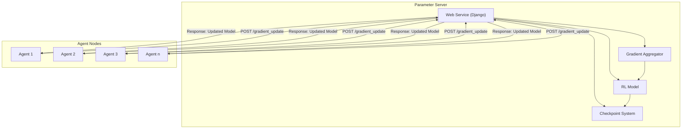
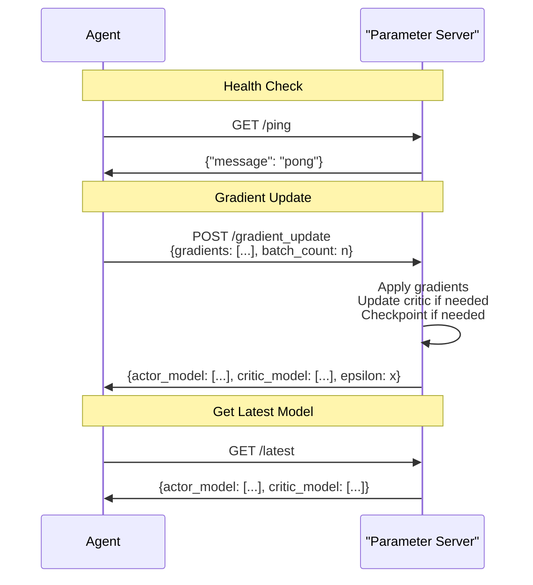
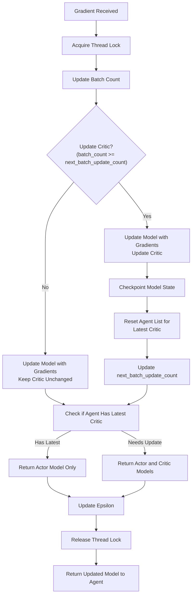
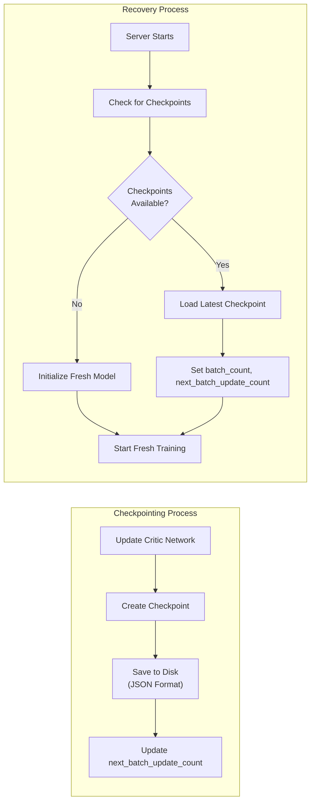
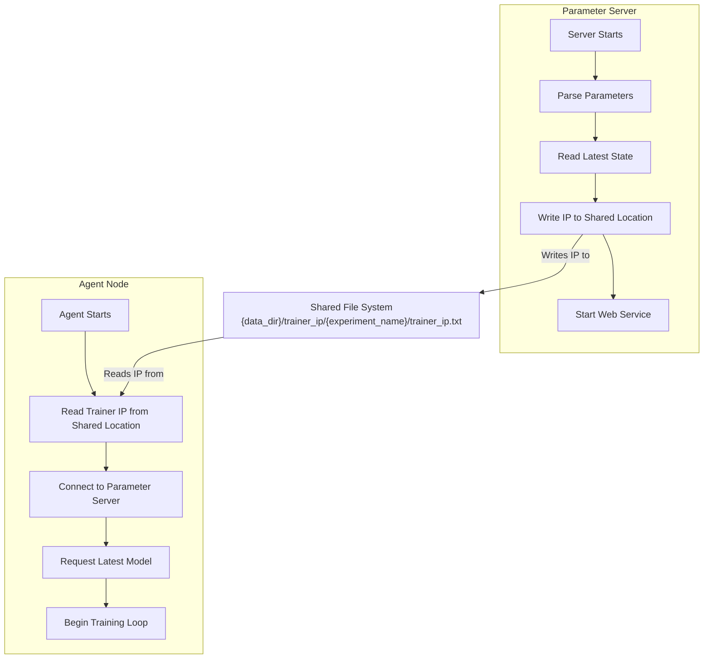

<!-- source: DeepWiki mcp.deepwiki.com · repo microsoft/AutonomousDrivingCookbook · page 4.2 Parameter Server Implementation · fetched 2026-10-26 -->

# Parameter Server Implementation

Relevant source files

The following files were used as context for generating this wiki page:

- [DistributedRL/Share/scripts_downpour/app/views.py](DistributedRL/Share/scripts_downpour/app/views.py)

## Purpose and Scope

This document provides a technical deep dive into the Parameter Server implementation used in the Distributed Reinforcement Learning (DRL) system of the Autonomous Driving Cookbook. The Parameter Server is a central component that aggregates gradient updates from multiple agent nodes and maintains the global model state. This page focuses specifically on the server-side implementation, network communication protocols, and model update mechanisms. For information about the Distributed Agent Architecture, see [Distributed Agent Architecture](#4.1), and for details about the Model Architectures, see [Model Architectures](#4.3).

## Parameter Server Architecture Overview

The Parameter Server in this distributed reinforcement learning system is implemented as a web service that communicates with multiple agent nodes. It follows the Downpour SGD architecture pattern, where multiple agents independently collect experiences, compute gradients, and send them to a central server that aggregates these updates.

Sources: [DistributedRL/Share/scripts_downpour/app/views.py:16-30]()), [DistributedRL/Share/scripts_downpour/app/views.py:35-45]()), [DistributedRL/Share/scripts_downpour/app/views.py:46-122]())

## Implementation Components

The Parameter Server is implemented as a Django web application with several key components:

1. **Web Service**: Provides RESTful API endpoints for agent communication
2. **RL Model**: Maintains the actor and critic networks
3. **Gradient Aggregator**: Processes gradient updates from agents
4. **Checkpoint System**: Periodically saves model state for fault tolerance
5. **Synchronization Mechanism**: Ensures thread safety during model updates

### Core Components Breakdown

| Component | Purpose | Implementation |
|-----------|---------|----------------|
| Web Service | Exposes API endpoints for agent communication | Django HTTP server with REST endpoints |
| RL Model | Manages neural network models | `RlModel` class that wraps TensorFlow/Keras models |
| Gradient Aggregator | Applies gradient updates to model | Implemented in `gradient_update` function |
| Checkpoint System | Saves model state to disk | `checkpoint_state` and `read_latest_state` functions |
| Synchronization | Prevents race conditions | `model_lock` threading lock |

Sources: [DistributedRL/Share/scripts_downpour/app/views.py:16-30]()), [DistributedRL/Share/scripts_downpour/app/views.py:142-192]())

## Communication Protocol

The Parameter Server exposes three main HTTP endpoints for communication with agent nodes:

### API Endpoints

1. **Ping Endpoint** (`/ping`):
   - A simple health check endpoint
   - Returns a JSON response with message "pong"

2. **Gradient Update Endpoint** (`/gradient_update`):
   - Receives gradient updates from agents
   - Applies the gradients to update the model
   - Returns the updated model to the agent

3. **Latest Model Endpoint** (`/latest`):
   - Returns the current state of the model
   - Used by agents to initialize or resynchronize

Sources: [DistributedRL/Share/scripts_downpour/app/views.py:35-45]()), [DistributedRL/Share/scripts_downpour/app/views.py:46-122]()), [DistributedRL/Share/scripts_downpour/app/views.py:128-140]())

## Gradient Aggregation and Model Updates

The Parameter Server implements a multi-step process for aggregating gradients and updating the model:

### Key Implementation Details

1. **Thread Safety**:
   - Uses `model_lock` to ensure only one gradient update happens at a time
   - Prevents race conditions when multiple agents send updates simultaneously

2. **Critic Network Updates**:
   - The critic network (target network) is updated less frequently than the actor
   - Updates occur when `batch_count >= next_batch_update_count`
   - After update, the next update is scheduled for `batch_count + batch_update_frequency`

3. **Bandwidth Optimization**:
   - Tracks which agents have the latest critic model
   - Only sends the critic model to agents that don't have the latest version

4. **Epsilon Decay**:
   - The exploration parameter (epsilon) is gradually reduced over time
   - Decayed by `epsilon_step` at each update, with a lower bound of `min_epsilon`

Sources: [DistributedRL/Share/scripts_downpour/app/views.py:46-122]()), [DistributedRL/Share/scripts_downpour/app/views.py:30-33]())

## Checkpointing and Fault Tolerance

The Parameter Server implements a checkpointing mechanism to ensure fault tolerance and enable recovery from failures:

### Checkpoint Implementation

1. **Checkpoint Format**:
   - Checkpoints are stored as JSON files
   - Contains model weights and batch count information

2. **Checkpoint Frequency**:
   - Checkpoints are created whenever the critic network is updated
   - This aligns with the batch update frequency

3. **Recovery Process**:
   - On startup, the server looks for existing checkpoints
   - Loads the most recent checkpoint if available
   - Resumes training from the saved state

4. **File Organization**:
   - Checkpoints are stored in a directory structure that includes the experiment name
   - Path: `{data_dir}/checkpoint/{experiment_name}/{batch_count}.json`

Sources: [DistributedRL/Share/scripts_downpour/app/views.py:142-192]()), [DistributedRL/Share/scripts_downpour/app/views.py:194-217]()), [DistributedRL/Share/scripts_downpour/app/views.py:252-254]())

## Agent Discovery Mechanism

To enable agents to discover the Parameter Server, the server writes its IP address to a shared file location:

### Implementation Details

1. **IP Address Storage**:
   - The server IP is written to `{data_dir}/trainer_ip/{experiment_name}/trainer_ip.txt`
   - Uses the `AZ_BATCH_NODE_LIST` environment variable to get the server's IP

2. **Directory Creation**:
   - Creates the necessary directory structure if it doesn't exist
   - Handles potential race conditions during directory creation

3. **Startup Sequence**:
   - The IP write operation happens during server initialization
   - Executed after parameter parsing and state recovery

Sources: [DistributedRL/Share/scripts_downpour/app/views.py:219-239]()), [DistributedRL/Share/scripts_downpour/app/views.py:252-254]())

## Initialization and Configuration

The Parameter Server is configured through environment variables that define its behavior:

| Environment Variable | Purpose | Default |
|----------------------|---------|---------|
| `weights_path` | Path to initial weights (if available) | None |
| `train_conv_layers` | Whether to train convolutional layers | Configurable |
| `min_epsilon` | Minimum exploration rate | Configurable |
| `per_iter_epsilon_reduction` | Epsilon decay rate per update | Configurable |
| `data_dir` | Directory for checkpoints and IP files | Configurable |
| `experiment_name` | Name of the current experiment | Configurable |
| `batch_update_frequency` | Frequency of critic network updates | Configurable |
| `AZ_BATCH_NODE_LIST` | Azure Batch node IP addresses | Provided by Azure |

Sources: [DistributedRL/Share/scripts_downpour/app/views.py:17-21]()), [DistributedRL/Share/scripts_downpour/app/views.py:30-32]()), [DistributedRL/Share/scripts_downpour/app/views.py:194-217]()), [DistributedRL/Share/scripts_downpour/app/views.py:219-239]())

## Conclusion

The Parameter Server implementation in the Distributed Reinforcement Learning system follows a client-server architecture where a central server aggregates gradient updates from multiple agent nodes. Key features include:

1. A web-based API for agent communication
2. Thread-safe gradient aggregation
3. Periodic critic network updates
4. Checkpointing for fault tolerance
5. Bandwidth optimization by selective model updates
6. Agent discovery through file-based IP sharing

This architecture enables scalable distributed training across multiple agents, with the Parameter Server acting as the central coordination point that maintains the global model state.

---

