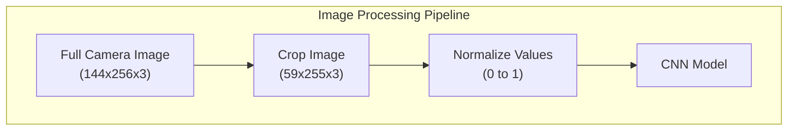
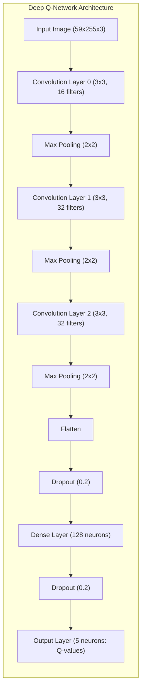
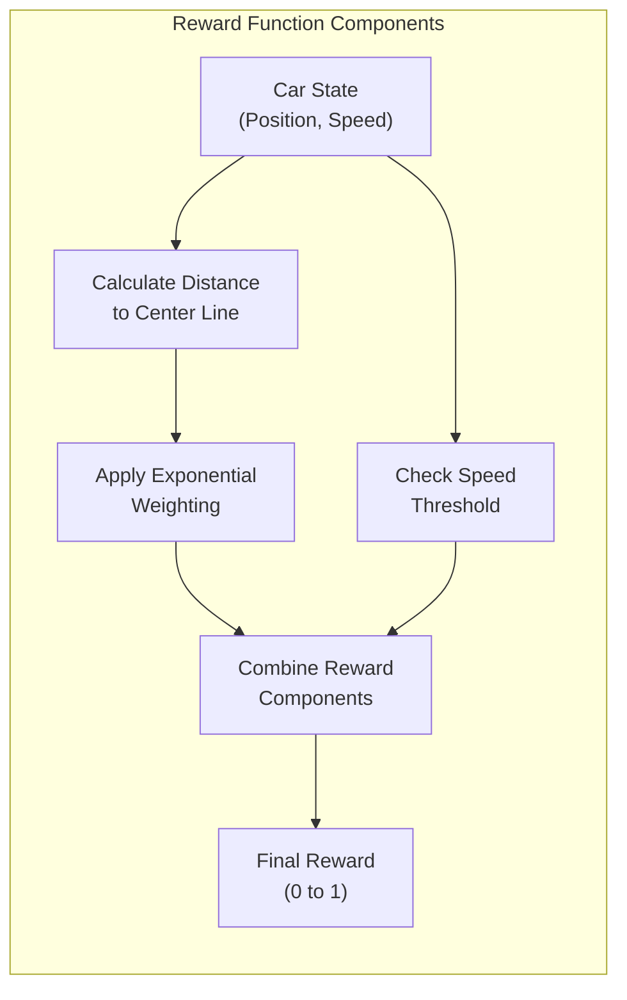
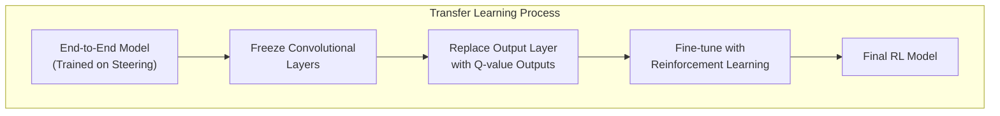
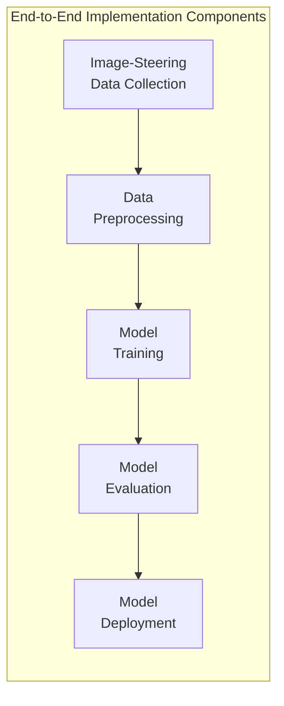
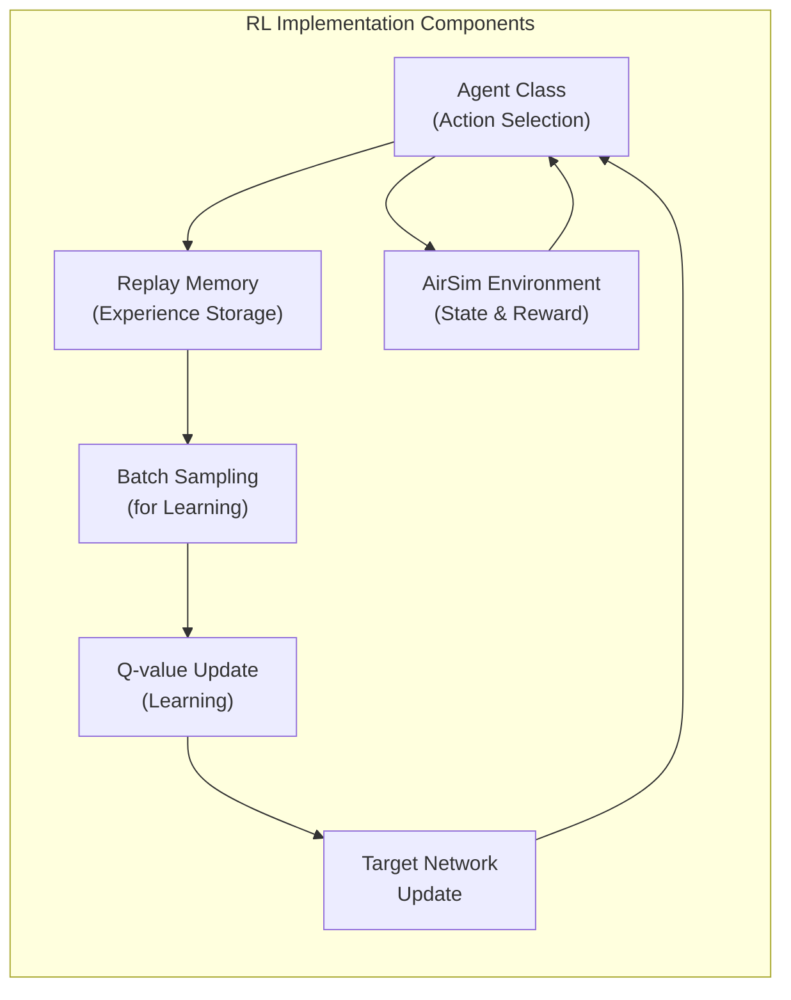
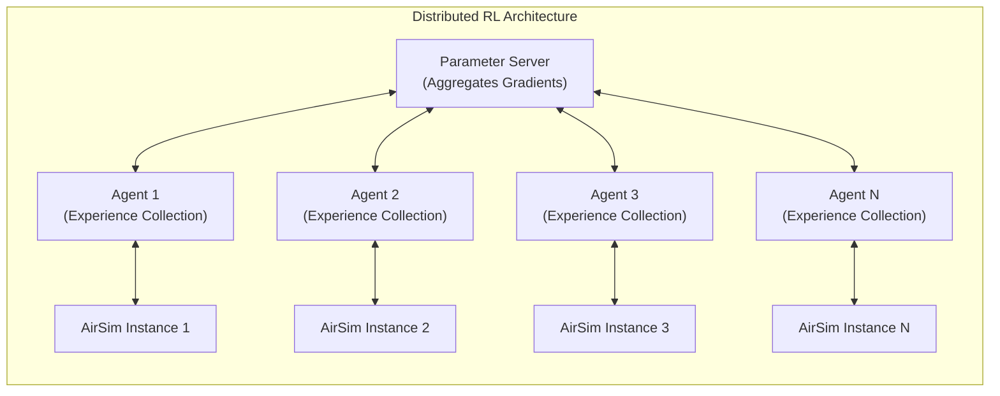

<!-- source: DeepWiki mcp.deepwiki.com · repo microsoft/AutonomousDrivingCookbook · page 4.3 Model Architectures · fetched 2026-10-26 -->

# Model Architectures

<details>
<summary>Relevant source files</summary>

The following files were used as context for generating this wiki page:

- [AirSimE2EDeepLearning/TrainModel.ipynb](AirSimE2EDeepLearning/TrainModel.ipynb)
- [DistributedRL/ExploreAlgorithm.ipynb](DistributedRL/ExploreAlgorithm.ipynb)

</details>


This page provides detailed information about the neural network architectures used in the autonomous driving tutorials. It covers both the end-to-end deep learning approach and the distributed reinforcement learning approach, explaining their structures, components, and implementation details.

## Overview

This repository demonstrates two different approaches to autonomous driving:

1. **End-to-End Deep Learning**: A direct perception-based approach that maps images to steering commands
2. **Distributed Reinforcement Learning**: A reinforcement learning approach that learns optimal actions through experience

Both approaches use convolutional neural networks but differ in their training methodologies and objectives.

## End-to-End Deep Learning Architecture

The End-to-End Deep Learning architecture directly maps raw sensor inputs to control outputs, similar to NVIDIA's approach in their "End to End Learning for Self-Driving Cars" paper.

### Network Structure

The network takes images from a front-facing camera and predicts steering angles.

```mermaid
flowchart TD
    subgraph "End-to-End Model Architecture"
        direction TB
        input["Input Image (59x255x3)"] --> conv1
        conv1["Convolution Layer 1 (3x3, 24 filters)"] --> norm1["Batch Normalization"] --> elu1["ELU"] --> pool1["Max Pooling (2x2)"]
        pool1 --> conv2["Convolution Layer 2 (3x3, 36 filters)"] --> norm2["Batch Normalization"] --> elu2["ELU"] --> pool2["Max Pooling (2x2)"]
        pool2 --> conv3["Convolution Layer 3 (3x3, 48 filters)"] --> norm3["Batch Normalization"] --> elu3["ELU"] --> pool3["Max Pooling (2x2)"]
        pool3 --> conv4["Convolution Layer 4 (3x3, 64 filters)"] --> norm4["Batch Normalization"] --> elu4["ELU"] --> pool4["Max Pooling (2x2)"]
        pool4 --> conv5["Convolution Layer 5 (3x3, 64 filters)"] --> norm5["Batch Normalization"] --> elu5["ELU"] --> pool5["Max Pooling (2x2)"]
        pool5 --> flat["Flatten"]
        flat --> drop1["Dropout (0.5)"]
        drop1 --> dense1["Dense Layer 1 (100 neurons)"] --> elu6["ELU"]
        elu6 --> drop2["Dropout (0.5)"]
        drop2 --> dense2["Dense Layer 2 (50 neurons)"] --> elu7["ELU"]
        elu7 --> drop3["Dropout (0.5)"]
        drop3 --> dense3["Dense Layer 3 (10 neurons)"] --> elu8["ELU"]
        elu8 --> output["Output Layer (1 neuron: steering angle)"]
    end
```



Sources: Based on architecture description in the repository documentation and the reference to it in ExploreAlgorithm.ipynb

### Input Processing

The model uses a subset of the full camera image to reduce complexity and computational requirements:



The cropped region focuses on the road area in front of the vehicle, removing irrelevant information like the sky and dashboard.

Sources: [DistributedRL/ExploreAlgorithm.ipynb:235-240]()

### Training Process

The model is trained using supervised learning with human driving data. Key aspects include:

- Loss function: Mean squared error (MSE) between predicted and actual steering angles
- Optimizer: Adam optimizer
- Data augmentation: Random brightness adjustments, shadow simulation, and horizontal flips
- Regularization: Dropout layers to prevent overfitting

## Distributed Reinforcement Learning Architecture

The Distributed Reinforcement Learning approach uses a Deep Q-Network (DQN) architecture to learn optimal driving behavior through interaction with the environment.

### Network Structure



Sources: [DistributedRL/ExploreAlgorithm.ipynb:308-330]()

### Input and Output

- **Input**: Same preprocessed image format as the end-to-end model (59x255x3)
- **Output**: Q-values for 5 discrete actions (representing different steering angles and throttle combinations)

### Reward Function

The reinforcement learning model requires a reward function to learn the optimal policy. The reward function is based on:

1. Distance to the center of the road (exponentially weighted)
2. Speed (minimum speed threshold)



Sources: [DistributedRL/ExploreAlgorithm.ipynb:75-109]()

The reward function code:

```python
def compute_reward(car_state, collision_info, road_points):
    # Define constant parameters for the reward function
    THRESH_DIST = 3.5               # Maximum distance from center for reward calculation
    DISTANCE_DECAY_RATE = 1.2       # Rate at which reward decays with distance
    
    # If car is stopped, reward is zero
    speed = car_state.speed
    if (speed < 2):
        return 0
    
    # Calculate distance to nearest road center line
    car_point = get_car_position(car_state)
    distance = min_distance_to_road_center(car_point, road_points)
    
    # Calculate reward using exponential decay with distance
    distance_reward = math.exp(-(distance * DISTANCE_DECAY_RATE))
    
    return distance_reward
```

Sources: [DistributedRL/ExploreAlgorithm.ipynb:75-109]()

### Transfer Learning Approach

The reinforcement learning model can leverage transfer learning from the end-to-end model to accelerate training:



The key benefit is that the convolutional layers have already learned to recognize road features, allowing the RL model to focus on learning the optimal policy rather than basic feature extraction.

Sources: [DistributedRL/ExploreAlgorithm.ipynb:253-259]()

## Architecture Comparison

| Feature | End-to-End Deep Learning | Distributed Reinforcement Learning |
|---------|--------------------------|-----------------------------------|
| **Input** | Front camera image (59x255x3) | Front camera image (59x255x3) |
| **Output** | Continuous steering angle | Q-values for 5 discrete actions |
| **Learning Approach** | Supervised (imitation learning) | Reinforcement learning |
| **Convolutional Layers** | 5 layers with batch normalization | 3 layers without batch normalization |
| **Dense Layers** | 3 layers with dropout | 1 layer with dropout |
| **Training Data** | Human driving demonstrations | Experience generated through interaction |
| **Activation Functions** | ELU (Exponential Linear Unit) | ReLU (Rectified Linear Unit) |
| **Loss Function** | Mean Squared Error | Mean Squared Error (for Q-learning) |

## Model Implementation Details

### End-to-End Model Components

The End-to-End model implementation focuses on a regression task - predicting the exact steering angle:



Sources: Repository structure and context from documentation

### Reinforcement Learning Components

The Reinforcement Learning implementation includes additional components necessary for the RL training paradigm:



Sources: [DistributedRL/ExploreAlgorithm.ipynb:202-332]()

### Distributed Training Architecture

For the reinforcement learning approach, the repository implements a distributed training architecture:



This distributed architecture allows for parallel experience collection and faster training. The parameter server maintains the global model while agents collect experiences and compute gradients.

Sources: Repository documentation and architectural diagrams

## Implementation Code

### Key Model Definition for Reinforcement Learning

The reinforcement learning model is defined using Keras with three convolutional layers followed by dense layers:

```python
pic_input = Input(shape=(59,255,3))
train_conv_layers = False  # For transfer learning

img_stack = Conv2D(16, (3, 3), name='convolution0', padding='same', activation=activation, 
                  trainable=train_conv_layers)(pic_input)
img_stack = MaxPooling2D(pool_size=(2,2))(img_stack)
img_stack = Conv2D(32, (3, 3), activation=activation, padding='same', name='convolution1', 
                  trainable=train_conv_layers)(img_stack)
img_stack = MaxPooling2D(pool_size=(2, 2))(img_stack)
img_stack = Conv2D(32, (3, 3), activation=activation, padding='same', name='convolution2', 
                  trainable=train_conv_layers)(img_stack)
img_stack = MaxPooling2D(pool_size=(2, 2))(img_stack)
img_stack = Flatten()(img_stack)
img_stack = Dropout(0.2)(img_stack)
img_stack = Dense(128, name='rl_dense', kernel_initializer=random_normal(stddev=0.01))(img_stack)
img_stack = Dropout(0.2)(img_stack)
output = Dense(5, name='rl_output', kernel_initializer=random_normal(stddev=0.01))(img_stack)
```

Sources: [DistributedRL/ExploreAlgorithm.ipynb:308-327]()

## Conclusion

Both model architectures are designed for autonomous driving but take different approaches:

1. The End-to-End model uses supervised learning to directly map perceptions to actions, mimicking human driving behavior.

2. The Reinforcement Learning model learns optimal behavior through interaction with the environment, using a reward function to guide learning.

The choice between these approaches depends on the specific requirements and constraints of the autonomous driving task. The end-to-end approach is simpler to implement but requires large amounts of human demonstration data. The reinforcement learning approach is more flexible and can potentially learn optimal behaviors beyond human capabilities, but requires careful design of the reward function and typically needs more computation for training.

---

