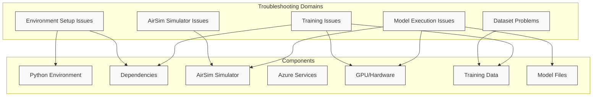
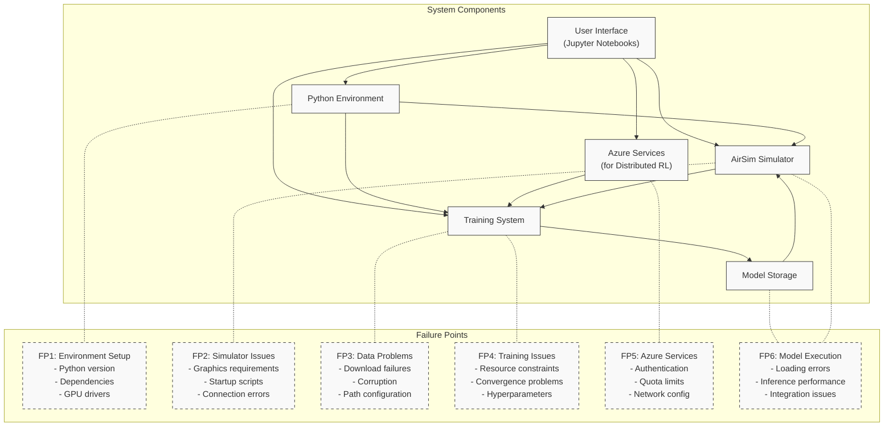

<!-- source: DeepWiki mcp.deepwiki.com · repo microsoft/AutonomousDrivingCookbook · page 5 Troubleshooting and FAQ · fetched 2026-10-26 -->

# Troubleshooting and FAQ

<details>
<summary>Relevant source files</summary>

The following files were used as context for generating this wiki page:

- [AirSimE2EDeepLearning/.gitignore](AirSimE2EDeepLearning/.gitignore)
- [AirSimE2EDeepLearning/README.md](AirSimE2EDeepLearning/README.md)
- [DistributedRL/README.md](DistributedRL/README.md)
- [README.md](README.md)

</details>


## Purpose and Scope

This document provides solutions to common issues encountered when working with the Autonomous Driving Cookbook tutorials and answers frequently asked questions about the codebase. It covers troubleshooting for both the AirSimE2EDeepLearning and DistributedRL components, focusing on environment setup, data preparation, model training, and execution problems. For general overview information, refer to [Overview](#1), and for tutorial-specific guides, see [End-to-End Deep Learning for Autonomous Driving](#2) or [Distributed Reinforcement Learning](#3).

## Common Setup Issues

### Diagram: Common Setup Issues and Components



Sources: [README.md](), [AirSimE2EDeepLearning/README.md](), [DistributedRL/README.md]()

### Environment Setup Issues

| Issue | Solution |
|-------|----------|
| **Anaconda installation fails** | Ensure you have administrator privileges. Try downloading the installer directly from the [Anaconda website](https://www.anaconda.com/download) rather than using package managers. |
| **CNTK/TensorFlow installation errors** | For CNTK, follow the exact steps in the [official guide](https://docs.microsoft.com/en-us/cognitive-toolkit/Setup-CNTK-on-your-machine). For TensorFlow, verify GPU compatibility and CUDA version if using GPU acceleration. |
| **Keras backend configuration issues** | Check if the Keras backend is properly set in the `~/.keras/keras.json` file. Make sure the backend value matches what you installed (tensorflow or cntk). |
| **AzCopy path configuration** | Confirm AzCopy is added to your system PATH. Test by running `azcopy --version` from any directory. |
| **Package installation failures** | Run `InstallPackages.py` with administrator privileges. If individual packages fail, try installing them separately with `pip install [package]`. |

Sources: [AirSimE2EDeepLearning/README.md:42-57](), [DistributedRL/README.md:37-53]()

### AirSim Simulator Issues

| Issue | Solution |
|-------|----------|
| **Simulator won't start** | Ensure your system meets the graphics requirements. Try running the simulator in low-resolution mode by modifying settings in `settings.json`. |
| **PowerShell execution policy restrictions** | If PowerShell blocks script execution, run PowerShell as administrator and execute `Set-ExecutionPolicy -ExecutionPolicy Bypass -Scope Process` before running the start script. |
| **Simulator crashes on startup** | Check Windows Event Viewer for crash details. Typically this is due to GPU driver issues or insufficient system resources. Update your GPU drivers and close other resource-intensive applications. |
| **Wrong environment loads** | Verify you're using the correct PowerShell command: `.\AD_Cookbook_Start_AirSim.ps1 landscape` for E2E learning or `.\AD_Cookbook_Start_AirSim.ps1 neighborhood` for RL. |
| **Connection errors between code and simulator** | Ensure no firewall is blocking the connection and that the simulator is running before executing your code. |

Sources: [AirSimE2EDeepLearning/README.md:59-67](), [DistributedRL/README.md:56-63]()

### Dataset Issues

| Issue | Solution |
|-------|----------|
| **Dataset download fails** | Use AzCopy for reliable transfer of the large dataset. Command: `azcopy copy "https://aka.ms/AirSimTutorialDataset" "YourDestinationFolder" --recursive` |
| **Insufficient disk space** | The uncompressed dataset requires approximately 3.25GB. Ensure you have at least 5GB free space to handle extraction and temporary files. |
| **Dataset integrity issues** | Verify the dataset integrity by ensuring all expected files are present. For E2E learning, check that all image files and annotation CSV files exist. |
| **Data path configuration** | Update path references in notebooks if you've stored the dataset in a location different from the default. |

Sources: [AirSimE2EDeepLearning/README.md:76-77]()

## Diagram: Troubleshooting Workflow by Component

```mermaid
flowchart TB
    Start["Issue Detected"] --> Identify["Identify Component"]
    
    Identify --> EnvIssue["Environment Issue"]
    Identify --> SimIssue["Simulator Issue"]
    Identify --> DataIssue["Data Issue"]
    Identify --> E2EIssue["E2E Learning Issue"]
    Identify --> RLIssue["RL Issue"]
    
    EnvIssue --> CheckPython["Check Python Version\n(3.5+ required)"]
    EnvIssue --> CheckDeps["Verify Dependencies\n(Run InstallPackages.py)"]
    EnvIssue --> CheckGPU["Check GPU Setup\n(CUDA, drivers)"]
    
    SimIssue --> CheckHW["Verify Hardware\nRequirements"]
    SimIssue --> CheckGraphics["Update Graphics\nDrivers"]
    SimIssue --> ReinstallSim["Reinstall Simulator"]
    
    DataIssue --> CheckData["Verify Dataset\nDownload"]
    DataIssue --> CheckSpace["Check Disk Space"]
    DataIssue --> FixPaths["Update Data Paths\nin Notebooks"]
    
    E2EIssue --> CheckDataExp["Check Data Exploration\nNotebook"]
    E2EIssue --> CheckTrain["Debug Training\nNotebook"]
    E2EIssue --> CheckTest["Troubleshoot Testing\nNotebook"]
    
    RLIssue --> CheckCluster["Verify Azure Cluster\nSetup"]
    RLIssue --> CheckAlgo["Debug RL Algorithm"]
    RLIssue --> CheckJob["Check Training Job\nLaunch"]
    
    CheckPython & CheckDeps & CheckGPU --> EnvResolved["Environment Issue Resolved"]
    CheckHW & CheckGraphics & ReinstallSim --> SimResolved["Simulator Issue Resolved"]
    CheckData & CheckSpace & FixPaths --> DataResolved["Data Issue Resolved"]
    CheckDataExp & CheckTrain & CheckTest --> E2EResolved["E2E Issue Resolved"]
    CheckCluster & CheckAlgo & CheckJob --> RLResolved["RL Issue Resolved"]
    
    EnvResolved & SimResolved & DataResolved & E2EResolved & RLResolved --> End["Issue Resolved"]
    
    classDef issue fill:#f9f9f9,stroke:#333,stroke-width:1px
    classDef step fill:#f9f9f9,stroke:#333,stroke-width:1px
    classDef resolved fill:#f9f9f9,stroke:#333,stroke-width:1px
    class Start,Identify,EnvIssue,SimIssue,DataIssue,E2EIssue,RLIssue issue
    class CheckPython,CheckDeps,CheckGPU,CheckHW,CheckGraphics,ReinstallSim,CheckData,CheckSpace,FixPaths,CheckDataExp,CheckTrain,CheckTest,CheckCluster,CheckAlgo,CheckJob step
    class EnvResolved,SimResolved,DataResolved,E2EResolved,RLResolved,End resolved
```



Sources: [README.md](), [AirSimE2EDeepLearning/README.md](), [DistributedRL/README.md]()

## AirSimE2EDeepLearning Specific Issues

### Data Exploration and Preparation Issues

| Issue | Solution |
|-------|----------|
| **Notebook fails to load data** | Verify the data path in the notebook. Default is `training_data` directory. Update path if necessary. |
| **Image visualization errors** | Check if OpenCV and Matplotlib are properly installed. Try reinstalling: `pip install opencv-python matplotlib==2.1.2`. |
| **Out of memory errors during data loading** | Load data in smaller batches by modifying the batch size parameter or upgrade your hardware if persistent. |
| **Data parsing errors** | Ensure that the CSV files containing steering data are not corrupted. Verify they contain the expected format with header rows and proper delimiters. |

Sources: [AirSimE2EDeepLearning/README.md:25-26]()

### Model Training Issues

| Issue | Solution |
|-------|----------|
| **CUDA out of memory** | Reduce batch size in `TrainModel.ipynb`. If using a GPU with limited memory, consider using a smaller model or training on CPU. |
| **Extremely slow training** | Ensure you're using GPU acceleration. If using CPU, expect significantly longer training times. Consider using a cloud-based GPU instance if local GPU is unavailable. |
| **Vanishing/exploding gradients** | Check model architecture and consider reducing learning rate. Monitor loss graphs for sudden spikes or plateaus. |
| **Model fails to converge** | Verify data preprocessing steps and augmentation. Try different model architectures or hyperparameters as described in the notebook. |
| **Training interrupted/crashed** | Implement checkpointing to save model state periodically. Resume training from the last checkpoint. |

Sources: [AirSimE2EDeepLearning/README.md:27-28]()

### Model Testing Issues

| Issue | Solution |
|-------|----------|
| **Model file not found** | Ensure the model path in `TestModel.ipynb` points to the correct location where the trained model was saved. |
| **Prediction errors in simulator** | Verify the preprocessing steps in testing match those used during training. Check for any scaling factors that might be missing. |
| **Model performs well in testing but poorly in simulator** | This indicates a domain gap between training and testing. Consider collecting more diverse training data or implementing additional data augmentation. |
| **Car drives erratically** | Check the control smoothing parameters. Implement additional post-processing to smooth out predictions. |
| **Simulator connection timeout** | Ensure the AirSim simulator is running before executing the testing code. Restart the simulator if connection issues persist. |

Sources: [AirSimE2EDeepLearning/README.md:29-30]()

## DistributedRL Specific Issues

### Azure Cluster Setup Issues

| Issue | Solution |
|-------|----------|
| **Azure authentication failures** | Verify your Azure credentials. Run `az login` to refresh your authentication token. |
| **Resource quota limits** | Request quota increases for NV6 VMs in your Azure subscription if you encounter quota limitations. |
| **Cluster creation timeout** | Check Azure Activity Log for specific error messages. Common issues include networking configuration or resource availability in the selected region. |
| **AzCopy path problems** | Ensure AzCopy is properly installed and added to your system PATH. Verify with `azcopy --version`. |
| **Azure PowerShell cmdlet not found** | Ensure you've installed the latest Azure PowerShell modules: `Install-Module -Name Az -AllowClobber -Force`. |

Sources: [DistributedRL/README.md:77-78]()

### Distributed Training Issues

| Issue | Solution |
|-------|----------|
| **Parameter server not starting** | Check cluster setup logs for networking or resource allocation issues. Verify the VM is running and accessible. |
| **Agent nodes not connecting to parameter server** | Check firewall settings and network security groups in Azure. Ensure all VMs can communicate on the required ports. |
| **Training progress stalls** | Monitor agent logs. If gradients are not being sent or received, restart the parameter server and agent nodes. |
| **Out of memory errors on agent nodes** | Reduce replay buffer size or batch size in the agent configuration. Consider using VMs with more memory. |
| **Job scheduling failures** | Verify that the Azure Batch account is properly configured and has appropriate permissions. Check job submission logs for detailed errors. |

Sources: [DistributedRL/README.md:79-82]()

### Local Training Issues

| Issue | Solution |
|-------|----------|
| **GPU memory exhaustion** | Reduce replay buffer size by modifying `BufferSize` parameter in the algorithm configuration. |
| **Training process termination** | Implement checkpointing to save the model state periodically. Enable log files to diagnose the cause of termination. |
| **Slow training progress** | Monitor GPU utilization. Optimize data transfer between simulator and training process. Consider reducing simulator graphics settings for better performance. |
| **AirSim connection issues** | Verify AirSim is running before starting training. Check for firewall restrictions that might be blocking the connection. |
| **Model fails to converge** | Adjust reward function parameters in the algorithm configuration. Experiment with different exploration strategies. |

Sources: [DistributedRL/README.md:87-93]()

## Frequently Asked Questions

### General Questions

#### Q: How much training data is needed for effective models?
A: The E2E Deep Learning tutorial uses a 3.25GB dataset, but the actual amount needed depends on your specific use case and complexity. More diverse scenarios generally require more data. For the RL approach, the agent generates its own training data through exploration.

#### Q: Can I use my own custom AirSim environment?
A: Yes, but you'll need to modify path references and potentially adjust reward functions (for RL) or data collection scripts (for E2E learning) to match your environment's characteristics.

#### Q: Which approach is better: E2E Deep Learning or Reinforcement Learning?
A: Each has advantages. E2E learning is simpler to implement and can work with human demonstration data but may struggle with rare scenarios. RL can discover optimal policies through exploration but requires careful reward function design and longer training times.

#### Q: What hardware is recommended for running these tutorials?
A: For local execution, a system with a modern GPU (NVIDIA GTX 970 or better) with at least 4GB VRAM, 16GB system RAM, and 5GB free disk space is recommended. For distributed RL, NV6 Azure VMs are specified.

#### Q: How long does training typically take?
A: For E2E learning on a GTX 970, training takes approximately 45 minutes. For distributed RL with 4 nodes, training takes about 3 days from scratch or 6 hours with transfer learning. Local RL training can take up to 5 days from scratch.

Sources: [AirSimE2EDeepLearning/README.md:68-73](), [DistributedRL/README.md:66-72]()

### Technical Questions

#### Q: Why is my model not controlling the car smoothly?
A: This could be due to:
1. Insufficient training data diversity
2. Overfitting to specific scenarios
3. Missing preprocessing steps between training and inference
4. High latency between simulator and control code
5. Lack of prediction smoothing (temporal consistency)

Implement temporal smoothing by averaging predictions over time or using more sophisticated techniques like Kalman filtering.

#### Q: How do I implement checkpointing to resume interrupted training?
A: For E2E learning, use Keras callbacks:

```python
from keras.callbacks import ModelCheckpoint

checkpoint = ModelCheckpoint('model-{epoch:03d}.h5', 
                             monitor='val_loss', 
                             save_best_only=True)
model.fit(..., callbacks=[checkpoint])
```

For RL, you can save the model at regular intervals:

```python
if episode % CHECKPOINT_INTERVAL == 0:
    agent.save_model(f"checkpoint_ep{episode}.h5")
```

#### Q: How do I modify the reward function for RL training?
A: The reward function is defined in the algorithm exploration notebook. You can modify rewards for specific actions or states to guide the learning process. Key components include:
- Distance traveled reward
- Collision penalties
- Steering smoothness incentives
- Speed maintenance rewards

#### Q: How do I visualize training progress?
A: For E2E learning, use TensorBoard or Keras's history object to plot loss curves. For RL, implement custom logging of rewards, epsilon values, and Q-values during training.

Sources: [DistributedRL/README.md:77-93]()

### Diagram: System Integration and Failure Points



Sources: [README.md](), [AirSimE2EDeepLearning/README.md](), [DistributedRL/README.md]()

## Advanced Troubleshooting

### Debugging Model Performance

| Issue | Diagnostic Tools | Potential Fix |
|-------|-----------------|---------------|
| **Model underfitting** | Plot training vs. validation loss | Increase model complexity, train longer, or gather more data |
| **Model overfitting** | High training accuracy but poor validation | Add regularization, data augmentation, or reduce model complexity |
| **Gradient problems** | NaN losses or weights | Reduce learning rate, implement gradient clipping |
| **Imbalanced data** | Biased predictions toward certain scenarios | Balance training data or use weighted loss functions |
| **Domain gap** | Model works in training but not testing | Add domain randomization or sim-to-real transfer techniques |

### Performance Optimization

| Component | Optimization Technique | Expected Improvement |
|-----------|------------------------|----------------------|
| **Data loading** | Use memory mapping, parallel data loading | 2-5x faster data preparation |
| **Training speed** | Mixed precision training, TensorFlow optimization flags | 30-50% faster training |
| **Simulator performance** | Lower graphics settings, dedicated GPU | Smoother execution, more stable training |
| **Distributed training** | Optimize batch size per node, tune communication frequency | Better scaling with additional nodes |
| **Model inference** | Model quantization, TensorRT optimization | 2-4x faster inference, critical for real-time control |

Sources: [AirSimE2EDeepLearning/README.md](), [DistributedRL/README.md]()

## Tips for Best Results

1. **Start small**: Begin with the simplest driving scenarios before tackling complex environments.
2. **Incremental development**: Build on working models rather than starting from scratch each time.
3. **Hyperparameter experimentation**: Systematically experiment with learning rates, network architectures, and other parameters.
4. **Regularization**: Add dropout and batch normalization to prevent overfitting.
5. **Save checkpoints**: Always implement checkpointing to avoid losing training progress.
6. **Data augmentation**: Create variations of your training data to improve generalization.
7. **Monitor resources**: Keep an eye on memory usage, GPU utilization, and disk space.
8. **Visualize intermediate outputs**: Examine network activations to understand what your model is learning.
9. **Separate validation environment**: Test in environments different from training to ensure generalization.
10. **Documentation**: Keep detailed records of experiments and results to track progress.

Sources: [README.md](), [AirSimE2EDeepLearning/README.md](), [DistributedRL/README.md]()