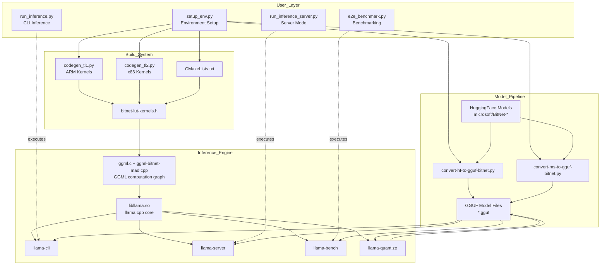
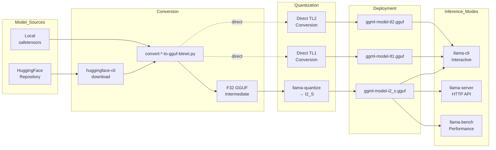
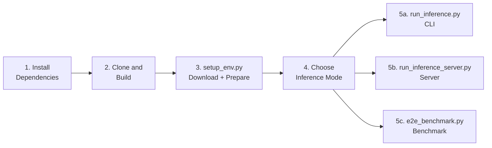

<!-- source: DeepWiki mcp.deepwiki.com · repo microsoft/BitNet · page 1 BitNet.cpp Overview · fetched 2026-10-26 -->

# BitNet.cpp Overview

Relevant source files

The following files were used as context for generating this wiki page:

- [README.md](README.md)

This document provides a high-level introduction to BitNet.cpp, explaining its purpose, core capabilities, and system architecture. For detailed installation instructions, see [Getting Started](#2). For in-depth technical details about the architecture, see [Technical Architecture](#4).

## Purpose

BitNet.cpp is the official inference framework for 1-bit Large Language Models (LLMs), specifically designed for BitNet b1.58 models. The framework provides optimized kernels for **fast** and **lossless** inference on CPU and GPU hardware, enabling efficient deployment of 1-bit quantized models.

The framework is built as an extension of [llama.cpp](https://github.com/ggerganov/llama.cpp), inheriting its mature inference infrastructure while adding specialized support for 1-bit quantization through lookup table (LUT) based matrix operations.

**Sources:** [README.md:9-11]()

## Key Capabilities

BitNet.cpp delivers the following core capabilities:

| Capability | Description |
|------------|-------------|
| **1-bit Quantization** | Native support for BitNet b1.58 ternary weight quantization (-1, 0, +1) |
| **Multi-Architecture Support** | Optimized kernels for ARM (NEON) and x86 (AVX2) CPUs |
| **Multiple Quantization Schemes** | I2_S, TL1 (ARM), and TL2 (x86) formats with architecture-specific optimizations |
| **Model Conversion** | Tools to convert HuggingFace and safetensors models to GGUF format |
| **Flexible Deployment** | CLI, server, and benchmarking modes for various use cases |
| **Performance Tuning** | Configurable kernel parameters and preset configurations for optimal performance |
| **Experimental GPU Support** | CUDA-based W2A8 kernels for GPU inference |

**Performance achievements** (detailed in [Performance Benchmarks](#1.2)):
- **1.37x to 5.07x** speedup on ARM CPUs
- **2.37x to 6.17x** speedup on x86 CPUs  
- **55.4% to 82.2%** energy consumption reduction
- Additional **1.15x to 2.1x** speedup with recent parallel kernel optimizations
- Can run 100B parameter models on single CPU at human-readable speeds (5-7 tokens/second)

**Sources:** [README.md:9-13](), [README.md:24-34]()

## Architecture Overview

The following diagram shows the major system components and their relationships:

### System Component Architecture

**Sources:** [README.md:1-340](), Diagrams 1, 2, and 6 from system architecture analysis

### Data Flow and Quantization Pipeline

**Sources:** [README.md:195-219](), [README.md:222-246](), Diagram 2 from system architecture analysis

## Core Components

### User Interface Layer

BitNet.cpp provides Python scripts that orchestrate the complete workflow:

| Script | Purpose | Key Functionality |
|--------|---------|-------------------|
| `setup_env.py` | Environment setup and model preparation | Downloads models, generates kernels, builds binaries, performs quantization |
| `run_inference.py` | Interactive CLI inference | Single prompt or conversation mode inference |
| `run_inference_server.py` | HTTP server deployment | RESTful API for production deployments |
| `e2e_benchmark.py` | Performance benchmarking | Measures throughput, latency, and token generation speed |

**Sources:** [README.md:195-219](), [README.md:222-246](), [README.md:249-286]()

### Model Conversion Pipeline

The conversion pipeline transforms models from HuggingFace or safetensors format to optimized GGUF format:

| Component | File | Functionality |
|-----------|------|---------------|
| HuggingFace Converter | `convert-hf-to-gguf-bitnet.py` | Converts standard HuggingFace BitNet models |
| Microsoft Converter | `convert-ms-to-gguf-bitnet.py` | Converts Microsoft-specific checkpoint formats |
| Helper Utilities | `convert-helper-bitnet.py` | Wrapper providing unified conversion interface |
| Quantization Tool | `llama-quantize` | Post-conversion quantization to I2_S format |

**Sources:** [README.md:297-305](), Diagram 2 from system architecture analysis

### Kernel System

BitNet.cpp implements three quantization schemes, each optimized for specific architectures:

| Scheme | Target Architecture | Generated By | Description |
|--------|---------------------|--------------|-------------|
| **I2_S** | ARM and x86 | Built-in to GGML | Standard 2-bit packed format, quantized post-conversion |
| **TL1** | ARM (NEON) | `codegen_tl1.py` | Lookup table implementation optimized for ARM NEON instructions |
| **TL2** | x86 (AVX2) | `codegen_tl2.py` | Lookup table implementation optimized for x86 AVX2 instructions |

The kernel header `bitnet-lut-kernels.h` is generated at build time and compiled into `ggml-bitnet-mad.cpp`, which provides the core matrix multiplication operations.

**Sources:** [README.md:40-68](), [README.md:69-155](), Diagram 3 from system architecture analysis

### Integration with llama.cpp

BitNet.cpp extends the llama.cpp framework through:

1. **Custom GGML Quantization Types**: Adds `GGML_TYPE_I2_S`, `GGML_TYPE_TL1`, and `GGML_TYPE_TL2` to the GGML type system
2. **Kernel Injection**: Implements custom `ggml_vec_dot_i2_i8_s` functions in `ggml-bitnet-mad.cpp`
3. **Compile-Time Flags**: Uses `GGML_BITNET_ARM_TL1` and `GGML_BITNET_X86_TL2` to enable architecture-specific paths
4. **GGUF Format Extension**: Extends GGUF metadata to include BitNet-specific quantization parameters

The integration is designed such that BitNet models in GGUF format can be consumed by standard llama.cpp binaries (`llama-cli`, `llama-server`, etc.), while BitNet-compiled binaries retain full compatibility with standard llama.cpp GGUF models.

**Sources:** [README.md:36-38](), Diagram 6 from system architecture analysis

## Supported Models

BitNet.cpp supports models from multiple sources on HuggingFace. For a complete list of supported models, kernel compatibility by architecture, and parameter counts, see [Supported Models and Hardware](#1.1).

**Official Microsoft models:**
- `microsoft/BitNet-b1.58-2B-4T`: 2.4B parameter model with I2_S and architecture-specific TL support

**Community models:**
- `1bitLLM/bitnet_b1_58-*`: 0.7B to 3.3B parameter variants
- `HF1BitLLM/Llama3-8B-1.58-100B-tokens`: 8B parameter Llama3-based model
- `tiiuae/Falcon3-*` and `tiiuae/Falcon-E-*`: 1B to 10B parameter Falcon family models

**Sources:** [README.md:39-155]()

## Typical Workflow

The standard workflow for using BitNet.cpp follows these steps:

1. **Installation**: Install Python 3.9+, CMake 3.22+, and Clang 18+ (see [Installation and Build](#2.1))
2. **Clone and Build**: Clone repository and install Python dependencies
3. **Setup**: Run `setup_env.py` to download models, generate kernels, build binaries, and quantize models
4. **Inference**: Choose an inference mode based on use case
5. **Deployment**: For production, use server mode with continuous batching

For performance optimization, the optional tuning workflow uses `tune_gemm_config.py` to find optimal kernel parameters (see [Performance Tuning Guide](#5.1)).

**Sources:** [README.md:176-219](), Diagram 5 from system architecture analysis

## Key Design Principles

BitNet.cpp is designed around several core principles:

1. **Lossless Inference**: All quantization schemes preserve the exact ternary values (-1, 0, +1) without approximation
2. **Architecture-Specific Optimization**: Separate kernel implementations leverage hardware-specific SIMD instructions (NEON for ARM, AVX2 for x86)
3. **Lookup Table Methodology**: Based on T-MAC research, using precomputed lookup tables for fast matrix operations
4. **Build-Time Specialization**: Kernels are generated and optimized at build time for the target architecture
5. **llama.cpp Compatibility**: Maintains full compatibility with the llama.cpp ecosystem and GGUF format

**Sources:** [README.md:9-11](), [README.md:36-38](), Diagram 3 from system architecture analysis

## Related Documentation

- For installation instructions and build configuration: [Installation and Build](#2.1)
- For model download and preparation: [Model Preparation](#2.2)
- For inference usage patterns: [Running Inference](#3)
- For detailed architecture explanation: [Technical Architecture](#4)
- For performance optimization: [Performance Tuning Guide](#5.1)
- For GPU inference: [GPU Inference (Experimental)](#3.4)

**Sources:** Table of contents from wiki structure

---

