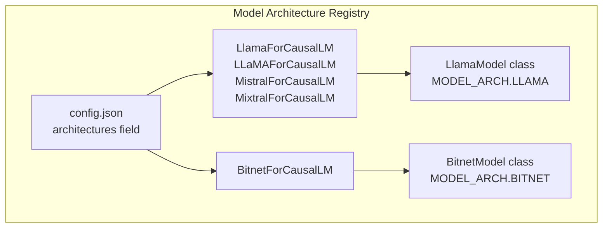
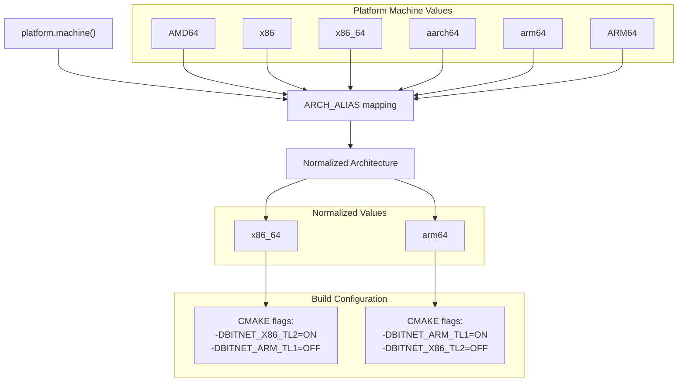
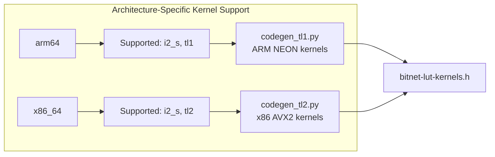
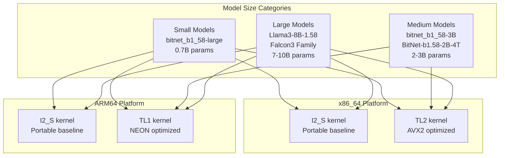
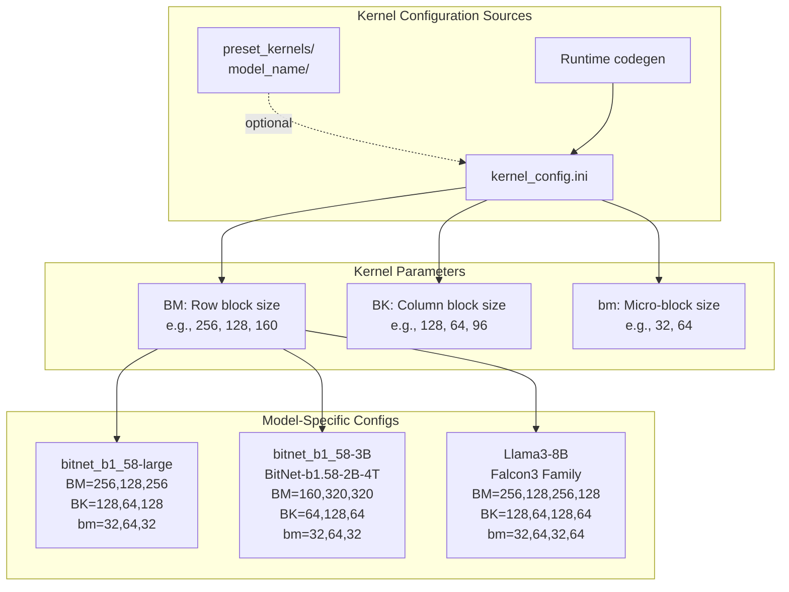

<!-- source: DeepWiki mcp.deepwiki.com · repo microsoft/BitNet · page 1.1 Supported Models and Hardware · fetched 2026-10-26 -->

# Supported Models and Hardware

<details>
<summary>Relevant source files</summary>

The following files were used as context for generating this wiki page:

- [README.md](README.md)
- [run_inference.py](run_inference.py)
- [setup_env.py](setup_env.py)
- [utils/convert-hf-to-gguf-bitnet.py](utils/convert-hf-to-gguf-bitnet.py)

</details>


This page documents the models and hardware platforms compatible with BitNet.cpp. It covers officially supported BitNet models, community-contributed models, CPU architecture requirements, and the mapping between hardware platforms and kernel implementations.

For information about setting up and preparing these models for inference, see [Model Preparation](#2.2). For performance characteristics of different hardware configurations, see [Performance Benchmarks](#1.2).

## Overview

BitNet.cpp supports 1-bit and 1.58-bit LLMs from HuggingFace with varying parameter sizes (0.7B to 10B+). The framework provides architecture-specific optimized kernels that are automatically selected based on the detected CPU architecture. Three quantization kernel types are available: I2_S (portable baseline), TL1 (ARM64-optimized), and TL2 (x86_64-optimized).

## Supported Models

### Official Models

Microsoft provides officially tested BitNet models optimized for the framework:

| Model | Parameters | HuggingFace Repository | x86 Kernels | ARM Kernels |
|-------|-----------|------------------------|-------------|-------------|
| BitNet-b1.58-2B-4T | 2.4B | [microsoft/BitNet-b1.58-2B-4T](https://huggingface.co/microsoft/BitNet-b1.58-2B-4T) | I2_S, TL2 | I2_S, TL1 |

**Sources:** [README.md:39-67]()

### Community Models

The following community-contributed 1-bit LLMs are supported through HuggingFace integration:

| Model | Parameters | Repository | x86 Kernels | ARM Kernels |
|-------|-----------|-----------|-------------|-------------|
| bitnet_b1_58-large | 0.7B | [1bitLLM/bitnet_b1_58-large](https://huggingface.co/1bitLLM/bitnet_b1_58-large) | I2_S, TL2 | I2_S, TL1 |
| bitnet_b1_58-3B | 3.3B | [1bitLLM/bitnet_b1_58-3B](https://huggingface.co/1bitLLM/bitnet_b1_58-3B) | TL2 | TL1 |
| Llama3-8B-1.58-100B-tokens | 8.0B | [HF1BitLLM/Llama3-8B-1.58-100B-tokens](https://huggingface.co/HF1BitLLM/Llama3-8B-1.58-100B-tokens) | I2_S, TL2 | I2_S, TL1 |
| Falcon3 Family | 1B-10B | [tiiuae/falcon3-*](https://huggingface.co/collections/tiiuae/falcon3-67605ae03578be86e4e87026) | I2_S, TL2 | I2_S, TL1 |
| Falcon-E Family | 1B-3B | [tiiuae/Falcon-E-*](https://huggingface.co/collections/tiiuae/falcon-edge-series-6804fd13344d6d8a8fa71130) | I2_S, TL2 | I2_S, TL1 |

**Sources:** [README.md:69-155]()

### Recognized Model Architectures

BitNet.cpp recognizes the following model architectures in HuggingFace `config.json`:



**Architecture Detection Flow:**

The model architecture is read from `config.json` and mapped to a handler class:

- **`LlamaForCausalLM`** variants (including Mistral, Mixtral): Handled by `LlamaModel` class using `gguf.MODEL_ARCH.LLAMA`
- **`BitnetForCausalLM`**: Handled by `BitnetModel` class using `gguf.MODEL_ARCH.BITNET`

**Sources:** [utils/convert-hf-to-gguf-bitnet.py:682-684](), [utils/convert-hf-to-gguf-bitnet.py:955-957]()

### Model Registry Configuration

The supported models are registered in the `SUPPORTED_HF_MODELS` dictionary:

```python
# Examples from setup_env.py
SUPPORTED_HF_MODELS = {
    "1bitLLM/bitnet_b1_58-large": {"model_name": "bitnet_b1_58-large"},
    "1bitLLM/bitnet_b1_58-3B": {"model_name": "bitnet_b1_58-3B"},
    "HF1BitLLM/Llama3-8B-1.58-100B-tokens": {"model_name": "Llama3-8B-1.58-100B-tokens"},
    "tiiuae/Falcon3-7B-Instruct-1.58bit": {"model_name": "Falcon3-7B-Instruct-1.58bit"},
    # ... additional models
}
```

This registry is used by `setup_env.py` for model download and preparation.

**Sources:** [setup_env.py:13-59]()

## Hardware Support

### CPU Architecture Compatibility

BitNet.cpp supports the following CPU architectures with specialized kernel implementations:

| Architecture | Platform Detection | SIMD Instructions | Optimized Kernels |
|--------------|-------------------|-------------------|-------------------|
| **x86_64** | `AMD64`, `x86`, `x86_64` | AVX2 (256-bit) | I2_S, TL2 |
| **ARM64** | `aarch64`, `arm64`, `ARM64` | NEON (128-bit), optional DOTPROD | I2_S, TL1 |

**Sources:** [setup_env.py:61-82]()

### Architecture Detection System



**Architecture Detection Implementation:**

The `system_info()` function in `setup_env.py` performs architecture detection:

1. Calls `platform.machine()` to get raw architecture string
2. Maps through `ARCH_ALIAS` dictionary to normalize variations
3. Returns tuple of `(os_name, normalized_arch)`

**Sources:** [setup_env.py:75-85]()

### Kernel Type Mapping

The build system selects quantization kernel types based on detected architecture:



**Quantization Type Configuration:**

```python
# From setup_env.py
SUPPORTED_QUANT_TYPES = {
    "arm64": ["i2_s", "tl1"],
    "x86_64": ["i2_s", "tl2"]
}
```

The command-line argument parser restricts `--quant-type` choices based on the detected architecture.

**Sources:** [setup_env.py:61-64](), [setup_env.py:224-233]()

## Quantization Kernel Types

### I2_S (Baseline Portable Kernel)

**Characteristics:**
- **Availability:** Both x86_64 and ARM64
- **Format:** 2-bit integer with sign encoding
- **Conversion:** Two-step process (F32 → I2_S via `llama-quantize`)
- **Use Case:** Baseline implementation, guaranteed compatibility

**Conversion Process:**
1. Convert HuggingFace model to F32 GGUF format
2. Quantize F32 GGUF to I2_S using `llama-quantize` binary

```bash
# Example I2_S conversion flow
llama-quantize ggml-model-f32.gguf ggml-model-i2_s.gguf I2_S 1
```

**Sources:** [setup_env.py:132-146](), [README.md:49-66]()

### TL1 (ARM64 Table Lookup Kernel)

**Characteristics:**
- **Availability:** ARM64 only
- **SIMD Instructions:** ARM NEON (128-bit), optional DOTPROD extension
- **Format:** Lookup table-based encoding optimized for ARM
- **Conversion:** Direct conversion during HuggingFace import
- **Performance:** Optimized for ARM cache hierarchy and instruction set

**Code Generation:**
- Generated by `utils/codegen_tl1.py` with model-specific block sizes
- Parameters: `BM`, `BK`, `bm` (tiling dimensions)
- Output: `include/bitnet-lut-kernels.h`

**Preprocessing Functions:**
- `process_tl1()`: Weight layout transformation
- `preprocess_weights_tl1()`: Entry point for TL1 quantization

**Sources:** [setup_env.py:167-181](), [utils/convert-hf-to-gguf-bitnet.py:463-520]()

### TL2 (x86_64 Table Lookup Kernel)

**Characteristics:**
- **Availability:** x86_64 only
- **SIMD Instructions:** AVX2 (256-bit)
- **Format:** Lookup table-based encoding optimized for x86
- **Conversion:** Direct conversion during HuggingFace import
- **Performance:** Optimized for x86 cache hierarchy and AVX2 operations

**Code Generation:**
- Generated by `utils/codegen_tl2.py` with model-specific block sizes
- Parameters: `BM`, `BK`, `bm` (tiling dimensions)
- Output: `include/bitnet-lut-kernels.h`

**Preprocessing Functions:**
- `preprocess_two_weights_tl2()`: Handles 2-element groups
- `preprocess_three_weights_tl2()`: Handles 3-element groups with sign bits
- `preprocess_weights_tl2()`: Entry point for TL2 quantization

**Sources:** [setup_env.py:184-200](), [utils/convert-hf-to-gguf-bitnet.py:523-660]()

## Hardware-Kernel Compatibility Matrix

The following matrix shows which kernel configurations are available for each model-hardware combination:



**Platform-Specific Notes:**

**x86_64 Systems:**
- All models support I2_S and TL2 quantization
- AVX2 instruction set required for optimal TL2 performance
- TL2 provides 2.37x to 6.17x speedup over baseline

**ARM64 Systems:**
- All models support I2_S and TL1 quantization
- NEON instruction set required (standard on ARMv8)
- Optional DOTPROD extension provides additional acceleration
- TL1 provides 1.37x to 5.07x speedup over baseline

**Sources:** [README.md:11](), [README.md:40-155]()

## Kernel Configuration Parameters

Each model requires specific kernel parameters that define the tiling and blocking strategy:



**Configuration Selection:**

The `--use-pretuned` flag in `setup_env.py` allows using pre-optimized kernel configurations:

```bash
# Use pretuned kernels if available
python setup_env.py --hf-repo MODEL_REPO --use-pretuned
```

If pretuned kernels are not available, the system falls back to model-specific defaults in the code generation scripts.

**Sources:** [setup_env.py:162-200](), [utils/convert-hf-to-gguf-bitnet.py:493-504](), [utils/convert-hf-to-gguf-bitnet.py:611-625]()

## System Requirements

### Minimum Requirements

- **Python:** >= 3.9
- **CMake:** >= 3.22
- **Clang:** >= 18
- **Memory:** Varies by model size (minimum 8GB for 3B models)

### Platform-Specific Requirements

**Linux (Debian/Ubuntu):**
```bash
# Install Clang via LLVM script
bash -c "$(wget -O - https://apt.llvm.org/llvm.sh)"
```

**Windows:**
- Visual Studio 2022 with:
  - Desktop development with C++
  - C++-CMake Tools for Windows
  - Git for Windows
  - C++-Clang Compiler for Windows
  - MS-Build Support for LLVM-Toolset (clang)

**macOS:**
- Xcode Command Line Tools
- Clang provided by Xcode

**Sources:** [README.md:159-175]()

### GPU Support (Experimental)

Limited experimental GPU support is available with CUDA kernels:

- **Kernel Type:** W2A8 (2-bit weights, 8-bit activations)
- **CUDA Operations:** `dp4a` instructions
- **Status:** Experimental, separate from CPU inference path
- **Documentation:** See [GPU Inference](#3.4)

**Sources:** Inferred from diagram context, not directly visible in provided files

---

