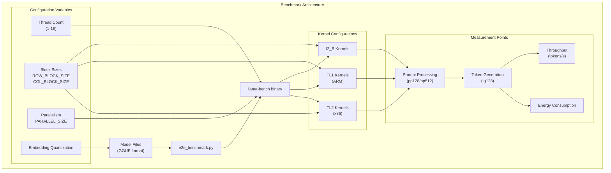
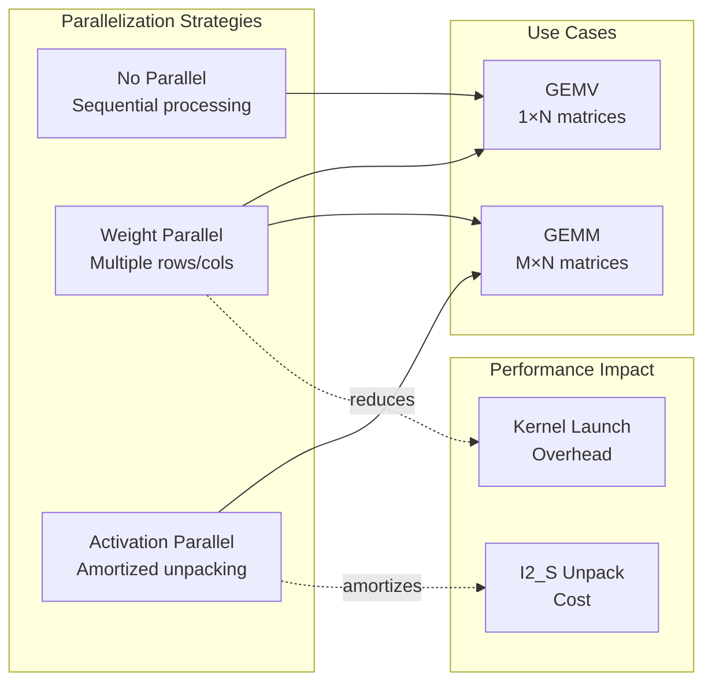
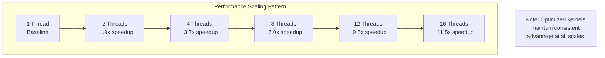
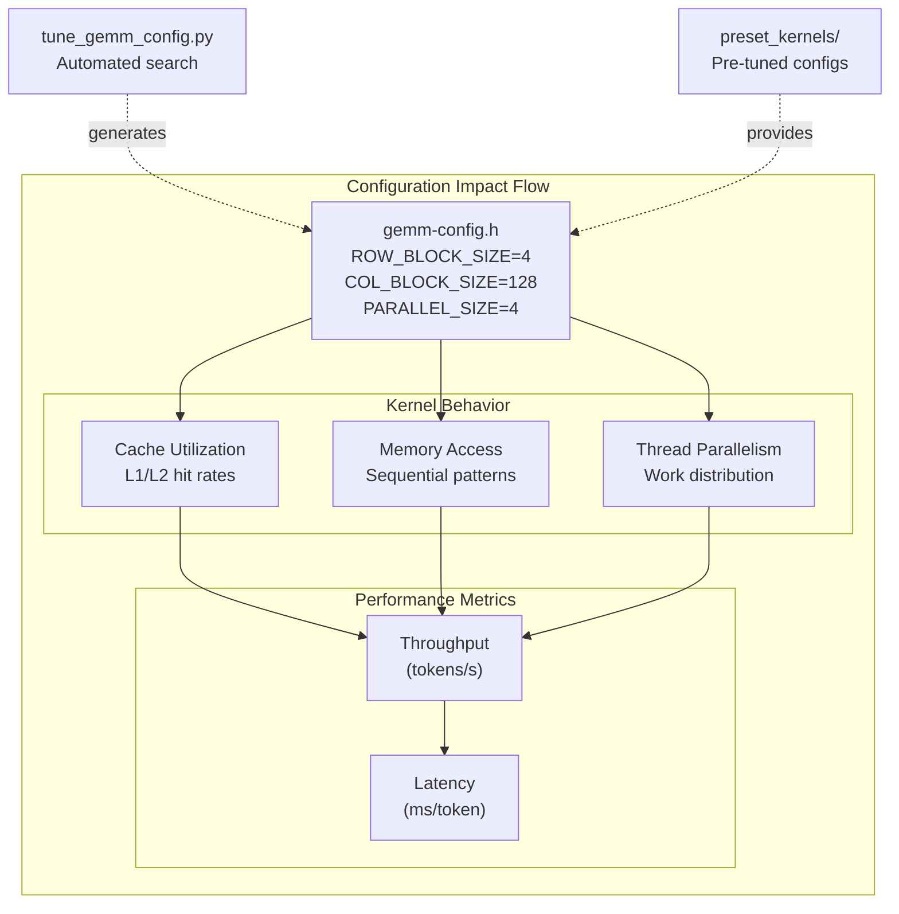
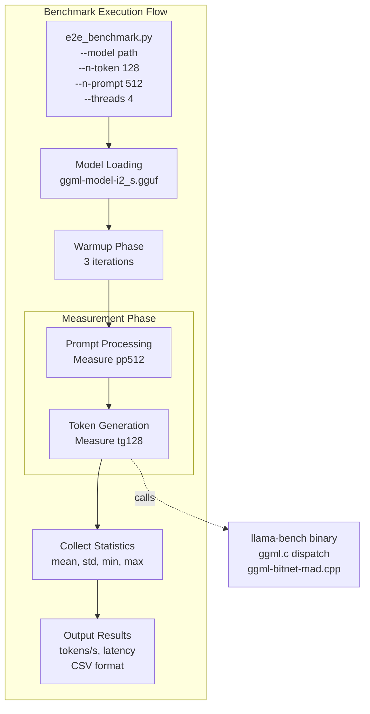

<!-- source: DeepWiki mcp.deepwiki.com · repo microsoft/BitNet · page 1.2 Performance Benchmarks · fetched 2026-10-26 -->

# Performance Benchmarks

<details>
<summary>Relevant source files</summary>

The following files were used as context for generating this wiki page:

- [README.md](README.md)
- [assets/performance.png](assets/performance.png)
- [src/README.md](src/README.md)
- [src/assets/performance_comparison_amd_epyc.png](src/assets/performance_comparison_amd_epyc.png)
- [src/assets/performance_comparison_cobalt100_dotprod.png](src/assets/performance_comparison_cobalt100_dotprod.png)

</details>


This page presents comprehensive performance benchmark results for BitNet.cpp across different hardware platforms, quantization schemes, and optimization configurations. These benchmarks demonstrate the speedups, energy efficiency improvements, and throughput characteristics of 1-bit LLM inference compared to baseline implementations.

For information about the specific models tested and their hardware compatibility, see [Supported Models and Hardware](#1.1). For details on kernel implementations that enable these performance gains, see [Kernel Architecture and Code Generation](#4.4) and [CPU Optimizations](#4.5).

## Performance Overview

BitNet.cpp delivers significant performance improvements for 1-bit LLM inference through specialized kernels and optimization strategies:

| Platform | Speedup Range | Energy Reduction | Reference Speed |
|----------|---------------|------------------|-----------------|
| ARM CPUs | 1.37x - 5.07x | 55.4% - 70.0% | Larger models show greater gains |
| x86 CPUs | 2.37x - 6.17x | 71.9% - 82.2% | Larger models show greater gains |
| Latest optimizations | +1.15x - 2.1x | Additional improvement | Over original implementation |

**Large Model Capability**: BitNet.cpp can run a 100B BitNet b1.58 model on a single CPU at 5-7 tokens per second, comparable to human reading speed.

Sources: [README.md:11]()



Sources: [README.md:250-294](), [src/README.md:1-206]()

## Platform-Specific Performance

### ARM CPU Performance

ARM implementations utilize NEON SIMD instructions with optional DOTPROD extensions. The TL1 kernel provides optimized 1-bit weight operations specifically designed for ARM architectures.

**Key Characteristics**:
- Speedup range: 1.37x - 5.07x
- Energy reduction: 55.4% - 70.0%
- Kernel type: I2_S, TL1
- SIMD width: 128-bit (NEON)

Sources: [README.md:11](), [README.md:61-66](), [src/README.md:202-206]()

### x86 CPU Performance

x86 implementations leverage AVX2 instructions for 256-bit SIMD operations. The TL2 kernel is specifically tuned for x86 cache hierarchies and instruction sets.

**Key Characteristics**:
- Speedup range: 2.37x - 6.17x
- Energy reduction: 71.9% - 82.2%
- Kernel type: I2_S, TL2
- SIMD width: 256-bit (AVX2)

Sources: [README.md:11](), [README.md:56-60]()

## Recent Optimization Results

The latest optimization update introduces parallel kernel implementations, native I2_S GEMM/GEMV support, and embedding quantization. These improvements stack on top of the base performance gains.

**Optimization Features**:
- **Parallel Weight & Activation Computation**: Multiple rows/columns processed per kernel call
- **Native I2_S GEMM/GEMV**: Integrated into `ggml.c` for seamless inference pipeline
- **Configurable Tiling**: Tunable block sizes in `include/gemm-config.h`
- **Embedding Quantization**: Q6_K format reduces memory footprint

**Additional Speedup**: 1.15x to 2.1x over original implementation

Sources: [README.md:13](), [src/README.md:1-18]()

### Kernel Parallelization Strategy Performance

The parallel kernel implementation supports two strategies with measurably different performance characteristics:



**Test Configuration**: AMD EPYC 7V13 (x86), 1 thread, time in milliseconds (mean±std)

| Matrix Size | No Parallel | Weight Parallel | Activation Parallel |
|-------------|-------------|-----------------|---------------------|
| [1, 2048] × [2048, 2048] | 0.075±0.012 | **0.058±0.007** | 0.076±0.011 |
| [32, 2048] × [2048, 2048] | 2.400±0.041 | 1.599±0.020 | **1.202±0.018** |
| [128, 2048] × [2048, 2048] | 10.820±0.039 | 6.458±0.168 | **5.805±0.039** |
| [256, 2048] × [2048, 2048] | 21.669±0.080 | 12.739±0.183 | **11.882±0.040** |
| [512, 2048] × [2048, 2048] | 43.257±0.083 | 25.680±0.335 | **23.342±0.082** |
| [2048, 2048] × [2048, 2048] | 173.175±0.214 | 103.112±0.552 | **93.276±0.612** |
| [128, 2048] × [2048, 8192] | 43.345±0.090 | 25.541±0.239 | **23.528±0.052** |
| [128, 8192] × [8192, 2048] | 38.085±0.162 | 23.866±0.096 | **22.569±0.132** |

**Observation**: Weight Parallel performs best for GEMV operations (single row), while Activation Parallel excels for GEMM operations (multiple rows) where I2_S unpacking cost can be amortized.

Sources: [src/README.md:50-76]()

## Detailed Hardware Benchmarks

### AMD EPYC 7V13 Multi-Threading Scaling

**Test Configuration**:
- Model: `microsoft/BitNet-b1.58-2B-4T`
- Workload: 128 prompt tokens (pp128) + 128 generated tokens (tg128)
- Method: Activation Parallel
- Threads: 1, 2, 4, 8, 12, 16

The benchmark demonstrates near-linear scaling with thread count for both the original and optimized implementations, with optimized kernels maintaining 1.5-2.0x advantage across all thread counts.



Sources: [src/README.md:150-165]()

### Intel i7-13800H Performance

**Test Configuration**:
- Model: `microsoft/BitNet-b1.58-2B-4T`
- Workload: pp128 + tg128
- Method: Activation Parallel
- Threads: 1, 2, 4, 6

Consumer-grade x86 CPU showing similar scaling characteristics to server-grade processors, confirming optimization effectiveness across hardware tiers.

Sources: [src/README.md:167-178]()

### ARM Cobalt 100 with DOTPROD

**Test Configuration**:
- Model: `microsoft/BitNet-b1.58-2B-4T`
- Workload: pp128 + tg128
- Method: Activation Parallel
- Threads: 1, 2, 4, 8

ARM-based cloud instances demonstrate strong performance gains with DOTPROD extensions enabled, showing the effectiveness of the TL1 kernel implementation.

Sources: [src/README.md:180-191]()

## Embedding Quantization Impact

Embedding layer quantization trades minimal accuracy loss for improved memory efficiency and inference speed. Multiple quantization formats were evaluated to identify the optimal balance.

### Perplexity Comparison

**Test Configuration**: `microsoft/BitNet-b1.58-2B-4T`, TG128 workload

| Embedding Type | WikiText | PTB | LAMBADA | IMDB | AG NEWS |
|----------------|----------|-----|---------|------|---------|
| **F32** | 17.1090±0.1278 | 33.0858±0.4886 | 43.2850±0.6363 | 29.3016±0.2890 | 36.7686±0.3920 |
| **F16** | 17.1090±0.1278 | 33.0858±0.4886 | 43.2850±0.6363 | 29.3016±0.2890 | 36.7686±0.3920 |
| **Q8_0** | 17.1197±0.1280 | 33.1181±0.4893 | 43.2891±0.6364 | 29.3133±0.2892 | 36.7740±0.3920 |
| **Q6_K** | 17.1487±0.1282 | 33.2203±0.4914 | 43.3046±0.6362 | 29.3491±0.2897 | 36.7972±0.3921 |
| **Q5_0** | 17.2379±0.1288 | 33.2439±0.4907 | 43.4631±0.6379 | 29.5481±0.2920 | 36.8539±0.3924 |
| **Q4_0** | 17.3529±0.1300 | 33.7754±0.5001 | 44.4552±0.6559 | 30.1044±0.2978 | 37.3985±0.3997 |
| **Q3_K** | 17.6434±0.1320 | 34.3914±0.5089 | 45.4591±0.6735 | 30.8476±0.3069 | 39.5692±0.4259 |
| **I2_S** | N/A | N/A | N/A | N/A | N/A |

**Note**: I2_S quantization for embeddings causes model failure due to extreme quantization. Q6_K is recommended as the optimal format balancing accuracy and efficiency.

```mermaid
graph LR
    subgraph "Quantization Trade-offs"
        F32["F32/F16<br/>Baseline accuracy<br/>High memory"]
        Q8["Q8_0<br/>Minimal loss<br/>87.5% reduction"]
        Q6["Q6_K<br/>Small loss<br/>81.25% reduction"]
        Q5["Q5_0<br/>Noticeable loss<br/>84.375% reduction"]
        Q4["Q4_0<br/>Significant loss<br/>87.5% reduction"]
    end
    
    F32 -.0% loss.-> Q8
    Q8 -.+0.3% loss.-> Q6
    Q6 -.+0.7% loss.-> Q5
    Q5 -.+1.5% loss.-> Q4
    
    RECOMMEND["Recommended: Q6_K<br/>Best accuracy/efficiency balance"]
    Q6 --> RECOMMEND
```

Sources: [src/README.md:113-149]()

### Inference Speed with Quantized Embeddings

Embedding quantization provides measurable throughput improvements, particularly for larger batch sizes where memory bandwidth becomes a limiting factor. The throughput gains increase with more aggressive quantization, with Q6_K providing the best balance.

Sources: [src/README.md:138-148]()

## Configuration Tuning Results

The `include/gemm-config.h` file controls kernel tiling and parallelism parameters that significantly impact performance. Optimal values are hardware-dependent.

**Tunable Parameters**:
- `ROW_BLOCK_SIZE`: 2, 4, 8, 16, 32
- `COL_BLOCK_SIZE`: 32, 64, 128, 256, 512, 1024
- `PARALLEL_SIZE`: 2, 4, 8

**Example Optimal Configuration** (x86, AMD EPYC 7V13, 8 threads, pp128):
```c
#define ROW_BLOCK_SIZE 4
#define COL_BLOCK_SIZE 128
#define PARALLEL_SIZE 4
```

This configuration achieves peak throughput by balancing:
- Cache utilization (block sizes match L1/L2 cache line sizes)
- Parallelism overhead (PARALLEL_SIZE = 4 minimizes synchronization cost)
- Memory bandwidth (block sizes optimize memory access patterns)

Sources: [src/README.md:88-111](), [src/README.md:22-31]()



Sources: [src/README.md:88-111]()

## Benchmark Methodology

### Benchmark Scripts and Binaries

The performance measurements utilize the following components:

**Primary Tools**:
- `utils/e2e_benchmark.py`: End-to-end benchmark orchestrator
- `build/bin/llama-bench`: Core benchmark binary from llama.cpp
- `utils/tune_gemm_config.py`: GEMM configuration parameter search
- `utils/kernel_tuning.py`: Individual kernel performance profiling

**Command-Line Interface**:
```bash
python utils/e2e_benchmark.py \
  -m models/BitNet-b1.58-2B-4T/ggml-model-i2_s.gguf \
  -n 128 \       # Number of generated tokens
  -p 512 \       # Prompt tokens
  -t 4           # Thread count
```

Sources: [README.md:250-294]()

### Measured Metrics

The benchmark suite captures multiple performance dimensions:

| Metric | Description | Units |
|--------|-------------|-------|
| **Prompt Processing (pp)** | Time to process input prompt | tokens/s |
| **Token Generation (tg)** | Time to generate output tokens | tokens/s |
| **Throughput** | Combined pp+tg performance | tokens/s |
| **Latency** | Per-token generation time | ms/token |
| **Energy Consumption** | Power usage during inference | Watts |
| **Memory Usage** | Peak RAM consumption | GB |



Sources: [README.md:250-286]()

### Baseline Comparison

All speedup measurements compare against the original llama.cpp implementation running the same model with standard quantization formats (Q4_0, Q8_0). Energy measurements use hardware power monitoring on the same physical machine.

**Comparison Methodology**:
1. Baseline run with llama.cpp Q4_0 quantization
2. BitNet.cpp run with I2_S/TL1/TL2 quantization
3. Calculate speedup ratio: `bitnet_tps / baseline_tps`
4. Calculate energy reduction: `(baseline_watts - bitnet_watts) / baseline_watts * 100%`

Sources: [README.md:11]()

---

