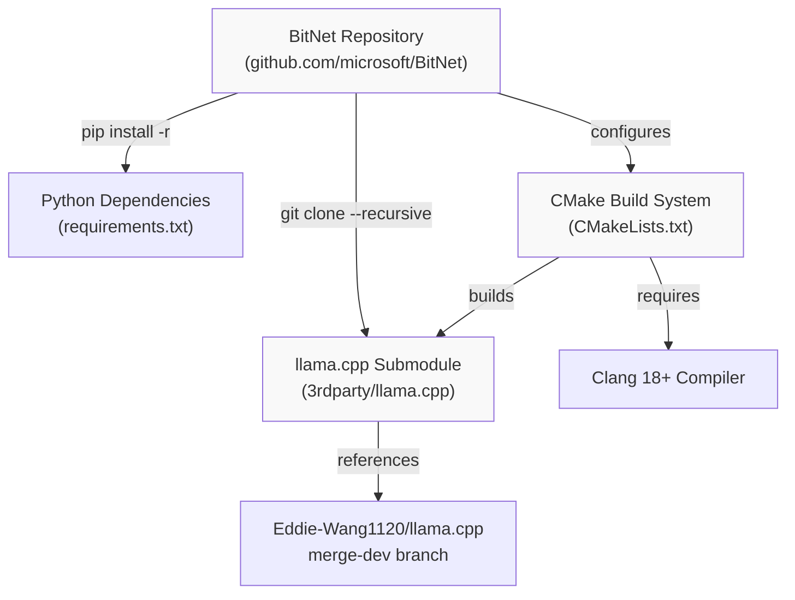
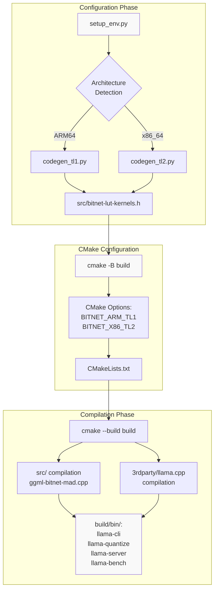
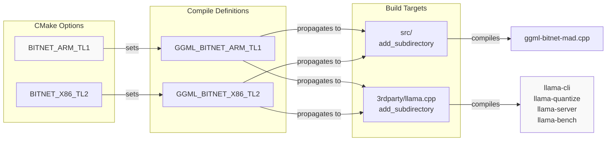
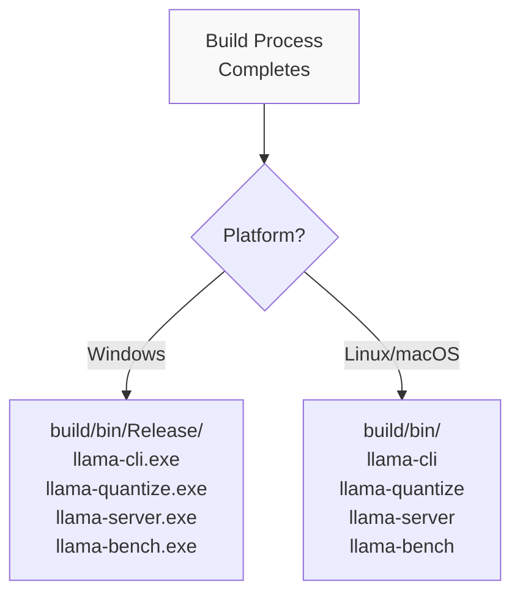

<!-- source: DeepWiki mcp.deepwiki.com · repo microsoft/BitNet · page 2.1 Installation and Build · fetched 2026-10-26 -->

# Installation and Build

<details>
<summary>Relevant source files</summary>

The following files were used as context for generating this wiki page:

- [.gitmodules](.gitmodules)
- [CMakeLists.txt](CMakeLists.txt)
- [README.md](README.md)
- [run_inference_server.py](run_inference_server.py)

</details>


This page covers the installation of prerequisites, cloning the repository, and building the BitNet.cpp project from source. This includes setting up the build environment, compiling the C++ inference engine, and generating the necessary binaries for running 1-bit LLM inference.

For information about preparing models after building, see [Model Preparation](#2.2). For details about the build system architecture and how kernels are generated, see [Build System Details](#6.1).

## Prerequisites

BitNet.cpp requires the following tools and dependencies to build successfully:

| Requirement | Minimum Version | Notes |
|-------------|----------------|-------|
| Python | 3.9 | Required for build orchestration scripts |
| CMake | 3.22 | Required for build configuration |
| Clang | 18 | C++ compiler (specific version required) |
| Git | Any recent | For cloning repository with submodules |
| Conda | Optional | Highly recommended for environment isolation |

**Sources:** [README.md:161-174]()

### Platform-Specific Requirements

#### Windows

Windows users must install **Visual Studio 2022** with the following components enabled:

- Desktop development with C++
- C++ CMake Tools for Windows
- Git for Windows
- C++ Clang Compiler for Windows
- MS-Build Support for LLVM-Toolset (clang)

All commands must be run from a **Developer Command Prompt** or **Developer PowerShell for VS2022**. This ensures that the Visual Studio toolchain is properly initialized in the environment.

**Sources:** [README.md:165-171]()

#### Linux (Debian/Ubuntu)

For Debian and Ubuntu users, Clang 18 can be installed using the automatic installation script:

```bash
bash -c "$(wget -O - https://apt.llvm.org/llvm.sh)"
```

**Sources:** [README.md:171-173]()

## Repository Structure and Dependencies

BitNet.cpp integrates with llama.cpp as a Git submodule. The repository structure includes custom BitNet kernels that extend llama.cpp's inference capabilities.

### Build Dependencies Flow



**Sources:** [.gitmodules:1-4](), [README.md:181-185]()

## Cloning the Repository

Clone the repository with the `--recursive` flag to automatically initialize and fetch the llama.cpp submodule:

```bash
git clone --recursive https://github.com/microsoft/BitNet.git
cd BitNet
```

The `--recursive` flag is critical because BitNet.cpp depends on a customized fork of llama.cpp located in the `3rdparty/llama.cpp` directory. The submodule references the `merge-dev` branch from `Eddie-Wang1120/llama.cpp`, which contains BitNet-specific integration patches.

**Sources:** [README.md:181-185](), [.gitmodules:1-4]()

## Installing Python Dependencies

It is highly recommended to create an isolated Conda environment to avoid conflicts with system packages:

```bash
# Create and activate a new conda environment
conda create -n bitnet-cpp python=3.9
conda activate bitnet-cpp

# Install Python dependencies
pip install -r requirements.txt
```

The `requirements.txt` file contains dependencies needed by the build orchestration scripts (`setup_env.py`), model conversion utilities, and inference scripts.

**Sources:** [README.md:186-193]()

## Build Process Overview

The build process consists of two main phases: configuration and compilation. The configuration phase generates platform-specific kernel code and sets up CMake, while the compilation phase produces the final binaries.

### Build Process Flow



**Sources:** [README.md:194-199](), [CMakeLists.txt:1-79]()

## Building the Project

The simplest way to build BitNet.cpp is through the `setup_env.py` script, which automates kernel generation, CMake configuration, and compilation. However, the build process can also be performed manually for more control.

### Automated Build (Recommended)

The `setup_env.py` script handles the entire build process, including kernel code generation and CMake configuration:

```bash
# Download a model and build with I2_S quantization
huggingface-cli download microsoft/BitNet-b1.58-2B-4T-gguf --local-dir models/BitNet-b1.58-2B-4T
python setup_env.py -md models/BitNet-b1.58-2B-4T -q i2_s
```

Key `setup_env.py` arguments relevant to building:

| Argument | Short | Description |
|----------|-------|-------------|
| `--quant-type` | `-q` | Quantization type: `i2_s`, `tl1`, or `tl2` (determines kernel generation) |
| `--use-pretuned` | `-p` | Use pre-tuned kernel parameters (skips code generation) |

**Sources:** [README.md:194-219]()

### Manual Build Process

For users who need more control or want to understand the build process in detail:

1. **Generate kernel code** (if not using pre-tuned kernels):
   ```bash
   # For ARM platforms
   python utils/codegen_tl1.py
   
   # For x86 platforms  
   python utils/codegen_tl2.py
   ```

2. **Configure with CMake**:
   ```bash
   cmake -B build \
       -DBITNET_ARM_TL1=ON   # For ARM with TL1 kernels
       # OR
       -DBITNET_X86_TL2=ON   # For x86 with TL2 kernels
   ```

3. **Compile**:
   ```bash
   cmake --build build --config Release
   ```

**Sources:** [CMakeLists.txt:14-33]()

## CMake Build Configuration

The `CMakeLists.txt` file orchestrates the build process and configures the integration with llama.cpp.

### Key CMake Options



The CMake configuration performs the following key actions:

1. **Option Propagation** [CMakeLists.txt:24-33]():
   - `BITNET_ARM_TL1` → sets `GGML_BITNET_ARM_TL1` compile definition
   - `BITNET_X86_TL2` → sets `GGML_BITNET_X86_TL2` compile definition

2. **Build Subdirectories** [CMakeLists.txt:41-43]():
   - `add_subdirectory(src)` - Compiles BitNet-specific kernels
   - `add_subdirectory(3rdparty/llama.cpp)` - Compiles llama.cpp with BitNet extensions

3. **Server Build** [CMakeLists.txt:42]():
   - `LLAMA_BUILD_SERVER` is forced to `ON` to ensure `llama-server` binary is built

**Sources:** [CMakeLists.txt:1-79]()

## Build Artifacts

After a successful build, the following binaries are produced in the `build/bin/` directory:

| Binary | Purpose | Usage |
|--------|---------|-------|
| `llama-cli` | Interactive command-line inference | Used by `run_inference.py` |
| `llama-quantize` | Model quantization tool | Converts F32 GGUF to I2_S format |
| `llama-server` | HTTP API server for inference | Used by `run_inference_server.py` |
| `llama-bench` | Performance benchmarking | Used by `e2e_benchmark.py` |

On Windows, binaries are located in `build/bin/Release/` with `.exe` extensions. On Unix-like systems, they are in `build/bin/` without extensions.

### Binary Location Logic



**Sources:** [run_inference_server.py:17-23](), [CMakeLists.txt:12]()

## Platform-Specific Considerations

### Windows Build Environment

Windows builds require careful environment setup to ensure Clang and Visual Studio tools are accessible.

#### Verifying Environment Setup

Before building, verify the environment is correctly initialized:

```bash
clang -v
```

If you receive an error like `'clang' is not recognized`, your command line environment is not properly initialized for Visual Studio tools.

#### Initializing Visual Studio Environment

**For Command Prompt:**
```cmd
"C:\Program Files\Microsoft Visual Studio\2022\Professional\Common7\Tools\VsDevCmd.bat" -startdir=none -arch=x64 -host_arch=x64
```

**For PowerShell:**
```powershell
Import-Module "C:\Program Files\Microsoft Visual Studio\2022\Professional\Common7\Tools\Microsoft.VisualStudio.DevShell.dll"
Enter-VsDevShell 3f0e31ad -SkipAutomaticLocation -DevCmdArguments "-arch=x64 -host_arch=x64"
```

These commands must be run in each new terminal session before building.

**Sources:** [README.md:314-339]()

### Linux/macOS Considerations

On Unix-like systems, the build process is more straightforward. Ensure that:

1. Clang 18 or later is installed and in the PATH
2. CMake 3.22 or later is available
3. pthread support is available (usually standard)

The build system sets `THREADS_PREFER_PTHREAD_FLAG` to ensure proper threading support [CMakeLists.txt:22]().

## Build Configuration Options

The build system supports several configuration options that affect kernel generation and compilation:

### Architecture Selection

The build system automatically detects the target architecture, but you can explicitly control kernel type:

```bash
# For ARM platforms with TL1 kernels
cmake -B build -DBITNET_ARM_TL1=ON

# For x86 platforms with TL2 kernels
cmake -B build -DBITNET_X86_TL2=ON
```

These options control which optimized kernel implementations are compiled into the binaries. See [Kernel Architecture and Code Generation](#4.4) for details on kernel types.

### Build Type

The default build type is `Release` for optimal performance. Other build types can be selected:

```bash
cmake -B build -DCMAKE_BUILD_TYPE=Debug        # Debug symbols
cmake -B build -DCMAKE_BUILD_TYPE=MinSizeRel   # Minimize binary size
cmake -B build -DCMAKE_BUILD_TYPE=RelWithDebInfo  # Release with debug info
```

**Sources:** [CMakeLists.txt:7-10]()

## Verification

After building, verify that the binaries were created successfully:

```bash
# Unix/Linux/macOS
ls -la build/bin/

# Windows (PowerShell)
dir build\bin\Release\

# Windows (Command Prompt)
dir build\bin\Release\
```

You should see the four main binaries listed in the Build Artifacts section. To verify functionality, you can run a simple version check:

```bash
# Unix/Linux/macOS
./build/bin/llama-cli --version

# Windows
.\build\bin\Release\llama-cli.exe --version
```

**Sources:** [run_inference_server.py:17-23]()

## Troubleshooting Common Build Issues

### Issue: std::chrono Build Errors in log.cpp

Recent versions of llama.cpp may have issues with `std::chrono` in `log.cpp`. This is a known issue in the llama.cpp submodule.

**Solution:** Refer to [this commit](https://github.com/tinglou/llama.cpp/commit/4e3db1e3d78cc1bcd22bcb3af54bd2a4628dd323) for the fix. You may need to apply the patch to `3rdparty/llama.cpp/common/log.cpp`.

**Sources:** [README.md:309-312]()

### Issue: Clang Not Found on Windows

If CMake cannot find Clang during configuration, ensure:

1. Visual Studio 2022 is installed with the required components
2. You are running from Developer Command Prompt or Developer PowerShell
3. The environment initialization commands have been executed

See the Windows Build Environment section above for initialization commands.

**Sources:** [README.md:314-339]()

### Issue: Submodule Not Initialized

If you cloned without `--recursive`, the `3rdparty/llama.cpp` directory will be empty, causing build failures.

**Solution:**
```bash
git submodule update --init --recursive
```

**Sources:** [README.md:181-185](), [.gitmodules:1-4]()

### Issue: CMake Version Too Old

BitNet.cpp requires CMake 3.22 or later due to modern CMake features used in the build configuration.

**Solution:** Update CMake to version 3.22 or later from [cmake.org](https://cmake.org/download/).

**Sources:** [README.md:163](), [CMakeLists.txt:1]()

## Next Steps

After successfully building BitNet.cpp, proceed to:

- [Model Preparation](#2.2) - Download and prepare quantized models for inference
- [Running Your First Inference](#2.3) - Execute basic inference with the built binaries
- [Build System Details](#6.1) - Learn more about the build system architecture

**Sources:** [README.md:194-219]()

---

