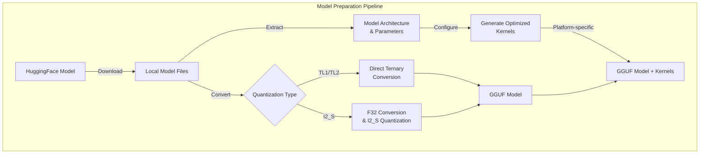
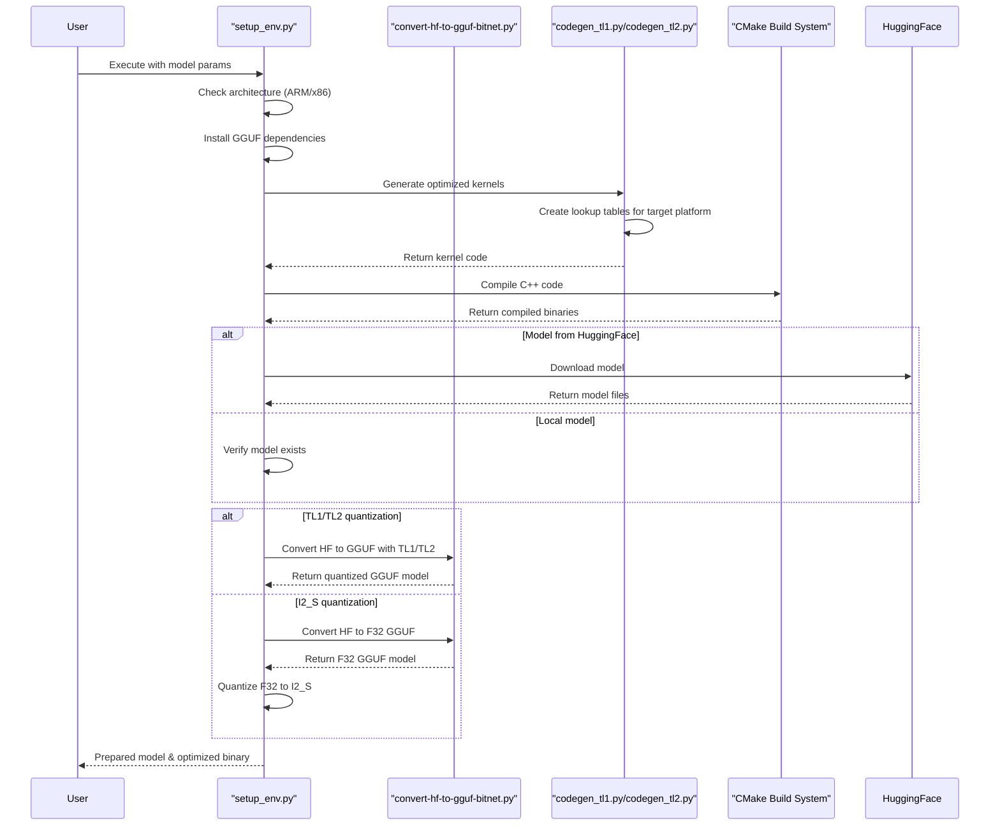
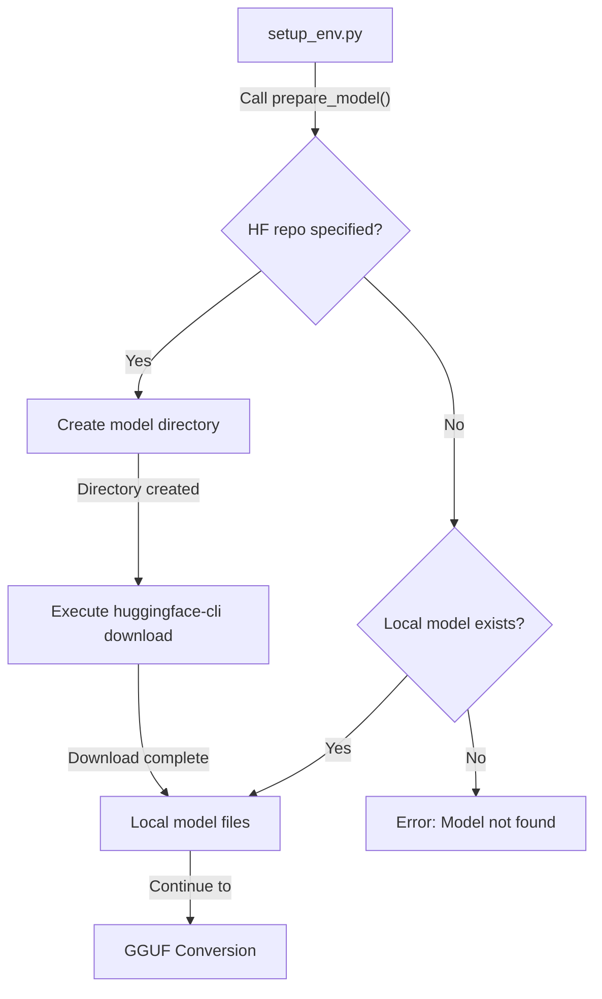
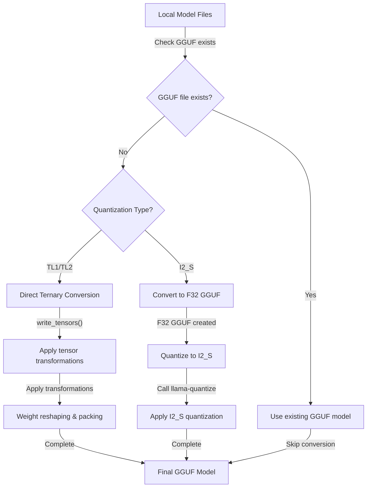
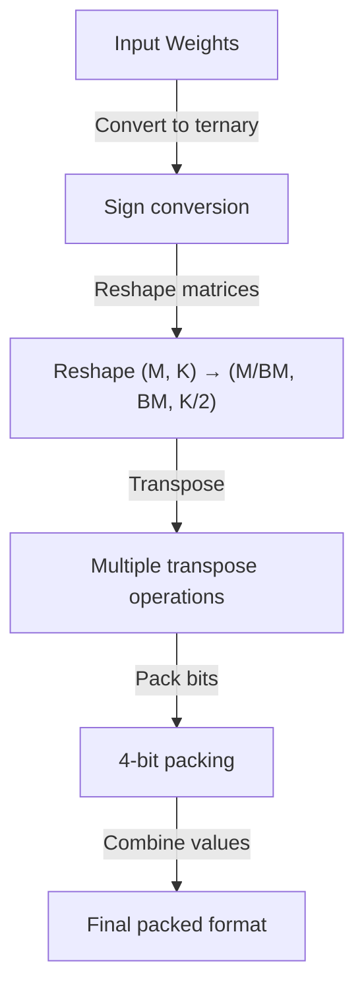
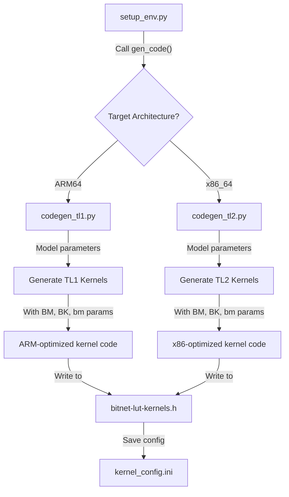

<!-- source: DeepWiki mcp.deepwiki.com · repo microsoft/BitNet · page 2.2 Model Preparation · fetched 2026-10-26 -->

# Model Preparation

<details>
<summary>Relevant source files</summary>

The following files were used as context for generating this wiki page:

- [README.md](README.md)
- [run_inference.py](run_inference.py)
- [setup_env.py](setup_env.py)
- [utils/convert-hf-to-gguf-bitnet.py](utils/convert-hf-to-gguf-bitnet.py)

</details>


This document explains how to prepare models for use with BitNet.cpp. It covers downloading models from Hugging Face, converting models to the GGUF format, and applying ternary quantization techniques. For information on running inference with prepared models, see [Running Inference](#3).

## Overview

BitNet.cpp supports various ternary (1.58-bit) language models, which must go through a preparation process before inference. This preparation includes downloading, conversion, and optimization for the target hardware platform.



Sources: [setup_env.py:97-136](), [utils/convert-hf-to-gguf-bitnet.py:1082-1165]()

## Supported Models and Quantization Types

BitNet.cpp officially supports the 2.4B parameter BitNet-b1.58-2B-4T model and is compatible with several other ternary models.

### Supported Models

| Model | Parameters | Description |
|-------|------------|-------------|
| [BitNet-b1.58-2B-4T](https://huggingface.co/microsoft/BitNet-b1.58-2B-4T) | 2.4B | Official BitNet model |
| [bitnet_b1_58-large](https://huggingface.co/1bitLLM/bitnet_b1_58-large) | 0.7B | Community BitNet model |
| [bitnet_b1_58-3B](https://huggingface.co/1bitLLM/bitnet_b1_58-3B) | 3.3B | Community BitNet model |
| [Llama3-8B-1.58](https://huggingface.co/HF1BitLLM/Llama3-8B-1.58-100B-tokens) | 8.0B | Ternary Llama3 model |
| [Falcon3 Family](https://huggingface.co/collections/tiiuae/falcon3-67605ae03578be86e4e87026) | 1B-10B | Various ternary Falcon3 models |

### Quantization Types

Each model can be quantized using different methods depending on the target hardware:

| Quantization Type | Description | Supported Architecture |
|-------------------|-------------|------------------------|
| I2_S | Standard 2-bit sign-magnitude quantization | ARM64, x86_64 |
| TL1 | Ternary lookup optimization for ARM | ARM64 only |
| TL2 | Ternary lookup optimization for x86 | x86_64 only |

Sources: [README.md:37-139](), [setup_env.py:48-52]()

## Using setup_env.py

The `setup_env.py` script is the primary tool for model preparation. It orchestrates the entire preparation process, including model download, conversion, kernel generation, and compilation.



Sources: [setup_env.py:206-210](), [setup_env.py:97-138]()

### Command Line Arguments

The `setup_env.py` script accepts several command line arguments:

| Argument | Description | Default |
|----------|-------------|---------|
| `--hf-repo`, `-hr` | HuggingFace repository to download from | None |
| `--model-dir`, `-md` | Directory to save/load model | "models" |
| `--log-dir`, `-ld` | Directory for logging information | "logs" |
| `--quant-type`, `-q` | Quantization type (i2_s, tl1, or tl2) | "i2_s" |
| `--quant-embd` | Quantize embeddings to f16 | False |
| `--use-pretuned`, `-p` | Use pre-tuned kernel parameters | False |

Example usage:
```bash
python setup_env.py -hr microsoft/BitNet-b1.58-2B-4T -q i2_s
```

Or with a local model:
```bash
python setup_env.py -md models/BitNet-b1.58-2B-4T -q tl1
```

Sources: [setup_env.py:212-221](), [README.md:177-203]()

## Model Download Process

When downloading from Hugging Face, the script creates an appropriate directory structure and uses `huggingface-cli` to download the model.



Sources: [setup_env.py:97-114]()

## Model Conversion Process

The model conversion process transforms Hugging Face models into the GGUF format used by BitNet.cpp. This process handles different model architectures and applies the appropriate quantization method.



Sources: [setup_env.py:116-136](), [utils/convert-hf-to-gguf-bitnet.py:1082-1165]()

### Conversion Process Details

The conversion process involves several key steps:

1. **Model Architecture Detection**: The converter identifies whether the model is a standard LlamaModel or a specialized BitnetModel.

2. **Parameter Extraction**: Model parameters like vocabulary size, embedding dimensions, and attention heads are extracted.

3. **Vocabulary Processing**: The tokenizer vocabulary is processed and added to the GGUF file.

4. **Tensor Transformation**: Model weights are processed according to the selected quantization method.

5. **GGUF Writing**: The processed model is written to a GGUF file format.

Sources: [utils/convert-hf-to-gguf-bitnet.py:679-1079]()

## Quantization Methods

BitNet.cpp supports three quantization methods, each with its own advantages and target platforms.

### I2_S (2-bit Sign-Magnitude)

I2_S is a standard 2-bit quantization format that represents weights with a sign bit and a magnitude bit. This format is supported on both ARM and x86 platforms.

### TL1 (Ternary Lookup for ARM)

TL1 is a specialized ternary representation optimized for ARM processors. It involves:

1. Converting weights to ternary values (-1, 0, 1)
2. Reshaping and transposing matrices for ARM's memory access patterns
3. Packing multiple ternary values into bytes
4. Generating lookup tables for fast computation



Sources: [utils/convert-hf-to-gguf-bitnet.py:460-517]()

### TL2 (Ternary Lookup for x86)

TL2 is optimized for x86 processors and follows a different optimization approach:

1. Dividing the weight matrix into two parts: threeK and twoK
2. Processing threeK with a specialized 3-to-1 bit packing scheme
3. Processing twoK with a simpler 2-to-1 bit packing scheme
4. Optimizing for x86 SIMD instructions

Sources: [utils/convert-hf-to-gguf-bitnet.py:520-657]()

## Kernel Code Generation

Based on the model architecture and target platform, BitNet.cpp generates optimized kernels for matrix multiplication operations.



The kernel generation process is customized based on:

1. **Model Architecture**: Different models have different optimal blocking parameters
2. **Matrix Dimensions**: The dimensions of weight matrices affect blocking strategies
3. **Target Platform**: ARM (TL1) and x86 (TL2) require different optimizations

Sources: [setup_env.py:144-188]()

## Complete Preparation Workflow

The complete model preparation workflow involves several integrated steps:

1. **Setup Environment**: Install dependencies and prepare the environment
2. **Generate Kernel Code**: Create optimized kernels for the target platform
3. **Compile C++ Code**: Build the BitNet.cpp framework with generated kernels
4. **Prepare Model**: Download, convert, and quantize the model
5. **Ready for Inference**: The prepared model is now ready for [inference](#3)

Sources: [setup_env.py:206-210]()

## Troubleshooting Model Preparation

Common issues during model preparation include:

1. **Missing Dependencies**: Ensure all required packages are installed
2. **Unsupported Models**: Verify that your model is supported by BitNet.cpp
3. **Conversion Errors**: Check model architecture matches expected format
4. **Kernel Generation Failures**: Ensure your hardware is properly detected
5. **Compilation Issues**: On Windows, ensure you're using Developer Command Prompt

Sources: [README.md:280-312]()

---

