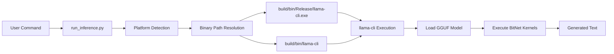
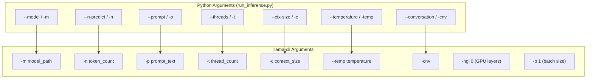
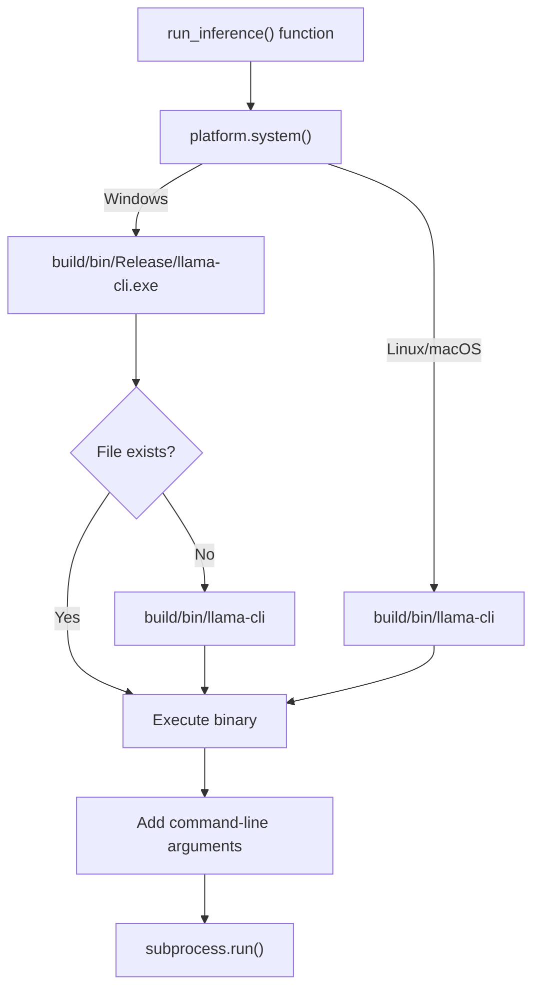
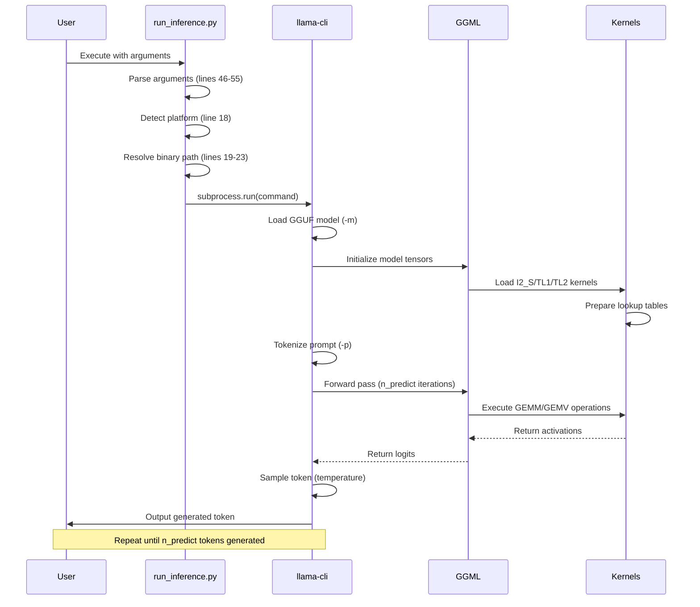
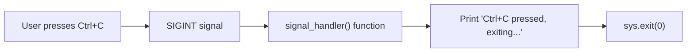

<!-- source: DeepWiki mcp.deepwiki.com · repo microsoft/BitNet · page 2.3 Running Your First Inference · fetched 2026-10-26 -->

# Running Your First Inference

<details>
<summary>Relevant source files</summary>

The following files were used as context for generating this wiki page:

- [README.md](README.md)
- [run_inference.py](run_inference.py)
- [setup_env.py](setup_env.py)
- [utils/convert-hf-to-gguf-bitnet.py](utils/convert-hf-to-gguf-bitnet.py)

</details>


This page provides a quick start guide for running inference with BitNet.cpp using the `run_inference.py` script. It assumes you have already completed the installation and model preparation steps covered in [Installation and Build](#2.1) and [Model Preparation](#2.2).

For advanced inference modes including server deployment and benchmarking, see [Running Inference](#3).

## Prerequisites

Before running inference, ensure you have:

1. **Built the project** - The `llama-cli` binary must exist in `build/bin/` (see [Installation and Build](#2.1))
2. **Prepared a quantized model** - You should have a `.gguf` file in your model directory (see [Model Preparation](#2.2))

The typical model path after running `setup_env.py` will be:
- `models/<model-name>/ggml-model-i2_s.gguf` (I2_S quantization)
- `models/<model-name>/ggml-model-tl1.gguf` (TL1 quantization, ARM only)
- `models/<model-name>/ggml-model-tl2.gguf` (TL2 quantization, x86 only)

## Basic Inference Command

The simplest way to run inference is:

```bash
python run_inference.py -m models/BitNet-b1.58-2B-4T/ggml-model-i2_s.gguf -p "You are a helpful assistant"
```

This command will:
1. Load the specified GGUF model
2. Generate 128 tokens (default) from the prompt
3. Output the generated text to the console

**Example output:**
```
You are a helpful assistant.

User: What is the capital of France?
Assistant: The capital of France is Paris.
```

Sources: [README.md:222-247](), [run_inference.py:1-56]()

## Execution Flow

### High-Level Process



### Argument Translation

The `run_inference.py` script acts as a wrapper that translates Python arguments into `llama-cli` command-line arguments:



Sources: [run_inference.py:16-37]()

## Command-Line Arguments Reference

The following table describes all available arguments for `run_inference.py`:

| Argument | Short | Type | Required | Default | Description |
|----------|-------|------|----------|---------|-------------|
| `--model` | `-m` | string | No | `models/bitnet_b1_58-3B/ggml-model-i2_s.gguf` | Path to the GGUF model file |
| `--n-predict` | `-n` | integer | No | 128 | Number of tokens to generate |
| `--prompt` | `-p` | string | **Yes** | - | Input prompt text |
| `--threads` | `-t` | integer | No | 2 | Number of CPU threads to use |
| `--ctx-size` | `-c` | integer | No | 2048 | Maximum context window size in tokens |
| `--temperature` | `-temp` | float | No | 0.8 | Sampling temperature (0.0 = deterministic, higher = more random) |
| `--conversation` | `-cnv` | flag | No | False | Enable chat/conversation mode for instruct models |

**Important Notes:**
- The `--prompt` argument is the only required parameter
- When `--conversation` is enabled, the prompt specified via `-p` is used as the system prompt
- The script sets `-ngl 0` (no GPU layers) and `-b 1` (batch size 1) by default

Sources: [run_inference.py:46-54](), [README.md:226-246]()

## Example Usage Scenarios

### Scenario 1: Simple Text Completion

Generate a continuation of a given text:

```bash
python run_inference.py \
  -m models/BitNet-b1.58-2B-4T/ggml-model-i2_s.gguf \
  -p "The quick brown fox" \
  -n 50
```

This generates 50 tokens continuing the phrase "The quick brown fox".

### Scenario 2: Chat Mode with Instruct Model

For instruction-tuned models like `Falcon3-7B-Instruct-1.58bit`:

```bash
python run_inference.py \
  -m models/Falcon3-7B-Instruct-1.58bit/ggml-model-i2_s.gguf \
  -p "You are a helpful AI assistant" \
  -cnv
```

With `-cnv` flag, the model enters conversational mode where the prompt becomes the system message.

### Scenario 3: Long-Form Generation with Custom Settings

Generate longer text with specific sampling parameters:

```bash
python run_inference.py \
  -m models/Llama3-8B-1.58-100B-tokens/ggml-model-i2_s.gguf \
  -p "Write a detailed explanation of quantum computing:" \
  -n 512 \
  -c 4096 \
  -temp 0.7 \
  -t 8
```

This uses:
- 512 token generation limit
- 4096 token context window
- Temperature 0.7 for balanced creativity
- 8 CPU threads for faster inference

### Scenario 4: Deterministic Output

For reproducible results:

```bash
python run_inference.py \
  -m models/BitNet-b1.58-2B-4T/ggml-model-i2_s.gguf \
  -p "Summarize the following:" \
  -temp 0.0
```

Setting temperature to 0.0 makes the output deterministic (always selects the most probable token).

Sources: [README.md:222-246]()

## Understanding the Binary Execution Path

### Platform-Specific Binary Resolution

The `run_inference.py` script determines which binary to execute based on the operating system:



**Key Implementation Details:**

1. **Binary Location** ([run_inference.py:17-23]()):
   - Windows: First checks `build/bin/Release/llama-cli.exe`, falls back to `build/bin/llama-cli`
   - Unix (Linux/macOS): Uses `build/bin/llama-cli`

2. **Fixed Arguments** ([run_inference.py:24-34]()):
   - `-ngl 0`: Disables GPU layer offloading (CPU-only inference)
   - `-b 1`: Sets batch size to 1 (processes one token at a time)

3. **Error Handling** ([run_inference.py:8-14]()):
   - Uses `subprocess.run()` with `check=True` to raise exceptions on failure
   - Catches `CalledProcessError` and exits with error message

Sources: [run_inference.py:16-37]()

## Internal Process Flow

### Complete Inference Pipeline



**Pipeline Stages:**

1. **Argument Processing**: Python script parses and validates user inputs
2. **Binary Invocation**: Platform-appropriate `llama-cli` binary is executed
3. **Model Loading**: GGUF file is loaded into memory with BitNet-specific quantization
4. **Kernel Initialization**: I2_S, TL1, or TL2 kernels are selected based on model format
5. **Token Generation**: Autoregressive generation loop produces tokens one at a time
6. **Output**: Generated text is streamed to console

Sources: [run_inference.py:16-37](), [README.md:222-246]()

## Signal Handling

The script includes interrupt handling for graceful shutdown:



This allows users to interrupt long-running inference sessions cleanly without corrupting output or leaving processes hanging.

Sources: [run_inference.py:39-41](), [run_inference.py:44]()

## Next Steps

After successfully running your first inference, you can explore:

- **[Interactive CLI Inference](#3.1)**: Learn about advanced CLI options and interactive mode
- **[Server Deployment](#3.2)**: Set up `llama-server` for HTTP API access
- **[Benchmarking Performance](#3.3)**: Measure throughput and latency with `e2e_benchmark.py`
- **[Performance Tuning Guide](#5.1)**: Optimize kernel configurations for your hardware

For understanding the underlying architecture, see:
- **[System Overview](#4.1)**: How `run_inference.py` integrates with llama.cpp
- **[Quantization Schemes](#4.3)**: Details about I2_S, TL1, and TL2 formats

---

