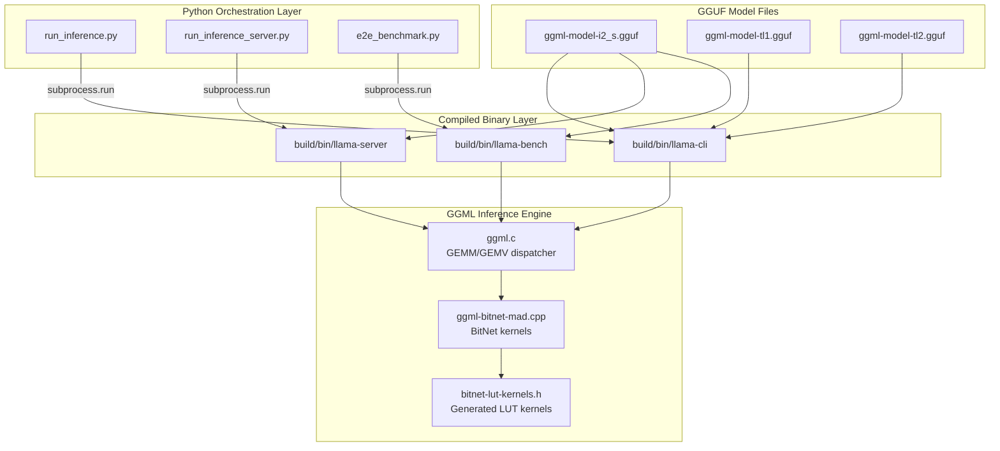
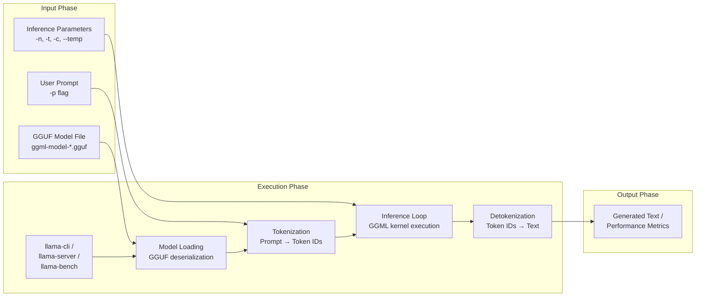

<!-- source: DeepWiki mcp.deepwiki.com · repo microsoft/BitNet · page 3 Running Inference · fetched 2026-10-26 -->

# Running Inference

<details>
<summary>Relevant source files</summary>

The following files were used as context for generating this wiki page:

- [README.md](README.md)
- [run_inference.py](run_inference.py)
- [setup_env.py](setup_env.py)
- [utils/convert-hf-to-gguf-bitnet.py](utils/convert-hf-to-gguf-bitnet.py)

</details>


This page provides a comprehensive guide to running inference with BitNet.cpp models. It covers the available inference modes, execution workflows, and common parameters. For detailed information about model preparation and quantization, see [Model Preparation](#2.2).

The BitNet.cpp framework provides four primary inference modes:
1. **Interactive CLI Inference** - Command-line interface for interactive text generation (see [Interactive CLI Inference](#3.1))
2. **Server Deployment** - HTTP API server for production deployments (see [Server Deployment](#3.2))
3. **Benchmarking** - Performance measurement tools (see [Benchmarking Performance](#3.3))
4. **GPU Inference** - Experimental CUDA-based inference (see [GPU Inference (Experimental)](#3.4))

## Prerequisites

Before running inference, you must:
1. Complete the build process (see [Installation and Build](#2.1))
2. Prepare a quantized GGUF model (see [Model Preparation](#2.2))

The inference system requires models in GGUF format with one of the following quantization schemes:
- **I2_S**: Two-stage quantization (F32 → I2_S), compatible with both ARM and x86
- **TL1**: Table lookup optimization for ARM64 architectures
- **TL2**: Table lookup optimization for x86_64 architectures

Sources: [README.md:159-219](), [setup_env.py:61-64]()

## Inference Execution Architecture

The BitNet.cpp inference system follows a layered architecture where Python orchestration scripts invoke compiled C++ binaries that execute GGML operations:



**Python orchestration scripts** construct command-line arguments and invoke the corresponding binary using `subprocess.run`. The scripts handle platform-specific binary paths (Windows vs. Unix) and parameter validation.

**Compiled binaries** (`llama-cli`, `llama-server`, `llama-bench`) are built from the llama.cpp submodule with BitNet-specific extensions enabled during compilation. These binaries load GGUF models and dispatch computation to GGML.

**GGML inference engine** performs the actual model inference using optimized kernels. The dispatcher in `ggml.c` routes operations to BitNet-specific implementations in `ggml-bitnet-mad.cpp`, which use lookup tables generated in `bitnet-lut-kernels.h`.

Sources: [run_inference.py:16-37](), [README.md:220-247](), Diagram 1, Diagram 6

## Inference Workflow

The following diagram illustrates the complete data flow from model file to inference output:



The workflow consists of three phases:

**Input Phase**: The system accepts a GGUF model file path, user prompt, and inference parameters. All parameters are passed as command-line flags to the binary.

**Execution Phase**: 
1. `LOAD` - The binary deserializes the GGUF file and loads tensors into memory
2. `TOKENIZE` - The prompt string is converted to token IDs using the model's tokenizer
3. `INFERENCE` - The model generates tokens autoregressively using GGML kernels
4. `DECODE` - Generated token IDs are converted back to text strings

**Output Phase**: The system outputs either generated text (CLI/server modes) or performance metrics (benchmark mode).

Sources: [run_inference.py:16-37](), Diagram 2, Diagram 5

## Inference Modes

| Mode | Binary | Python Script | Use Case | Output Format |
|------|--------|---------------|----------|---------------|
| Interactive CLI | `llama-cli` | `run_inference.py` | Interactive text generation, testing | Text stream to stdout |
| Server | `llama-server` | `run_inference_server.py` | Production API deployment | HTTP JSON responses |
| Benchmark | `llama-bench` | `e2e_benchmark.py` | Performance measurement | Performance metrics |
| GPU (Experimental) | Custom CUDA kernels | `generate.py` | GPU-accelerated inference | Text output |

Sources: [README.md:220-295](), Diagram 5

### Interactive CLI Inference

The CLI mode provides an interactive command-line interface for text generation. It is invoked via `run_inference.py`, which constructs arguments for `llama-cli`:

```bash
python run_inference.py \
    -m models/BitNet-b1.58-2B-4T/ggml-model-i2_s.gguf \
    -p "You are a helpful assistant" \
    -n 128 \
    -t 2 \
    -c 2048 \
    --temp 0.8 \
    -cnv
```

The script resolves the platform-specific binary path (`build/bin/llama-cli` on Unix, `build/bin/Release/llama-cli.exe` on Windows) and executes it with the provided arguments. The `-cnv` flag enables conversation mode for instruct-tuned models.

For detailed documentation of all CLI parameters and advanced usage, see [Interactive CLI Inference](#3.1).

Sources: [run_inference.py:1-56](), [README.md:220-247]()

### Server Deployment

Server mode launches an HTTP API endpoint using `llama-server`, enabling production deployments with RESTful interfaces:

```bash
python run_inference_server.py \
    -m models/BitNet-b1.58-2B-4T/ggml-model-i2_s.gguf \
    --host 0.0.0.0 \
    --port 8080
```

The server supports continuous batching for efficient multi-request handling. Client applications can send HTTP POST requests to generate text programmatically.

For server configuration, API endpoints, and client integration examples, see [Server Deployment](#3.2).

Sources: [README.md:7](), Diagram 5

### Benchmarking Performance

Benchmark mode measures inference throughput and latency using `llama-bench`:

```bash
python utils/e2e_benchmark.py \
    -m models/BitNet-b1.58-2B-4T/ggml-model-i2_s.gguf \
    -n 128 \
    -p 512 \
    -t 4
```

The benchmark processes a specified number of prompt tokens (`-p`) and generates a fixed number of output tokens (`-n`) to measure tokens/second and GFLOPS metrics.

For comprehensive benchmarking procedures and result interpretation, see [Benchmarking Performance](#3.3).

Sources: [README.md:248-295](), Diagram 5

### GPU Inference (Experimental)

GPU inference uses CUDA kernels for W2A8 (2-bit weights, 8-bit activations) quantization:

```bash
python gpu/generate.py \
    --checkpoint models/checkpoint.pth \
    --prompt "Once upon a time"
```

This mode requires CUDA environment setup and model conversion via `gpu/convert_checkpoint.py`. GPU inference is experimental and supports a subset of model architectures.

For GPU setup instructions and performance characteristics, see [GPU Inference (Experimental)](#3.4).

Sources: [README.md:7](), Diagram 5

## Common Inference Parameters

The following table documents parameters shared across inference modes:

| Parameter | Flag | Type | Default | Description |
|-----------|------|------|---------|-------------|
| Model Path | `-m`, `--model` | string | (required) | Path to GGUF model file |
| Prompt | `-p`, `--prompt` | string | (required) | Input text to generate from |
| Tokens to Generate | `-n`, `--n-predict` | integer | 128 | Number of tokens to generate |
| Thread Count | `-t`, `--threads` | integer | 2 | CPU threads for parallel execution |
| Context Size | `-c`, `--ctx-size` | integer | 2048 | Maximum context window length |
| Temperature | `--temp`, `--temperature` | float | 0.8 | Sampling temperature (higher = more random) |
| Conversation Mode | `-cnv`, `--conversation` | flag | false | Enable chat mode with system prompt |
| Batch Size | `-b` | integer | 1 | Number of tokens processed per batch |
| GPU Layers | `-ngl` | integer | 0 | Number of layers offloaded to GPU (0 = CPU only) |

**Parameter Details**:

- **Model Path** (`-m`): Must point to a valid GGUF file created by `setup_env.py`. The file format is validated during loading.

- **Thread Count** (`-t`): Should match available CPU cores. Higher values improve throughput but may cause cache contention. Optimal values depend on hardware and model size (see [Performance Tuning Guide](#5.1)).

- **Context Size** (`-c`): Must not exceed the model's `max_position_embeddings` from `config.json`. Larger contexts increase memory usage linearly.

- **Temperature**: Controls output randomness. Values closer to 0 produce deterministic outputs; values above 1.0 increase diversity but may reduce coherence.

- **Conversation Mode** (`-cnv`): When enabled, the prompt specified by `-p` is treated as the system prompt. The binary enters an interactive loop for multi-turn conversations.

- **GPU Layers** (`-ngl`): Currently set to `0` (CPU-only) in BitNet.cpp CPU inference. GPU offloading is only available in the experimental GPU mode (see [GPU Inference (Experimental)](#3.4)).

Sources: [run_inference.py:46-53](), [README.md:226-246]()

## Platform-Specific Considerations

### Windows Binary Resolution

On Windows systems, `run_inference.py` implements a fallback mechanism for locating binaries:

```python
if platform.system() == "Windows":
    main_path = os.path.join(build_dir, "bin", "Release", "llama-cli.exe")
    if not os.path.exists(main_path):
        main_path = os.path.join(build_dir, "bin", "llama-cli")
```

The script first checks `build/bin/Release/llama-cli.exe` (Visual Studio build output), then falls back to `build/bin/llama-cli` if not found.

Sources: [run_inference.py:18-23]()

### Unix-like Systems

On Unix-like systems (Linux, macOS), binaries are located directly in `build/bin/`:

```python
else:
    main_path = os.path.join(build_dir, "bin", "llama-cli")
```

Ensure the binary has execute permissions (`chmod +x build/bin/llama-cli`).

Sources: [run_inference.py:22-23]()

## Error Handling

All Python orchestration scripts implement uniform error handling via `subprocess.run`:

```python
def run_command(command, shell=False):
    try:
        subprocess.run(command, shell=shell, check=True)
    except subprocess.CalledProcessError as e:
        print(f"Error occurred while running command: {e}")
        sys.exit(1)
```

When the underlying binary exits with a non-zero status code, the Python script propagates the error and terminates with exit code 1. Common error scenarios include:
- Model file not found or corrupted
- Insufficient memory for model loading
- Invalid parameter combinations
- Architecture mismatch (TL1 on x86, TL2 on ARM)

Sources: [run_inference.py:8-14]()

## Signal Handling

The scripts implement graceful shutdown on SIGINT (Ctrl+C):

```python
def signal_handler(sig, frame):
    print("Ctrl+C pressed, exiting...")
    sys.exit(0)

signal.signal(signal.SIGINT, signal_handler)
```

This allows users to interrupt long-running inference sessions cleanly.

Sources: [run_inference.py:39-44]()

---

