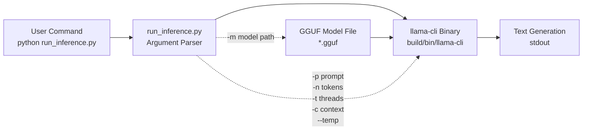
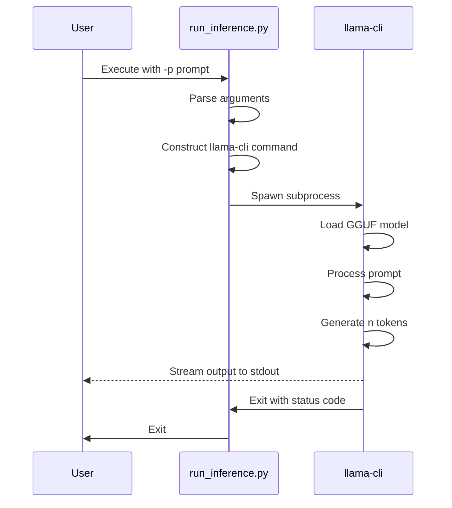
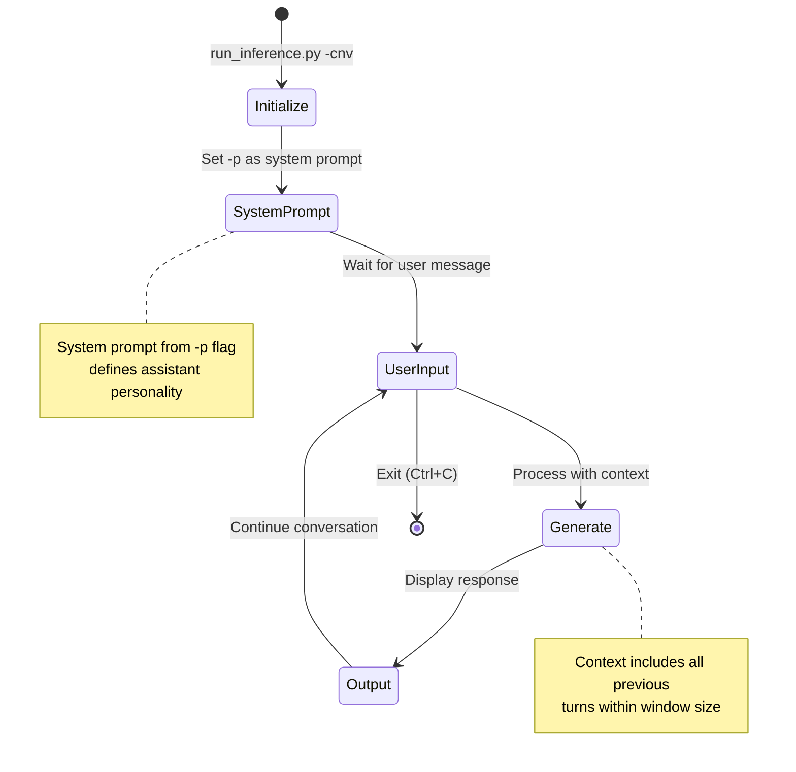
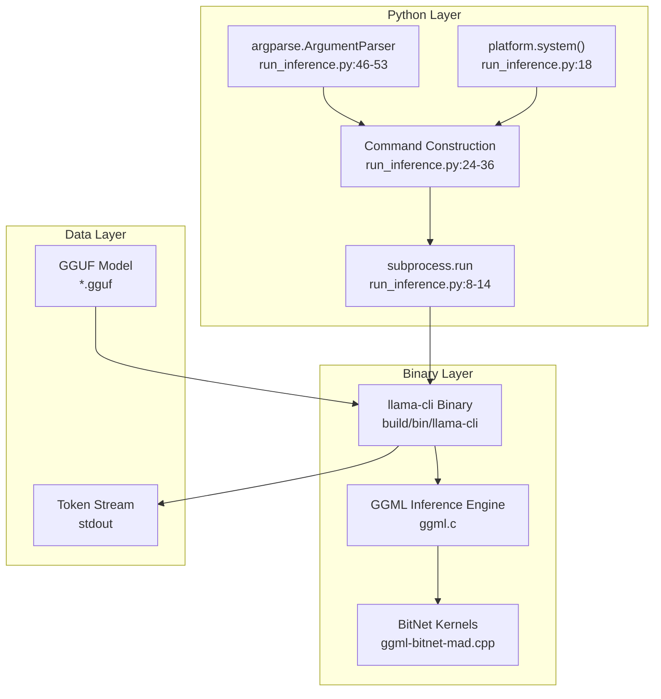
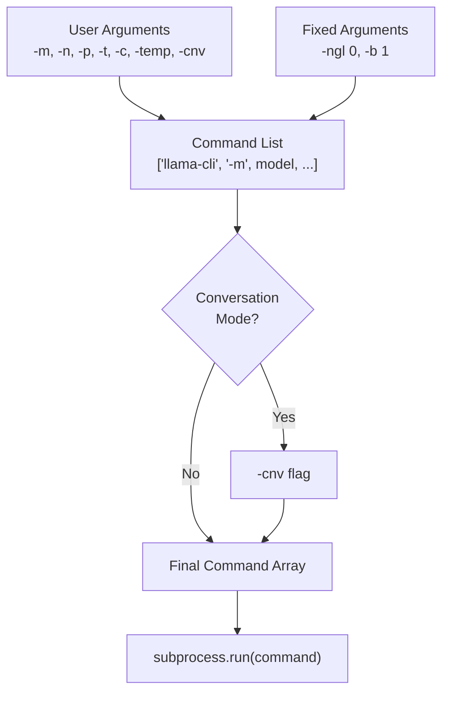
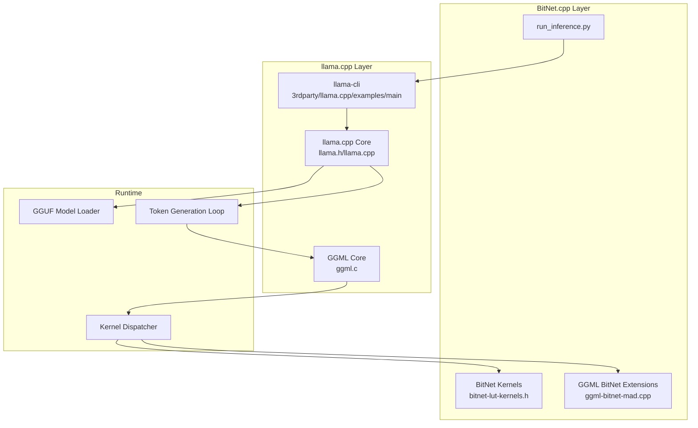

<!-- source: DeepWiki mcp.deepwiki.com · repo microsoft/BitNet · page 3.1 Interactive CLI Inference · fetched 2026-10-26 -->

# Interactive CLI Inference

<details>
<summary>Relevant source files</summary>

The following files were used as context for generating this wiki page:

- [README.md](README.md)
- [run_inference.py](run_inference.py)
- [setup_env.py](setup_env.py)
- [utils/convert-hf-to-gguf-bitnet.py](utils/convert-hf-to-gguf-bitnet.py)

</details>


This document describes how to run interactive inference using the BitNet.cpp command-line interface. It covers the `run_inference.py` script, its command-line arguments, and the two primary modes of operation: single-shot text generation and conversational chat.

For deploying inference as an HTTP API service, see [Server Deployment](#3.2). For systematic performance measurement, see [Benchmarking Performance](#3.3). For preparing models before inference, see [Model Preparation](#2.2).

---

## Overview

The `run_inference.py` script provides an interactive command-line interface for text generation using quantized BitNet models. It acts as a Python wrapper around the compiled `llama-cli` binary, translating user-friendly arguments into the appropriate low-level parameters.

**Workflow Diagram: CLI Inference Pipeline**



Sources: [run_inference.py:1-56]()

---

## Command-Line Arguments

The `run_inference.py` script accepts the following command-line arguments:

| Argument | Short | Type | Default | Description |
|----------|-------|------|---------|-------------|
| `--model` | `-m` | str | `models/bitnet_b1_58-3B/ggml-model-i2_s.gguf` | Path to the quantized GGUF model file |
| `--n-predict` | `-n` | int | `128` | Number of tokens to generate |
| `--prompt` | `-p` | str | **Required** | Text prompt to generate from |
| `--threads` | `-t` | int | `2` | Number of CPU threads to use for inference |
| `--ctx-size` | `-c` | int | `2048` | Context window size in tokens |
| `--temperature` | `-temp` | float | `0.8` | Sampling temperature (controls randomness) |
| `--conversation` | `-cnv` | flag | `False` | Enable chat/conversation mode |

Sources: [run_inference.py:46-53](), [README.md:226-247]()

---

## Argument Details

### Model Path (`-m`)

Specifies the path to a quantized GGUF model file. The model must have been prepared using `setup_env.py` with one of the supported quantization types (I2_S, TL1, or TL2).

```bash
python run_inference.py -m models/BitNet-b1.58-2B-4T/ggml-model-i2_s.gguf -p "Hello"
```

### Token Generation (`-n`)

Controls how many tokens the model will generate in response to the prompt. Larger values produce longer outputs but take more time.

```bash
# Generate 256 tokens instead of default 128
python run_inference.py -m model.gguf -p "Explain quantum computing" -n 256
```

### Threading (`-t`)

Specifies the number of CPU threads to use for parallel computation. Higher values can improve throughput on multi-core systems but may show diminishing returns beyond the optimal point for your hardware.

```bash
# Use 8 threads for faster inference
python run_inference.py -m model.gguf -p "Hello" -t 8
```

### Context Size (`-c`)

Sets the maximum context window size in tokens. This limits how much text (prompt + generated output) the model can consider at once. Larger contexts consume more memory.

```bash
# Use 4096-token context for longer conversations
python run_inference.py -m model.gguf -p "Hello" -c 4096
```

### Temperature (`-temp`)

Controls sampling randomness during generation. Values closer to 0 produce more deterministic outputs, while higher values increase creativity and randomness.

- `0.0`: Greedy (most deterministic)
- `0.8`: Default (balanced)
- `1.0+`: More creative/random

```bash
# More deterministic output
python run_inference.py -m model.gguf -p "Hello" -temp 0.2
```

Sources: [run_inference.py:46-53]()

---

## Single-Shot Inference Mode

By default, `run_inference.py` operates in single-shot mode, where it generates text once in response to the provided prompt and then exits.

### Basic Usage

```bash
python run_inference.py \
  -m models/BitNet-b1.58-2B-4T/ggml-model-i2_s.gguf \
  -p "Microsoft Corporation is an American multinational corporation and technology company headquartered in Redmond, Washington."
```

**Single-Shot Execution Flow**



Sources: [run_inference.py:16-37](), [run_inference.py:45]()

---

## Conversation Mode

Conversation mode (`-cnv` flag) enables multi-turn chat interactions with instruct-tuned models. In this mode, the provided prompt becomes the system prompt, and the model engages in back-and-forth dialogue.

### Enabling Chat Mode

```bash
python run_inference.py \
  -m models/BitNet-b1.58-2B-4T/ggml-model-i2_s.gguf \
  -p "You are a helpful assistant" \
  -cnv
```

### Behavior in Conversation Mode

When the `-cnv` flag is set:

1. The `-p` prompt text becomes the **system prompt** (defines the assistant's behavior)
2. The `llama-cli` binary enters interactive mode
3. Users can type multiple queries in sequence
4. Context is maintained across turns (up to the context window size)

**Conversation Mode Flow**



### Example Workflow

```bash
# Start conversation with system prompt
python run_inference.py \
  -m models/BitNet-b1.58-2B-4T/ggml-model-i2_s.gguf \
  -p "You are a helpful assistant" \
  -c 4096 \
  -cnv

# Interactive session begins:
# User: What is machine learning?
# Assistant: [response]
# User: Give me an example
# Assistant: [response with context from previous turn]
```

Sources: [run_inference.py:35-36](), [README.md:224-246]()

---

## Technical Architecture

### Script Structure

The `run_inference.py` script is a lightweight orchestration layer that performs three primary functions:

1. **Argument Parsing**: Converts user-friendly CLI arguments into structured parameters
2. **Binary Location**: Determines the correct path to `llama-cli` based on platform and build configuration
3. **Subprocess Execution**: Spawns the `llama-cli` binary with constructed arguments

**Component Architecture**



Sources: [run_inference.py:1-56]()

### Binary Path Resolution

The script determines the `llama-cli` binary path based on the operating system:

| Platform | Binary Path |
|----------|-------------|
| Windows | `build/bin/Release/llama-cli.exe` (fallback: `build/bin/llama-cli`) |
| Linux/macOS | `build/bin/llama-cli` |

This logic is implemented in [run_inference.py:17-23]().

### Command Construction

The script constructs a command array for `subprocess.run()` with the following fixed and variable parameters:

**Fixed Parameters** (always included):
- `-ngl 0`: Disables GPU layers (CPU-only inference)
- `-b 1`: Sets batch size to 1 for interactive responsiveness

**Variable Parameters** (from user arguments):
- `-m`: Model path
- `-n`: Token count
- `-t`: Thread count
- `-p`: Prompt text
- `-c`: Context size
- `--temp`: Temperature
- `-cnv`: Conversation flag (conditional)

The command construction occurs in [run_inference.py:24-36]().

**Argument Mapping Flow**



Sources: [run_inference.py:24-37]()

---

## Signal Handling

The script implements SIGINT (Ctrl+C) signal handling to allow graceful termination:

```python
def signal_handler(sig, frame):
    print("Ctrl+C pressed, exiting...")
    sys.exit(0)
```

This handler is registered at [run_inference.py:39-44](), ensuring that users can interrupt long-running inference sessions cleanly without leaving zombie processes.

Sources: [run_inference.py:39-44]()

---

## Common Usage Patterns

### Quick Text Generation

For simple text completion tasks:

```bash
python run_inference.py \
  -m models/BitNet-b1.58-2B-4T/ggml-model-i2_s.gguf \
  -p "The future of artificial intelligence is" \
  -n 100 \
  -t 4
```

### Long-Form Content Generation

For generating longer outputs with more context:

```bash
python run_inference.py \
  -m models/BitNet-b1.58-2B-4T/ggml-model-i2_s.gguf \
  -p "Write a detailed essay about climate change:" \
  -n 512 \
  -c 4096 \
  -t 8 \
  -temp 0.7
```

### Interactive Assistant Session

For multi-turn conversations:

```bash
python run_inference.py \
  -m models/BitNet-b1.58-2B-4T/ggml-model-i2_s.gguf \
  -p "You are a helpful coding assistant" \
  -c 4096 \
  -t 8 \
  -cnv
```

### Deterministic Output

For reproducible, deterministic text generation:

```bash
python run_inference.py \
  -m models/BitNet-b1.58-2B-4T/ggml-model-i2_s.gguf \
  -p "Summarize the key benefits of edge computing:" \
  -temp 0.0 \
  -n 200
```

Sources: [README.md:221-247]()

---

## Integration with llama.cpp

The `run_inference.py` script delegates all actual inference computation to the `llama-cli` binary from the llama.cpp framework. BitNet.cpp extends llama.cpp with custom BitNet kernels while maintaining compatibility with the standard CLI interface.

**Integration Points**



The compilation process links BitNet-specific kernels into the `llama-cli` binary through CMake build definitions. When `run_inference.py` executes `llama-cli`, the binary automatically dispatches matrix operations to the optimized BitNet kernels based on the quantization type detected in the GGUF model metadata.

Sources: [run_inference.py:16-37](), [setup_env.py:203-216]()

---

## Error Handling

The script implements basic error handling through the `run_command()` function:

1. **Subprocess Failure**: If `llama-cli` exits with a non-zero status code, the script prints an error message and exits with status code 1
2. **Signal Interruption**: SIGINT (Ctrl+C) is caught and handled gracefully
3. **Missing Binary**: If the binary path doesn't exist, the subprocess call will fail with a clear error

The error handling logic is implemented in [run_inference.py:8-14]().

Sources: [run_inference.py:8-14](), [run_inference.py:39-44]()

---

## Performance Considerations

### Thread Count Selection

The default thread count is 2, which may not be optimal for most systems. Consider these guidelines:

- **Physical Cores**: Set `-t` to the number of physical CPU cores (not including hyperthreading)
- **Avoid Oversubscription**: Using more threads than physical cores can degrade performance
- **Workload Type**: Larger models benefit more from increased parallelism

### Context Window Sizing

The default context size is 2048 tokens. Larger contexts:
- Enable longer conversations and prompts
- Increase memory consumption linearly
- May reduce throughput due to attention computation overhead

### Batch Size

The script hardcodes batch size to 1 (`-b 1`) for optimal interactive responsiveness. This cannot be changed through `run_inference.py` arguments.

Sources: [run_inference.py:24-34]()

---

