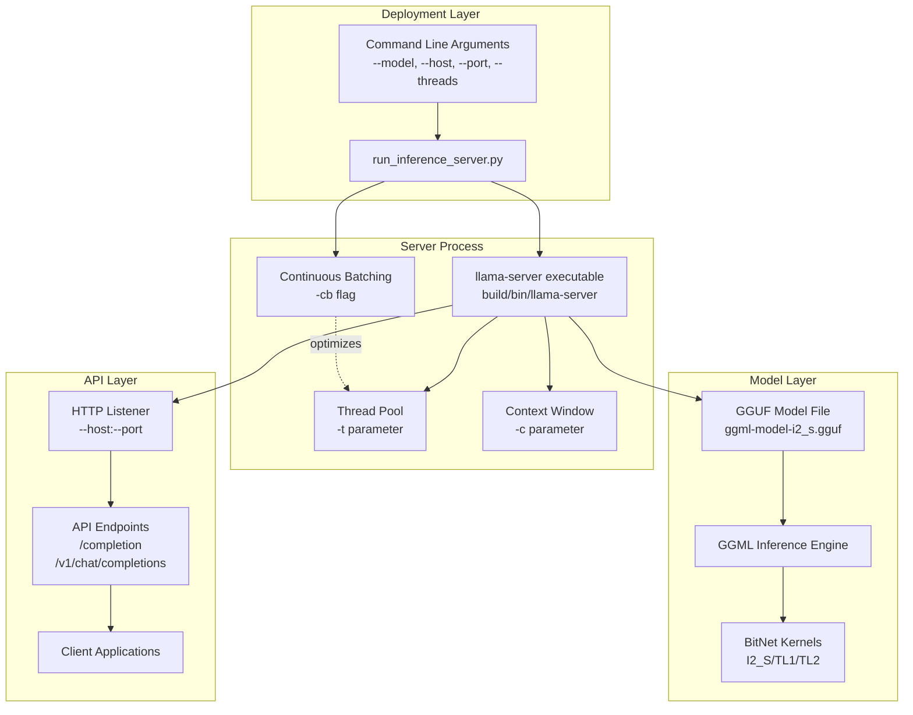
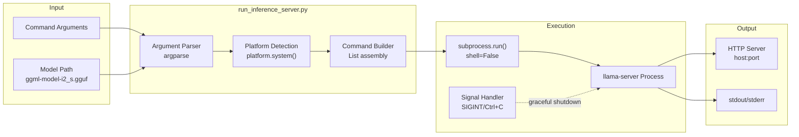
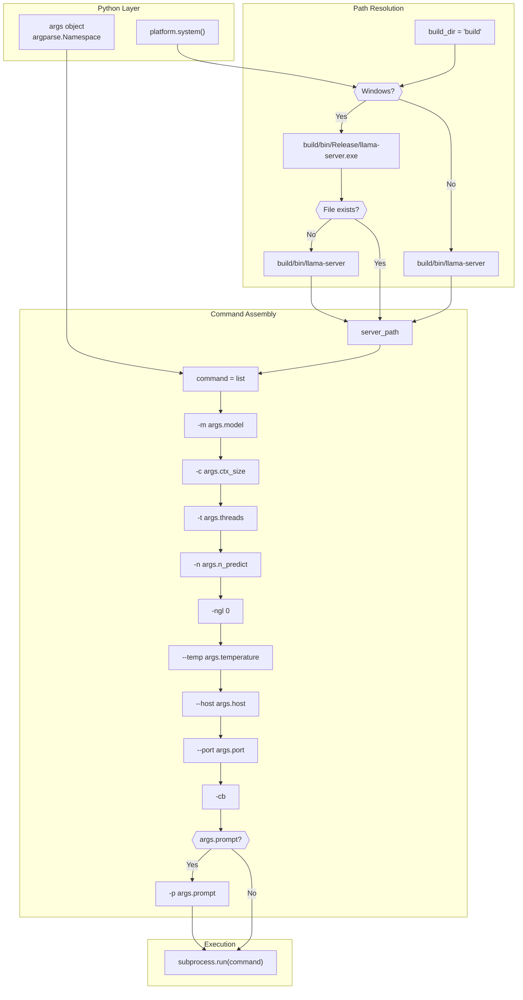

<!-- source: DeepWiki mcp.deepwiki.com · repo microsoft/BitNet · page 3.2 Server Deployment · fetched 2026-10-26 -->

# Server Deployment

<details>
<summary>Relevant source files</summary>

The following files were used as context for generating this wiki page:

- [CMakeLists.txt](CMakeLists.txt)
- [README.md](README.md)
- [run_inference_server.py](run_inference_server.py)

</details>


This page documents how to deploy BitNet.cpp as an HTTP server for production inference workloads. The server mode enables API-based access to BitNet models, supporting multiple concurrent clients through continuous batching.

For interactive command-line inference, see [Interactive CLI Inference](#3.1). For performance measurement, see [Benchmarking Performance](#3.3).

## Overview

The server deployment uses `llama-server`, a component from the llama.cpp submodule that provides an HTTP API for model inference. The `run_inference_server.py` script wraps the server executable with BitNet-specific configurations and provides a simplified interface for deployment.

**Key Capabilities:**
- HTTP REST API for inference requests
- Continuous batching (`-cb` flag) for efficient multi-client handling
- Configurable host, port, and resource limits
- Compatible with all quantized GGUF models (I2_S, TL1, TL2)

Sources: [run_inference_server.py:1-65](), [CMakeLists.txt:42]()

## Server Architecture



**Server Architecture Diagram**: Shows how `run_inference_server.py` orchestrates the `llama-server` executable with continuous batching enabled, threading configuration, and HTTP API exposure.

Sources: [run_inference_server.py:16-44]()

## Prerequisites

Before deploying the server, ensure the following steps are completed:

1. **Build System**: The project must be compiled with server support enabled (enabled by default)
2. **Model Preparation**: At least one quantized GGUF model must be available (see [Model Preparation](#2.2))
3. **Network Configuration**: Firewall rules must allow incoming connections on the chosen port

The server executable is automatically built when running `setup_env.py` and is located at:
- Linux/macOS: `build/bin/llama-server`
- Windows: `build/bin/Release/llama-server.exe` or `build/bin/llama-server`

Sources: [run_inference_server.py:17-23](), [CMakeLists.txt:42]()

## Starting the Server

### Basic Server Launch



**Server Launch Flow Diagram**: Traces the execution path from command-line arguments through `run_inference_server.py` to the running `llama-server` process.

The simplest way to start the server:

```bash
python run_inference_server.py -m models/BitNet-b1.58-2B-4T/ggml-model-i2_s.gguf
```

This starts the server with default configuration:
- Host: `127.0.0.1` (localhost only)
- Port: `8080`
- Context size: `2048` tokens
- Threads: `2`
- Max tokens: `4096`

Sources: [run_inference_server.py:50-64]()

### Configuration Options

The server supports the following command-line arguments:

| Argument | Short | Type | Default | Description |
|----------|-------|------|---------|-------------|
| `--model` | `-m` | str | `models/bitnet_b1_58-3B/ggml-model-i2_s.gguf` | Path to quantized GGUF model file |
| `--prompt` | `-p` | str | None | System prompt (prepended to all requests) |
| `--n-predict` | `-n` | int | `4096` | Maximum tokens to generate per request |
| `--threads` | `-t` | int | `2` | Number of CPU threads for inference |
| `--ctx-size` | `-c` | int | `2048` | Context window size (prompt + generation) |
| `--temperature` | | float | `0.8` | Sampling temperature for generation |
| `--host` | | str | `127.0.0.1` | IP address to bind the server to |
| `--port` | | int | `8080` | TCP port for HTTP listener |

**Additional Server Flags** (passed internally by `run_inference_server.py`):
- `-ngl 0`: Disables GPU layer offloading (CPU-only inference)
- `-cb`: Enables continuous batching for concurrent request handling

Sources: [run_inference_server.py:53-62](), [run_inference_server.py:25-36]()

### Production Configuration Example

For production deployment with higher capacity:

```bash
python run_inference_server.py \
  -m models/BitNet-b1.58-2B-4T/ggml-model-i2_s.gguf \
  -t 8 \
  -c 4096 \
  -n 8192 \
  --host 0.0.0.0 \
  --port 8080 \
  --temperature 0.7
```

**Configuration Notes:**
- `--host 0.0.0.0`: Accepts connections from any network interface (required for remote access)
- `-t 8`: Uses 8 threads (adjust based on available CPU cores)
- `-c 4096`: Larger context window for longer conversations
- `-n 8192`: Higher generation limit for complex tasks

Sources: [run_inference_server.py:25-44]()

## Server Command Construction



**Command Construction Flow Diagram**: Details how `run_inference_server.py` builds the command list for `subprocess.run()`, including platform-specific path resolution and conditional argument inclusion.

The script performs the following operations:

1. **Platform Detection**: Determines OS to locate the correct executable path [run_inference_server.py:18-23]()
2. **Command List Assembly**: Builds argument list for `subprocess.run()` [run_inference_server.py:25-36]()
3. **Optional Arguments**: Conditionally adds `--prompt` if provided [run_inference_server.py:38-39]()
4. **Process Execution**: Launches server with `check=True` for error detection [run_inference_server.py:8-14]()

Sources: [run_inference_server.py:16-44]()

## HTTP API Endpoints

The `llama-server` executable provides a REST API compatible with OpenAI's completion format. While the complete API specification is maintained by llama.cpp, the primary endpoints are:

| Endpoint | Method | Description |
|----------|--------|-------------|
| `/completion` | POST | Raw completion requests (llama.cpp format) |
| `/v1/chat/completions` | POST | Chat completion requests (OpenAI-compatible) |
| `/health` | GET | Server health check |
| `/props` | GET | Model properties and configuration |
| `/tokenize` | POST | Tokenize input text |
| `/detokenize` | POST | Detokenize token IDs |

**Note**: The server runs in continuous batching mode (`-cb` flag enabled by default), which allows efficient handling of multiple concurrent requests by batching them during inference.

Sources: [run_inference_server.py:35]()

## Client Integration

### Python Client Example

```python
import requests
import json

# Server configuration
server_url = "http://127.0.0.1:8080"

# Basic completion request
def generate_text(prompt, max_tokens=100):
    response = requests.post(
        f"{server_url}/completion",
        json={
            "prompt": prompt,
            "n_predict": max_tokens,
            "temperature": 0.8,
            "stop": ["\n"]
        }
    )
    return response.json()

# Chat completion request (OpenAI-compatible)
def chat_completion(messages, max_tokens=100):
    response = requests.post(
        f"{server_url}/v1/chat/completions",
        json={
            "messages": messages,
            "max_tokens": max_tokens,
            "temperature": 0.8
        }
    )
    return response.json()

# Example usage
result = generate_text("The capital of France is", max_tokens=50)
print(result["content"])
```

### cURL Example

```bash
# Basic completion
curl http://127.0.0.1:8080/completion \
  -H "Content-Type: application/json" \
  -d '{
    "prompt": "The capital of France is",
    "n_predict": 50,
    "temperature": 0.8
  }'

# Health check
curl http://127.0.0.1:8080/health
```

Sources: [run_inference_server.py:25-44]()

## Process Management

### Signal Handling

The server script includes a signal handler for graceful shutdown:


**Signal Handler Flow Diagram**: Shows how `SIGINT` (Ctrl+C) is trapped and handled for clean server shutdown.

The signal handler is registered at script startup [run_inference_server.py:51]() and prints a shutdown message before exiting [run_inference_server.py:47]().

Sources: [run_inference_server.py:46-51]()

### Error Handling

The `run_command()` function uses `subprocess.run()` with `check=True`, which raises `CalledProcessError` if the server exits with a non-zero status. This ensures:

1. Early detection of configuration errors
2. Automatic error logging to stderr
3. Clean exit with appropriate error code

If the server fails to start, the script will print an error message and exit with status code 1.

Sources: [run_inference_server.py:8-14]()

## Production Deployment Considerations

### Security Configuration

**Default Configuration (Development Only):**
- Host: `127.0.0.1` - Only accepts local connections
- No authentication or rate limiting
- No TLS/SSL encryption

**Production Recommendations:**
1. **Reverse Proxy**: Deploy behind nginx/Apache with:
   - TLS termination
   - Authentication (API keys, OAuth)
   - Rate limiting
   - Request logging

2. **Network Isolation**: Use `--host 127.0.0.1` and expose only through reverse proxy

3. **Resource Limits**: Set appropriate `-t`, `-c`, and `-n` values based on available hardware

### Resource Allocation

**Thread Count (`-t`):**
- Recommended: Number of physical CPU cores
- Too high: Context switching overhead
- Too low: Underutilized hardware

**Context Size (`-c`):**
- Memory usage: Approximately `ctx_size * model_size_per_token`
- Larger contexts support longer conversations but consume more RAM
- Must be ≤ model's maximum context length

**Max Tokens (`-n`):**
- Controls maximum generation length per request
- Should be less than context size to leave room for prompt
- Higher values allow longer responses but increase latency

Sources: [run_inference_server.py:53-62]()

### Monitoring and Logging

The server outputs logs to stdout/stderr. For production:

1. **Redirect Output**: Capture logs for analysis
   ```bash
   python run_inference_server.py -m model.gguf 2>&1 | tee server.log
   ```

2. **Health Checks**: Poll `/health` endpoint regularly

3. **Performance Metrics**: Monitor through llama.cpp's built-in metrics (tokens/second, latency)

### Horizontal Scaling

The server is stateless and can be scaled horizontally:
- Deploy multiple instances on different ports
- Use load balancer (nginx, HAProxy) to distribute requests
- Each instance requires its own copy of the model in memory

Sources: [run_inference_server.py:1-65]()

## Troubleshooting

### Server Fails to Start

**Symptom**: Script exits with "Error occurred while running command"

**Possible Causes:**
1. **Missing executable**: Server binary not built
   - Solution: Run `setup_env.py` to trigger build
   - Verify: Check `build/bin/llama-server` exists

2. **Invalid model path**: Model file not found or corrupted
   - Solution: Verify `-m` path points to valid `.gguf` file
   - Check: Model was properly quantized (see [Model Preparation](#2.2))

3. **Port already in use**: Another process bound to the port
   - Solution: Use different `--port` or kill existing process
   - Check: `netstat -an | grep 8080` (Linux/macOS) or `netstat -an | findstr 8080` (Windows)

Sources: [run_inference_server.py:8-14](), [run_inference_server.py:17-23]()

### Performance Issues

**Symptom**: Slow response times or timeouts

**Diagnostics:**
1. **Insufficient threads**: Check CPU utilization
   - Solution: Increase `-t` parameter up to physical core count

2. **Context overflow**: Requests exceed context window
   - Solution: Increase `-c` or reduce prompt/generation length

3. **Memory pressure**: System swapping to disk
   - Solution: Reduce `-c`, use lighter quantization (TL1/TL2), or add RAM

**Optimization Path:**
- For detailed performance tuning, see [Performance Tuning Guide](#5.1)
- For embedding layer optimization, see [Embedding Quantization](#5.4)

Sources: [run_inference_server.py:25-36]()

### Connection Refused

**Symptom**: Client cannot connect to server

**Possible Causes:**
1. **Localhost-only binding**: Server using default `127.0.0.1`
   - Solution: Use `--host 0.0.0.0` for remote access
   - Security: Ensure firewall/network security is configured

2. **Firewall blocking**: Port not open
   - Solution: Add firewall rule for the port
   - Linux: `sudo ufw allow 8080`
   - Windows: Add inbound rule in Windows Firewall

Sources: [run_inference_server.py:60-61]()

## Related Documentation

- **[Interactive CLI Inference](#3.1)**: For command-line inference without server deployment
- **[Benchmarking Performance](#3.3)**: For measuring server throughput and latency
- **[Performance Tuning Guide](#5.1)**: For optimizing GEMM configurations
- **[llama.cpp Integration](#4.2)**: For understanding the underlying server architecture

---

