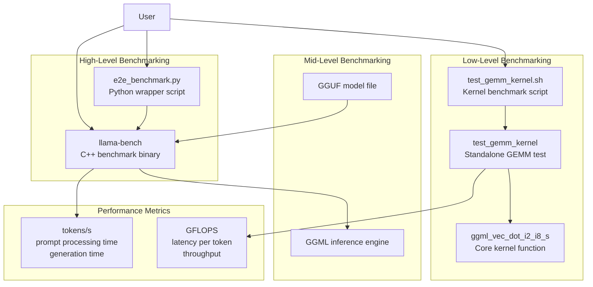
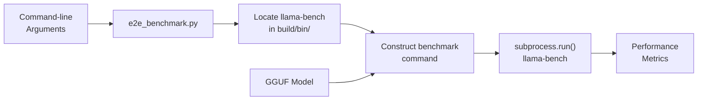
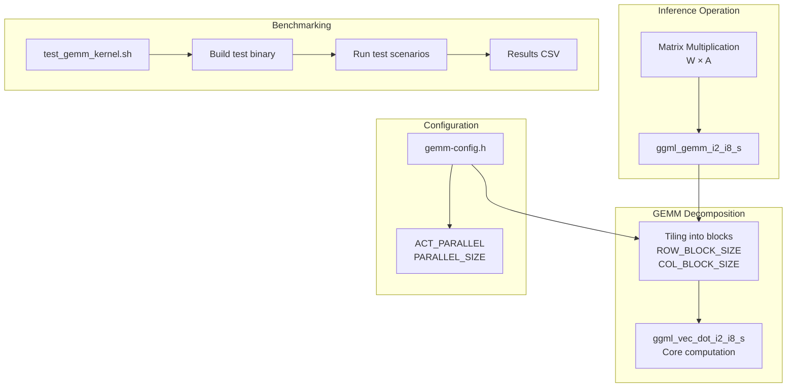
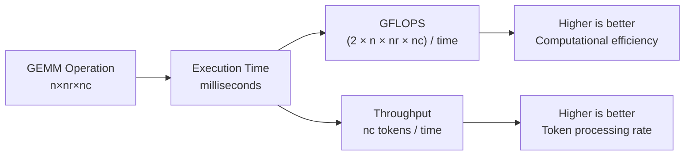

<!-- source: DeepWiki mcp.deepwiki.com · repo microsoft/BitNet · page 3.3 Benchmarking Performance · fetched 2026-10-26 -->

# Benchmarking Performance

<details>
<summary>Relevant source files</summary>

The following files were used as context for generating this wiki page:

- [README.md](README.md)
- [utils/e2e_benchmark.py](utils/e2e_benchmark.py)
- [utils/test_gemm_kernel.sh](utils/test_gemm_kernel.sh)

</details>


This page explains how to measure and analyze the performance of BitNet.cpp using the built-in benchmarking tools. These tools help evaluate inference speed, throughput, and computational efficiency across different hardware configurations and model sizes.

## Purpose and Scope

This document covers:
- End-to-end inference benchmarking with `e2e_benchmark.py`
- Direct benchmarking with `llama-bench`
- Low-level GEMM kernel benchmarking with `test_gemm_kernel.sh`
- Understanding performance metrics and interpreting results
- Generating dummy models for performance testing
</thinking>

For information about interactive inference, see [Interactive CLI Inference](#3.1). For server deployment and benchmarking production workloads, see [Server Deployment](#3.2).

## Benchmarking Architecture

BitNet.cpp provides three levels of benchmarking tools, each serving different purposes:



**Diagram: Benchmarking Tool Hierarchy**

The benchmarking system operates at three levels:
1. **High-level**: `e2e_benchmark.py` provides simplified end-to-end testing
2. **Mid-level**: `llama-bench` offers detailed inference metrics
3. **Low-level**: `test_gemm_kernel.sh` isolates GEMM kernel performance

Sources: [utils/e2e_benchmark.py:1-59](), [utils/test_gemm_kernel.sh:1-574](), [README.md:249-286]()

## End-to-End Benchmarking with e2e_benchmark.py

The `e2e_benchmark.py` script provides a convenient wrapper around `llama-bench` for measuring inference performance.

### Basic Usage

```bash
# Basic benchmark with default settings
python utils/e2e_benchmark.py -m models/BitNet-b1.58-2B-4T/ggml-model-i2_s.gguf

# Benchmark with specific parameters
python utils/e2e_benchmark.py -m models/BitNet-b1.58-2B-4T/ggml-model-i2_s.gguf -p 256 -n 200 -t 4
```

### Command-Line Arguments

| Argument | Short | Description | Default |
|----------|-------|-------------|---------|
| `--model` | `-m` | Path to the GGUF model file | **Required** |
| `--n-token` | `-n` | Number of tokens to generate | 128 |
| `--n-prompt` | `-p` | Number of prompt tokens to process | 512 |
| `--threads` | `-t` | Number of CPU threads to use | 2 |

The script internally invokes `llama-bench` with these parameters:
- `-ngl 0`: No GPU offloading (CPU-only benchmark)
- `-b 1`: Batch size of 1
- `-r 5`: Run 5 repetitions for statistical accuracy

Sources: [utils/e2e_benchmark.py:25-46](), [README.md:252-278]()

### Understanding the Workflow



**Diagram: e2e_benchmark.py Execution Flow**

The script performs these steps:
1. Parses command-line arguments via `argparse` [utils/e2e_benchmark.py:48-54]()
2. Locates the `llama-bench` binary in `build/bin/` [utils/e2e_benchmark.py:26-35]()
3. Constructs the benchmark command with specified parameters [utils/e2e_benchmark.py:36-45]()
4. Executes the command using `subprocess.run()` [utils/e2e_benchmark.py:8-23]()

Sources: [utils/e2e_benchmark.py:25-59]()

## Direct Benchmarking with llama-bench

For more control over benchmarking parameters, you can invoke `llama-bench` directly. This binary is built from the llama.cpp submodule and provides detailed performance metrics.

### Basic llama-bench Usage

```bash
# Navigate to build directory
cd build/bin

# Run benchmark with standard parameters
./llama-bench -m ../../models/BitNet-b1.58-2B-4T/ggml-model-i2_s.gguf \
              -n 128 \
              -p 512 \
              -t 4 \
              -r 5
```

### Key llama-bench Parameters

| Parameter | Description | Typical Values |
|-----------|-------------|----------------|
| `-m` | Model path | Path to `.gguf` file |
| `-n` | Number of tokens to generate | 128, 256, 512 |
| `-p` | Prompt size (tokens) | 128, 256, 512, 1024, 2048 |
| `-t` | Thread count | 1, 2, 4, 8, 16 |
| `-r` | Number of repetitions | 3, 5, 10 |
| `-ngl` | GPU layers to offload | 0 (CPU-only) |
| `-b` | Batch size | 1, 32, 512 |

### Benchmarking Different Workloads

```bash
# Benchmark prompt processing (prefill phase)
./llama-bench -m model.gguf -p 2048 -n 1 -r 5

# Benchmark token generation (decode phase)
./llama-bench -m model.gguf -p 128 -n 512 -r 5

# Benchmark with multiple threads
./llama-bench -m model.gguf -p 512 -n 128 -t 8 -r 5

# Benchmark with batch processing
./llama-bench -m model.gguf -p 512 -n 128 -b 32 -r 5
```

Sources: [utils/e2e_benchmark.py:36-45](), [README.md:249-286]()

## GEMM Kernel Benchmarking

The `test_gemm_kernel.sh` script provides low-level benchmarking of the core GEMM (General Matrix Multiply) kernels used in BitNet inference. This is useful for kernel tuning and architecture-specific optimization.

### Understanding GEMM in BitNet.cpp



**Diagram: GEMM Kernel Architecture and Benchmarking**

The GEMM kernel performs matrix multiplication between 2-bit weights (`i2`) and 8-bit activations (`i8`). It decomposes large matrices into tiles controlled by `ROW_BLOCK_SIZE` and `COL_BLOCK_SIZE`, then processes each tile using the optimized `ggml_vec_dot_i2_i8_s` kernel.

Sources: [utils/test_gemm_kernel.sh:107-173](), [README.md:13]()

### Basic GEMM Benchmarking

```bash
# Run with default settings
cd utils
./test_gemm_kernel.sh

# Specify output file
./test_gemm_kernel.sh -o ../stats/my_results.csv

# Quick test with fewer iterations
./test_gemm_kernel.sh -i 100

# Skip rebuild if binary exists
./test_gemm_kernel.sh -s -o results.csv
```

### GEMM Benchmark Script Options

| Option | Long Form | Description | Default |
|--------|-----------|-------------|---------|
| `-o` | `--output` | Output CSV file path | `../stats/gemm_kernel_test_noparal.csv` |
| `-i` | `--iterations` | Iterations per test | 1000 |
| `-s` | `--skip-build` | Skip building the binary | `false` |
| `-h` | `--help` | Show help message | - |

Sources: [utils/test_gemm_kernel.sh:15-38]()

### Test Scenarios

The script runs eight test scenarios representing typical BitNet-2B workloads:

| Test Name | Description | Matrix Shape (n × r × c) |
|-----------|-------------|--------------------------|
| `single_token_gen` | Single token generation | 2048 × 1 × 2048 |
| `small_batch_prompt` | 128-token prompt processing | 2048 × 128 × 2048 |
| `medium_batch_prompt` | 256-token prompt processing | 2048 × 256 × 2048 |
| `large_batch_prompt` | 512-token prompt processing | 2048 × 512 × 2048 |
| `ffn_up_projection` | Feed-forward expansion | 2048 × 128 × 8192 |
| `ffn_down_projection` | Feed-forward reduction | 8192 × 128 × 2048 |
| `long_context` | Long context processing | 2048 × 2048 × 2048 |
| `batched_token_gen` | Batched generation | 2048 × 32 × 2048 |

Sources: [utils/test_gemm_kernel.sh:496-563]()

### Understanding GEMM Benchmark Output

The benchmark generates CSV output with these metrics:

```csv
test_name,n,nr,nc,time_ms,gflops,throughput_tokens_per_sec
single_token_gen,2048,1,2048,0.234±0.012,35.2,8547.0
small_batch_prompt,2048,128,2048,12.45±0.34,42.1,10282.0
```

**Metrics Explanation:**
- **time_ms**: Average time ± standard deviation in milliseconds
- **gflops**: Billions of floating-point operations per second (2 × n × nr × nc / time)
- **throughput_tokens_per_sec**: Tokens processed per second (nc / time)

Sources: [utils/test_gemm_kernel.sh:458-493]()

### GEMM Benchmark Implementation Details

The `test_gemm_kernel.sh` script:
1. Generates an embedded C++ test program [utils/test_gemm_kernel.sh:107-389]()
2. Compiles it with optimizations (`-O3 -march=native`) [utils/test_gemm_kernel.sh:392-423]()
3. Links against `libggml.so` from the build directory [utils/test_gemm_kernel.sh:403-413]()
4. Runs multiple test scenarios with configurable iterations [utils/test_gemm_kernel.sh:495-563]()
5. Extracts metrics and saves to CSV [utils/test_gemm_kernel.sh:462-493]()

Sources: [utils/test_gemm_kernel.sh:1-574]()

## Performance Metrics Explained

Understanding the metrics reported by benchmarking tools is essential for performance analysis.

### End-to-End Metrics

When running `llama-bench`, you'll see output similar to:

```
model: models/BitNet-b1.58-2B-4T/ggml-model-i2_s.gguf
build: 1 (a1b2c3d)
system: Linux 5.15.0 x86_64

| model | size | params | backend | ngl | test | t/s |
|-------|------|--------|---------|-----|------|-----|
| bitnet | 2.37B | 2.40B | CPU | 0 | pp512 | 156.32 ± 3.21 |
| bitnet | 2.37B | 2.40B | CPU | 0 | tg128 | 42.18 ± 0.89 |
```

**Metric Definitions:**

| Metric | Full Name | Description |
|--------|-----------|-------------|
| `pp512` | Prompt Processing 512 | Tokens/second for processing 512-token prompt |
| `tg128` | Token Generation 128 | Tokens/second for generating 128 tokens |
| `t/s` | Tokens per second | Overall throughput |
| `±` | Standard deviation | Variability across repetitions |

### GEMM Kernel Metrics

GEMM benchmarks report three key metrics:



**Diagram: GEMM Performance Metrics Calculation**

- **GFLOPS**: Measures computational efficiency (billions of operations per second)
- **Throughput**: Measures practical token processing rate
- **Latency**: Average time per operation (inverse of throughput)

Sources: [utils/test_gemm_kernel.sh:301-322]()

## Benchmarking with Dummy Models

For performance testing without downloading large models, BitNet.cpp supports generating dummy models with realistic architectures.

### Generating Dummy Models

```bash
# Generate a 125M parameter model with TL1 format
python utils/generate-dummy-bitnet-model.py models/bitnet_b1_58-large \
    --outfile models/dummy-bitnet-125m.tl1.gguf \
    --outtype tl1 \
    --model-size 125M

# Generate larger models
python utils/generate-dummy-bitnet-model.py models/bitnet_b1_58-large \
    --outfile models/dummy-bitnet-1b.tl2.gguf \
    --outtype tl2 \
    --model-size 1B
```

### Benchmarking Dummy Models

```bash
# Benchmark the dummy model
python utils/e2e_benchmark.py -m models/dummy-bitnet-125m.tl1.gguf -p 512 -n 128

# Test different configurations
python utils/e2e_benchmark.py -m models/dummy-bitnet-125m.tl1.gguf -p 1024 -n 256 -t 8
```

This approach is useful for:
- Testing infrastructure without network downloads
- Evaluating performance scaling with model size
- Quick validation of build configurations
- Kernel tuning without real model weights

Sources: [README.md:288-295]()

## Kernel Type Examples

BitNet.cpp provides different optimized kernels based on your hardware platform:

| Kernel | Hardware | Description |
|--------|----------|-------------|
| i2_s | Both ARM64 and x86_64 | Default kernel type for all platforms |
| tl1 | ARM64 (e.g., Apple Silicon) | Optimized for ARM processors |
| tl2 | x86_64 (e.g., Intel, AMD) | Optimized for x86 processors |

To specify a kernel type during model preparation:

```bash
# For ARM64 with tl1 kernel
python setup_env.py -md models/BitNet-b1.58-2B-4T -q tl1

# For x86_64 with tl2 kernel
python setup_env.py -md models/BitNet-b1.58-2B-4T -q tl2
```

Then run inference with the prepared model:

```bash
# For ARM64 with tl1 kernel
python run_inference.py -m models/BitNet-b1.58-2B-4T/ggml-model-tl1.gguf -p "Your prompt here"

# For x86_64 with tl2 kernel
python run_inference.py -m models/BitNet-b1.58-2B-4T/ggml-model-tl2.gguf -p "Your prompt here"
```

Sources: [setup_env.py:49-52](), [README.md:178-186]()

## Examples with Supported Models

Here are examples using different models supported by BitNet.cpp:

### Official BitNet Model

```bash
# Download and set up the official BitNet model
huggingface-cli download microsoft/BitNet-b1.58-2B-4T --local-dir models/BitNet-b1.58-2B-4T
python setup_env.py -md models/BitNet-b1.58-2B-4T -q i2_s

# Run inference
python run_inference.py -m models/BitNet-b1.58-2B-4T/ggml-model-i2_s.gguf -p "Explain how ternary neural networks work:"
```

### Falcon3 Family Model Example

```bash
# Set up a Falcon3 model
python setup_env.py -hr tiiuae/Falcon3-3B-Instruct-1.58bit -q i2_s

# Run inference in conversation mode
python run_inference.py -m models/Falcon3-3B-Instruct-1.58bit/ggml-model-i2_s.gguf -p "You are a helpful assistant" -cnv
```

### Llama3 Model Example

```bash
# Set up Llama3 1-bit model
python setup_env.py -hr HF1BitLLM/Llama3-8B-1.58-100B-tokens -q tl2

# Run inference
python run_inference.py -m models/Llama3-8B-1.58-100B-tokens/ggml-model-tl2.gguf -p "The history of large language models began with"
```

Sources: [README.md:66-138](), [setup_env.py:13-47]()

---

