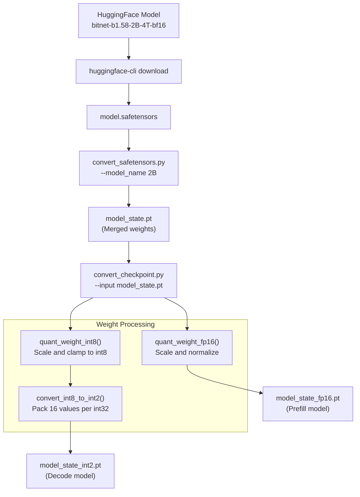
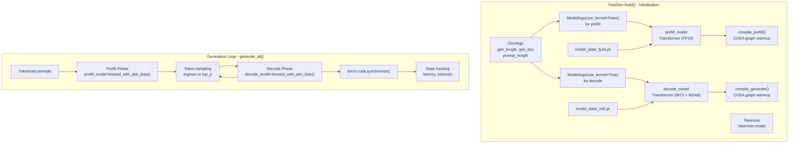

<!-- source: DeepWiki mcp.deepwiki.com · repo microsoft/BitNet · page 3.4 GPU Inference (Experimental) · fetched 2026-10-26 -->

# GPU Inference (Experimental)

<details>
<summary>Relevant source files</summary>

The following files were used as context for generating this wiki page:

- [gpu/README.md](gpu/README.md)
- [gpu/convert_checkpoint.py](gpu/convert_checkpoint.py)
- [gpu/generate.py](gpu/generate.py)

</details>


This document describes the experimental GPU inference system for BitNet models using CUDA-accelerated kernels. This is a separate inference path from the main CPU-based system and uses PyTorch with custom CUDA kernels optimized for W2A8 (2-bit weight × 8-bit activation) computation.

For CPU-based inference using I2_S, TL1, or TL2 quantization, see [Interactive CLI Inference](#3.1) and [Server Deployment](#3.2). For information about CPU kernel architecture, see [Kernel Architecture and Code Generation](#4.4).

## System Architecture

The GPU inference system operates independently from the main llama.cpp-based CPU inference path. While the CPU system uses GGML kernels compiled into C++ binaries, the GPU system uses PyTorch models with custom CUDA kernels.

### GPU vs CPU Architecture Comparison

```mermaid
graph TB
    subgraph "CPU Inference Path"
        CPU_CONVERT["convert-hf-to-gguf-bitnet.py"]
        CPU_QUANT["llama-quantize<br/>I2_S/TL1/TL2"]
        CPU_GGUF["GGUF Models<br/>*.gguf"]
        CPU_BINARIES["llama-cli / llama-server<br/>C++ Executables"]
        CPU_GGML["GGML Library<br/>ggml-bitnet-mad.cpp"]
        CPU_KERNELS["CPU Kernels<br/>AVX2/NEON"]
        
        CPU_CONVERT --> CPU_QUANT
        CPU_QUANT --> CPU_GGUF
        CPU_GGUF --> CPU_BINARIES
        CPU_BINARIES --> CPU_GGML
        CPU_GGML --> CPU_KERNELS
    end
    
    subgraph "GPU Inference Path (Experimental)"
        GPU_SAFETENSORS["HuggingFace safetensors<br/>model.safetensors"]
        GPU_CONVERT_SF["convert_safetensors.py"]
        GPU_CONVERT_CK["convert_checkpoint.py"]
        GPU_CHECKPOINTS["PyTorch Checkpoints<br/>model_state_int2.pt<br/>model_state_fp16.pt"]
        GPU_GENERATE["generate.py"]
        GPU_FASTGEN["FastGen class"]
        GPU_MODELS["Transformer Models<br/>prefill_model (FP16)<br/>decode_model (INT2)"]
        GPU_CUDA["CUDA Kernels<br/>bitnet_kernels/<br/>W2A8 GEMV"]
        
        GPU_SAFETENSORS --> GPU_CONVERT_SF
        GPU_CONVERT_SF --> GPU_CONVERT_CK
        GPU_CONVERT_CK --> GPU_CHECKPOINTS
        GPU_CHECKPOINTS --> GPU_GENERATE
        GPU_GENERATE --> GPU_FASTGEN
        GPU_FASTGEN --> GPU_MODELS
        GPU_MODELS --> GPU_CUDA
    end
    
    style CPU_GGML fill:#f9f9f9
    style GPU_FASTGEN fill:#f9f9f9
```



**Key Architectural Differences:**

| Aspect | CPU Inference | GPU Inference |
|--------|--------------|---------------|
| **Format** | GGUF | PyTorch checkpoint (.pt) |
| **Framework** | llama.cpp + GGML | PyTorch + custom CUDA |
| **Quantization** | I2_S, TL1, TL2 | W2A8 (2-bit weight, 8-bit activation) |
| **Runtime** | C++ binaries | Python with torch.cuda |
| **Optimization** | Architecture-specific kernels | CUDA graphs + xformers |
| **Models** | Single quantized model | Dual models: FP16 (prefill) + INT2 (decode) |

Sources: [gpu/README.md:1-107](), [gpu/generate.py:1-359](), [gpu/convert_checkpoint.py:1-101]()

## Model Conversion Pipeline

The GPU inference system requires converting HuggingFace models into PyTorch checkpoint format with specialized weight quantization and packing.

### Conversion Workflow



Sources: [gpu/convert_checkpoint.py:1-101](), [gpu/README.md:34-44]()

### Weight Quantization Functions

The conversion process implements two quantization strategies:

**INT8 Quantization (for INT2 decode model):**
- Function: `quant_weight_int8()` [gpu/convert_checkpoint.py:23-27]()
- Computes scale factor: `s = 1.0 / weight.abs().mean().clamp_(min=1e-5)`
- Quantizes: `(weight * s).round().clamp(-1, 1).to(torch.int8)`
- Stores scale as `bfloat16` for dequantization

**FP16 Quantization (for FP16 prefill model):**
- Function: `quant_weight_fp16()` [gpu/convert_checkpoint.py:29-32]()
- Same scaling but keeps as float: `(weight * s).round().clamp(-1, 1) / s`
- Used for higher-accuracy prefill phase

### Weight Packing Strategy

INT8 weights are packed into INT2 format using specialized layout:

**Block-Based Permutation:**
- Weight matrix divided into 16×32 blocks
- Values stored contiguously within blocks
- Permuted for efficient CUDA memory access

**INT2 Packing:**
- 16 two-bit values packed into one 32-bit integer
- Interleaving pattern: `[0, 4, 8, 12, 1, 5, 9, 13, 2, 6, 10, 14, 3, 7, 11, 15]`
- Enables fast 4-value extraction to int8 in CUDA kernels
- Function: `convert_int8_to_int2()` [gpu/convert_checkpoint.py:34-35]()

**Weight-Specific Processing:**
[gpu/convert_checkpoint.py:41-83]()
- **wqkv weights**: Split into wq, wk, wv; quantize separately; concatenate with scale tensor
- **w13 weights**: Split into w1, w3; quantize separately; concatenate with scale tensor  
- **w2/wo weights**: Quantize as single tensor with padding in scale
- **Other weights**: Copied without quantization (embeddings, norms)

Sources: [gpu/convert_checkpoint.py:14-100](), [gpu/README.md:47-71]()

## Inference Execution

The GPU inference system uses a two-phase approach with separate models and CUDA graph optimization for low-latency generation.

### FastGen Architecture



Sources: [gpu/generate.py:42-101](), [gpu/generate.py:216-304]()

### Dual-Model Strategy

The system uses two separate `Transformer` models for different generation phases:

**Prefill Model (FP16):**
- Loaded from `model_state_fp16.pt` [gpu/generate.py:66-70]()
- Uses `ModelArgs(use_kernel=False)` [gpu/generate.py:56]()
- Processes full prompt sequence
- Higher precision for better context encoding
- Used once per generation request

**Decode Model (INT2 with W2A8):**
- Loaded from `model_state_int2.pt` [gpu/generate.py:68-71]()
- Uses `ModelArgs(use_kernel=True)` [gpu/generate.py:57]()
- Processes single token at a time
- Custom W2A8 CUDA kernels for GEMV
- Used iteratively for each generated token

### CUDA Graph Optimization

Both models are compiled into CUDA graphs to eliminate kernel launch overhead:

**Prefill Compilation:**
[gpu/generate.py:102-157]()

1. Creates KV cache: `fast.make_cache()`
2. Builds attention bias: `AttnBias.from_seqlens()` from xformers
3. Performs warmup forward pass in separate CUDA stream
4. Records graph: `torch.cuda.graph(self._prefill_cuda_graph)`
5. Returns `replay()` function for zero-overhead execution

**Decode Compilation:**
[gpu/generate.py:159-213]()

1. Reuses KV cache from prefill
2. Builds single-token attention bias
3. Performs warmup forward pass
4. Records graph with `capture_error_mode="thread_local"` for stability
5. Returns `replay()` function with dynamic sequence length updates

### Generation Loop Implementation

The `generate_all()` method [gpu/generate.py:216-304]() implements the complete generation workflow:

**Phase 1: Prefill**
```
1. Pad prompts to fixed length (gen_args.prompt_length)
2. Convert to token tensor
3. Execute: output = self._prefill_compile_model(tokens, None)
4. Extract logits at sequence end positions
5. Sample first output token
```

**Phase 2: Iterative Decode**
```
for niter in range(1, gen_length):
    1. Increment KV sequence lengths
    2. Execute: output = self._generate_compile_model(next_token, kv_seqlen)
    3. Sample next token (argmax or top_p)
    4. Check for EOS token
    5. Repeat until gen_length or EOS
```

**Sampling Methods:**
- Greedy: `torch.argmax(logits, dim=-1)` [gpu/generate.py:258]()
- Nucleus: `sample_utils.top_p(probs, top_p)` with temperature scaling [gpu/generate.py:252-256]()

Sources: [gpu/generate.py:102-213](), [gpu/generate.py:216-304]()

### Attention Mechanism

The system uses `xformers` library for efficient attention:

**AttnBias Configuration:**
```python
from xformers.ops.fmha.attn_bias import (
    BlockDiagonalCausalWithOffsetPaddedKeysMask as AttnBias,
)
```
[gpu/generate.py:21-23]()

This bias type enables:
- Causal masking (tokens can't attend to future positions)
- Variable sequence lengths in batch
- Padded KV cache with efficient memory layout
- Offset tracking for incremental decode

Sources: [gpu/generate.py:21-23](), [gpu/generate.py:112-118](), [gpu/generate.py:170-176]()

## W2A8 CUDA Kernel Optimizations

The GPU inference system achieves high performance through specialized CUDA kernel optimizations for 2-bit weight × 8-bit activation matrix-vector multiplication.

### Optimization Techniques

**Weight Permutation (16×32 Blocks):**
- Matrix divided into fixed-size blocks
- Values stored contiguously within blocks
- Memory access patterns optimized for coalescing
- Implemented in: [gpu/convert_checkpoint.py:34-35]()

**Fast Decoding with Interleaved Packing:**
- 16 two-bit values per 32-bit word
- Interleaving pattern enables 4-value extraction per operation
- Pattern: `[0, 4, 8, 12, 1, 5, 9, 13, 2, 6, 10, 14, 3, 7, 11, 15]`
- Reduces decoding overhead significantly

**dp4a Instruction Usage:**
- CUDA intrinsic for 4-element dot product
- Computes: `sum(a[i] * b[i] for i in range(4))` where a, b are int8 vectors
- Accumulates into int32 result
- Significantly accelerates GEMV throughput
- Native hardware support on modern NVIDIA GPUs

Sources: [gpu/README.md:47-72]()

## Performance Characteristics

### Kernel-Level Benchmarks

Performance measured on NVIDIA A100 40GB GPU for individual GEMV operations:

| Matrix Shape (N×K) | W2A8 Latency (μs) | BF16 Latency (μs) | Speedup |
|-------------------|-------------------|-------------------|---------|
| 2560 × 2560       | 13.32             | 18.32             | 1.38×   |
| 3840 × 2560       | 14.90             | 18.87             | 1.27×   |
| 13824 × 2560      | 18.75             | 59.51             | 3.17×   |
| 2560 × 6912       | 14.49             | 37.78             | 2.61×   |
| 3200 × 3200       | 14.61             | 19.08             | 1.31×   |
| 4800 × 3200       | 13.09             | 21.84             | 1.67×   |
| 3200 × 10240      | 19.64             | 60.79             | 3.10×   |
| 20480 × 3200      | 30.99             | 112.39            | 3.63×   |

**Performance Scaling:**
- Small matrices (2560×2560): 1.27-1.38× speedup
- Large matrices (>10K dimensions): 2.61-3.63× speedup
- Best performance on compute-bound operations (larger K dimension)

Sources: [gpu/README.md:74-90]()

### End-to-End Generation Latency

Comparison against Gemma-2-2B (BF16 with vLLM) on NVIDIA A100 40GB:

| Input Length | Output Length | BF16 Latency (ms) | W2A8 Latency (ms) | Speedup |
|--------------|---------------|-------------------|-------------------|---------|
| 64           | 16            | 187.64            | 57.40             | 3.27×   |
| 64           | 32            | 353.50            | 112.22            | 3.15×   |
| 64           | 64            | 683.23            | 221.08            | 3.09×   |
| 256          | 16            | 183.14            | 61.24             | 2.99×   |
| 256          | 32            | 353.14            | 115.47            | 3.06×   |
| 256          | 64            | 684.24            | 224.16            | 3.05×   |
| 512          | 16            | 208.99            | 68.06             | 3.07×   |
| 512          | 32            | 354.33            | 122.72            | 2.89×   |
| 512          | 64            | 709.65            | 231.82            | 3.06×   |

**Observations:**
- Consistent 2.89-3.27× speedup across workloads
- Performance relatively stable across different input lengths
- Slightly better speedup on shorter output sequences (prefill phase dominates)

Sources: [gpu/README.md:91-106]()

### Memory Usage

The dual-model architecture requires additional memory:
- FP16 prefill model parameters
- INT2 decode model parameters (1/8th size of FP16)
- KV cache allocated for max sequence length
- CUDA graph memory for recorded kernels

Memory tracking available via: `torch.cuda.max_memory_reserved()` [gpu/generate.py:355]()

Sources: [gpu/generate.py:355]()

## Setup and Usage

### Prerequisites

**Environment Setup:**
```bash
# Create conda environment (Python < 3.13 required)
conda create --name bitnet-gpu "python<3.13"
conda activate bitnet-gpu

# Install dependencies
cd gpu/
pip install -r requirements.txt
```

**CUDA Kernel Compilation:**
```bash
cd bitnet_kernels/
bash compile.sh
cd ..
```

Sources: [gpu/README.md:13-30]()

### Model Preparation

**Download and Convert Model:**
```bash
# Create checkpoint directory
mkdir checkpoints

# Download from HuggingFace
huggingface-cli download microsoft/bitnet-b1.58-2B-4T-bf16 \
    --local-dir ./checkpoints/bitnet-b1.58-2B-4T-bf16

# Convert safetensors to merged checkpoint
python ./convert_safetensors.py \
    --safetensors_file ./checkpoints/bitnet-b1.58-2B-4T-bf16/model.safetensors \
    --output checkpoints/model_state.pt \
    --model_name 2B

# Quantize to INT2 and FP16 formats
python ./convert_checkpoint.py \
    --input ./checkpoints/model_state.pt

# Cleanup intermediate file
rm ./checkpoints/model_state.pt
```

**Output Files:**
- `checkpoints/model_state_int2.pt` - Decode model with W2A8 quantization
- `checkpoints/model_state_fp16.pt` - Prefill model in FP16

Sources: [gpu/README.md:34-44]()

### Running Inference

**Interactive Mode:**
```bash
python3 ./generate.py ./checkpoints/ --interactive --chat_format
```

**Command-Line Arguments:**
- `ckpt_dir`: Path to directory containing `model_state_int2.pt` and `model_state_fp16.pt`
- `--interactive`: Enable interactive prompt input
- `--chat_format`: Apply chat formatting (system/user/assistant roles)
- `--sampling`: Enable nucleus sampling instead of greedy decoding

**Non-Interactive Mode:**
```bash
python3 ./generate.py ./checkpoints/
```
Uses default prompt: `"Hello, my name is"`

Sources: [gpu/generate.py:322-356](), [gpu/README.md:34-44]()

### Generation Parameters

Configuration via `GenArgs` dataclass [gpu/generate.py:26-35]():

| Parameter | Default | Description |
|-----------|---------|-------------|
| `gen_length` | 32 | Maximum tokens to generate |
| `gen_bsz` | 1 | Batch size (fixed at build time) |
| `prompt_length` | 64 | Fixed prompt length for CUDA graphs |
| `use_sampling` | False | Enable nucleus sampling vs greedy |
| `temperature` | 0.8 | Temperature for sampling |
| `top_p` | 0.9 | Nucleus sampling threshold |

**CUDA Graph Control:**
Set environment variable `NO_CUDA_GRAPHS` to disable graph optimization and use eager execution.

Sources: [gpu/generate.py:26-35](), [gpu/generate.py:343]()

## Limitations and Considerations

**Experimental Status:**
- Separate codebase from main CPU inference system
- Not integrated with llama.cpp infrastructure
- Requires different model format (PyTorch .pt vs GGUF)
- Limited to specific model architecture (BitNet-b1.58-2B-4T)

**Hardware Requirements:**
- NVIDIA GPU with CUDA support
- Sufficient VRAM for dual-model storage (~4-6GB for 2B model)
- Modern GPU architecture for dp4a instruction support

**Flexibility Constraints:**
- Fixed batch size at build time (CUDA graph requirement)
- Fixed prompt length padding (graph input shape)
- Cannot switch between greedy/sampling without rebuild
- Single-model support (no multi-model serving)

**Workflow Differences from CPU:**
- No GGUF format support
- No llama-server HTTP API
- Python-based execution only
- Requires PyTorch and xformers dependencies

Sources: [gpu/generate.py:1-359](), [gpu/README.md:1-107]()

---

