<!-- source: DeepWiki mcp.deepwiki.com · repo microsoft/BitNet · page 4 Technical Architecture · fetched 2026-10-26 -->

# Technical Architecture

<details>
<summary>Relevant source files</summary>

The following files were used as context for generating this wiki page:

- [README.md](README.md)
- [include/gemm-config.h](include/gemm-config.h)
- [src/README.md](src/README.md)
- [src/ggml-bitnet-mad.cpp](src/ggml-bitnet-mad.cpp)

</details>


This document provides a detailed overview of BitNet.cpp's internal architecture, explaining how the system is structured to enable efficient inference for 1-bit (ternary) Large Language Models. For information about getting started and running models, see [Getting Started](#2), and for specific details on kernel optimization techniques, see [Kernel Generation System](#4.1).

## System Overview

BitNet.cpp extends the llama.cpp framework to support efficient inference for 1-bit ternary LLMs (BitNet b1.58). The architecture consists of Python orchestration scripts, C++ inference binaries, and dynamically generated optimized kernels.

**High-Level Architecture**

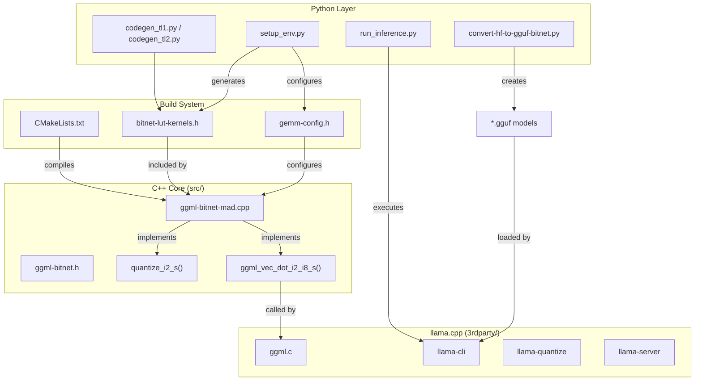

The system operates in three phases:

1. **Setup Phase**: `setup_env.py` detects CPU architecture, generates optimized kernels via `codegen_tl1.py` or `codegen_tl2.py`, and compiles the C++ codebase with the generated `bitnet-lut-kernels.h`.

2. **Model Preparation**: Conversion scripts transform HuggingFace models into GGUF format with I2_S, TL1, or TL2 quantization. `llama-quantize` can further apply embedding quantization.

3. **Inference Phase**: Python scripts invoke `llama-cli` or `llama-server`, which load GGUF models and execute inference using custom kernels from `ggml-bitnet-mad.cpp`.

Sources: [README.md:176-219](), [setup_env.py:1-300](), [src/ggml-bitnet-mad.cpp:1-15](), [include/gemm-config.h:1-36]()

## Core Components

**Component Mapping to Code Entities**

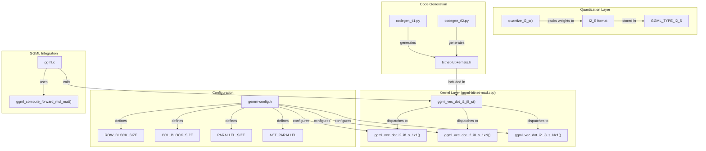

### Key Files and Functions

| Component | File/Function | Purpose |
|-----------|---------------|---------|
| I2_S Quantization | `quantize_i2_s()` in [src/ggml-bitnet-mad.cpp:51-196]() | Packs ternary weights {-1,0,1} into 2-bit representation with scale factor |
| Parallel Kernel Dispatch | `ggml_vec_dot_i2_i8_s()` in [src/ggml-bitnet-mad.cpp:1043-1056]() | Selects optimal kernel based on workload size and parallelism |
| Weight Parallel | `ggml_vec_dot_i2_i8_s_1xN()` in [src/ggml-bitnet-mad.cpp:512-789]() | Processes multiple weight rows per call |
| Activation Parallel | `ggml_vec_dot_i2_i8_s_Nx1()` in [src/ggml-bitnet-mad.cpp:791-1040]() | Amortizes unpacking cost across activations |
| Configuration | `gemm-config.h` in [include/gemm-config.h:1-36]() | Defines block sizes and parallelism strategy |
| TL1 Generation | `codegen_tl1.py` | Generates ARM NEON lookup table kernels |
| TL2 Generation | `codegen_tl2.py` | Generates x86 AVX2 lookup table kernels |

### Quantization Formats

BitNet.cpp supports three quantization schemes:

1. **I2_S (2-bit signed)**: 
   - Representation: Values {-1, 0, 1} encoded as {0, 1, 2}
   - Storage: 4 values packed per byte (2 bits each)
   - Layout (x86): 32-byte groups with 4 sub-groups of 8 bytes
   - Layout (ARM): 16-byte groups with 4 sub-groups of 4 bytes
   - Scale: Single FP32 scale factor stored after packed data

2. **TL1 (Table Lookup for ARM)**:
   - Precomputed lookup tables for NEON instructions
   - Optimized for ARM processors with DOTPROD extension
   - Matrix partitioning: M/BM blocks → BM×BK blocks → bm×compute_num/bm compute blocks

3. **TL2 (Table Lookup for x86)**:
   - Precomputed lookup tables for AVX2 instructions
   - Split processing for BK%6==0: threeK + twoK methods
   - Optimized for x86 processors with AVX2 support

Sources: [src/ggml-bitnet-mad.cpp:51-196](), [src/ggml-bitnet-mad.cpp:1043-1056](), [include/gemm-config.h:1-36](), [src/README.md:1-206]()

## Hardware-Specific Optimization Strategy

BitNet.cpp implements three levels of optimization: platform-specific lookup tables (TL1/TL2), parallel kernel implementations, and configurable tiling.

### Optimization Performance Summary

| Optimization | Target Platform | Base Speedup | Additional Parallel Speedup |
|--------------|-----------------|--------------|----------------------------|
| TL1 | ARM CPUs | 1.37x - 5.07x | +1.15x - 2.1x |
| TL2 | x86 CPUs | 2.37x - 6.17x | +1.15x - 2.1x |
| I2_S + Parallel | ARM/x86 | Baseline | 1.5x - 2.0x |

### Parallel Kernel Implementation

BitNet.cpp implements two parallelization strategies controlled by the `ACT_PARALLEL` macro in [include/gemm-config.h:1]():

**Kernel Dispatch Logic**

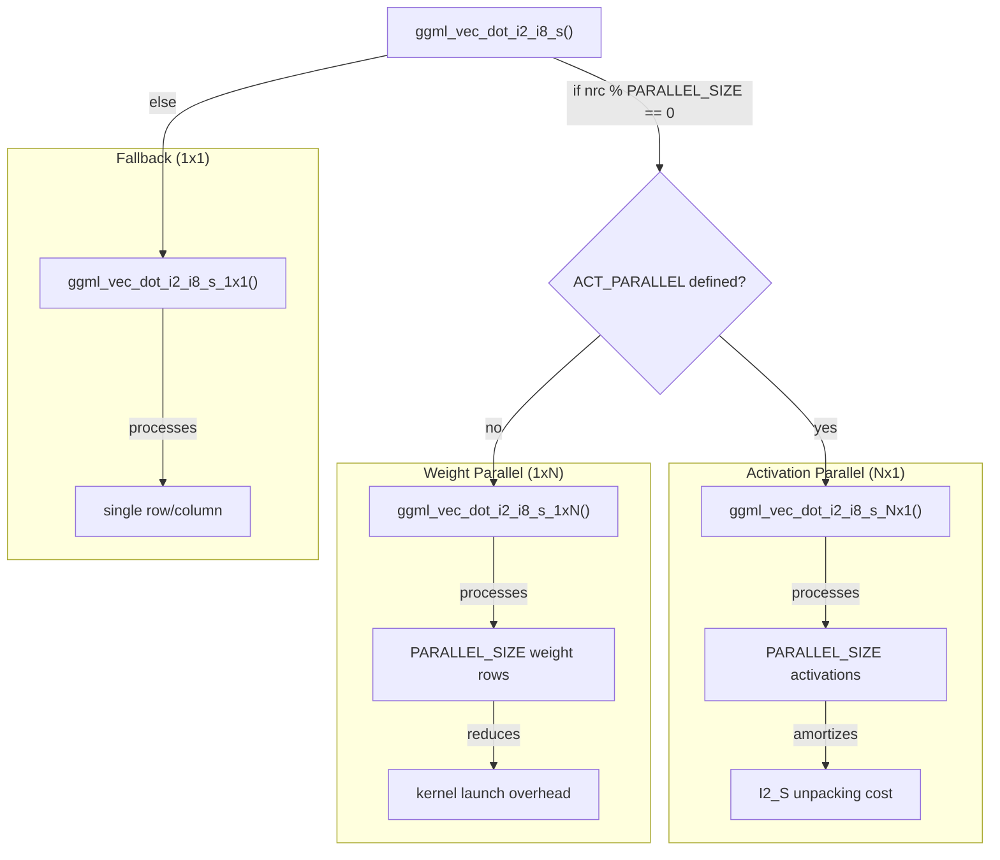

**Kernel Performance Comparison (AMD EPYC 7V13, 1 thread)**

| Matrix Size | No Parallel (ms) | Weight Parallel (ms) | Activation Parallel (ms) |
|-------------|------------------|----------------------|--------------------------|
| [1, 2048] × [2048, 2048] | 0.075±0.012 | **0.058±0.007** | 0.076±0.011 |
| [32, 2048] × [2048, 2048] | 2.400±0.041 | 1.599±0.020 | **1.202±0.018** |
| [128, 2048] × [2048, 2048] | 10.820±0.039 | 6.458±0.168 | **5.805±0.039** |
| [512, 2048] × [2048, 2048] | 43.257±0.083 | 25.680±0.335 | **23.342±0.082** |

### Configurable Block Sizes

The `gemm-config.h` file defines architecture-specific block sizes:

**x86 Configuration (ACT_PARALLEL enabled)**
```
ROW_BLOCK_SIZE = 4
COL_BLOCK_SIZE = 128
PARALLEL_SIZE = 4
```

**ARM with DOTPROD (ACT_PARALLEL enabled)**
```
ROW_BLOCK_SIZE = 8
COL_BLOCK_SIZE = 256
PARALLEL_SIZE = 8
```

**ARM without DOTPROD (ACT_PARALLEL enabled)**
```
ROW_BLOCK_SIZE = 8
COL_BLOCK_SIZE = 256
PARALLEL_SIZE = 4
```

### SIMD Instruction Mapping

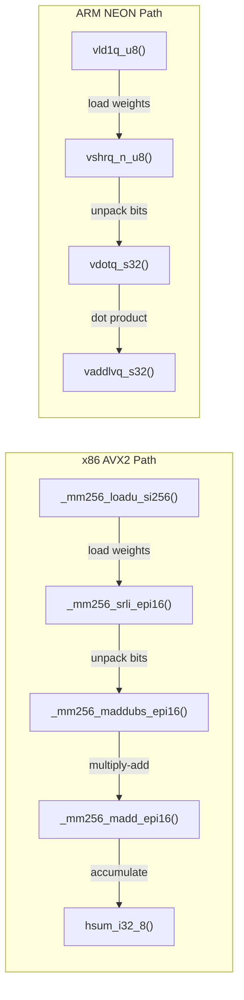

Sources: [src/ggml-bitnet-mad.cpp:1043-1056](), [include/gemm-config.h:1-36](), [src/README.md:50-112](), [src/ggml-bitnet-mad.cpp:198-412]()

## Integration with llama.cpp

BitNet.cpp integrates with llama.cpp through three primary mechanisms: compile-time definitions, GGML type extensions, and kernel function hooks.

### Integration Architecture

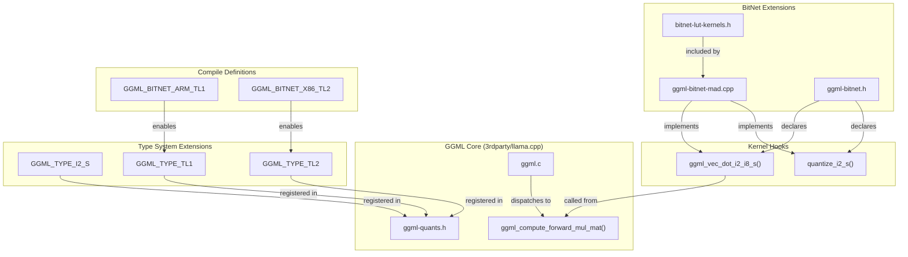

### Key Integration Points

| Integration Point | BitNet Component | llama.cpp Component | Mechanism |
|-------------------|------------------|---------------------|-----------|
| Type Registration | `GGML_TYPE_I2_S` | `ggml-quants.h` | Adds new quantization type to GGML |
| Kernel Hook | `ggml_vec_dot_i2_i8_s()` | `ggml_compute_forward_mul_mat()` | Function pointer dispatch in GGML compute graph |
| Compile Flag | `GGML_BITNET_ARM_TL1` | `ggml.c` | Conditional compilation of TL1 code paths |
| Compile Flag | `GGML_BITNET_X86_TL2` | `ggml.c` | Conditional compilation of TL2 code paths |
| Quantization | `quantize_i2_s()` | `llama-quantize` | Called during model quantization |

### Build System Integration

The [CMakeLists.txt:14-77]() configures the integration:

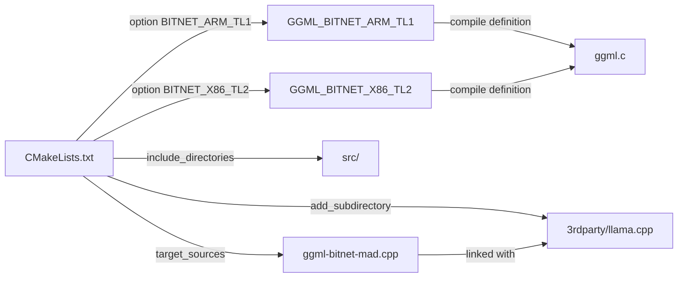

### GGML Compute Graph Integration

BitNet kernels are invoked through GGML's compute graph during matrix multiplication operations:

1. **Model Loading**: GGUF loader recognizes `GGML_TYPE_I2_S`, `GGML_TYPE_TL1`, or `GGML_TYPE_TL2` tensors
2. **Graph Construction**: `ggml_mul_mat()` creates computation nodes with I2_S weight tensors
3. **Kernel Dispatch**: `ggml_compute_forward_mul_mat()` detects I2_S type and calls `ggml_vec_dot_i2_i8_s()`
4. **Execution**: Custom kernel performs optimized W2A8 matrix multiplication
5. **Result**: Output tensor continues through standard GGML computation pipeline

Sources: [CMakeLists.txt:14-77](), [src/ggml-bitnet-mad.cpp:1-15](), [README.md:36-38]()

## Model Conversion Pipeline

To use models with BitNet.cpp, they must be converted from their original Hugging Face format to the GGUF format with appropriate quantization. This conversion process is handled by the model conversion pipeline.

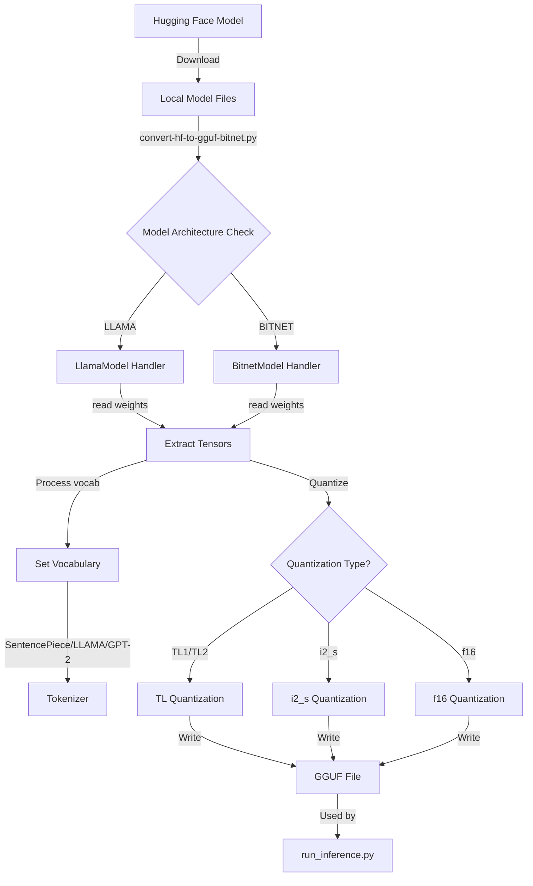

The conversion pipeline supports several model architectures and quantization types, providing flexibility to optimize for different hardware platforms.

Sources: [README.md:67-139]()

## Kernel Generation System

The kernel generation system produces architecture-specific C++ code for lookup table-based matrix multiplication. This system is invoked by `setup_env.py` during the build process.

### Code Generation Pipeline

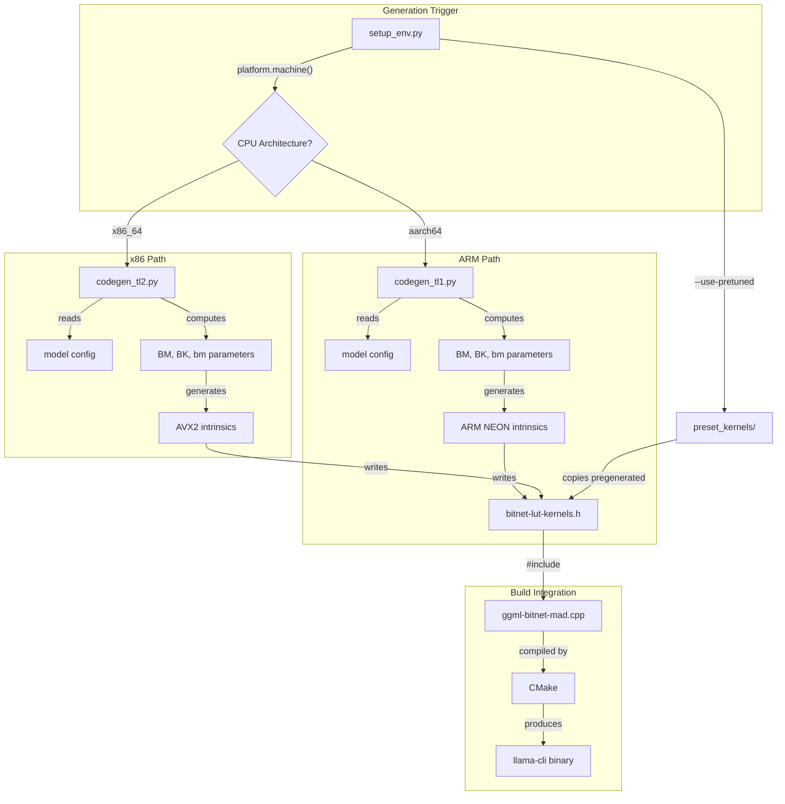

### TL1 Generation Strategy (ARM)

The `codegen_tl1.py` script generates lookup table kernels optimized for ARM NEON:

1. **Matrix Partitioning**:
   - Input matrix [M, K] divided into M/BM blocks of size [BM, K]
   - Each [BM, K] block divided into [BM, BK] sub-blocks
   - Final compute blocks: [bm, compute_num/bm]

2. **Lookup Table Construction**:
   - Precomputes all possible combinations of ternary weights
   - Stores results in compact lookup tables
   - Uses NEON `vld1q_s8()` and `vdotq_s32()` for efficient access

3. **Generated Code Structure**:
   - Header guards and includes
   - Lookup table arrays
   - Kernel function implementations with NEON intrinsics
   - Template specializations for different block sizes

### TL2 Generation Strategy (x86)

The `codegen_tl2.py` script generates lookup table kernels optimized for x86 AVX2:

1. **Split Processing**:
   - For BK % 6 == 0: Uses threeK + twoK method
   - threeK: Processes 3-element groups directly with AVX2
   - twoK: Fallback for remaining 2-element groups

2. **SIMD Optimization**:
   - Uses `_mm256_loadu_si256()` for 256-bit loads
   - `_mm256_maddubs_epi16()` for multiply-add operations
   - Horizontal sum with `hsum_i32_8()` for final reduction

3. **Generated Code Structure**:
   - AVX2 intrinsic definitions
   - Lookup table initialization
   - Optimized kernel implementations
   - Block-specific optimizations based on cache line size

### Preset Kernels

The `--use-pretuned` flag in `setup_env.py` enables use of pre-generated optimized kernels from `preset_kernels/` directory:

| Hardware | Optimal BM | Optimal BK | Optimal bm | Location |
|----------|------------|------------|------------|----------|
| ARM Cortex-A76 | 32 | 256 | 8 | `preset_kernels/arm_a76/` |
| ARM Cortex-A78 | 32 | 256 | 8 | `preset_kernels/arm_a78/` |
| Intel x86_64 | 64 | 512 | 16 | `preset_kernels/x86_intel/` |
| AMD x86_64 | 64 | 512 | 16 | `preset_kernels/x86_amd/` |

Sources: [README.md:196-219](), [CMakeLists.txt:14-77]()

## Inference Pipeline

The inference pipeline orchestrates model loading, prompt processing, and text generation through coordinated execution of Python scripts and C++ binaries.

### Pipeline Flow with Code Entities

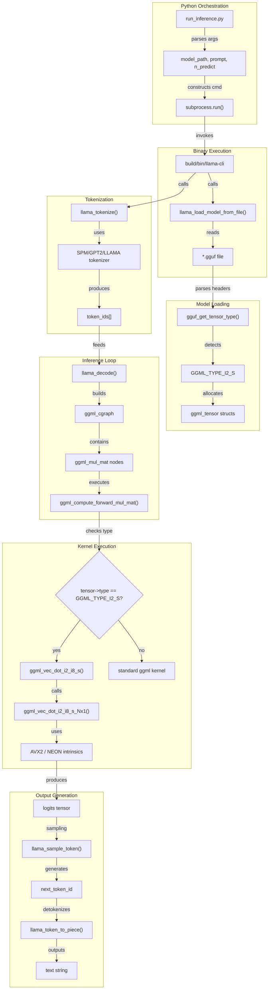

### Execution Sequence

**Phase 1: Model Preparation**
1. `run_inference.py` validates model path and parameters
2. Constructs command line: `build/bin/llama-cli -m model.gguf -p "prompt" -n 100`
3. Invokes binary via `subprocess.run()`

**Phase 2: Model Loading** 
1. `llama_load_model_from_file()` opens GGUF file
2. Reads metadata and tensor descriptors
3. Allocates memory for tensors based on `GGML_TYPE_I2_S` type
4. Loads quantized weights into memory

**Phase 3: Prompt Processing (Prefill)**
1. Tokenizes prompt with `llama_tokenize()`
2. Builds compute graph with `ggml_mul_mat()` nodes for attention and FFN layers
3. Executes graph with `ggml_graph_compute()`
4. Matrix multiplications invoke `ggml_vec_dot_i2_i8_s()` for I2_S tensors
5. Produces logits for all prompt tokens in parallel

**Phase 4: Token Generation (Decode)**
1. Samples next token from logits via `llama_sample_token()`
2. Appends token to context
3. Builds compute graph for single token
4. Executes graph (GEMV operations using `ggml_vec_dot_i2_i8_s_1x1()`)
5. Detokenizes and outputs text
6. Repeats until stopping condition

### Performance Characteristics

| Phase | Operation Type | Kernel Used | Typical Time (2B model) |
|-------|----------------|-------------|-------------------------|
| Model Load | File I/O | N/A | 100-500ms |
| Prefill (128 tokens) | GEMM | `ggml_vec_dot_i2_i8_s_Nx1()` | 50-150ms |
| Decode (per token) | GEMV | `ggml_vec_dot_i2_i8_s_1x1()` | 5-15ms |

### Multi-Threading

Thread count is controlled via `-t` flag to `llama-cli`. The GGML compute graph parallelizes matrix operations across threads:

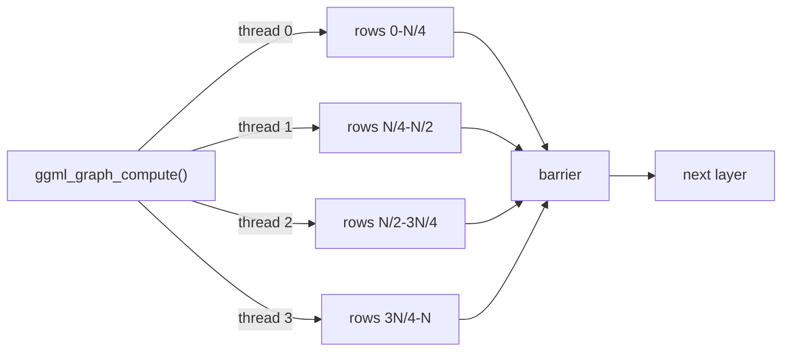

Sources: [README.md:221-247](), [src/ggml-bitnet-mad.cpp:1043-1056](), [src/README.md:79-86]()

## Supported Models and Hardware Platforms

BitNet.cpp is designed to efficiently run a variety of 1-bit LLMs on different hardware platforms. The following table summarizes the officially supported models and their compatibility with different kernel types:

| Model | Parameters | i2_s (ARM/x86) | TL1 (ARM) | TL2 (x86) |
|-------|------------|----------|-------|-------|
| BitNet-b1.58-2B-4T | 2.4B | ✅ | ✅ | ✅ |
| bitnet_b1_58-large | 0.7B | ✅ | ✅ | ✅ |
| bitnet_b1_58-3B | 3.3B | ❌ | ✅ | ✅ |
| Llama3-8B-1.58 | 8.0B | ✅ | ✅ | ✅ |
| Falcon3 Family | 1B-10B | ✅ | ✅ | ✅ |

The performance and efficiency gains vary by platform and model size:

1. **ARM CPUs (TL1)**:
   - Performance: 1.37x to 5.07x speedup
   - Energy efficiency: 55.4% to 70.0% reduction

2. **x86 CPUs (TL2)**:
   - Performance: 2.37x to 6.17x speedup
   - Energy efficiency: 71.9% to 82.2% reduction

Sources: [README.md:37-139]()

## Build System Configuration

The CMake build system in [CMakeLists.txt:1-77]() orchestrates compilation of BitNet extensions and llama.cpp integration.

### Build Configuration Flow

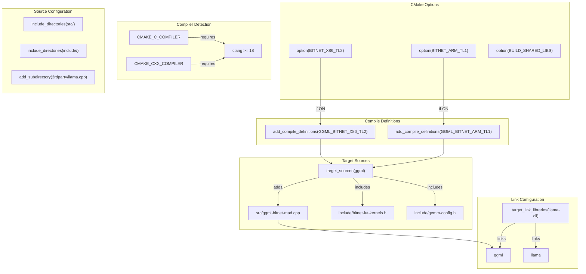

### Build Targets

| Target | Output | Purpose | Dependencies |
|--------|--------|---------|--------------|
| `ggml` | `libggml.a` | Core tensor operations with BitNet extensions | `ggml-bitnet-mad.cpp`, `bitnet-lut-kernels.h` |
| `llama` | `libllama.a` | LLM inference engine | `ggml` |
| `llama-cli` | `build/bin/llama-cli` | Interactive inference binary | `llama`, `ggml` |
| `llama-quantize` | `build/bin/llama-quantize` | Model quantization tool | `llama`, `ggml` |
| `llama-server` | `build/bin/llama-server` | HTTP API server | `llama`, `ggml` |
| `llama-bench` | `build/bin/llama-bench` | Performance benchmarking | `llama`, `ggml` |

### Compiler Requirements

The build system enforces specific compiler versions:

**Minimum Requirements**
- Clang >= 18 (for C++17 and SIMD intrinsics)
- CMake >= 3.22 (for target properties)
- Python >= 3.9 (for code generation scripts)

**Platform-Specific Flags**

x86_64:
```cmake
-mavx2 -mfma -mf16c
```

ARM64:
```cmake
-march=armv8.2-a+dotprod
```

### Build Process

1. **Pre-build**: `setup_env.py` generates `bitnet-lut-kernels.h` and `gemm-config.h`
2. **Configure**: `cmake -B build` detects platform and sets compile definitions
3. **Compile**: `cmake --build build` builds all targets
4. **Install**: Binaries placed in `build/bin/`

Sources: [CMakeLists.txt:1-77](), [README.md:159-219]()

## Summary

BitNet.cpp implements a specialized architecture for efficient inference of 1-bit (ternary) Large Language Models. By leveraging lookup table-based optimizations and hardware-specific kernels, it achieves significant performance and energy efficiency improvements over standard approaches. The system's modular design allows it to support a variety of models and hardware platforms, making it a versatile solution for running LLMs on consumer hardware.

---

