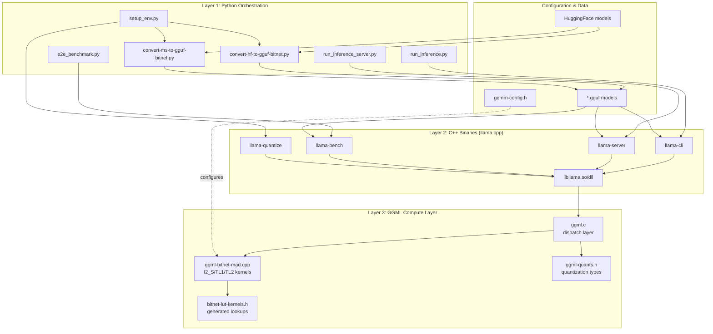
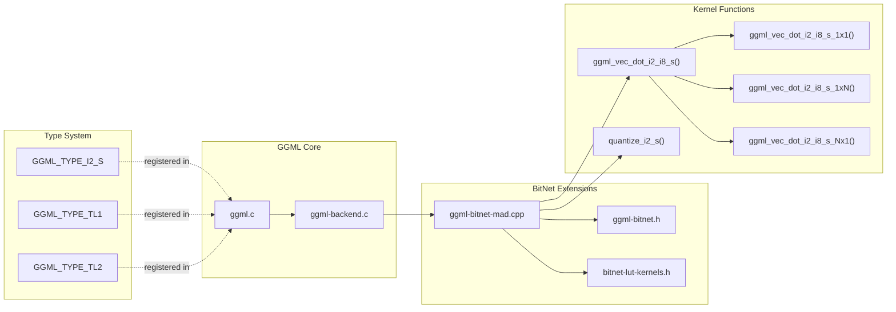
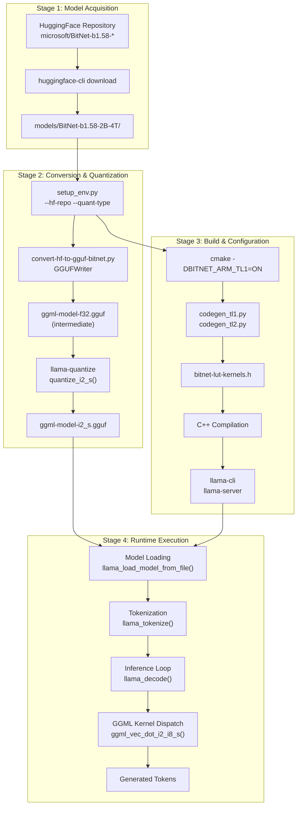
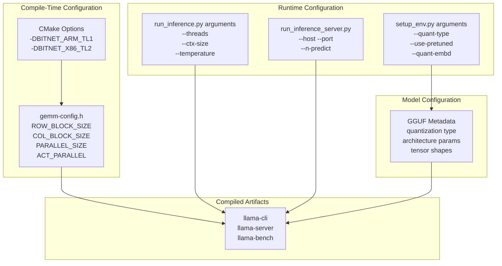

<!-- source: DeepWiki mcp.deepwiki.com · repo microsoft/BitNet · page 4.1 System Overview · fetched 2026-10-26 -->

# System Overview

<details>
<summary>Relevant source files</summary>

The following files were used as context for generating this wiki page:

- [CMakeLists.txt](CMakeLists.txt)
- [README.md](README.md)
- [include/gemm-config.h](include/gemm-config.h)
- [run_inference_server.py](run_inference_server.py)
- [src/ggml-bitnet-mad.cpp](src/ggml-bitnet-mad.cpp)

</details>


## Purpose and Scope

This document provides a technical overview of the BitNet.cpp system architecture, explaining how the major components interact to deliver fast inference for 1-bit quantized large language models. It covers the relationships between Python orchestration scripts, the C++ inference engine, and the llama.cpp integration layer, as well as the data flow from model acquisition to inference execution.

For detailed information about specific subsystems:
- For llama.cpp integration mechanics, see [llama.cpp Integration](#4.2)
- For quantization format details, see [Quantization Schemes](#4.3)
- For kernel implementation, see [Kernel Architecture and Code Generation](#4.4)
- For build system details, see [Build System Details](#6.1)

## Three-Layer Architecture

BitNet.cpp is organized into three distinct architectural layers that separate concerns between user interaction, model management, and computational execution.



**Sources:** [README.md:1-340](), [CMakeLists.txt:1-79]()

### Layer 1: Python Orchestration

Python scripts provide the user-facing interface and orchestrate lower-level operations without implementing inference logic themselves. These scripts are thin wrappers that:

| Script | Primary Function | Invoked Binary |
|--------|-----------------|----------------|
| `setup_env.py` | Model download, conversion, quantization, build | `llama-quantize`, `cmake`, `make` |
| `run_inference.py` | Interactive text generation | `llama-cli` |
| `run_inference_server.py` | HTTP API server deployment | `llama-server` |
| `e2e_benchmark.py` | Performance measurement | `llama-bench` |
| `convert-hf-to-gguf-bitnet.py` | HuggingFace → GGUF conversion | Direct Python execution |
| `convert-ms-to-gguf-bitnet.py` | Microsoft safetensors → GGUF | Direct Python execution |

The orchestration layer handles argument parsing, environment setup, and subprocess management but delegates all compute-intensive operations to compiled binaries.

**Sources:** [README.md:194-306](), [run_inference_server.py:1-65]()

### Layer 2: C++ Binaries (llama.cpp)

The binary layer consists of four main executables built from the llama.cpp submodule located at `3rdparty/llama.cpp`:

- **llama-cli**: Single-prompt inference with optional conversation mode
- **llama-server**: HTTP server with continuous batching for multi-client scenarios
- **llama-quantize**: Post-conversion quantization from F32 to I2_S format
- **llama-bench**: Systematic performance testing and profiling

All binaries link against `libllama`, which provides model loading, tokenization, and inference orchestration. The binaries themselves contain no BitNet-specific logic—all 1-bit quantization support is injected through the GGML layer.

**Sources:** [CMakeLists.txt:42-43](), [README.md:220-247]()

### Layer 3: GGML Compute Layer

The GGML layer is where BitNet.cpp's core innovations reside. This layer consists of:



**Key Integration Points:**

1. **Custom Type Registration**: Three new quantization types (`GGML_TYPE_I2_S`, `GGML_TYPE_TL1`, `GGML_TYPE_TL2`) are registered with GGML's type system
2. **Kernel Dispatch**: `ggml.c` dispatches operations on these types to functions in `ggml-bitnet-mad.cpp`
3. **Architecture-Specific Kernels**: Compile-time flags (`GGML_BITNET_ARM_TL1`, `GGML_BITNET_X86_TL2`) select between implementations

**Sources:** [src/ggml-bitnet-mad.cpp:1-1056](), [CMakeLists.txt:28-33]()

## Model-to-Inference Data Flow

This diagram traces the complete lifecycle of a model from acquisition through inference execution, mapping each stage to specific code entities:



**Sources:** [README.md:176-306](), [src/ggml-bitnet-mad.cpp:51-196]()

### Stage 1: Model Acquisition

Models originate from HuggingFace repositories and are downloaded using the `huggingface-cli` tool. The `setup_env.py` script orchestrates this process:

```
setup_env.py --hf-repo microsoft/BitNet-b1.58-2B-4T --model-dir models/BitNet-b1.58-2B-4T
```

This creates a local directory structure containing:
- `model.safetensors` or `pytorch_model.bin`: Raw model weights
- `tokenizer.model`: Tokenizer vocabulary
- `config.json`: Model architecture metadata

**Sources:** [README.md:197-199]()

### Stage 2: Conversion & Quantization

The conversion process has two paths depending on the quantization target:

**I2_S Path (Two-Step):**
1. `convert-hf-to-gguf-bitnet.py` converts HuggingFace format to F32 GGUF
2. `llama-quantize` applies I2_S quantization via `quantize_i2_s()` function

**TL1/TL2 Path (Direct):**
1. `convert-hf-to-gguf-bitnet.py` or `convert-ms-to-gguf-bitnet.py` generates TL1/TL2 GGUF directly
2. No additional quantization step required

The `quantize_i2_s()` function at [src/ggml-bitnet-mad.cpp:51-196]() implements the core quantization logic:
- Computes global scaling factor from maximum absolute value
- Maps float32 values to ternary representation {-1, 0, 1}
- Packs ternary values into 2-bit groups
- Stores packed weights with per-tensor scale

**Sources:** [src/ggml-bitnet-mad.cpp:51-196](), [README.md:297-305]()

### Stage 3: Build & Configuration

The build process generates architecture-specific kernels at compile time:

1. **Architecture Detection**: CMake detects CPU architecture (ARM/x86)
2. **Kernel Generation**: 
   - ARM: `codegen_tl1.py` generates `bitnet-lut-kernels.h` for TL1
   - x86: `codegen_tl2.py` generates `bitnet-lut-kernels.h` for TL2
3. **Compilation**: `ggml-bitnet-mad.cpp` includes generated kernels
4. **Linking**: Compiled kernels link into `libllama.so` → binaries

The `CMakeLists.txt` at [CMakeLists.txt:15-33]() defines compile-time options:
- `BITNET_ARM_TL1`: Enable TL1 kernels for ARM NEON
- `BITNET_X86_TL2`: Enable TL2 kernels for x86 AVX2

These propagate to GGML compile definitions:
- `GGML_BITNET_ARM_TL1`
- `GGML_BITNET_X86_TL2`

**Sources:** [CMakeLists.txt:15-43](), [include/gemm-config.h:1-36]()

### Stage 4: Runtime Execution

Runtime execution follows the standard llama.cpp inference pipeline, with BitNet-specific kernels automatically dispatched for I2_S/TL1/TL2 tensors:

1. **Model Loading**: `llama_load_model_from_file()` reads GGUF and detects quantization types
2. **Tokenization**: `llama_tokenize()` converts input text to token IDs
3. **Inference Loop**: `llama_decode()` processes tokens through transformer layers
4. **Kernel Dispatch**: GGML automatically routes operations on quantized tensors to:
   - `ggml_vec_dot_i2_i8_s_1x1()`: Single-row single-column operations
   - `ggml_vec_dot_i2_i8_s_1xN()`: Single-row multi-column (weight-parallel)
   - `ggml_vec_dot_i2_i8_s_Nx1()`: Multi-row single-column (activation-parallel)

The kernel selection at [src/ggml-bitnet-mad.cpp:1043-1056]() chooses between parallel implementations based on runtime configuration:

```cpp
void ggml_vec_dot_i2_i8_s(int n, float * s, size_t bs, const void * vx, 
                          size_t bx, const void * vy, size_t by, int nrc) {
    if (nrc % PARALLEL_SIZE == 0) {
#if defined(ACT_PARALLEL)
        ggml_vec_dot_i2_i8_s_Nx1(n, s, bs, vx, bx, vy, by, nrc);
#else
        ggml_vec_dot_i2_i8_s_1xN(n, s, bs, vx, bx, vy, by, nrc);
#endif
    } else {
        ggml_vec_dot_i2_i8_s_1x1(n, s, bs, vx, bx, vy, by, nrc);
    }
}
```

**Sources:** [src/ggml-bitnet-mad.cpp:198-1056]()

## Configuration and Parameterization

The system's behavior is controlled by three configuration sources:



### Compile-Time: gemm-config.h

The `gemm-config.h` file at [include/gemm-config.h:1-36]() defines critical performance parameters that are baked into the compiled binaries:

| Parameter | Purpose | ARM Default | x86 Default |
|-----------|---------|-------------|-------------|
| `ROW_BLOCK_SIZE` | Rows processed per kernel call | 8 | 4 |
| `COL_BLOCK_SIZE` | Columns processed per block | 256 | 128 |
| `PARALLEL_SIZE` | SIMD parallelism degree | 8 | 4 |
| `ACT_PARALLEL` | Activation vs weight parallelism | ON | ON |

These values are architecture-dependent and optimized for cache utilization and SIMD instruction efficiency.

**Sources:** [include/gemm-config.h:1-36]()

### Runtime: Python Script Arguments

Python scripts accept runtime arguments that control inference behavior without requiring recompilation:

- **setup_env.py**: Model selection, quantization type, preset kernel usage
- **run_inference.py**: Thread count, context size, temperature, prompt
- **run_inference_server.py**: Network binding, port, batch size

Example:
```bash
python run_inference_server.py \
    -m models/BitNet-b1.58-2B-4T/ggml-model-i2_s.gguf \
    -t 4 \
    -c 2048 \
    --host 0.0.0.0 \
    --port 8080
```

**Sources:** [run_inference_server.py:53-64](), [README.md:226-246]()

## Integration with llama.cpp Ecosystem

BitNet.cpp extends rather than forks llama.cpp, maintaining compatibility with the broader ecosystem while adding specialized capabilities. The integration is achieved through three mechanisms:

### 1. Git Submodule Integration

llama.cpp is included as a Git submodule at `3rdparty/llama.cpp`, built as part of the BitNet.cpp build process. CMake configuration at [CMakeLists.txt:42-43]() ensures:
- llama.cpp builds with BitNet-specific compile definitions
- BitNet kernels (`src/ggml-bitnet-mad.cpp`) compile into the llama.cpp library
- All llama.cpp binaries inherit BitNet functionality

### 2. Type System Extension

BitNet.cpp registers three new quantization types with GGML:
- `GGML_TYPE_I2_S`: General-purpose 2-bit ternary quantization
- `GGML_TYPE_TL1`: ARM-optimized lookup table format
- `GGML_TYPE_TL2`: x86-optimized lookup table format

These types integrate with GGML's dispatch mechanism, automatically routing operations to BitNet kernels when encountered.

### 3. Kernel Function Hooks

The primary integration point is the `ggml_vec_dot_i2_i8_s()` function family at [src/ggml-bitnet-mad.cpp:198-1056](), which implements dot product operations between 2-bit weights and 8-bit activations. GGML's computation graph automatically calls these functions when processing tensors with BitNet quantization types.

**Sources:** [CMakeLists.txt:24-43](), [src/ggml-bitnet-mad.cpp:1-1056]()

## Summary: Separation of Concerns

BitNet.cpp's architecture achieves clean separation between:

1. **User Interface** (Python): Argument parsing, subprocess orchestration, error handling
2. **Binary Execution** (llama.cpp): Model loading, tokenization, inference orchestration
3. **Computational Kernels** (GGML): Low-level SIMD operations, quantization logic

This separation enables:
- Independent optimization of Python vs C++ components
- Reuse of llama.cpp's mature inference infrastructure
- Clean extension points for new quantization schemes
- Build-time kernel specialization without Python overhead

The next sections in this Technical Architecture chapter dive deeper into each of these layers, explaining the llama.cpp integration details ([#4.2](#4.2)), quantization format specifications ([#4.3](#4.3)), and kernel implementation strategies ([#4.4](#4.4)).

**Sources:** [README.md:1-340](), [CMakeLists.txt:1-79](), [src/ggml-bitnet-mad.cpp:1-1056]()

---

