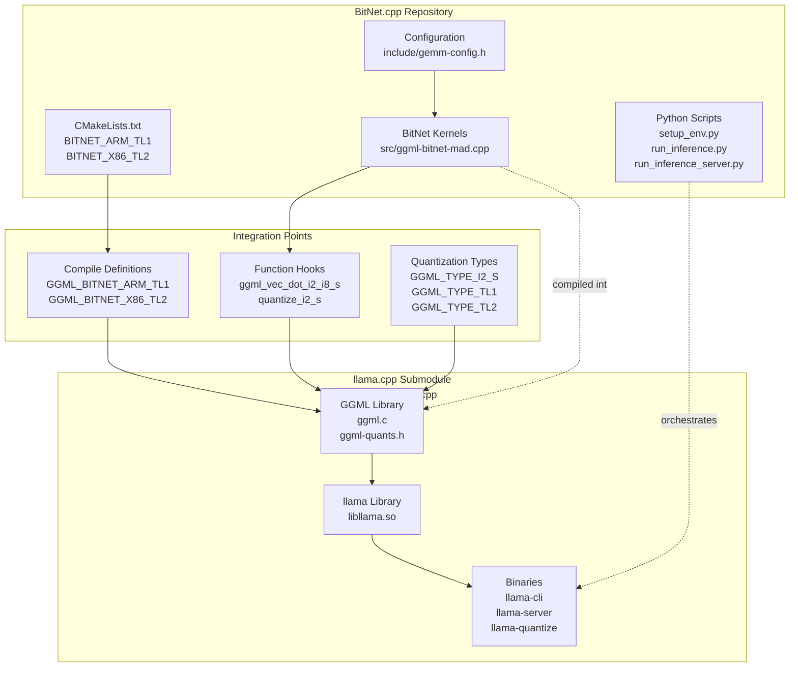
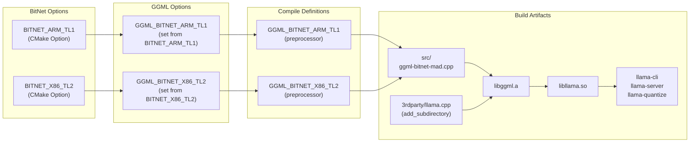
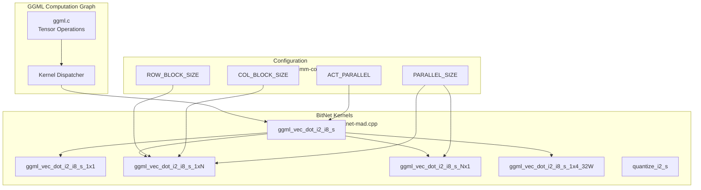
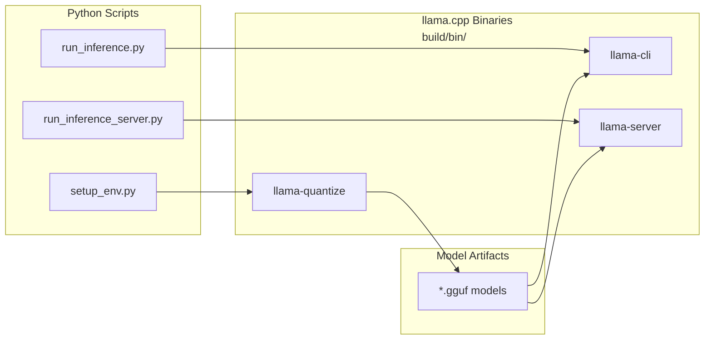

<!-- source: DeepWiki mcp.deepwiki.com · repo microsoft/BitNet · page 4.2 llama.cpp Integration · fetched 2026-10-26 -->

# llama.cpp Integration

<details>
<summary>Relevant source files</summary>

The following files were used as context for generating this wiki page:

- [.gitmodules](.gitmodules)
- [CMakeLists.txt](CMakeLists.txt)
- [include/gemm-config.h](include/gemm-config.h)
- [run_inference_server.py](run_inference_server.py)
- [src/ggml-bitnet-mad.cpp](src/ggml-bitnet-mad.cpp)

</details>


## Purpose and Scope

This document explains how BitNet.cpp integrates with the llama.cpp ecosystem to provide 1-bit LLM inference capabilities. BitNet.cpp extends llama.cpp through a carefully designed integration that adds custom quantization types and optimized kernels while preserving compatibility with llama.cpp's inference infrastructure.

For information about the specific quantization formats used (I2_S, TL1, TL2), see [Quantization Schemes](#4.3). For details on kernel code generation, see [Kernel Architecture and Code Generation](#4.4). For build configuration details, see [Build System Details](#6.1).

## Integration Architecture Overview

BitNet.cpp integrates with llama.cpp at multiple levels: build system, computation graph, and runtime orchestration. The integration is non-invasive, using compile-time definitions and function hooks rather than modifying llama.cpp's core code.

**Diagram: llama.cpp Integration Layers**



**Sources:** [.gitmodules:1-5](), [CMakeLists.txt:1-79](), [src/ggml-bitnet-mad.cpp:1-10]()

## Submodule Structure

llama.cpp is integrated as a Git submodule located at `3rdparty/llama.cpp`. The submodule points to a fork that includes BitNet-specific modifications.

| Property | Value |
|----------|-------|
| **Submodule Path** | `3rdparty/llama.cpp` |
| **Repository URL** | `https://github.com/Eddie-Wang1120/llama.cpp.git` |
| **Branch** | `merge-dev` |

The fork includes modifications to support BitNet's custom quantization types in GGML's type system and to enable BitNet kernel dispatch.

**Sources:** [.gitmodules:1-5]()

## Build System Integration

The CMake build system coordinates integration between BitNet.cpp and llama.cpp through compile-time options that propagate BitNet-specific features into the GGML library.

**Diagram: CMake Build Flow**



### CMake Configuration Options

The build system exposes two primary options:

- **`BITNET_ARM_TL1`**: Enables TL1 (Table Lookup 1) kernels for ARM platforms ([CMakeLists.txt:15]())
- **`BITNET_X86_TL2`**: Enables TL2 (Table Lookup 2) kernels for x86 platforms ([CMakeLists.txt:16]())

These options are propagated to GGML and exposed as preprocessor definitions:

```cmake
# override ggml options
set(GGML_BITNET_ARM_TL1    ${BITNET_ARM_TL1})
set(GGML_BITNET_X86_TL2    ${BITNET_X86_TL2})

if (GGML_BITNET_ARM_TL1)
    add_compile_definitions(GGML_BITNET_ARM_TL1)
endif()
if (GGML_BITNET_X86_TL2)
    add_compile_definitions(GGML_BITNET_X86_TL2)
endif()
```

**Sources:** [CMakeLists.txt:15-33]()

### Build Order

The build process follows this order:

1. BitNet kernel sources in `src/` are compiled into the GGML library ([CMakeLists.txt:41]())
2. llama.cpp submodule is built with `LLAMA_BUILD_SERVER` enabled ([CMakeLists.txt:42-43]())
3. GGML library is linked with BitNet kernels
4. llama.cpp binaries (`llama-cli`, `llama-server`, `llama-quantize`) are produced

**Sources:** [CMakeLists.txt:41-43]()

## GGML Kernel Hooks

BitNet.cpp extends GGML's computation graph through custom kernel functions that implement optimized operations for 1-bit quantized weights. The primary integration point is the `ggml_vec_dot_i2_i8_s` family of functions.

**Diagram: GGML Kernel Dispatch**



### Core Kernel Functions

The `ggml-bitnet-mad.cpp` file implements several specialized kernel variants:

| Function | Purpose | Parallelism Strategy |
|----------|---------|---------------------|
| `ggml_vec_dot_i2_i8_s` | Main dispatch function | Routes to specialized variants |
| `ggml_vec_dot_i2_i8_s_1x1` | Single row-column computation | Baseline implementation |
| `ggml_vec_dot_i2_i8_s_1xN` | Weight-parallel GEMV | Processes N rows in parallel |
| `ggml_vec_dot_i2_i8_s_Nx1` | Activation-parallel GEMV | Processes N columns in parallel |
| `ggml_vec_dot_i2_i8_s_1x4_32W` | Fixed 4-row batching | Optimized for specific workloads |

The dispatcher selects the appropriate variant based on configuration:

```cpp
void ggml_vec_dot_i2_i8_s(int n, float * s, size_t bs, const void * vx, 
                          size_t bx, const void * vy, size_t by, int nrc) {
    if (nrc % PARALLEL_SIZE == 0)
    {
#if defined(ACT_PARALLEL)
        ggml_vec_dot_i2_i8_s_Nx1(n, s, bs, vx, bx, vy, by, nrc);
#else
        ggml_vec_dot_i2_i8_s_1xN(n, s, bs, vx, bx, vy, by, nrc);
#endif
    }
    else
    {
        ggml_vec_dot_i2_i8_s_1x1(n, s, bs, vx, bx, vy, by, nrc);
    }
}
```

**Sources:** [src/ggml-bitnet-mad.cpp:1043-1056](), [src/ggml-bitnet-mad.cpp:198-412](), [src/ggml-bitnet-mad.cpp:512-789](), [src/ggml-bitnet-mad.cpp:791-1040]()

### Quantization Function

The `quantize_i2_s` function converts floating-point activations to I2_S format at runtime:

```cpp
size_t quantize_i2_s(const float * src, void * dst, int64_t nrow, 
                     int64_t n_per_row, const float * quant_weights)
```

This function implements platform-specific quantization logic for both x86 AVX2 and ARM NEON architectures, with support for both activation-parallel and weight-parallel modes ([src/ggml-bitnet-mad.cpp:51-196]()).

**Sources:** [src/ggml-bitnet-mad.cpp:51-196]()

## Configuration System

The `gemm-config.h` header defines architecture-specific parameters that control kernel behavior. These parameters are determined at build time based on CPU features and optimization strategy.

**Architecture-Specific Configuration Table**

| Platform | `ACT_PARALLEL` Mode | `ROW_BLOCK_SIZE` | `COL_BLOCK_SIZE` | `PARALLEL_SIZE` |
|----------|---------------------|------------------|------------------|-----------------|
| **x86 AVX2** (ACT_PARALLEL) | ON | 4 | 128 | 4 |
| **x86 AVX2** (Weight-parallel) | OFF | 128 | 32 | 8 |
| **ARM NEON + DOTPROD** (ACT_PARALLEL) | ON | 8 | 256 | 8 |
| **ARM NEON + DOTPROD** (Weight-parallel) | OFF | 64 | 16 | 2 |
| **ARM NEON** (ACT_PARALLEL) | ON | 8 | 256 | 4 |
| **ARM NEON** (Weight-parallel) | OFF | 128 | 32 | 4 |

The configuration uses preprocessor conditionals to select optimal parameters:

```cpp
#define ACT_PARALLEL
#if defined(__AVX__) || defined(__AVX2__) || defined(__AVX512F__) || defined(__SSSE3__)
#if defined(ACT_PARALLEL)
    #define ROW_BLOCK_SIZE 4
    #define COL_BLOCK_SIZE 128
    #define PARALLEL_SIZE 4
#else
    #define ROW_BLOCK_SIZE 128
    #define COL_BLOCK_SIZE 32
    #define PARALLEL_SIZE 8
#endif
```

**Sources:** [include/gemm-config.h:1-36]()

## Custom Quantization Types

BitNet.cpp extends GGML's type system with three new quantization formats. These types are registered in the llama.cpp fork and enable GGUF models to store BitNet weights in optimized formats.

| Type Name | Identifier | Description | Platform Availability |
|-----------|-----------|-------------|----------------------|
| `GGML_TYPE_I2_S` | `GGML_TYPE_I2_S` | I2_S format (2-bit packed) | All platforms |
| `GGML_TYPE_TL1` | `GGML_TYPE_TL1` | Table Lookup 1 | ARM with `GGML_BITNET_ARM_TL1` |
| `GGML_TYPE_TL2` | `GGML_TYPE_TL2` | Table Lookup 2 | x86 with `GGML_BITNET_X86_TL2` |

The quantization type determines:
- How weights are packed in memory
- Which unpacking kernel is used during inference
- Memory footprint and cache behavior

The I2_S format is available on all platforms and serves as the baseline, while TL1/TL2 formats provide additional optimizations through lookup table-based unpacking on specific architectures.

**Sources:** [CMakeLists.txt:28-33]()

## Runtime Orchestration

Python scripts in the BitNet.cpp repository orchestrate llama.cpp binaries rather than calling them as libraries. This design allows users to leverage llama.cpp's full feature set while BitNet provides simplified setup and model preparation.

**Diagram: Python Script to Binary Flow**



### Server Deployment Example

The `run_inference_server.py` script demonstrates the orchestration pattern:

```python
server_path = os.path.join(build_dir, "bin", "llama-server")

command = [
    f'{server_path}',
    '-m', args.model,
    '-c', str(args.ctx_size),
    '-t', str(args.threads),
    '-n', str(args.n_predict),
    '-ngl', '0',
    '--temp', str(args.temperature),
    '--host', args.host,
    '--port', str(args.port),
    '-cb'  # Enable continuous batching
]

run_command(command)
```

The script:
1. Locates the `llama-server` binary in the build directory ([run_inference_server.py:23]())
2. Constructs command-line arguments from user input ([run_inference_server.py:25-36]())
3. Executes the binary via `subprocess.run()` ([run_inference_server.py:44]())

This pattern is consistent across all Python wrapper scripts, allowing them to:
- Provide simplified interfaces with sensible defaults
- Handle platform differences (Windows vs. Linux paths)
- Pass through all llama.cpp command-line options
- Maintain compatibility with llama.cpp updates

**Sources:** [run_inference_server.py:16-44]()

## Integration Benefits

This integration architecture provides several advantages:

1. **Minimal Fork Maintenance**: By using compile definitions and function hooks rather than modifying llama.cpp core, BitNet.cpp can more easily track upstream llama.cpp updates.

2. **Binary Compatibility**: GGUF models created by BitNet.cpp can be used with standard llama.cpp tools (with appropriate quantization type support).

3. **Feature Reuse**: BitNet.cpp inherits llama.cpp's inference features (continuous batching, server mode, benchmarking tools) without reimplementation.

4. **Modular Optimization**: BitNet kernels can be developed and tuned independently of llama.cpp's codebase.

5. **Platform Flexibility**: The compile-time option system allows building optimized binaries for specific hardware without runtime overhead.

**Sources:** [CMakeLists.txt:1-79](), [.gitmodules:1-5](), [src/ggml-bitnet-mad.cpp:1-1056]()

---

