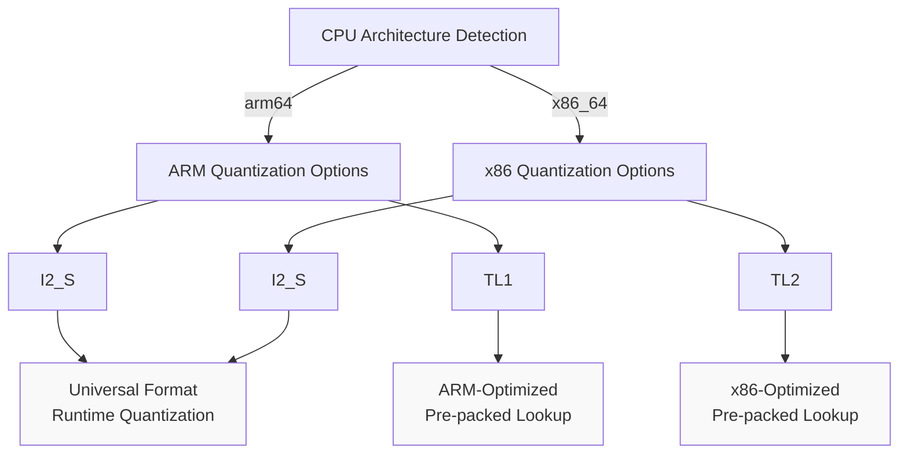
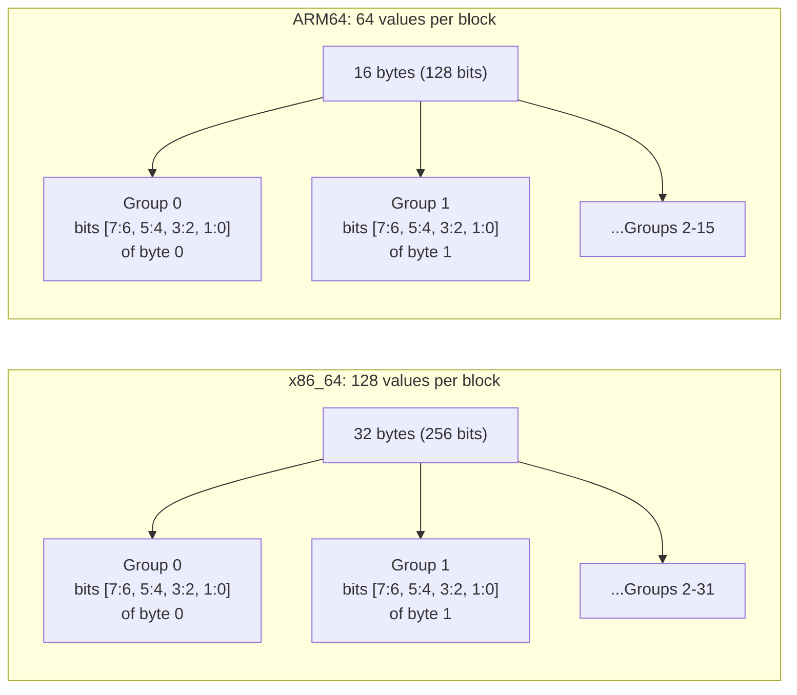
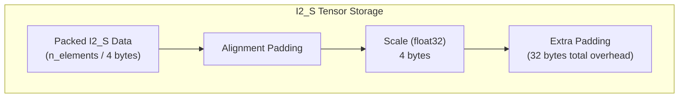
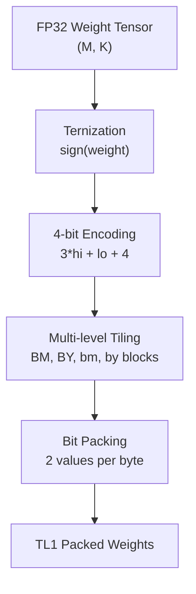
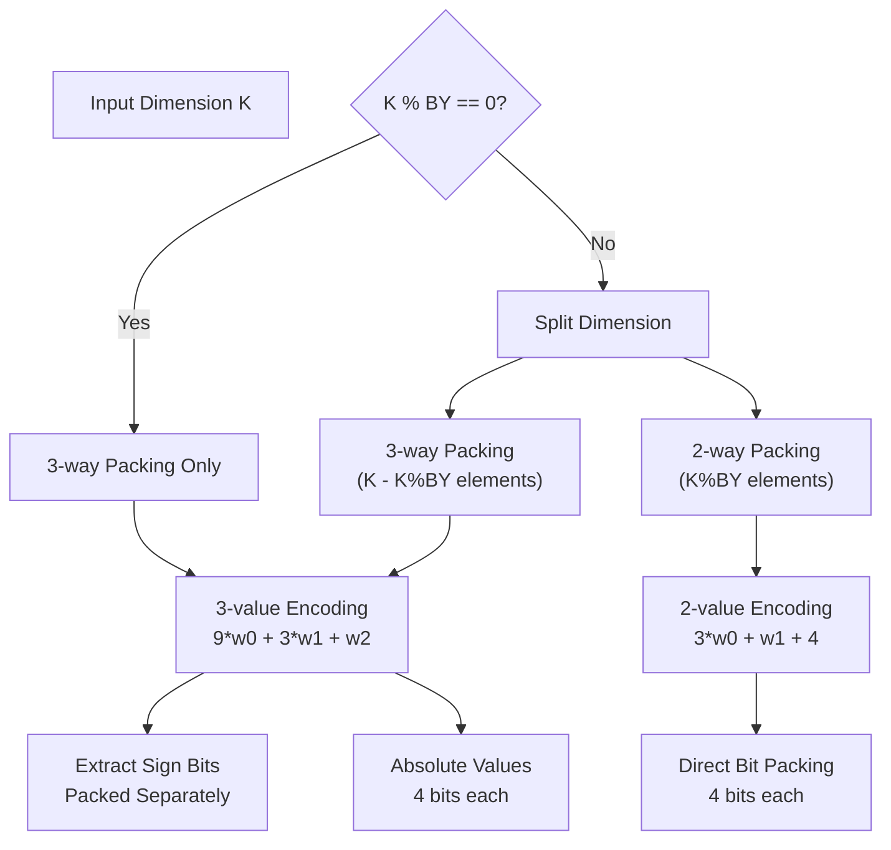
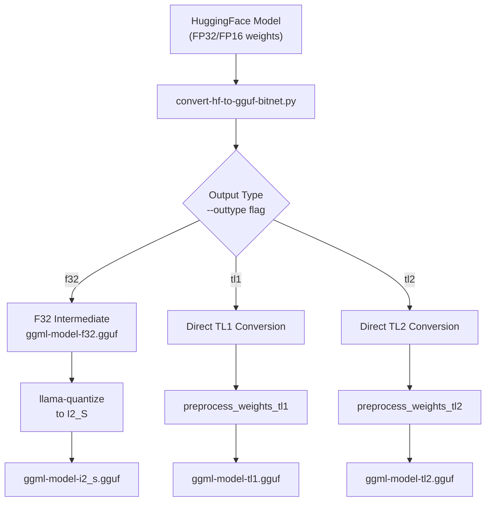

<!-- source: DeepWiki mcp.deepwiki.com · repo microsoft/BitNet · page 4.3 Quantization Schemes · fetched 2026-10-26 -->

# Quantization Schemes

<details>
<summary>Relevant source files</summary>

The following files were used as context for generating this wiki page:

- [include/gemm-config.h](include/gemm-config.h)
- [run_inference.py](run_inference.py)
- [setup_env.py](setup_env.py)
- [src/ggml-bitnet-mad.cpp](src/ggml-bitnet-mad.cpp)
- [utils/convert-hf-to-gguf-bitnet.py](utils/convert-hf-to-gguf-bitnet.py)
- [utils/convert-ms-to-gguf-bitnet.py](utils/convert-ms-to-gguf-bitnet.py)
- [utils/convert.py](utils/convert.py)

</details>


This page provides a detailed explanation of the three quantization formats used in BitNet.cpp: **I2_S**, **TL1**, and **TL2**. These schemes compress 1.58-bit model weights into efficient packed representations optimized for different CPU architectures.

For information about the kernel implementations that use these quantized formats, see [Kernel Architecture and Code Generation](#4.4). For the model conversion process that produces these formats, see [Model Conversion Pipeline](#4.6).

---

## Overview

BitNet.cpp supports three quantization schemes, each designed for specific hardware platforms and optimized for SIMD instruction sets:

| Scheme | Target Architecture | Bit Packing Density | Storage Format |
|--------|---------------------|---------------------|----------------|
| **I2_S** | ARM64, x86_64 (universal) | 4 values per byte | Runtime quantized from activations |
| **TL1** | ARM64 (NEON) | 4 values per byte | Pre-packed during conversion |
| **TL2** | x86_64 (AVX2) | Variable (2-way: 4/byte, 3-way: 3/byte + sign bits) | Pre-packed during conversion |

**Sources:** [setup_env.py:61-64](), [utils/convert-hf-to-gguf-bitnet.py:801-810]()

---

## Quantization Type Selection



**Architecture-Specific Quantization Selection**

The system selects quantization types based on CPU architecture detection during setup. The `SUPPORTED_QUANT_TYPES` dictionary maps each architecture to its available quantization schemes.

**Sources:** [setup_env.py:61-64](), [setup_env.py:84-85](), [setup_env.py:109-151]()

---

## I2_S Quantization

### Format Description

I2_S (Integer 2-bit Signed) is a universal quantization format that represents ternary values {-1, 0, +1} using 2 bits per element. Unlike TL1/TL2, I2_S quantization happens **at runtime** during inference for activation tensors.

**Value Mapping:**
- `0b00` (0) → -1
- `0b01` (1) → 0  
- `0b10` (2) → +1
- `0b11` (3) → unused

### Bit Packing Strategy



**I2_S Block Structure by Architecture**

Each byte stores 4 ternary values in 2-bit pairs, packed from MSB to LSB. The block size differs by architecture to align with SIMD register widths (256-bit for AVX2, 128-bit for NEON).

**Sources:** [src/ggml-bitnet-mad.cpp:12-15](), [src/ggml-bitnet-mad.cpp:51-196]()

### Runtime Quantization Process

The `quantize_i2_s` function converts floating-point activations to I2_S format:

1. **Scale Computation:** Find maximum absolute value across all elements
2. **Ternization:** Map each value to {-1, 0, +1} based on sign
3. **Bit Packing:** Pack 4 ternary values per byte using bit shifts
4. **Scale Storage:** Append scale factor at end of packed data

**x86_64 Implementation:**
```
For each 128-element block:
  For each 4-element group within 32-byte block:
    Shift group_idx positions: [6, 4, 2, 0] bits
    Pack into single byte at position group_pos
```

**ARM64 Implementation:**
```
For each 64-element block:
  For each 4-element group within 16-byte block:
    Shift group_idx positions: [6, 4, 2, 0] bits
    Pack into single byte at position group_pos
```

**Sources:** [src/ggml-bitnet-mad.cpp:51-96](), [src/ggml-bitnet-mad.cpp:151-195]()

### Storage Layout



**I2_S Memory Layout**

The quantized data is followed by alignment padding and a single scale factor. Total storage overhead is 32 bytes per tensor.

**Sources:** [src/ggml-bitnet-mad.cpp:90-96](), [src/ggml-bitnet-mad.cpp:188-194]()

---

## TL1 Quantization (ARM64)

### Format Description

TL1 (Ternary Lookup 1) is an ARM64-optimized quantization scheme that pre-packs weights during model conversion. The format uses a complex tiling pattern designed for efficient NEON SIMD operations.

**Key Characteristics:**
- Offline preprocessing during GGUF conversion
- Optimized for 128-bit NEON registers
- Supports configurable block sizes (BM, BY, bm, by)
- Stores 2 ternary values per byte (4 bits per value: 3*value + 4)

### Preprocessing Pipeline



**TL1 Conversion Pipeline**

The conversion process reads kernel configuration from `kernel_config.ini` to determine optimal block sizes for each weight matrix dimension.

**Sources:** [utils/convert-hf-to-gguf-bitnet.py:479-520](), [utils/convert-hf-to-gguf-bitnet.py:465-477]()

### Encoding Strategy

TL1 uses a paired encoding scheme:

1. **Pair Formation:** Group weight values into pairs
2. **Hierarchical Encoding:** `encoded = 3 * weight[0] + weight[1] + 4`
   - Maps {-1, 0, +1} × {-1, 0, +1} → {0, 1, 2, ..., 8}
3. **Reshape:** Apply multi-level tiling transformations
4. **Pack:** Store high and low 4-bits in single bytes

**Tiling Hierarchy:**
```
(M, K) 
→ (M/BM, BM, K/2) 
→ (M/BM, K/BY, BY/2, BM)
→ (M/BM, K/BY, BM/bm, bm, BY/2)
→ (M/BM, K/BY, BM/bm, BY/by, by/2, bm)
→ ... (additional SIMD-aligned reshapes)
```

**Sources:** [utils/convert-hf-to-gguf-bitnet.py:465-477](), [utils/convert-hf-to-gguf-bitnet.py:509-518]()

### Kernel Configuration

TL1 preprocessing reads configuration from `include/kernel_config.ini`:

```ini
[kernel_section_name]
m = <output_dimension>
k = <input_dimension>
bm = <row_block_size>
bk = <col_block_size>
bmm = <micro_block_size>
```

The configuration determines the exact tiling pattern for each weight matrix based on its dimensions.

**Sources:** [utils/convert-hf-to-gguf-bitnet.py:493-504]()

---

## TL2 Quantization (x86_64)

### Format Description

TL2 (Ternary Lookup 2) is an x86_64-optimized quantization scheme with a more complex encoding that handles both 2-way and 3-way packing strategies depending on the input dimension divisibility.

**Key Characteristics:**
- Offline preprocessing during GGUF conversion
- Optimized for 256-bit AVX2 registers
- Dual packing modes: 3-way (primary) and 2-way (remainder)
- Separate sign bit storage for 3-way encoding

### Two-Way vs Three-Way Packing



**TL2 Packing Strategy Decision Tree**

TL2 adaptively chooses between encoding strategies based on dimension alignment with the block size (BY).

**Sources:** [utils/convert-hf-to-gguf-bitnet.py:627-660](), [utils/convert-hf-to-gguf-bitnet.py:523-596]()

### Three-Way Encoding

For dimensions divisible by BY (typically 192 or 96):

1. **Triple Encoding:** `encoded = 9*w[0] + 3*w[1] + w[2]`
   - Maps {-1,0,+1}³ → {-13, -12, ..., 12, 13}
2. **Sign Extraction:** `sign_bit = (encoded < 0) ? 1 : 0`
3. **Absolute Value:** `abs_value = |encoded|`
4. **Separate Storage:**
   - Absolute values: 4 bits per triple
   - Sign bits: Packed 16 bits per uint16, stored separately

**Tiling Pattern:**
```
(M, K) 
→ (M/BM, BM, K/3)
→ (M/BM, K/BY, BY/3, BM)
→ (M/BM, K/BY, BM/bm, bm, BY/3)
→ ... (apply micro-tiling)
→ Split into [magnitude_data, sign_data]
```

**Sources:** [utils/convert-hf-to-gguf-bitnet.py:549-596]()

### Two-Way Encoding

For remainder elements (when K % BY != 0):

1. **Pair Encoding:** `encoded = 3*w[0] + w[1] + 4` (same as TL1)
2. **Direct Packing:** High and low 4-bits in single bytes
3. **Append:** Added after three-way encoded data

**Sources:** [utils/convert-hf-to-gguf-bitnet.py:523-548]()

### Sign Bit Compression

The three-way encoding stores sign bits separately in a compressed format:

```
16 sign bits → packed into uint16
Multiple uint16s → reshaped according to tiling pattern
Final layout: bm bytes per micro-block
```

This approach reduces storage overhead while maintaining SIMD-friendly access patterns.

**Sources:** [utils/convert-hf-to-gguf-bitnet.py:581-596]()

---

## Quantization in the Conversion Pipeline



**Model Conversion Flow with Quantization**

The conversion process differs based on target quantization format. I2_S requires a two-step process (F32 intermediate, then quantize), while TL1/TL2 apply preprocessing directly during conversion.

**Sources:** [setup_env.py:126-147](), [utils/convert-hf-to-gguf-bitnet.py:800-812]()

---

## Code Entity Mapping

### Key Functions by Quantization Scheme

| Quantization | Preprocessing Function | File Location | Runtime Kernel |
|--------------|----------------------|---------------|----------------|
| **I2_S** | `quantize_i2_s` | [src/ggml-bitnet-mad.cpp:51-196]() | `ggml_vec_dot_i2_i8_s` |
| **TL1** | `preprocess_weights_tl1` | [utils/convert-hf-to-gguf-bitnet.py:479-520]() | Generated lookup tables |
| **TL2** | `preprocess_weights_tl2` | [utils/convert-hf-to-gguf-bitnet.py:597-660]() | Generated lookup tables |

### Helper Functions

| Function | Purpose | File Location |
|----------|---------|---------------|
| `transform_to_tl1` | Wrapper for TL1 with scale extraction | [utils/convert-hf-to-gguf-bitnet.py:662-666]() |
| `transform_to_tl2` | Wrapper for TL2 with scale extraction | [utils/convert-hf-to-gguf-bitnet.py:668-672]() |
| `process_tl1` | Core TL1 bit packing logic | [utils/convert-hf-to-gguf-bitnet.py:465-477]() |
| `preprocess_three_weights_tl2` | TL2 3-way encoding | [utils/convert-hf-to-gguf-bitnet.py:549-596]() |
| `preprocess_two_weights_tl2` | TL2 2-way encoding | [utils/convert-hf-to-gguf-bitnet.py:523-548]() |

**Sources:** [utils/convert-hf-to-gguf-bitnet.py:463-672](), [src/ggml-bitnet-mad.cpp:51-196]()

---

## Data Type Definitions

The GGUF file format includes custom data type definitions for BitNet quantization schemes:

```python
# From gguf library integration
GGML_TYPE_I2_S  # I2_S quantized type
GGML_TYPE_TL1   # TL1 quantized type (ARM64)
GGML_TYPE_TL2   # TL2 quantized type (x86_64)
```

These types are registered in the GGUF writer during model conversion and recognized by the inference engine during model loading.

**Sources:** [utils/convert-hf-to-gguf-bitnet.py:801-810](), [utils/convert-hf-to-gguf-bitnet.py:156-157]()

---

## Performance Considerations

### Storage Efficiency

| Scheme | Bits per Weight | Overhead | Best Use Case |
|--------|----------------|----------|---------------|
| I2_S | 2 | 32 bytes/tensor | Universal, runtime quantization |
| TL1 | 2 | Minimal | ARM64 pre-packed weights |
| TL2 (3-way) | ~1.67 | Sign bits | x86_64 pre-packed weights |
| TL2 (2-way) | 2 | Minimal | x86_64 remainder handling |

### Kernel Integration

The quantization schemes integrate with architecture-specific kernels:

- **I2_S:** Unpacking happens inline during GEMV/GEMM operations
- **TL1:** Pre-generated lookup tables eliminate runtime unpacking
- **TL2:** Pre-generated lookup tables with sign bit handling

**Sources:** [include/gemm-config.h:1-36](), [src/ggml-bitnet-mad.cpp:198-1056]()

---

