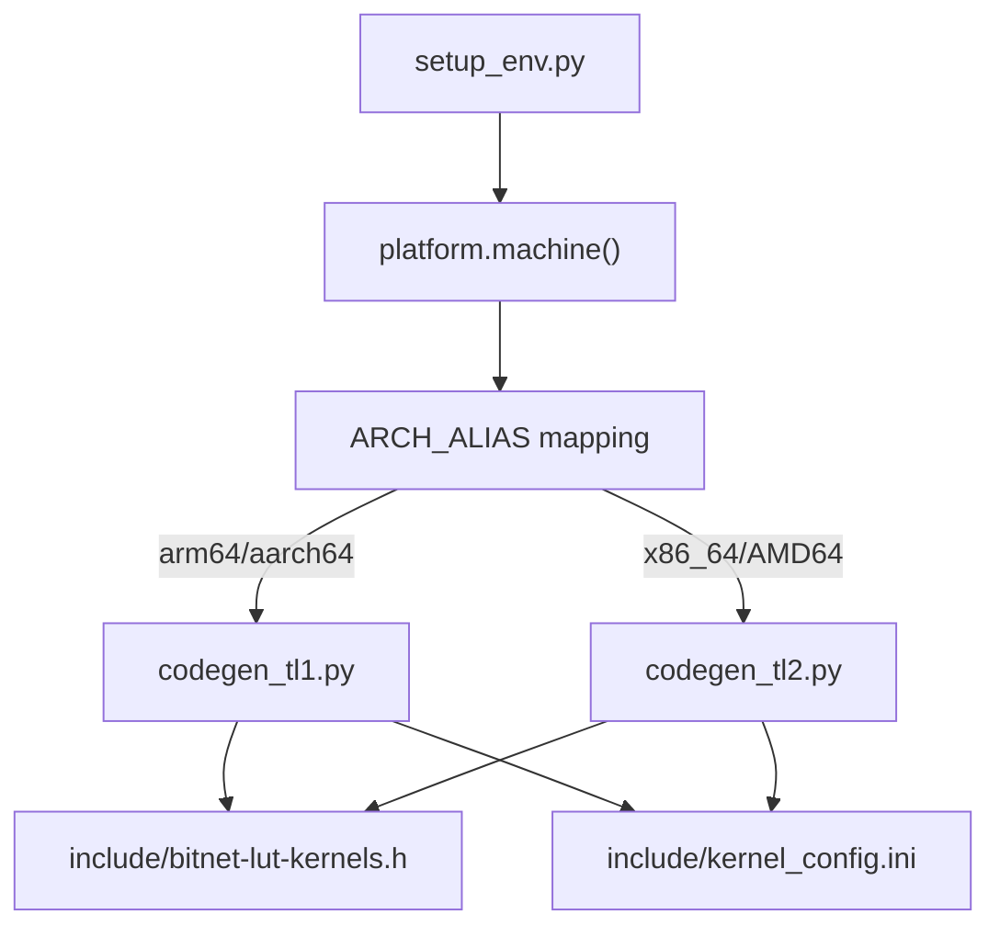
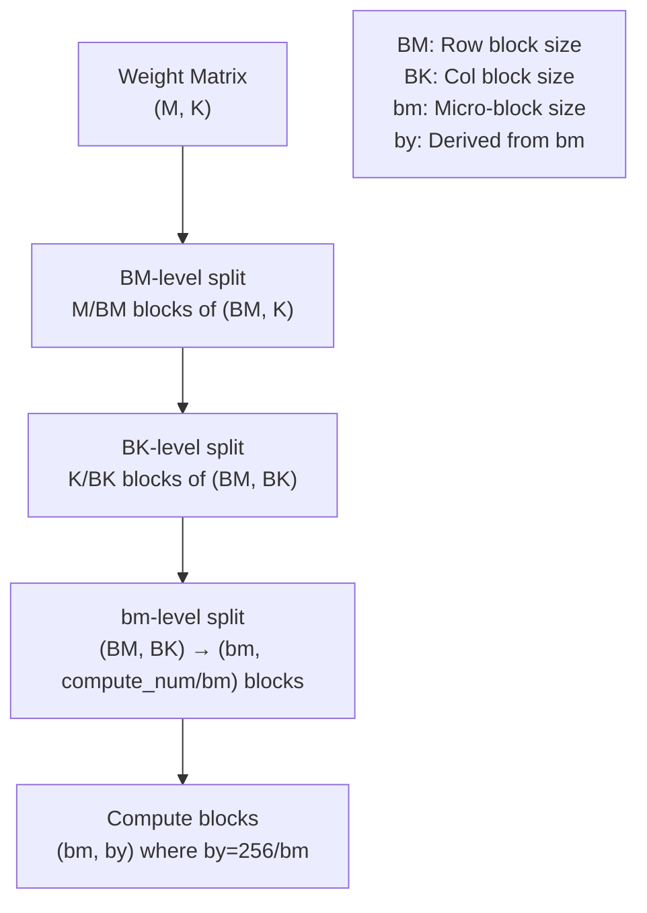
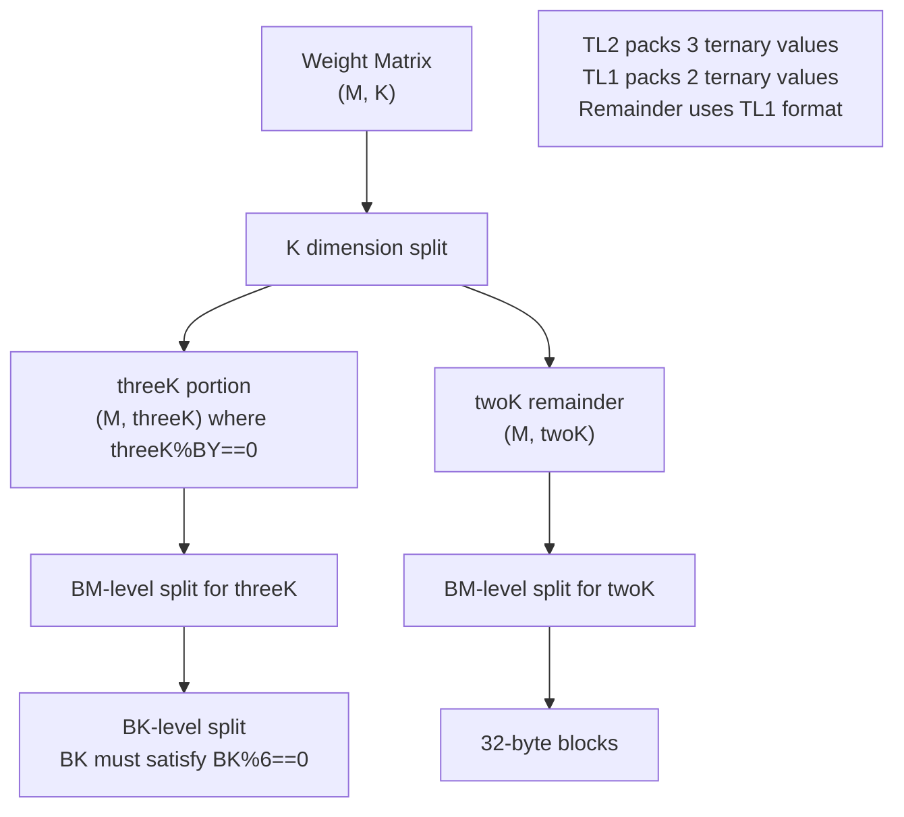
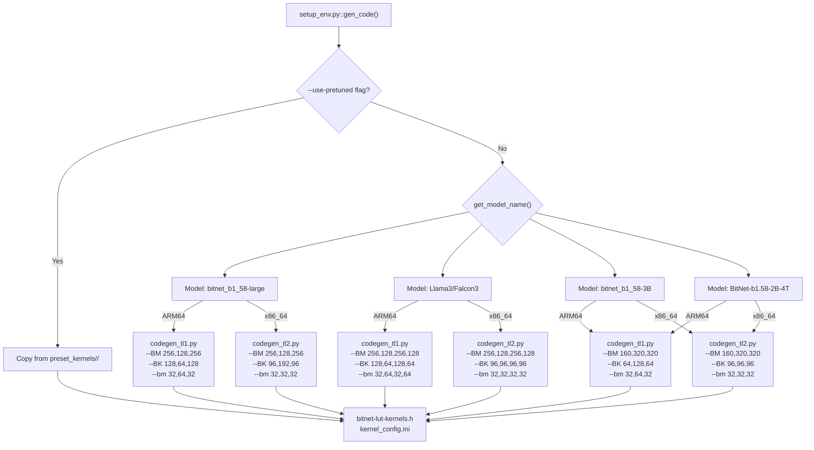
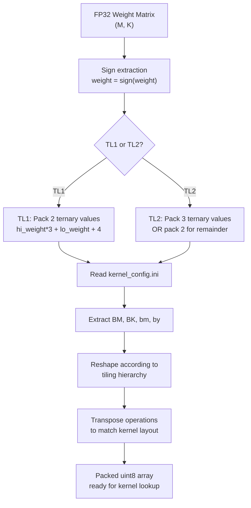
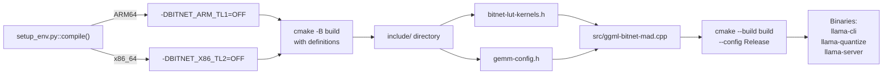
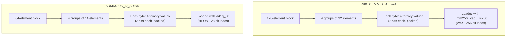
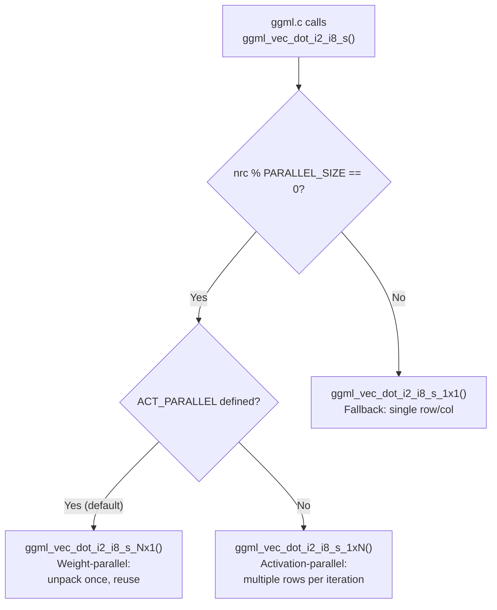

<!-- source: DeepWiki mcp.deepwiki.com · repo microsoft/BitNet · page 4.4 Kernel Architecture and Code Generation · fetched 2026-10-26 -->

# Kernel Architecture and Code Generation

<details>
<summary>Relevant source files</summary>

The following files were used as context for generating this wiki page:

- [assets/tl2.png](assets/tl2.png)
- [docs/codegen.md](docs/codegen.md)
- [include/gemm-config.h](include/gemm-config.h)
- [run_inference.py](run_inference.py)
- [setup_env.py](setup_env.py)
- [src/README.md](src/README.md)
- [src/ggml-bitnet-mad.cpp](src/ggml-bitnet-mad.cpp)
- [utils/convert-hf-to-gguf-bitnet.py](utils/convert-hf-to-gguf-bitnet.py)

</details>


This document explains the kernel code generation system in BitNet.cpp, which produces architecture-specific optimized kernels for TL1 (ARM64) and TL2 (x86_64) quantization formats. The code generation process creates lookup-table-based kernels tailored to specific model shapes and hardware capabilities.

For information about the runtime execution of these kernels and GEMM/GEMV operations, see [CPU Optimizations](#4.5). For details about the quantization formats themselves, see [Quantization Schemes](#4.3).

---

## Architecture Detection and Kernel Selection

BitNet.cpp generates different kernels based on the target CPU architecture. The system detects the architecture at build time and selects the appropriate code generator.



**Architecture Mapping and Code Generation Dispatch**

Sources: [setup_env.py:75-86](), [setup_env.py:156-200]()

The architecture detection maps platform-specific names to normalized identifiers:

| Platform Name | Normalized | Code Generator | Quantization Type |
|--------------|------------|----------------|-------------------|
| `aarch64`, `arm64`, `ARM64` | `arm64` | `codegen_tl1.py` | TL1 (preferred), I2_S |
| `x86_64`, `AMD64`, `x86` | `x86_64` | `codegen_tl2.py` | TL2 (preferred), I2_S |

---

## Code Generation Parameters

The code generators use a hierarchical tiling strategy to optimize cache utilization and SIMD instruction usage. Each model requires specific parameters based on its weight matrix dimensions.

### Tiling Hierarchy

#### TL1 (ARM64) Tiling Strategy



**TL1 Tiling Strategy**

Sources: [docs/codegen.md:29-39](), [setup_env.py:174-180]()

**TL1 Requirements:**
- `M % BM == 0` - Matrix rows must be divisible by BM
- `K % BK == 0` - Matrix columns must be divisible by BK
- `BM % bm == 0` - Block rows must be divisible by micro-block size
- `bm ∈ {32, 64}` - Micro-block size must be 32 or 64
- `by = 256 / bm` - Derived parameter for NEON optimization

#### TL2 (x86_64) Tiling Strategy



**TL2 Tiling Strategy with K-dimension Splitting**

Sources: [docs/codegen.md:40-49](), [setup_env.py:192-198](), [utils/convert-hf-to-gguf-bitnet.py:549-596]()

**TL2 Requirements:**
- `M % BM == 0` - Matrix rows must be divisible by BM
- `K % BK % 32 == 0` - Complex constraint for AVX2 optimization
- `BM % bm == 0` - Block rows must be divisible by micro-block size
- `bm = 32` - Fixed micro-block size for x86_64
- `by = 192 / bm` - Derived parameter for AVX2 optimization
- K dimension split into `threeK` (processed with TL2) and `twoK` (processed with TL1)

---

## Code Generation Process

The code generation workflow is orchestrated by `setup_env.py` and executed by model-specific generators.



**Code Generation Workflow and Model-Specific Parameters**

Sources: [setup_env.py:156-200]()

### Generated Output Files

The code generators produce two critical files:

1. **`include/bitnet-lut-kernels.h`** - Contains lookup table implementations
   - Model-specific lookup tables for weight unpacking
   - Optimized for target architecture's SIMD instructions
   - Generated as C arrays with inline hints

2. **`include/kernel_config.ini`** - Configuration metadata
   - Stores BM, BK, bm, by parameters for each kernel
   - Used during weight preprocessing in model conversion
   - INI format with sections per kernel dimension

Sources: [setup_env.py:168-172](), [utils/convert-hf-to-gguf-bitnet.py:493-504](), [utils/convert-hf-to-gguf-bitnet.py:611-625]()

---

## Weight Preprocessing and Kernel-Specific Layouts

The quantization functions in the conversion pipeline read kernel configuration and reorder weights to match the generated kernel's expected layout.



**Weight Preprocessing Pipeline**

Sources: [utils/convert-hf-to-gguf-bitnet.py:479-520](), [utils/convert-hf-to-gguf-bitnet.py:597-660]()

### TL1 Weight Layout

The `preprocess_weights_tl1` function transforms weights through multiple reshape and transpose operations:

```python
# Example layout transformation (simplified from actual code)
# Input: (M, K) matrix
# Step 1: Pair-wise packing - (M, K/2)
# Step 2: BM-level split - (M/BM, BM, K/2)
# Step 3: Transpose - (M/BM, K/2, BM)
# Step 4: BK-level split - (M/BM, K/BY, BY/2, BM)
# ... (multiple levels of reshaping)
# Final: Packed format ready for NEON loads
```

Sources: [utils/convert-hf-to-gguf-bitnet.py:465-477](), [utils/convert-hf-to-gguf-bitnet.py:479-520]()

### TL2 Weight Layout

TL2 is more complex because it packs 3 ternary values instead of 2, requiring the K dimension to be divisible by 6. When K is not divisible by 6, the matrix is split:

```python
# TL2 splits K dimension
if (K % BY != 0):
    slice_k_idx = K - K % BY
    three_weight = weight[:, :slice_k_idx]  # Process with TL2 (3-value packing)
    two_weight = weight[:, slice_k_idx:]     # Process with TL1 (2-value packing)
```

This approach also generates sign bits separately for TL2, stored in a compact bitfield format.

Sources: [utils/convert-hf-to-gguf-bitnet.py:549-596](), [utils/convert-hf-to-gguf-bitnet.py:627-657]()

---

## Build System Integration

The code generation process is tightly integrated with the CMake build system through compile-time definitions.



**Build System Integration**

Sources: [setup_env.py:66-69](), [setup_env.py:203-216]()

### Compile-Time Architecture Selection

The `COMPILER_EXTRA_ARGS` dictionary specifies architecture-specific flags:

| Architecture | CMake Definition | Effect |
|-------------|------------------|--------|
| `arm64` | `-DBITNET_ARM_TL1=OFF` | Enables ARM NEON optimizations, disables TL1 by default (controlled separately) |
| `x86_64` | `-DBITNET_X86_TL2=OFF` | Enables AVX2 optimizations, disables TL2 by default (controlled separately) |

These flags control conditional compilation in [src/ggml-bitnet-mad.cpp]() to select the appropriate SIMD instruction sets.

Sources: [setup_env.py:66-69](), [setup_env.py:209-214]()

### Pre-tuned Kernel Option

For performance-critical deployments, BitNet.cpp provides pre-tuned kernels that skip code generation:

```bash
python setup_env.py --use-pretuned --hf-repo microsoft/BitNet-b1.58-2B-4T
```

The `--use-pretuned` flag copies pre-optimized kernels from `preset_kernels/<model_name>/`:
- `bitnet-lut-kernels-tl1.h` or `bitnet-lut-kernels-tl2.h`
- `kernel_config_tl1.ini` or `kernel_config_tl2.ini`

These kernels have been optimized through systematic performance tuning on reference hardware. See [Performance Tuning Guide](#5.1) for details on generating custom pre-tuned kernels.

Sources: [setup_env.py:162-172](), [setup_env.py:184-190](), [setup_env.py:232]()

---

## Kernel Memory Layout and SIMD Optimization

The generated kernels use specific memory layouts optimized for SIMD load instructions.



**Architecture-Specific Block Sizes and SIMD Alignment**

Sources: [src/ggml-bitnet-mad.cpp:11-15]()

### Unpacking Operations

The kernel implementations in `ggml-bitnet-mad.cpp` perform on-the-fly unpacking using bit shifts and masks:

**x86_64 Unpacking (AVX2):**
```c
// Load 32 packed bytes (128 ternary values)
__m256i xq8_3 = _mm256_loadu_si256((const __m256i*)(px));
// Extract each 2-bit group via shifts
__m256i xq8_2 = _mm256_srli_epi16(xq8_3, 2);  // Shift right 2 bits
__m256i xq8_1 = _mm256_srli_epi16(xq8_3, 4);  // Shift right 4 bits
__m256i xq8_0 = _mm256_srli_epi16(xq8_3, 6);  // Shift right 6 bits
// Mask to extract 2-bit values
__m256i mask = _mm256_set1_epi8(0x03);  // 0b00000011
xq8_3 = _mm256_and_si256(xq8_3, mask);
// Now have 4 separate vectors with unpacked values {0, 1, 2}
```

Sources: [src/ggml-bitnet-mad.cpp:225-234]()

**ARM64 Unpacking (NEON):**
```c
// Load 16 packed bytes (64 ternary values)
uint8x16_t xq8_3 = vld1q_u8(px);
// Extract each 2-bit group via shifts
uint8x16_t xq8_2 = vshrq_n_u8(xq8_3, 2);
uint8x16_t xq8_1 = vshrq_n_u8(xq8_3, 4);
uint8x16_t xq8_0 = vshrq_n_u8(xq8_3, 6);
// Mask to extract 2-bit values
const uint8x16_t mask = vdupq_n_u8(3);
int8x16_t q8_0 = vreinterpretq_s8_u8(vandq_u8(xq8_0, mask));
// Now have 4 separate vectors with unpacked values
```

Sources: [src/ggml-bitnet-mad.cpp:323-331]()

---

## Runtime Kernel Dispatch

The generated kernels are integrated into GGML's computation graph through the `ggml_vec_dot_i2_i8_s` dispatcher.



**Runtime Kernel Dispatch Logic**

Sources: [src/ggml-bitnet-mad.cpp:1043-1056](), [include/gemm-config.h:1-6]()

The `PARALLEL_SIZE` parameter (defined in [include/gemm-config.h]()) controls how many rows/columns are processed in parallel:

| Architecture | `ACT_PARALLEL` | `PARALLEL_SIZE` |
|-------------|----------------|-----------------|
| x86_64 with AVX2 | Enabled | 4 |
| ARM64 with DOTPROD | Enabled | 8 |
| ARM64 without DOTPROD | Enabled | 4 |

Sources: [include/gemm-config.h:3-6](), [include/gemm-config.h:14-17](), [include/gemm-config.h:24-27]()

---

## Summary

The kernel architecture in BitNet.cpp consists of:

1. **Architecture Detection**: [setup_env.py]() detects CPU type and selects TL1 (ARM64) or TL2 (x86_64)
2. **Code Generation**: [utils/codegen_tl1.py]() and [utils/codegen_tl2.py]() generate lookup tables based on model-specific tiling parameters
3. **Weight Preprocessing**: Conversion utilities ([utils/convert-hf-to-gguf-bitnet.py]()) reorder weights to match kernel expectations
4. **Build Integration**: CMake compiles generated kernels ([include/bitnet-lut-kernels.h]()) with architecture-specific optimizations
5. **Runtime Dispatch**: [src/ggml-bitnet-mad.cpp]() selects optimal kernel variants based on workload shape

This design enables BitNet.cpp to achieve high performance across diverse CPU architectures while maintaining code maintainability through automated generation.

For runtime optimization techniques using these kernels, see [CPU Optimizations](#4.5). For details on tuning the tiling parameters for specific hardware, see [Performance Tuning Guide](#5.1).

---

