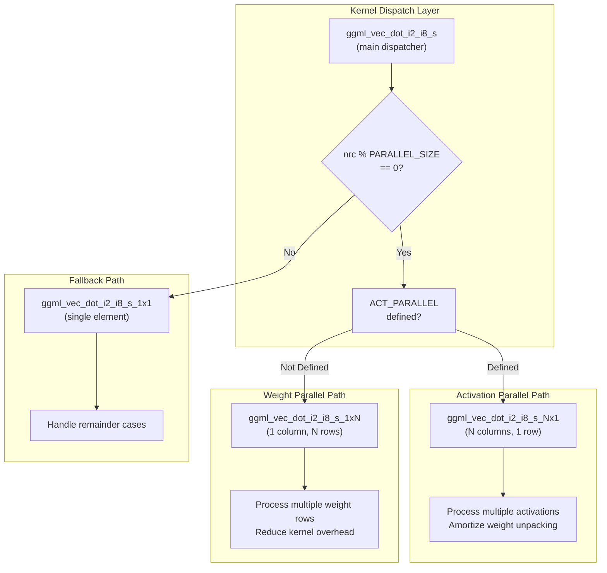
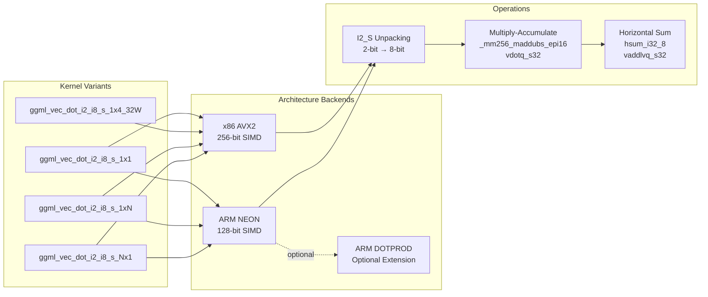
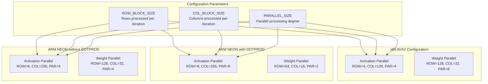
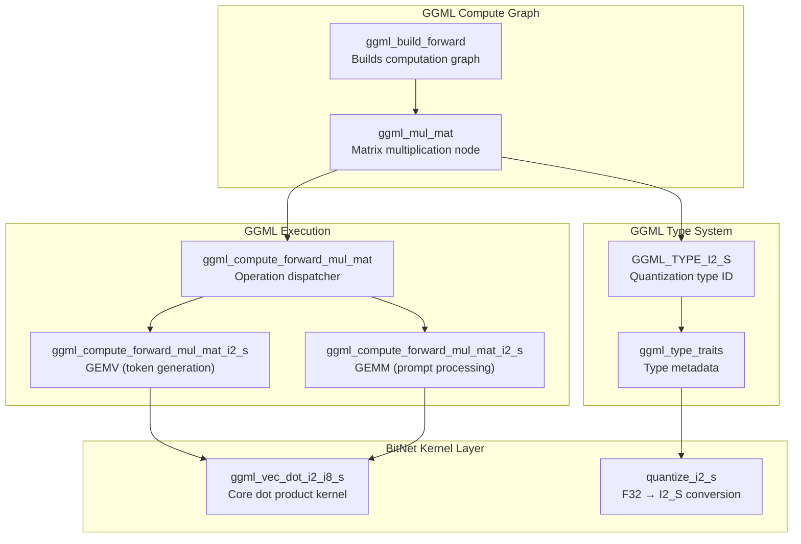
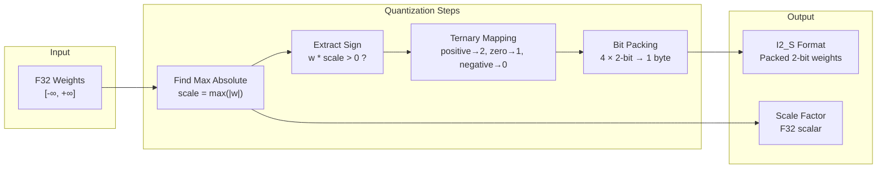
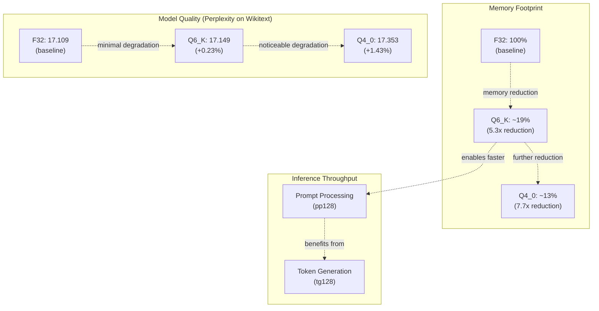

<!-- source: DeepWiki mcp.deepwiki.com · repo microsoft/BitNet · page 4.5 CPU Optimizations · fetched 2026-10-26 -->

# CPU Optimizations

<details>
<summary>Relevant source files</summary>

The following files were used as context for generating this wiki page:

- [include/gemm-config.h](include/gemm-config.h)
- [src/README.md](src/README.md)
- [src/ggml-bitnet-mad.cpp](src/ggml-bitnet-mad.cpp)

</details>


This page documents the CPU-specific performance optimizations implemented in BitNet.cpp, including parallel kernel implementations, configurable tiling strategies, and embedding quantization techniques. For information about tuning these parameters for specific hardware, see [Performance Tuning Guide](#5.1). For the broader kernel architecture and code generation process, see [Kernel Architecture and Code Generation](#4.4).

## Overview of Optimization Strategies

BitNet.cpp implements four major categories of CPU optimizations to accelerate inference:

1. **Parallel Weight & Activation Computation** - Processes multiple rows/columns simultaneously to reduce kernel launch overhead
2. **Native I2_S GEMM & GEMV Support** - Integrated matrix operations compatible with llama.cpp architecture
3. **Configurable Tiling & Parallelism** - Architecture-specific block sizes and parallelism levels
4. **Embedding Quantization** - Q6_K format for embedding layers to reduce memory footprint

These optimizations work together to achieve significant throughput improvements across x86 and ARM architectures. The activation parallel approach is recommended for I2_S quantization due to the benefits of amortizing unpacking costs.

**Sources:** [src/README.md:1-18]()

---

## Parallelization Strategies

### Weight Parallel vs Activation Parallel

BitNet.cpp implements two distinct parallelization strategies for matrix operations:

| Strategy | Description | Use Case | Key Benefit |
|----------|-------------|----------|-------------|
| **Weight Parallel** | Processes multiple weight rows/columns per kernel call | Single activation computations (GEMV) | Reduces kernel launch overhead |
| **Activation Parallel** | Processes multiple activation elements, amortizing weight unpacking | Multiple activation computations (GEMM) | Amortizes I2_S unpacking cost |

The choice between these strategies is controlled by the `ACT_PARALLEL` compile definition in [include/gemm-config.h:1]().

**Activation Parallel Performance Benefits:**

For I2_S quantization, activation parallel is recommended because unpacking the 2-bit weights is a significant operation. By unpacking once and reusing across multiple activations, the amortized cost per computation decreases substantially.

Performance comparison on AMD EPYC 7V13 (x86, 1 thread):

| Matrix Size | No Parallel | Weight Parallel | Activation Parallel |
|-------------|-------------|-----------------|---------------------|
| [1, 2048] × [2048, 2048] | 0.075±0.012 ms | **0.058±0.007 ms** | 0.076±0.011 ms |
| [32, 2048] × [2048, 2048] | 2.400±0.041 ms | 1.599±0.020 ms | **1.202±0.018 ms** |
| [128, 2048] × [2048, 2048] | 10.820±0.039 ms | 6.458±0.168 ms | **5.805±0.039 ms** |
| [512, 2048] × [2048, 2048] | 43.257±0.083 ms | 25.680±0.335 ms | **23.342±0.082 ms** |

For small batch sizes (single vector), weight parallel is more efficient. For larger batch sizes, activation parallel provides better performance by amortizing the unpacking overhead.

**Sources:** [src/README.md:50-76]()

---

### Parallelization Architecture



**Kernel Dispatch Logic**

The main dispatcher function `ggml_vec_dot_i2_i8_s` selects the appropriate kernel implementation based on the number of rows/columns to process (`nrc`) and the `ACT_PARALLEL` compile flag.

**Sources:** [src/ggml-bitnet-mad.cpp:1043-1056]()

---

## Kernel Implementation Details

### I2_S Vector Dot Product Kernels

BitNet.cpp provides multiple specialized implementations of the I2_S vector dot product operation:



**Kernel Function Summary:**

| Function | Purpose | x86 Support | ARM Support |
|----------|---------|-------------|-------------|
| `ggml_vec_dot_i2_i8_s_1x1` | Single row computation, handles remainders | ✅ | ✅ |
| `ggml_vec_dot_i2_i8_s_1x4_32W` | Fixed 4-row weight parallel (x86 only) | ✅ | ❌ |
| `ggml_vec_dot_i2_i8_s_1xN` | Weight parallel, PARALLEL_SIZE rows | ✅ | ✅ |
| `ggml_vec_dot_i2_i8_s_Nx1` | Activation parallel, PARALLEL_SIZE columns | ✅ | ✅ |

**Sources:** [src/ggml-bitnet-mad.cpp:198-1041]()

---

### x86 AVX2 Implementation

The x86 implementation leverages AVX2 instructions for 256-bit SIMD operations:

**Key Operations:**
- **Unpacking:** [src/ggml-bitnet-mad.cpp:225-234]() - Unpacks 2-bit weights into 8-bit values using bit shifts and masks
- **Multiply-Accumulate:** [src/ggml-bitnet-mad.cpp:242-245]() - Uses `_mm256_maddubs_epi16` for multiply-add operations
- **Horizontal Sum:** [src/ggml-bitnet-mad.cpp:20-26]() - `hsum_i32_8` reduces 8 int32 values to a single sum

**I2_S Data Layout (x86):**

The I2_S format packs 4 weight values (2 bits each) into a single byte, with 128 weights per block (QK_I2_S). For x86, this means 32 bytes per block. The unpacking process extracts these 2-bit values into separate bytes for SIMD processing.

```
Packed byte:  [w3:2b][w2:2b][w1:2b][w0:2b]
              ↓ unpack
Unpacked:     w0→[8b] w1→[8b] w2→[8b] w3→[8b]
```

**Sources:** [src/ggml-bitnet-mad.cpp:11-18](), [src/ggml-bitnet-mad.cpp:199-296]()

---

### ARM NEON Implementation

The ARM implementation uses 128-bit NEON intrinsics with optional DOTPROD extension support:

**Key Operations:**
- **Unpacking:** [src/ggml-bitnet-mad.cpp:323-331]() - Uses `vshrq_n_u8` and `vandq_u8` for bit extraction
- **Multiply-Accumulate with DOTPROD:** [src/ggml-bitnet-mad.cpp:338-342]() - Uses `vdotq_s32` for 4-way dot products (ARM v8.2+)
- **Multiply-Accumulate without DOTPROD:** [src/ggml-bitnet-mad.cpp:344-351]() - Uses `vmlal_s8` for accumulation
- **Horizontal Sum:** [src/ggml-bitnet-mad.cpp:408]() - `vaddlvq_s32` reduces vector to scalar

**DOTPROD Extension:**

When `__ARM_FEATURE_DOTPROD` is available, the kernel uses the specialized dot product instruction `vdotq_s32`, which performs 4 multiply-accumulate operations in a single instruction. Without DOTPROD, the fallback uses multiple `vmlal_s8` instructions.

**I2_S Data Layout (ARM):**

ARM uses QK_I2_S = 64, meaning 16 bytes per block (smaller than x86's 32 bytes due to 128-bit vs 256-bit SIMD width).

**Sources:** [src/ggml-bitnet-mad.cpp:12-15](), [src/ggml-bitnet-mad.cpp:297-411]()

---

## Configurable Tiling Parameters

The GEMM/GEMV tiling strategy is controlled by three compile-time parameters defined in [include/gemm-config.h]():



**Configuration File Structure:**

The configuration uses preprocessor directives to select optimal values based on architecture and parallelization strategy:

```c
#define ACT_PARALLEL  // Comment out for weight parallel
#if defined(__AVX__) || defined(__AVX2__) || defined(__AVX512F__) || defined(__SSSE3__)
    #if defined(ACT_PARALLEL)
        #define ROW_BLOCK_SIZE 4
        #define COL_BLOCK_SIZE 128
        #define PARALLEL_SIZE 4
    #else
        #define ROW_BLOCK_SIZE 128
        #define COL_BLOCK_SIZE 32
        #define PARALLEL_SIZE 8
    #endif
#elif defined(__ARM_NEON)
    // ... ARM configurations
#endif
```

**Parameter Impact on Performance:**

| Parameter | Effect on Performance | Effect on Memory |
|-----------|----------------------|------------------|
| `ROW_BLOCK_SIZE` | Larger = better cache locality for rows | Larger = more register pressure |
| `COL_BLOCK_SIZE` | Larger = better vectorization efficiency | Larger = more cache usage |
| `PARALLEL_SIZE` | Larger = better throughput (up to a point) | Larger = more intermediate storage |

These parameters should be tuned based on CPU cache sizes and architecture. Users can modify [include/gemm-config.h]() to experiment with different values, then rebuild the project.

**Sources:** [include/gemm-config.h:1-36](), [src/README.md:22-31]()

---

## GEMM/GEMV Integration with llama.cpp

The I2_S quantization format is fully integrated into llama.cpp's compute graph, enabling seamless operation within the existing inference pipeline:



**Integration Points:**

1. **Type Registration:** I2_S is registered as a custom GGML quantization type with specific traits (block size, quantization/dequantization functions)

2. **GEMV Operations:** Used for token generation (single token at a time). Matrix-vector multiplication optimized for single activation vectors.

3. **GEMM Operations:** Used for prompt processing (multiple tokens in parallel). Matrix-matrix multiplication with configurable tiling.

4. **Tiling Strategy:** The compute functions use `ROW_BLOCK_SIZE`, `COL_BLOCK_SIZE`, and `PARALLEL_SIZE` to tile the matrix operations for optimal cache utilization.

The integration ensures that BitNet models can leverage all existing llama.cpp infrastructure including multi-threading, memory management, and KV cache handling.

**Sources:** [src/README.md:79-86]()

---

## I2_S Quantization Process

The quantization function converts floating-point weights to the I2_S format:



**Quantization Algorithm:**

The `quantize_i2_s` function implements the following logic:

1. **Find Scale:** Compute `scale = max(|weight|)` across all weights [src/ggml-bitnet-mad.cpp:59-63]()

2. **Map to Ternary:** For each weight value:
   - If `|weight| < 1e-6`: map to 1 (represents 0)
   - If `weight * scale > 0`: map to 2 (represents +1)
   - Otherwise: map to 0 (represents -1)

3. **Pack Bits:** Group weights into blocks and pack 4 values per byte [src/ggml-bitnet-mad.cpp:81-88]()

4. **Store Scale:** Append the scale factor at the end of the packed data [src/ggml-bitnet-mad.cpp:90-91]()

**Memory Layout:**

For x86 (QK_I2_S = 128):
- 128 weights → 32 bytes (packed data)
- 1 float (4 bytes) for scale
- Total: 36 bytes per block

The layout enables efficient SIMD unpacking where all weights from a block can be unpacked and processed together.

**Sources:** [src/ggml-bitnet-mad.cpp:51-196]()

---

## Embedding Quantization

Embedding quantization reduces memory footprint and improves inference speed by quantizing the token embedding layer. BitNet.cpp supports multiple quantization formats for embeddings:

### Supported Formats and Trade-offs

| Format | Bits per Weight | Perplexity Impact | Inference Speed | Recommendation |
|--------|----------------|-------------------|-----------------|----------------|
| F32 | 32 | Baseline (17.109) | Baseline | Development only |
| F16 | 16 | No change (17.109) | Moderate | Not recommended |
| Q8_0 | 8 | Minimal (+0.011) | Good | If accuracy critical |
| **Q6_K** | ~6 | Low (+0.040) | Very Good | **Recommended** |
| Q5_0 | 5 | Moderate (+0.129) | Better | If memory tight |
| Q4_0 | 4 | High (+0.244) | Best | Not recommended |
| Q3_K | ~3 | Very High (+0.534) | Best | Not recommended |
| I2_S | 2 | Model failure | N/A | Not supported |

**Perplexity values are for BitNet-b1.58-2B-4T on Wikitext dataset.**

**Q6_K Format Selection:**

Q6_K is recommended because it provides:
- Minimal accuracy degradation (perplexity increase < 0.04)
- Significant memory savings (~5x compared to F32)
- Improved throughput for prompt processing
- Compatibility with existing quantization infrastructure

I2_S quantization for embeddings is not supported as it causes model failure due to extreme quantization of the embedding space.

**Sources:** [src/README.md:113-148]()

---

### Enabling Embedding Quantization

**Method 1: Using setup_env.py**

The simplest approach is to use the `--quant-embd` flag during model preparation:

```bash
python setup_env.py --quant-embd
```

This automatically converts embeddings to Q6_K format during the model conversion process.

**Method 2: Manual Conversion with llama-quantize**

For manual control, use the `llama-quantize` tool with the `--token-embedding-type` flag:

```bash
build/bin/llama-quantize \
    --token-embedding-type Q6_K \
    models/BitNet-b1.58-2B-4T/ggml-model-f32.gguf \
    models/BitNet-b1.58-2B-4T/ggml-model-i2_s-embed-q6_k.gguf \
    I2_S 1 1
```

**Command Parameters:**
- `--token-embedding-type Q6_K`: Specifies the embedding quantization format
- First argument: Input F32 GGUF model
- Second argument: Output quantized GGUF model
- `I2_S`: Weight quantization type (for non-embedding layers)
- `1 1`: Additional quantization parameters

The resulting model will have:
- Token embeddings quantized to Q6_K (~6 bits per weight)
- All other layers quantized to I2_S (2 bits per weight)

**Sources:** [src/README.md:33-46]()

---

### Embedding Quantization Performance Impact



**Performance Characteristics:**

1. **Prompt Processing (pp128):** Embedding quantization significantly improves throughput during prompt encoding, as the embedding lookup and subsequent matrix multiplications benefit from reduced memory bandwidth requirements.

2. **Token Generation (tg128):** Modest improvement during generation phase, as embeddings are only accessed once per token.

3. **Memory Bandwidth:** Q6_K reduces memory traffic by ~5x for embedding operations, which is particularly beneficial on memory-constrained systems.

**Recommended Configuration:**

For production deployments, use Q6_K embedding quantization with I2_S weight quantization:

```bash
python setup_env.py --quant-embd --quant-type i2_s
```

This provides the optimal balance of memory efficiency, model quality, and inference speed.

**Sources:** [src/README.md:113-148]()

---

## Architecture-Specific Optimizations

### x86-64 with AVX2

**Key Characteristics:**
- 256-bit SIMD registers
- QK_I2_S = 128 (32 bytes per block)
- Optimal for larger block sizes due to wider registers

**Recommended Configuration (Activation Parallel):**
- `ROW_BLOCK_SIZE = 4`
- `COL_BLOCK_SIZE = 128`
- `PARALLEL_SIZE = 4`

**Key Instructions Used:**
- `_mm256_maddubs_epi16`: Multiply unsigned 8-bit integers with signed 8-bit integers and accumulate to 16-bit
- `_mm256_madd_epi16`: Multiply 16-bit integers and accumulate to 32-bit
- `_mm256_add_epi32`: Add 32-bit integers

**Sources:** [include/gemm-config.h:2-11](), [src/ggml-bitnet-mad.cpp:11-12]()

### ARM with NEON

**Key Characteristics:**
- 128-bit SIMD registers
- QK_I2_S = 64 (16 bytes per block)
- Two variants: with and without DOTPROD extension

**Recommended Configuration (Activation Parallel, with DOTPROD):**
- `ROW_BLOCK_SIZE = 8`
- `COL_BLOCK_SIZE = 256`
- `PARALLEL_SIZE = 8`

**Recommended Configuration (Activation Parallel, without DOTPROD):**
- `ROW_BLOCK_SIZE = 8`
- `COL_BLOCK_SIZE = 256`
- `PARALLEL_SIZE = 4`

**Key Instructions Used:**
- With DOTPROD: `vdotq_s32` - 4-way dot product (ARMv8.2+)
- Without DOTPROD: `vmlal_s8` - Multiply-accumulate with widening
- `vaddlvq_s32` - Horizontal sum reduction

**Sources:** [include/gemm-config.h:12-34](), [src/ggml-bitnet-mad.cpp:13-15]()

### ARM with DOTPROD Extension

The DOTPROD extension (ARMv8.2-A and later) provides hardware acceleration for dot product operations, significantly improving performance:

**Performance Impact:**
- Single instruction replaces 8 separate multiply-accumulate operations
- Reduced register pressure
- Better instruction-level parallelism

When `__ARM_FEATURE_DOTPROD` is detected at compile time, the kernel automatically uses the optimized path. This is particularly beneficial for server-class ARM processors (e.g., AWS Graviton, Ampere Altra) and modern mobile processors.

**Sources:** [src/ggml-bitnet-mad.cpp:317-321](), [src/ggml-bitnet-mad.cpp:338-342]()

---

## Performance Comparison

### Multi-threaded Performance Scaling

The following results demonstrate performance scaling across different thread counts on various hardware platforms with activation parallel mode enabled:

**AMD EPYC 7V13 (x86):**
- Model: BitNet-b1.58-2B-4T
- Workload: 128 prompt tokens (pp128) + 128 generated tokens (tg128)
- Configuration: Activation Parallel, x86 AVX2

Demonstrates near-linear scaling up to 8 threads, with diminishing returns beyond that point due to memory bandwidth saturation.

**Intel Core i7-13800H (x86):**
- Model: BitNet-b1.58-2B-4T
- Workload: pp128 + tg128
- Configuration: Activation Parallel, x86 AVX2

Shows excellent scaling on hybrid architecture (P+E cores), with optimal performance at 4-6 threads.

**ARM Cobalt 100 (ARM with DOTPROD):**
- Model: BitNet-b1.58-2B-4T
- Workload: pp128 + tg128
- Configuration: Activation Parallel, ARM NEON + DOTPROD

Demonstrates the effectiveness of DOTPROD extension, achieving competitive performance with x86 despite narrower SIMD width.

**Sources:** [src/README.md:150-192]()

---

## Summary of Key Files

| File | Purpose | Key Components |
|------|---------|----------------|
| [src/ggml-bitnet-mad.cpp]() | Parallel kernel implementations | `ggml_vec_dot_i2_i8_s`, `quantize_i2_s` |
| [include/gemm-config.h]() | Tiling configuration | `ROW_BLOCK_SIZE`, `COL_BLOCK_SIZE`, `PARALLEL_SIZE` |
| [3rdparty/llama.cpp/ggml/src/ggml.c]() | GEMM/GEMV integration | Type registration, compute dispatch |

**Sources:** [src/README.md:193-200]()

---

