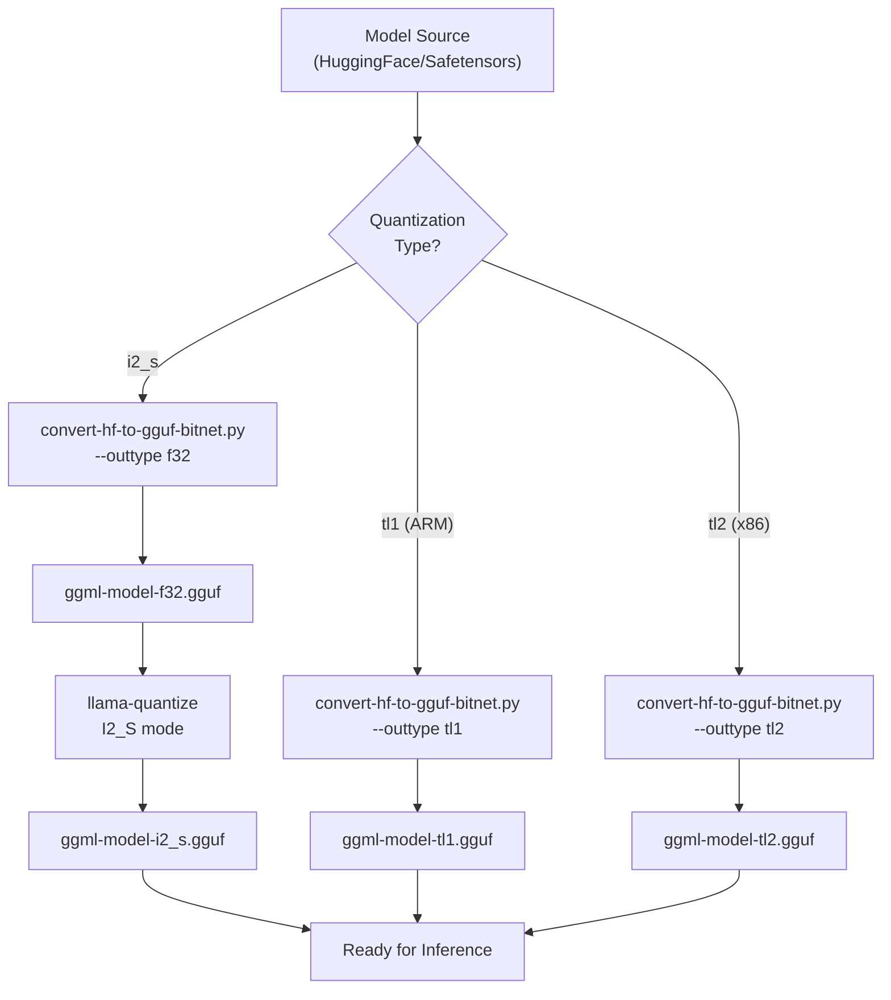
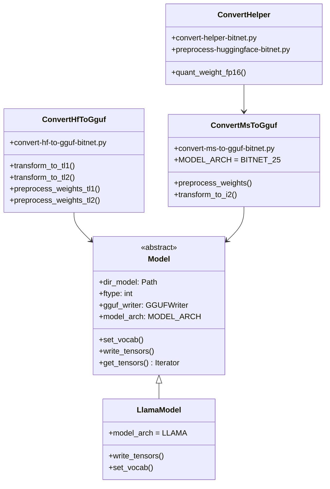
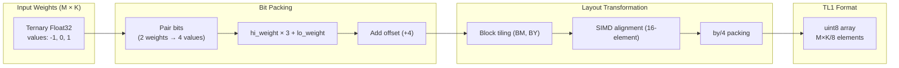
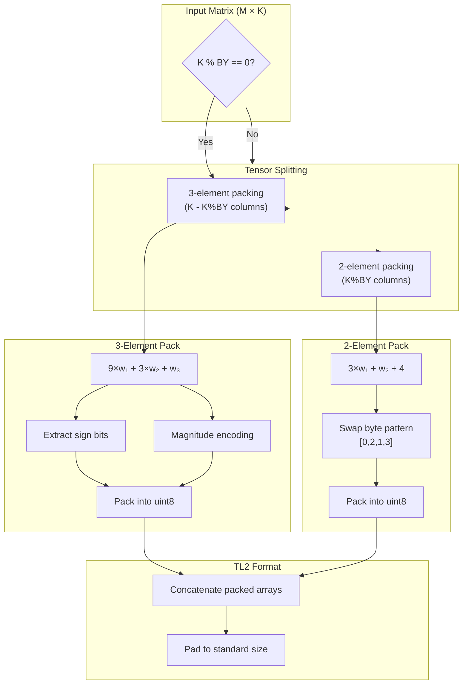
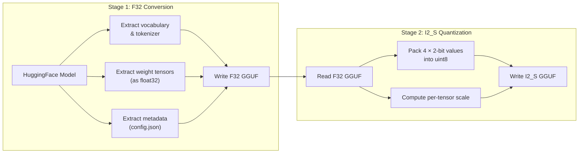
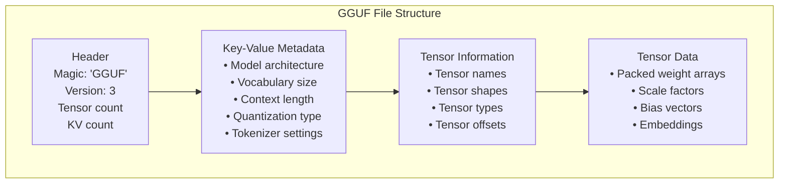
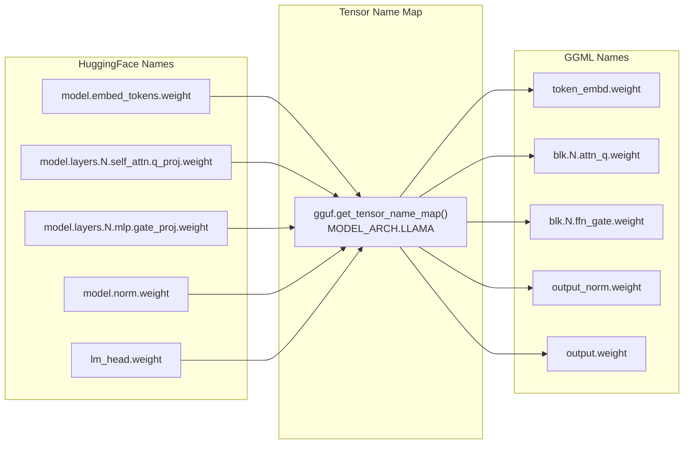
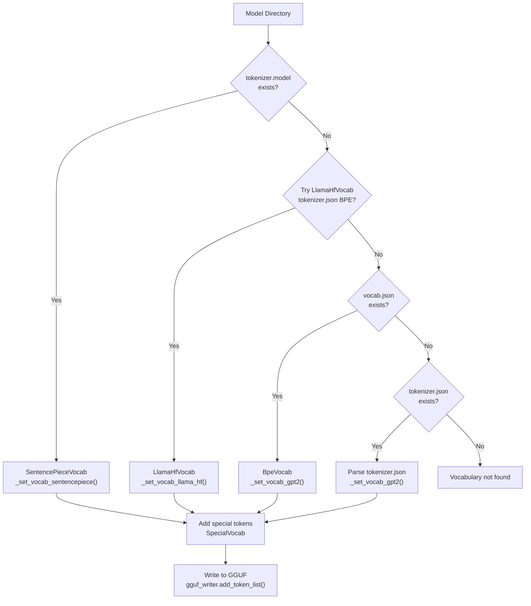
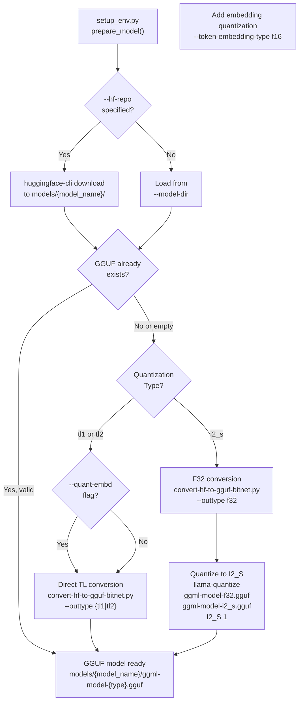

<!-- source: DeepWiki mcp.deepwiki.com · repo microsoft/BitNet · page 4.6 Model Conversion Pipeline · fetched 2026-10-26 -->

# Model Conversion Pipeline

<details>
<summary>Relevant source files</summary>

The following files were used as context for generating this wiki page:

- [run_inference.py](run_inference.py)
- [setup_env.py](setup_env.py)
- [utils/convert-helper-bitnet.py](utils/convert-helper-bitnet.py)
- [utils/convert-hf-to-gguf-bitnet.py](utils/convert-hf-to-gguf-bitnet.py)
- [utils/convert-ms-to-gguf-bitnet.py](utils/convert-ms-to-gguf-bitnet.py)
- [utils/convert.py](utils/convert.py)
- [utils/preprocess-huggingface-bitnet.py](utils/preprocess-huggingface-bitnet.py)

</details>


This document provides a technical deep dive into the model conversion pipeline that transforms HuggingFace models and safetensors checkpoints into GGUF format files suitable for BitNet.cpp inference. The conversion process includes weight preprocessing, quantization scheme application, and metadata extraction.

For basic model preparation workflows using `setup_env.py`, see [Model Preparation](#2.2). For details on the specific quantization formats (I2_S, TL1, TL2), see [Quantization Schemes](#4.3). For manual conversion techniques and advanced options, see [Manual Model Conversion](#5.3).

## Conversion Overview

The model conversion pipeline transforms models from their original format (HuggingFace safetensors or PyTorch bins) into GGUF files with BitNet-specific quantization. The pipeline supports two primary conversion paths depending on the target quantization type:

| Quantization Type | Conversion Path | Intermediate Format | Final Quantization |
|-------------------|----------------|---------------------|-------------------|
| **I2_S** | Two-stage | HF → F32 GGUF → I2_S GGUF | `llama-quantize` binary |
| **TL1** (ARM) | Direct | HF → TL1 GGUF | Built into converter |
| **TL2** (x86) | Direct | HF → TL2 GGUF | Built into converter |

**Conversion Path Selection**



Sources: [setup_env.py:109-150](), [utils/convert-hf-to-gguf-bitnet.py:1-50]()

## Conversion Scripts Architecture

The conversion pipeline consists of three main Python scripts with distinct responsibilities:

### Script Roles and Class Hierarchy



**convert-hf-to-gguf-bitnet.py**: Primary conversion script for standard HuggingFace models. Supports direct TL1/TL2 quantization during conversion or F32 intermediate format for subsequent I2_S quantization. Implements weight packing algorithms specific to each quantization scheme.

**convert-ms-to-gguf-bitnet.py**: Specialized converter for Microsoft-specific BitNet checkpoints. Uses a different tensor naming convention and weight preprocessing pipeline. Primarily targets the I2_S quantization path.

**convert-helper-bitnet.py**: Orchestration script that chains preprocessing and conversion steps. Automatically backs up original safetensors files, applies preprocessing, converts to F32, and quantizes to I2_S.

Sources: [utils/convert-hf-to-gguf-bitnet.py:48-70](), [utils/convert-ms-to-gguf-bitnet.py:1-50](), [utils/convert-helper-bitnet.py:1-50]()

## Weight Preprocessing and Transformation

BitNet models use ternary weights (values in {-1, 0, 1}) that must be packed into efficient binary representations for inference. The preprocessing pipeline performs three key transformations:

### Preprocessing Stages

1. **Weight Quantization** (if needed): Converts floating-point weights to ternary values
2. **Bit Packing**: Packs ternary values into uint8 arrays
3. **Layout Transformation**: Reorganizes packed weights for optimal SIMD access

### TL1 Weight Packing (ARM NEON)

The TL1 format packs weights for efficient ARM NEON computation with 128-bit SIMD operations:



The TL1 packing algorithm reads kernel configuration from `kernel_config.ini` to determine optimal block sizes:

```python
# TL1 packing parameters from config
BM  # Row block size (e.g., 256, 128)
BY  # Column block size (e.g., 128, 64)
bm  # SIMD row size (e.g., 32, 64)
by  # SIMD column size (256 / bm)
```

Sources: [utils/convert-hf-to-gguf-bitnet.py:463-520](), [utils/convert-hf-to-gguf-bitnet.py:465-477]()

### TL2 Weight Packing (x86 AVX2)

The TL2 format optimizes for x86 AVX2 with 256-bit SIMD operations and handles variable-length weight tensors:



The TL2 algorithm uses different block parameters optimized for AVX2:

```python
# TL2 packing parameters from config
BM  # Row block size (e.g., 256, 160)
BY  # Column block size (e.g., 96, 192)
bm  # SIMD row size (e.g., 32)
by  # SIMD column size (192 / bm)
```

Sources: [utils/convert-hf-to-gguf-bitnet.py:523-660](), [utils/convert-hf-to-gguf-bitnet.py:549-596]()

### I2_S Quantization Path

The I2_S path uses a two-stage process where weights are first converted to F32 GGUF, then quantized using the `llama-quantize` binary:



Sources: [setup_env.py:131-146](), [utils/convert-hf-to-gguf-bitnet.py:159-198]()

## GGUF Format Integration

The conversion pipeline outputs models in GGUF (GGML Universal File Format), which consists of three sections:

### GGUF File Structure



**Metadata Written by Converters:**

| Metadata Key | Source | Description |
|--------------|--------|-------------|
| `general.name` | Model directory name | Human-readable model name |
| `llama.context_length` | `config.json:max_position_embeddings` | Maximum sequence length |
| `llama.embedding_length` | `config.json:hidden_size` | Hidden dimension size |
| `llama.block_count` | `config.json:num_hidden_layers` | Number of transformer layers |
| `llama.feed_forward_length` | `config.json:intermediate_size` | FFN intermediate dimension |
| `llama.attention.head_count` | `config.json:num_attention_heads` | Number of attention heads |
| `llama.attention.head_count_kv` | `config.json:num_key_value_heads` | KV cache head count (GQA) |
| `llama.rope.freq_base` | `config.json:rope_theta` | RoPE base frequency |
| `llama.attention.layer_norm_rms_epsilon` | `config.json:rms_norm_eps` | RMS norm epsilon |
| `general.file_type` | Command-line argument | Quantization type enum |

Sources: [utils/convert-hf-to-gguf-bitnet.py:116-158](), [utils/convert.py:1076-1122]()

### Tensor Naming Convention

The converter maps HuggingFace tensor names to GGML naming conventions:



Sources: [utils/convert-hf-to-gguf-bitnet.py:64](), [utils/convert-hf-to-gguf-bitnet.py:110-114]()

## Vocabulary and Tokenizer Conversion

Vocabulary conversion handles multiple tokenizer formats from HuggingFace models:

### Tokenizer Type Detection



**Vocabulary Data Written to GGUF:**

- **Token list**: Byte sequences for each token ID
- **Token scores**: Probability scores (for SentencePiece)
- **Token types**: NORMAL, CONTROL, UNKNOWN, BYTE, USER_DEFINED
- **Special tokens**: BOS, EOS, PAD, UNK, SEP, CLS
- **Tokenizer model**: "llama" (SentencePiece) or "gpt2" (BPE)
- **Tokenizer pre**: Pre-tokenization algorithm identifier

Sources: [utils/convert-hf-to-gguf-bitnet.py:79-81](), [utils/convert-hf-to-gguf-bitnet.py:376-439](), [utils/convert-hf-to-gguf-bitnet.py:686-707]()

## Integration with Setup Process

The conversion pipeline is orchestrated by `setup_env.py`, which determines the appropriate conversion path based on quantization type and system architecture:

### Automated Conversion Flow



**Conversion Command Examples:**

```bash
# I2_S conversion (two-stage)
python utils/convert-hf-to-gguf-bitnet.py models/bitnet_b1_58-3B --outtype f32
./build/bin/llama-quantize \
  models/bitnet_b1_58-3B/ggml-model-f32.gguf \
  models/bitnet_b1_58-3B/ggml-model-i2_s.gguf \
  I2_S 1

# TL1 conversion (direct, ARM)
python utils/convert-hf-to-gguf-bitnet.py models/bitnet_b1_58-3B \
  --outtype tl1 --quant-embd

# TL2 conversion (direct, x86)
python utils/convert-hf-to-gguf-bitnet.py models/bitnet_b1_58-3B \
  --outtype tl2 --quant-embd
```

Sources: [setup_env.py:109-150](), [setup_env.py:126-147]()

## Kernel Configuration Integration

Both TL1 and TL2 converters read kernel configuration from `include/kernel_config.ini` to determine optimal block sizes for weight packing. This configuration is generated during the build process:

### Configuration File Format

```ini
[kernel_m{M}_k{K}]
m = {M}
k = {K}
bm = {block_m}
bk = {block_k}
bmm = {block_mm}
```

**Example:**
```ini
[kernel_m5120_k2560]
m = 5120
k = 2560
bm = 256
bk = 128
bmm = 32
```

The converter matches tensor dimensions (M, K) against kernel configurations to select appropriate packing parameters. If no matching configuration is found, the conversion raises `NotImplementedError`.

Sources: [utils/convert-hf-to-gguf-bitnet.py:493-507](), [utils/convert-hf-to-gguf-bitnet.py:611-625]()

## Error Handling and Validation

The conversion pipeline includes several validation checks:

### Validation Checks

| Check | Location | Error Condition |
|-------|----------|-----------------|
| **Tensor shape validation** | `convert-hf-to-gguf-bitnet.py:757-758` | Loaded tensor shape ≠ expected shape |
| **Kernel config lookup** | `convert-hf-to-gguf-bitnet.py:506-507` | No matching kernel config for (M, K) |
| **Vocab size mismatch** | `convert.py:1037-1069` | Model vocab size ≠ tokenizer vocab size |
| **File format detection** | `convert.py:987-995` | Unknown file format (not safetensors) |
| **GGUF existence check** | `setup_env.py:127-150` | GGUF already exists and is non-empty |
| **Tensor name mapping** | `convert-hf-to-gguf-bitnet.py:176-178` | Cannot map HF tensor name to GGML |

**Conversion Logging:**

The converter logs detailed information about each tensor transformation:

```
{name}, n_dims = {n_dims}, {old_dtype} --> {data.dtype}
```

Example output:
```
blk.0.attn_q.weight, n_dims = 2, torch.float16 --> uint8
blk.0.attn_k.weight, n_dims = 2, torch.float16 --> uint8
token_embd.weight, n_dims = 2, torch.float16 --> float32
```

Sources: [utils/convert-hf-to-gguf-bitnet.py:195](), [setup_env.py:148](), [utils/convert.py:1195-1200]()

## Microsoft Checkpoint Support

The `convert-ms-to-gguf-bitnet.py` script handles Microsoft-specific BitNet checkpoints with different tensor layouts:

### MS Checkpoint Specifics

**Differences from Standard HuggingFace:**
- Uses `BITNET_25` model architecture identifier
- Reads kernel configuration from `./build/kcfg.ini` instead of `include/kernel_config.ini`
- Implements custom weight preprocessing with different SIMD parameters
- Supports both safetensors and binary checkpoint formats

**Weight Preprocessing Algorithm:**

```mermaid
flowchart LR
    subgraph Input["Input (M × K)"]
        Bits["Extract individual bits<br/>w = stack([w >> ib & 1])"]
    end
    
    subgraph Group["Grouping (g=4)"]
        Reshape["Reshape to (M, K/g, g)"]
        Combine["Combine bits<br/>sum(w[:,:,ig] << ig)"]
    end
    
    subgraph SIMD["SIMD Alignment"]
        SimdN["simd_n_out blocks"]
        MGroup["mgroup = g × simd_n_in"]
    end
    
    subgraph Block["Block Tiling"]
        BMTile["M/bm × bm blocks"]
        KFactor["K/g/kfactor factors"]
    end
    
    subgraph Output["Output"]
        Final["(M/bm, K/g, bm/g)"]
    end
    
    Bits --> Reshape
    Reshape --> Combine
    Combine --> SimdN
    SimdN --> MGroup
    MGroup --> BMTile
    BMTile --> KFactor
    KFactor --> Final
```



Sources: [utils/convert-ms-to-gguf-bitnet.py:723-766](), [utils/convert-ms-to-gguf-bitnet.py:768-779]()

## Performance Considerations

The conversion pipeline is designed for efficiency with several optimizations:

### Parallelization Strategy

**Concurrent Processing:**
- Uses `bounded_parallel_map()` with configurable concurrency
- Default concurrency: 16 threads for tensor loading
- Process pool executor for Q8_0 quantization (CPU-intensive)
- Thread pool executor for I/O-bound operations

**Memory Management:**
- Lazy tensor loading: tensors loaded only when needed
- Memory mapping for safetensors files using `mmap`
- Backpressure mechanism: stops loading if consumer is slow
- Incremental GGUF writing to avoid full model in memory

### Conversion Benchmarks

Typical conversion times on a modern workstation:

| Model Size | Format | Quantization | Time | Memory Peak |
|------------|--------|--------------|------|-------------|
| 3B params | HF → F32 | None | ~2 min | ~12 GB |
| 3B params | F32 → I2_S | I2_S | ~1 min | ~6 GB |
| 3B params | HF → TL1 | TL1 | ~3 min | ~12 GB |
| 8B params | HF → TL2 | TL2 | ~8 min | ~32 GB |

Sources: [utils/convert.py:1002-1034](), [utils/convert.py:1178-1208]()

---

