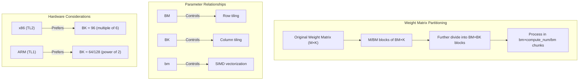
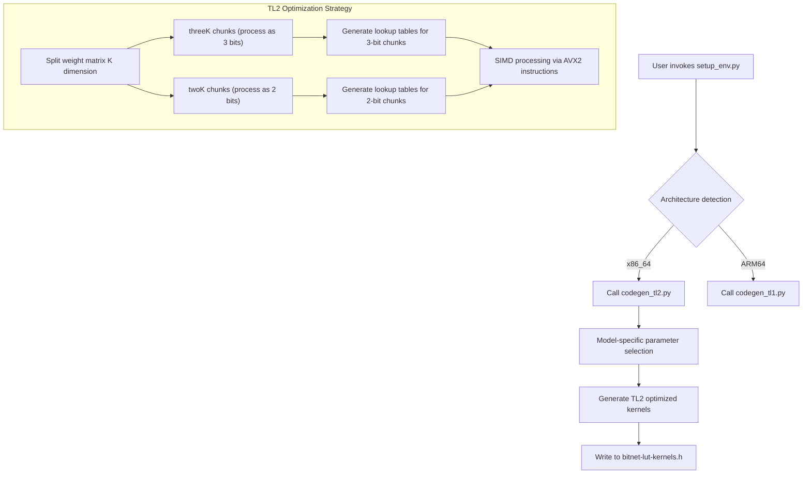
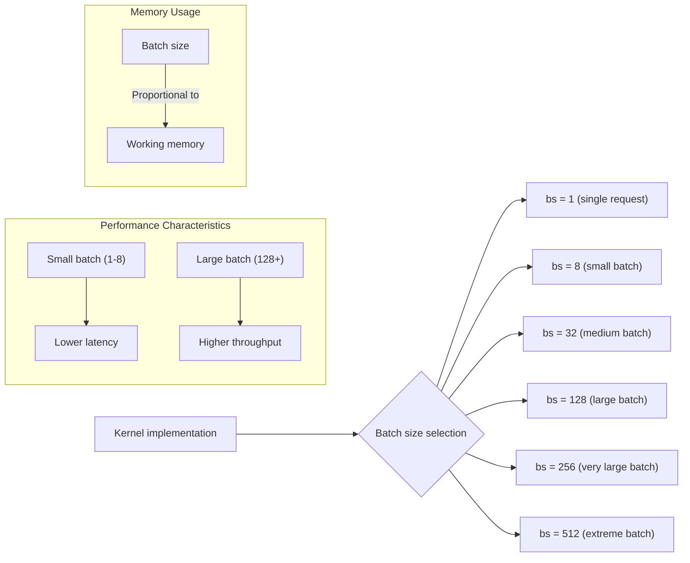
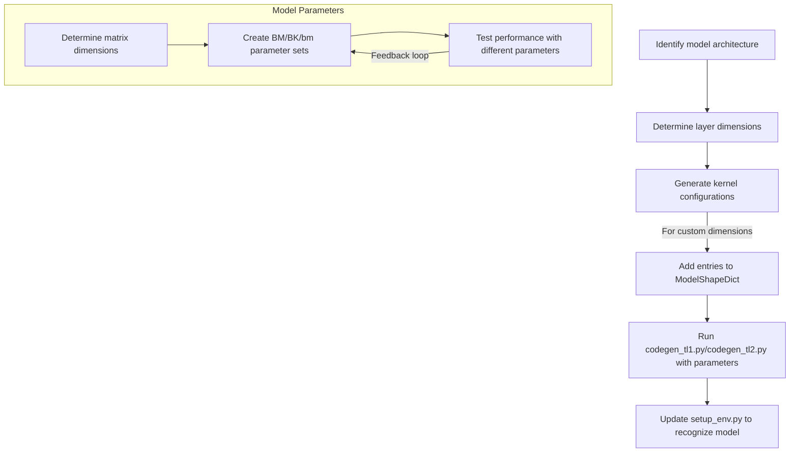
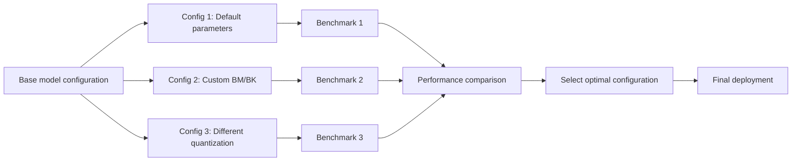

<!-- source: DeepWiki mcp.deepwiki.com · repo microsoft/BitNet · page 5 Advanced Usage · fetched 2026-10-26 -->

# Advanced Usage

<details>
<summary>Relevant source files</summary>

The following files were used as context for generating this wiki page:

- [run_inference.py](run_inference.py)
- [setup_env.py](setup_env.py)
- [src/README.md](src/README.md)
- [utils/convert-hf-to-gguf-bitnet.py](utils/convert-hf-to-gguf-bitnet.py)
- [utils/tune_gemm_config.py](utils/tune_gemm_config.py)

</details>


This page covers advanced topics for BitNet.cpp power users and developers who need to customize, optimize, and fine-tune the inference framework beyond the basic usage. For standard setup and inference instructions, refer to [Getting Started](#2) and [Running Inference](#3).

## Custom Kernel Configuration

BitNet.cpp achieves its performance through optimized kernels specifically designed for different hardware platforms (ARM and x86) and model architectures. You can customize these kernels to achieve optimal performance for your specific model and hardware configuration.

### Understanding Kernel Parameters

The kernel generation system in BitNet.cpp relies on three key parameters:

| Parameter | Description | Impact |
|-----------|-------------|--------|
| `BM` | Block size for matrix M dimension | Affects tile size for processing the weight matrix |
| `BK` | Block size for matrix K dimension | Controls data partitioning and memory access patterns |
| `bm` | Micro-block size for SIMD processing | Determines vectorization efficiency |

These parameters control how matrices are partitioned during inference computations:



Sources: [setup_env.py:152-168](), [utils/codegen_tl2.py:279-292]()

### Customizing Kernel Parameters

You can customize kernel parameters when setting up your environment using the `--use-pretuned` flag or by directly specifying parameters to the codegen scripts.

To use pre-tuned kernel parameters for a specific model:

```bash
python setup_env.py -md models/your-model -q tl2 -p
```

To generate custom kernels with specific parameters:

```bash
python utils/codegen_tl2.py --model model_name --BM "160,320,320" --BK "96,96,96" --bm "32,32,32"
```

The kernel parameters are stored in `include/kernel_config.ini` and can be manually adjusted for experimentation.

Sources: [setup_env.py:146-188]()

### Kernel Generation Process

The diagram below illustrates the kernel generation process for x86 platforms (TL2):



Sources: [utils/codegen_tl2.py:279-530](), [setup_env.py:140-188]()

## Performance Tuning

### Quantization Options

BitNet.cpp supports different quantization strategies that affect both performance and accuracy:

| Quantization | Description | Supported Platforms | Use Case |
|--------------|-------------|---------------------|----------|
| `i2_s` | Standard 2-bit signed integer | ARM, x86 | Good balance of performance and accuracy |
| `tl1` | Optimized lookup-based for ARM | ARM only | Best performance on ARM |
| `tl2` | Optimized lookup-based for x86 | x86 only | Best performance on x86 |

You can specify the quantization type when setting up your environment:

```bash
python setup_env.py -md models/your-model -q tl2
```

The `--quant-embd` flag can be used to quantize the embeddings to FP16, which reduces memory usage at the cost of slightly lower accuracy.

Sources: [setup_env.py:49-52](), [setup_env.py:114-135]()

### Batch Size Optimization

The inference performance can be significantly affected by the batch size. The optimized kernels in BitNet.cpp support specific batch sizes:



For benchmarking with different batch sizes, you can use the provided benchmark script:

```bash
python utils/e2e_benchmark.py -m models/your-model.gguf -t 4
```

Sources: [utils/codegen_tl2.py:532-623]()

### Thread Count Optimization

Thread count significantly impacts performance based on your CPU capabilities. You can set thread count during inference:

```bash
python run_inference.py -m models/your-model.gguf -p "Your prompt" -t 8
```

For best performance:
- For latency-sensitive applications, use thread count equal to the number of physical cores
- For throughput-oriented workloads, use thread count including hyper-threaded cores
- For very large models, reduce thread count to avoid memory contention

Sources: [README.md:204-231]()

## Advanced Model Compatibility

### Supporting Custom Model Architectures

BitNet.cpp primarily targets ternary (1-bit) models, but you can adapt it to work with custom model architectures by:

1. Adding the model architecture to the supported models list
2. Customizing the kernel parameters for the specific architecture
3. Generating a configuration that matches the layer dimensions



For testing custom architectures without an actual model, you can generate a dummy model:

```bash
python utils/generate-dummy-bitnet-model.py models/reference-model --outfile models/custom-model.tl2.gguf --outtype tl2 --model-size SIZE
```

Sources: [README.md:272-279](), [utils/codegen_tl2.py:683-696]()

### Using Alternative BitNet Model Formats

BitNet.cpp works with various 1-bit/ternary model formats. The compatibility matrix below shows which models can be used with which quantization methods:

| Model | Parameters | i2_s | TL1 (ARM) | TL2 (x86) |
|-------|------------|------|-----------|-----------|
| BitNet-b1.58-2B-4T | 2.4B | ✓ | ✓ | ✓ |
| bitnet_b1_58-large | 0.7B | ✓ | ✓ | ✓ |
| bitnet_b1_58-3B | 3.3B | ✗ | ✓ | ✓ |
| Llama3-8B-1.58 | 8.0B | ✓ | ✓ | ✓ |
| Falcon3 Family | 1B-10B | ✓ | ✓ | ✓ |

You can specify a Hugging Face repository directly when setting up:

```bash
python setup_env.py --hf-repo HF1BitLLM/Llama3-8B-1.58-100B-tokens -q tl1
```

Sources: [README.md:37-139](), [setup_env.py:13-47]()

## Advanced Benchmarking and Profiling

### End-to-End Benchmarking

For comprehensive performance analysis, use the end-to-end benchmarking tool:

```bash
python utils/e2e_benchmark.py -m models/your-model.gguf -n 200 -p 256 -t 4
```

Parameters to customize:
- `-n`: Number of tokens to generate (affects generation time)
- `-p`: Number of prompt tokens (affects prompt processing time)
- `-t`: Number of threads (affects parallelism)

This will provide metrics on:
- Tokens per second
- Prompt processing time
- Token generation time
- Total runtime

Sources: [README.md:233-271]()

### Comparing Different Kernel Configurations

To systematically compare different kernel configurations:

1. Generate multiple kernel configurations
2. Run benchmarks with each configuration
3. Compare results to find the optimal parameters



For systematic testing, create a shell script that iterates through different parameters and records performance metrics for each configuration.

Sources: [utils/codegen_tl2.py:682-725](), [README.md:233-271]()

## Troubleshooting Advanced Configurations

### Common Issues with Custom Kernels

When working with custom kernel configurations, you may encounter these common issues:

| Issue | Possible Cause | Solution |
|-------|---------------|----------|
| Build failure | Incompatible kernel parameters | Ensure BM, BK, and bm values are compatible with your model dimensions |
| Segmentation fault | Misaligned memory access | Make sure BK is a multiple of 32 for TL1 or a multiple of 6 for TL2 |
| Poor performance | Suboptimal block sizes | Experiment with different BM, BK values that match your CPU cache structure |
| Out of memory | Too large batch size | Reduce batch size or adjust BM/BK to reduce memory footprint |

When adjusting parameters, start with the default values for your model and make incremental changes while benchmarking performance.

Sources: [utils/codegen_tl2.py:725-741](), [setup_env.py:146-188]()

### Kernel Parameter Constraints

When customizing kernel parameters, certain constraints must be followed:

1. M % BM must equal 0 (matrix dimension must be divisible by block size)
2. K % BK % 32 must equal 0 (for alignment requirements)
3. bm value should be 32 for TL2 kernels
4. For TL2 (x86), BK should ideally be a multiple of 6 for optimal performance
5. For TL1 (ARM), BK should ideally be a power of 2 (64, 128) for optimal performance

Sources: [utils/codegen_tl2.py:725-729]()

## Conclusion

This page covered advanced usage topics for BitNet.cpp, including custom kernel configuration, performance tuning, and advanced model compatibility. By understanding and applying these concepts, you can optimize BitNet.cpp for your specific hardware, model architecture, and use case requirements.

For implementation details of the core BitNet.cpp architecture, refer to [Technical Architecture](#4).

---

