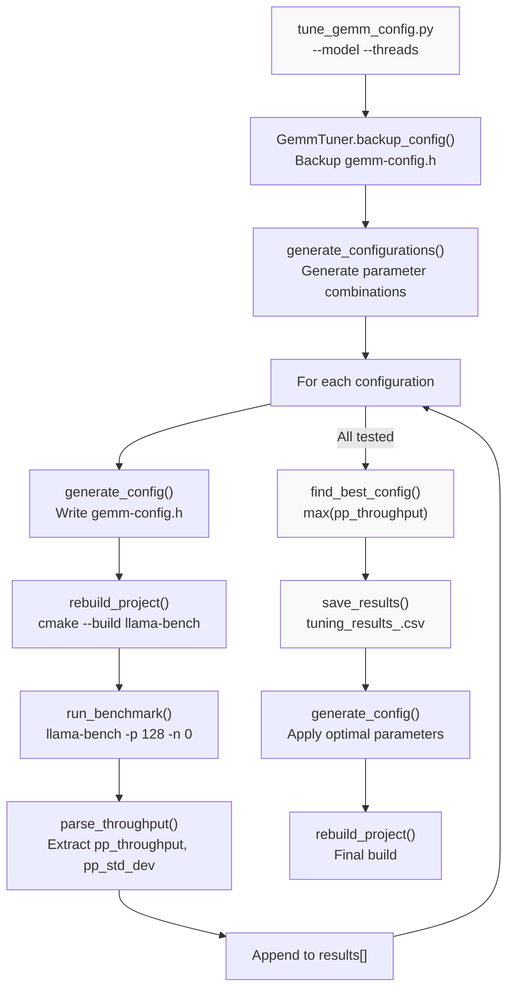
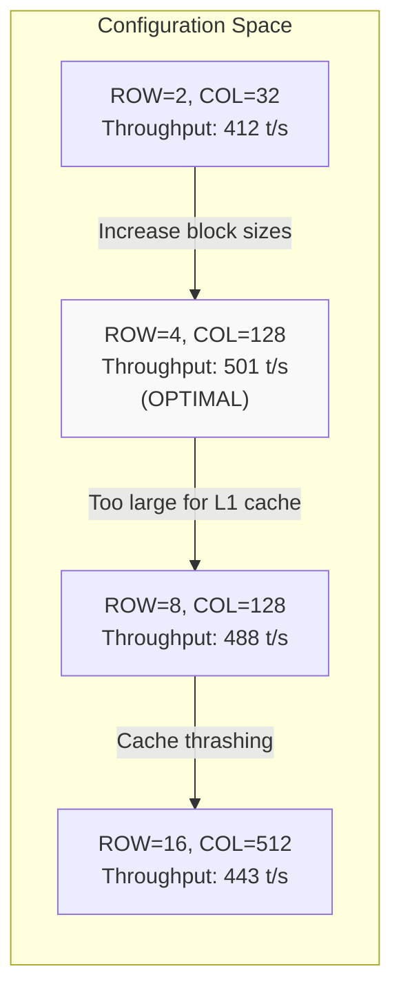
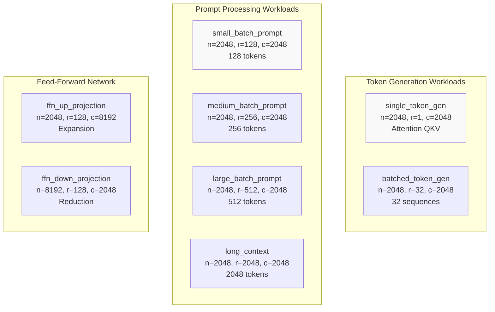
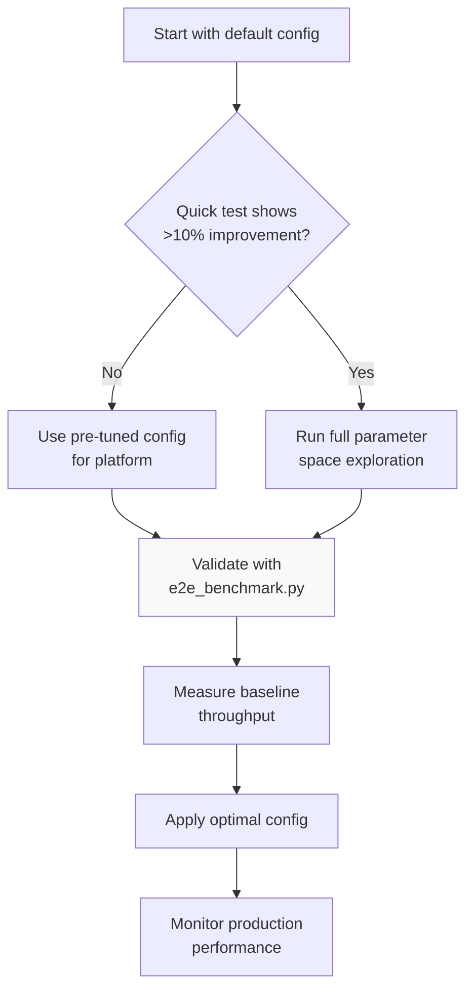

<!-- source: DeepWiki mcp.deepwiki.com · repo microsoft/BitNet · page 5.1 Performance Tuning Guide · fetched 2026-10-26 -->

# Performance Tuning Guide

<details>
<summary>Relevant source files</summary>

The following files were used as context for generating this wiki page:

- [src/README.md](src/README.md)
- [utils/test_gemm_kernel.sh](utils/test_gemm_kernel.sh)
- [utils/tune_gemm_config.py](utils/tune_gemm_config.py)

</details>


This guide covers automated and manual performance tuning for BitNet.cpp inference on different CPU architectures. The tuning process finds optimal GEMM/GEMV kernel configurations by systematically testing different block sizes and parallelism strategies, then measuring throughput with real inference workloads.

For manual configuration of kernel parameters without automated tuning, see [Custom Kernel Configuration](#5.2). For embedding quantization optimization, see [Embedding Quantization](#5.4). For general benchmarking procedures, see [Benchmarking Performance](#3.3).

**Sources:** [src/README.md:1-206](), [utils/tune_gemm_config.py:1-363]()

## When Performance Tuning Is Needed

Performance tuning is necessary when:

1. **New Hardware Deployment** - Different CPUs have varying cache sizes, memory bandwidth, and SIMD capabilities that affect optimal block sizes
2. **Different Workload Patterns** - Batch sizes, sequence lengths, and prompt vs. generation ratios influence optimal configurations
3. **Thread Count Changes** - Optimal parallelism parameters depend on the number of threads used during inference
4. **Custom Model Architectures** - Models with non-standard layer dimensions may benefit from architecture-specific tuning

The default configuration in [include/gemm-config.h]() provides reasonable performance across common hardware, but tuning can yield 20-40% throughput improvements on specific systems.

**Sources:** [src/README.md:87-111](), [utils/tune_gemm_config.py:296-310]()

## Configuration Parameters

The kernel behavior is controlled by four parameters defined in [include/gemm-config.h]():

| Parameter | Type | Range | Description |
|-----------|------|-------|-------------|
| `ACT_PARALLEL` | Flag | ON/OFF | Enables activation-parallel strategy (recommended for I2_S) |
| `ROW_BLOCK_SIZE` | Integer | 2-32 | Number of matrix rows processed per tiling block |
| `COL_BLOCK_SIZE` | Integer | 32-1024 | Number of matrix columns processed per tiling block |
| `PARALLEL_SIZE` | Integer | 2-8 | Parallelism degree for vectorized operations |

**Parameter Interactions:**

- When `ACT_PARALLEL=ON`: `PARALLEL_SIZE` must be ≤ `ROW_BLOCK_SIZE` (amortizes I2_S unpacking across activation elements)
- When `ACT_PARALLEL=OFF`: `PARALLEL_SIZE` must be ≤ `COL_BLOCK_SIZE` (parallelizes weight processing)
- Larger block sizes improve cache utilization but may cause cache thrashing on CPUs with small L1/L2 caches
- Smaller block sizes reduce computational intensity but increase loop overhead

**Sources:** [src/README.md:21-31](), [utils/tune_gemm_config.py:37-48](), [utils/tune_gemm_config.py:262-294]()

## Automated Tuning Workflow

The automated tuning system implements a systematic search over the configuration parameter space:



**Key Implementation Details:**

1. **Configuration Generation** - [utils/tune_gemm_config.py:262-294]() generates all valid parameter combinations, filtering invalid configurations (e.g., `PARALLEL_SIZE > ROW_BLOCK_SIZE` when `ACT_PARALLEL=ON`)

2. **Build Integration** - [utils/tune_gemm_config.py:52-64]() invokes `cmake --build` to recompile `llama-bench` with updated kernel parameters

3. **Benchmark Execution** - [utils/tune_gemm_config.py:66-91]() runs `llama-bench` with 128 prompt tokens (pp128 workload) to measure throughput

4. **Metric Parsing** - [utils/tune_gemm_config.py:93-108]() extracts throughput (tokens/s) and standard deviation from benchmark output using regex patterns

5. **Result Storage** - [utils/tune_gemm_config.py:153-164]() saves all configurations and metrics to CSV for offline analysis

**Sources:** [utils/tune_gemm_config.py:18-260](), [src/README.md:87-111]()

## Using tune_gemm_config.py

### Basic Usage

Run automated tuning for your specific hardware:

```bash
cd utils
python tune_gemm_config.py \
  --model ../models/BitNet-b1.58-2B-4T/ggml-model-i2_s.gguf \
  --threads 8 \
  --output ../stats/tuning_results.csv
```

**Command-Line Arguments:**

| Argument | Default | Description |
|----------|---------|-------------|
| `--config` | `../include/gemm-config.h` | Path to configuration header file |
| `--model` | `../models/.../ggml-model-i2_s.gguf` | GGUF model file for benchmarking |
| `--threads` | 8 | Number of CPU threads for inference |
| `--quick` | False | Run quick test with 5 preset configurations |
| `--custom` | False | Manually specify configurations interactively |
| `--output` | Auto-generated timestamp | Output CSV file path |

**Sources:** [utils/tune_gemm_config.py:296-310]()

### Quick Testing Mode

For rapid exploration, use `--quick` to test only key configurations:

```bash
python tune_gemm_config.py --model <model.gguf> --threads 8 --quick
```

This tests five configurations:
- `ACT_PARALLEL=ON, ROW=4, COL=128, PARALLEL=4`
- `ACT_PARALLEL=ON, ROW=8, COL=128, PARALLEL=4`
- `ACT_PARALLEL=ON, ROW=4, COL=64, PARALLEL=4`
- `ACT_PARALLEL=OFF, ROW=32, COL=4, PARALLEL=4`
- `ACT_PARALLEL=OFF, ROW=16, COL=4, PARALLEL=4`

**Sources:** [utils/tune_gemm_config.py:333-341]()

### Full Parameter Space Exploration

Modify [utils/tune_gemm_config.py:262-294]() to customize the search space:

```python
def generate_configurations():
    configurations = []
    
    act_parallel_options = [True]  # Test only ACT_PARALLEL=ON
    row_sizes = [2, 4, 8, 16, 32]
    col_sizes = [32, 64, 128, 256, 512, 1024]
    parallelism_degree = [2, 4, 8]
    
    for act_parallel in act_parallel_options:
        for row in row_sizes:
            for col in col_sizes:
                for parallel in parallelism_degree:
                    # Validation logic
                    if act_parallel and parallel > row:
                        continue
                    configurations.append({...})
    
    return configurations
```

This generates up to 450 configurations. Expect ~30 seconds per configuration (15-225 minutes total).

**Sources:** [utils/tune_gemm_config.py:262-294]()

### Interactive Application

The tuning script prompts for confirmation before applying the optimal configuration:

```
🏆 BEST CONFIGURATION FOUND!
Configuration: ACT_ON_R4_C128_P4
ACT_PARALLEL: True
ROW_BLOCK_SIZE: 4
COL_BLOCK_SIZE: 128
PARALLEL_SIZE: 4
PP128 Throughput: 501.06 ± 11.37 t/s

Do you want to apply this configuration to gemm-config.h? (y/n):
```

Answering `y` writes the optimal parameters to [include/gemm-config.h]() and rebuilds the project. Answering `n` restores the original configuration.

**Sources:** [utils/tune_gemm_config.py:202-243]()

## Understanding Tuning Results

### CSV Output Format

The tuning script saves detailed results to `stats/tuning_results_<timestamp>.csv`:

```csv
config_name,act_parallel,row_block_size,col_block_size,parallel_size,pp_throughput,pp_std_dev
ACT_ON_R2_C32_P2,True,2,32,2,412.34,8.21
ACT_ON_R4_C128_P4,True,4,128,4,501.06,11.37
ACT_ON_R8_C128_P4,True,8,128,4,487.92,9.54
```

**Columns:**
- `config_name` - Human-readable configuration identifier
- `act_parallel` - Boolean indicating activation parallel mode
- `row_block_size`, `col_block_size`, `parallel_size` - Kernel parameters
- `pp_throughput` - Prompt processing throughput (tokens/s) with 128-token prompt
- `pp_std_dev` - Standard deviation of throughput measurements

**Sources:** [utils/tune_gemm_config.py:153-164]()

### Performance Patterns

**Typical Results (AMD EPYC 7V13, 8 threads, pp128):**



**Observations:**
1. **Small blocks** (ROW=2, COL=32) - Low computational intensity, high loop overhead
2. **Medium blocks** (ROW=4-8, COL=64-128) - Optimal cache utilization on most CPUs
3. **Large blocks** (ROW=16+, COL=512+) - Cache thrashing degrades performance

**Sources:** [src/README.md:87-111]()

## Manual Kernel Testing

For detailed kernel-level performance analysis, use [utils/test_gemm_kernel.sh]():

```bash
cd utils
./test_gemm_kernel.sh -o ../stats/kernel_results.csv -i 1000
```

This script compiles a standalone benchmark [utils/test_gemm_kernel.sh:107-389]() that directly measures `ggml_gemm_i2_i8_s` performance across typical model layer shapes.

**Command-Line Arguments:**

| Argument | Default | Description |
|----------|---------|-------------|
| `-o, --output` | `../stats/gemm_kernel_test_noparal.csv` | Output CSV file |
| `-i, --iterations` | 1000 | Benchmark iterations per test |
| `-s, --skip-build` | False | Skip recompilation |
| `-h, --help` | - | Show usage information |

**Sources:** [utils/test_gemm_kernel.sh:1-574]()

### Test Scenarios

The script benchmarks eight representative matrix shapes:



Each test reports:
- Average/min/max latency (ms)
- GFLOPS (billions of floating-point operations per second)
- Throughput (tokens/s)
- Latency per token (µs)

**Sources:** [utils/test_gemm_kernel.sh:496-574]()

### Analyzing Kernel Test Results

Output CSV format from [utils/test_gemm_kernel.sh:458-493]():

```csv
test_name,n,nr,nc,time_ms,gflops,throughput_tokens_per_sec
single_token_gen,2048,1,2048,0.075±0.012,112.34,27307.52
small_batch_prompt,2048,128,2048,10.820±0.039,198.76,11826.40
```

The `time_ms` column format is `mean±std_dev`, calculated from min/max timing over iterations.

**Interpreting Results:**
- **GFLOPS** measures computational efficiency (higher is better)
- **Throughput** measures tokens processed per second (higher is better for batched workloads)
- **Latency per token** matters for interactive use cases (lower is better)

**Sources:** [utils/test_gemm_kernel.sh:458-493]()

## Using Pre-tuned Configurations

For common hardware platforms, use pre-tuned configurations from `preset_kernels/` directory:

```bash
python setup_env.py --use-pretuned --quant-type i2_s
```

This bypasses code generation and uses optimized lookup tables. Available presets:

| Platform | Architecture | Preset Directory | Optimization Target |
|----------|--------------|------------------|---------------------|
| x86_64 | Intel/AMD with AVX2 | `preset_kernels/TL2/` | TL2 kernels |
| ARM64 | Apple Silicon, AWS Graviton | `preset_kernels/TL1/` | TL1 kernels |
| ARM64 | With DOTPROD extension | `preset_kernels/TL1/` | TL1 + DOTPROD |

**Trade-offs:**
- **Faster compilation** - Skip code generation (saves 5-15 minutes)
- **Stable performance** - Tested configurations for common CPUs
- **Less flexibility** - May not be optimal for uncommon hardware

For new or uncommon hardware, custom tuning typically yields better results.

**Sources:** [src/README.md:1-206]()

## Best Practices

### Tuning Strategy



**Sources:** [src/README.md:87-111](), [utils/tune_gemm_config.py:296-363]()

### Thread-Specific Tuning

Optimal configurations vary with thread count. Tune for your deployment thread count:

**Single-threaded (t=1):**
- Small blocks minimize loop overhead
- Recommended: `ROW=2, COL=64, PARALLEL=2`

**Multi-threaded (t=8-16):**
- Larger blocks amortize synchronization costs
- Recommended: `ROW=4-8, COL=128-256, PARALLEL=4`

**High core count (t=32+):**
- Very large blocks reduce inter-thread communication
- Recommended: `ROW=8-16, COL=256-512, PARALLEL=4-8`

**Sources:** [src/README.md:87-111]()

### Validation Procedure

After tuning, validate performance across workloads:

1. **Prompt processing (pp128)** - Measured during tuning
2. **Token generation (tg128)** - Single token latency matters
3. **Mixed workloads** - Run [e2e_benchmark.py](#3.3) with `--prompt-tokens 128 --gen-tokens 128`
4. **Different batch sizes** - Test batch=1, 8, 32 if using batching

Ensure no workload regresses by >5% compared to default configuration.

**Sources:** [src/README.md:150-192]()

### Embedding Quantization Interaction

Tuning `gemm-config.h` optimizes matrix multiplication kernels but does not affect embedding layer quantization. For additional speedup, combine with Q6_K embedding quantization (see [Embedding Quantization](#5.4)):

```bash
# 1. Tune GEMM configuration
python utils/tune_gemm_config.py --model model.gguf --threads 8

# 2. Apply embedding quantization
python setup_env.py --quant-embd

# 3. Validate combined optimization
python e2e_benchmark.py --model model-i2_s-embed-q6_k.gguf
```

Both optimizations are orthogonal and combine additively.

**Sources:** [src/README.md:33-46](), [src/README.md:113-149]()

---

