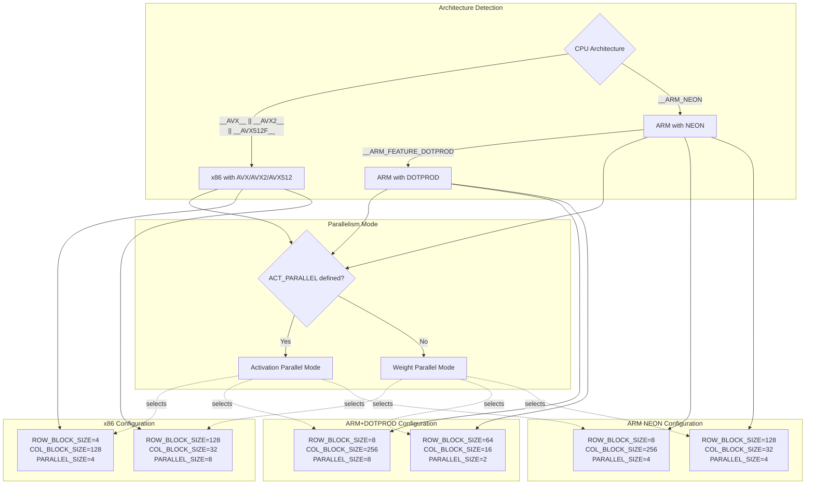
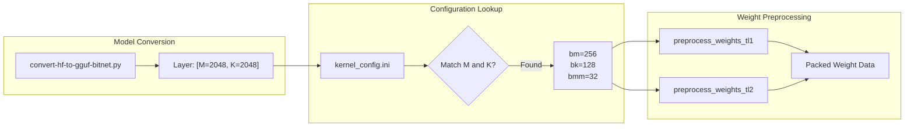
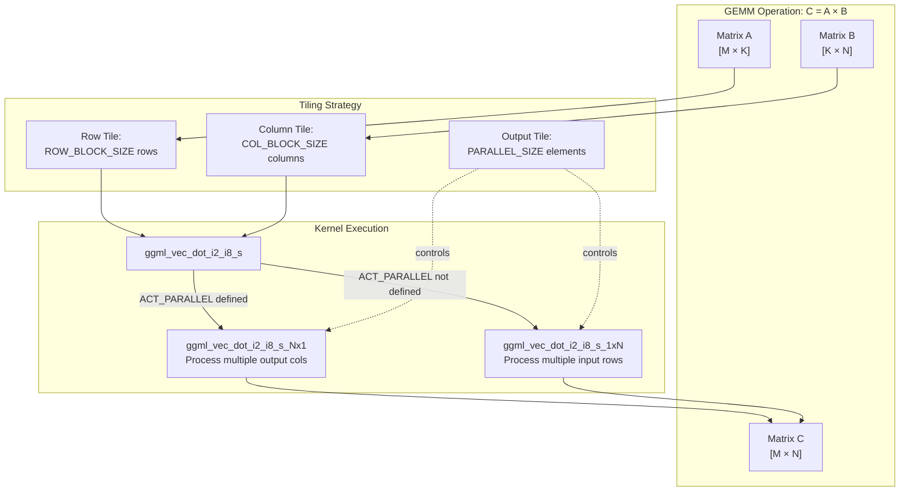
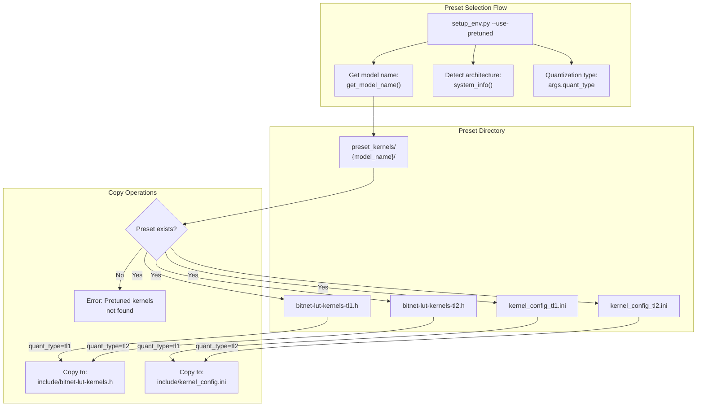
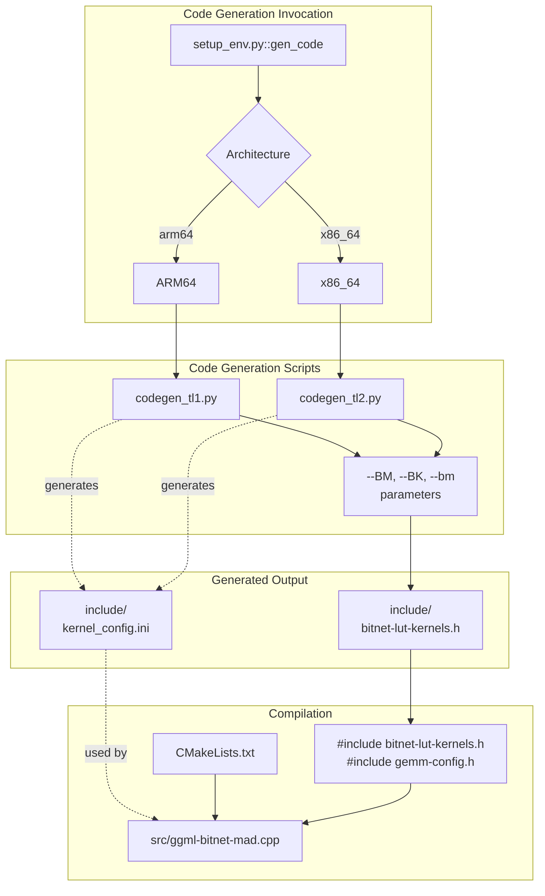

<!-- source: DeepWiki mcp.deepwiki.com · repo microsoft/BitNet · page 5.2 Custom Kernel Configuration · fetched 2026-10-26 -->

# Custom Kernel Configuration

<details>
<summary>Relevant source files</summary>

The following files were used as context for generating this wiki page:

- [include/gemm-config.h](include/gemm-config.h)
- [run_inference.py](run_inference.py)
- [setup_env.py](setup_env.py)
- [src/README.md](src/README.md)
- [src/ggml-bitnet-mad.cpp](src/ggml-bitnet-mad.cpp)
- [utils/convert-hf-to-gguf-bitnet.py](utils/convert-hf-to-gguf-bitnet.py)

</details>


This page explains how to manually configure BitNet kernel parameters for specific hardware platforms. For automated performance tuning that discovers optimal parameters, see [5.1](#5.1). For understanding the underlying kernel architecture and code generation process, see [4.4](#4.4).

## Overview

BitNet.cpp uses configurable kernel parameters to optimize GEMM/GEMV operations for different CPU architectures. These parameters control blocking strategies, parallelism levels, and memory access patterns. Users can either use pre-tuned configurations from `preset_kernels/` or manually specify parameters in configuration files.

The configuration system operates at two levels:
1. **Runtime tiling parameters** in `include/gemm-config.h` that control how kernels process data
2. **Weight preprocessing parameters** in `include/kernel_config.ini` that define how weights are packed during model conversion

Sources: [setup_env.py:156-201](), [include/gemm-config.h:1-36](), [src/README.md:19-31]()

## Configuration Files

### gemm-config.h

The primary configuration file for runtime kernel behavior. This header defines three critical parameters:

```c
#define ROW_BLOCK_SIZE 4       // Number of rows processed per tile
#define COL_BLOCK_SIZE 128     // Number of columns processed per tile
#define PARALLEL_SIZE 4        // Parallelism degree for multi-row/column processing
```

The file uses preprocessor conditionals to select appropriate defaults based on CPU architecture and SIMD capabilities:



**Diagram: gemm-config.h Architecture Selection Logic**

Sources: [include/gemm-config.h:1-36]()

### kernel_config.ini

This INI file stores layer-specific weight packing parameters used during model conversion. Each section corresponds to a specific layer dimension and contains:

| Parameter | Description | Example Value |
|-----------|-------------|---------------|
| `m` | Matrix rows (output dimension) | `2048` |
| `k` | Matrix columns (input dimension) | `2048` |
| `bm` | Block size for M dimension | `256` |
| `bk` | Block size for K dimension | `128` |
| `bmm` | Micro-block size for M | `32` |

The conversion utilities `convert-hf-to-gguf-bitnet.py` read this file to determine how to pack weights for each layer:



**Diagram: kernel_config.ini Usage in Weight Preprocessing**

Sources: [utils/convert-hf-to-gguf-bitnet.py:483-520](), [utils/convert-hf-to-gguf-bitnet.py:597-660]()

## Configuration Parameters

### Block Size Parameters

**ROW_BLOCK_SIZE**: Controls how many output rows are computed together in a single tile. Larger values improve instruction-level parallelism but may exceed cache capacity.

**COL_BLOCK_SIZE**: Controls how many input/output columns are processed per tile. Must be chosen to maximize cache utilization while ensuring complete SIMD vector usage.

**PARALLEL_SIZE**: Determines the parallelism degree when processing multiple rows or columns simultaneously. Used by `ggml_vec_dot_i2_i8_s_1xN` and `ggml_vec_dot_i2_i8_s_Nx1` functions.

The relationship between these parameters and memory access patterns:



**Diagram: Configuration Parameters and Kernel Dispatch**

Sources: [src/ggml-bitnet-mad.cpp:1043-1056](), [include/gemm-config.h:1-36]()

### Parallelism Modes

The `ACT_PARALLEL` macro switches between two parallelization strategies:

**Activation Parallel (ACT_PARALLEL defined)**: Amortizes the cost of unpacking I2_S weights across multiple activation elements. The `ggml_vec_dot_i2_i8_s_Nx1` function processes `PARALLEL_SIZE` output columns simultaneously using the same unpacked weight data.

**Weight Parallel (ACT_PARALLEL undefined)**: Processes multiple weight rows simultaneously. The `ggml_vec_dot_i2_i8_s_1xN` function computes `PARALLEL_SIZE` dot products in parallel.

| Mode | Best For | Function | Key Benefit |
|------|----------|----------|-------------|
| Activation Parallel | I2_S quantization | `ggml_vec_dot_i2_i8_s_Nx1` | Reuses unpacked weights |
| Weight Parallel | Dense computation | `ggml_vec_dot_i2_i8_s_1xN` | Better cache locality |

Sources: [src/ggml-bitnet-mad.cpp:512-789](), [src/ggml-bitnet-mad.cpp:791-1040](), [src/README.md:50-77]()

## Architecture-Specific Configurations

### x86 with AVX2

The x86 configuration leverages 256-bit AVX2 SIMD instructions. Default activation parallel configuration:

```
ROW_BLOCK_SIZE = 4
COL_BLOCK_SIZE = 128
PARALLEL_SIZE = 4
```

This processes 4 output columns simultaneously, with each inner loop handling 128 elements at a time using `_mm256_loadu_si256` intrinsics for efficient data movement.

Key implementation details:
- Uses `_mm256_maddubs_epi16` for efficient multiply-add of unsigned/signed 8-bit integers
- Processes weights in groups of 32 blocks (4096 elements) to maximize cache efficiency
- Accumulates results in 256-bit registers before horizontal reduction with `hsum_i32_8`

Sources: [src/ggml-bitnet-mad.cpp:512-633](), [include/gemm-config.h:2-11]()

### ARM with NEON

ARM NEON provides 128-bit SIMD operations. Default activation parallel configuration:

```
ROW_BLOCK_SIZE = 8
COL_BLOCK_SIZE = 256
PARALLEL_SIZE = 4
```

The implementation uses different strategies depending on DOTPROD availability:

**With DOTPROD Extension** (`__ARM_FEATURE_DOTPROD`):
- Uses `vdotq_s32` for efficient 4×8-bit dot product into 32-bit accumulator
- Enables higher parallelism (PARALLEL_SIZE = 8)
- Reduces intermediate accumulation steps

**Without DOTPROD**:
- Uses `vmlal_s8` for multiply-accumulate with 16-bit intermediate results
- Requires explicit widening operations: `vmovl_s16`, `vmovl_high_s16`
- Lower PARALLEL_SIZE (4) to reduce register pressure

Sources: [src/ggml-bitnet-mad.cpp:634-788](), [include/gemm-config.h:12-34]()

## Using Preset Kernels

Preset kernels provide pre-optimized configurations for specific models and hardware platforms, stored in `preset_kernels/<model_name>/`:

```
preset_kernels/
├── bitnet_b1_58-3B/
│   ├── bitnet-lut-kernels-tl1.h
│   ├── bitnet-lut-kernels-tl2.h
│   ├── kernel_config_tl1.ini
│   └── kernel_config_tl2.ini
├── bitnet_b1_58-large/
│   └── ...
└── Llama3-8B-1.58-100B-tokens/
    └── ...
```

### Automatic Preset Selection

Use the `--use-pretuned` flag with `setup_env.py`:

```bash
python setup_env.py --hf-repo "1bitLLM/bitnet_b1_58-3B" \
                    --quant-type tl1 \
                    --use-pretuned
```

The setup script automatically:
1. Detects the CPU architecture (x86_64 or arm64)
2. Selects the appropriate quantization-specific preset
3. Copies `bitnet-lut-kernels-{quant_type}.h` to `include/bitnet-lut-kernels.h`
4. Copies `kernel_config_{quant_type}.ini` to `include/kernel_config.ini`



**Diagram: Preset Kernel Selection and Copy Process**

Sources: [setup_env.py:162-190]()

### Manual Preset Installation

To manually install preset kernels:

```bash
# For TL1 on ARM
cp preset_kernels/bitnet_b1_58-3B/bitnet-lut-kernels-tl1.h include/bitnet-lut-kernels.h
cp preset_kernels/bitnet_b1_58-3B/kernel_config_tl1.ini include/kernel_config.ini

# For TL2 on x86
cp preset_kernels/bitnet_b1_58-3B/bitnet-lut-kernels-tl2.h include/bitnet-lut-kernels.h
cp preset_kernels/bitnet_b1_58-3B/kernel_config_tl2.ini include/kernel_config.ini
```

After copying, rebuild:

```bash
cmake -B build
cmake --build build --config Release
```

Sources: [setup_env.py:162-190]()

## Manual Configuration Workflow

### Step 1: Modify gemm-config.h

Edit `include/gemm-config.h` to set custom parameters:

```c
#define ACT_PARALLEL  // Choose parallelism mode
#define ROW_BLOCK_SIZE 8
#define COL_BLOCK_SIZE 256
#define PARALLEL_SIZE 4
```

Considerations:
- **Cache Size**: Total working set should fit in L1/L2 cache
  - L1 data cache is typically 32-64 KB per core
  - Working set ≈ `ROW_BLOCK_SIZE × COL_BLOCK_SIZE × sizeof(element)`
- **SIMD Width**: Choose block sizes that align with vector widths
  - x86 AVX2: 256-bit (32 bytes)
  - ARM NEON: 128-bit (16 bytes)
- **Register Pressure**: `PARALLEL_SIZE` × number of accumulators must fit in registers
  - x86: 16 vector registers available
  - ARM: 32 vector registers available

Sources: [include/gemm-config.h:1-36](), [src/README.md:86-112]()

### Step 2: Update kernel_config.ini

For TL1/TL2 quantization, create or modify `include/kernel_config.ini` with layer-specific parameters:

```ini
[kernel_0]
m = 2048
k = 2048
bm = 256
bk = 128
bmm = 32

[kernel_1]
m = 8192
k = 2048
bm = 256
bk = 128
bmm = 32
```

Each section must match a layer's dimensions (`m`, `k`). The conversion script looks up these values:

```python
config.read('include/kernel_config.ini')
for kernel in config.sections():
    if int(config.get(kernel, 'm')) == M and int(config.get(kernel, 'k')) == K:
        BM = int(config.get(kernel, 'bm'))
        BY = int(config.get(kernel, 'bk'))
        bm = int(config.get(kernel, 'bmm'))
```

If no matching section is found, conversion fails with `NotImplementedError`.

Sources: [utils/convert-hf-to-gguf-bitnet.py:493-507](), [utils/convert-hf-to-gguf-bitnet.py:611-625]()

### Step 3: Rebuild and Test

```bash
# Rebuild with new configuration
cmake -B build
cmake --build build --config Release

# Test performance
python e2e_benchmark.py -m models/bitnet_b1_58-3B/ggml-model-i2_s.gguf \
                        -p 128 -n 128 -t 4 -r 5
```

Monitor performance metrics and iterate on parameters. For systematic exploration, use the automated tuning tools described in [5.1](#5.1).

Sources: [setup_env.py:203-217]()

## Code Generation Integration

For TL1 and TL2 quantization, `setup_env.py` invokes code generation scripts that use both configuration sources:



**Diagram: Configuration Flow Through Code Generation**

### Model-Specific Code Generation Parameters

The `gen_code()` function in `setup_env.py` calls code generators with model-specific block size parameters:

**For bitnet_b1_58-3B (ARM TL1)**:
```bash
python utils/codegen_tl1.py --model bitnet_b1_58-3B \
                            --BM 160,320,320 \
                            --BK 64,128,64 \
                            --bm 32,64,32
```

**For Llama3-8B-1.58-100B-tokens (x86 TL2)**:
```bash
python utils/codegen_tl2.py --model Llama3-8B-1.58-100B-tokens \
                            --BM 256,128,256,128 \
                            --BK 96,96,96,96 \
                            --bm 32,32,32,32
```

These parameters control:
- **BM**: Block sizes for the M (row) dimension across layers
- **BK**: Block sizes for the K (column) dimension across layers  
- **bm**: Micro-block sizes for M dimension across layers

Each comma-separated list corresponds to a different layer in the model architecture.

Sources: [setup_env.py:156-201]()

### Integration with Runtime Configuration

The generated `bitnet-lut-kernels.h` contains lookup tables that are compiled into `ggml-bitnet-mad.cpp`. At runtime, the kernels use parameters from `gemm-config.h`:

```c
// From src/ggml-bitnet-mad.cpp
#include "gemm-config.h"  // ROW_BLOCK_SIZE, COL_BLOCK_SIZE, PARALLEL_SIZE
#include "bitnet-lut-kernels.h"  // Generated lookup tables

void ggml_vec_dot_i2_i8_s_1xN(int n, float * s, ...) {
    // Uses PARALLEL_SIZE from gemm-config.h
    for (int row = 0; row < nrc; row += PARALLEL_SIZE) {
        // Kernel implementation using generated lookup tables
    }
}
```

This separation allows:
- **Build-time optimization**: Generated lookup tables are specific to quantization type and model
- **Runtime flexibility**: Block sizes can be tuned without regenerating lookup tables (for I2_S)
- **Architecture portability**: Same lookup table format works across x86 and ARM

Sources: [src/ggml-bitnet-mad.cpp:1-9](), [src/ggml-bitnet-mad.cpp:512-633]()

## Configuration Impact on Performance

The configuration parameters directly affect three key performance aspects:

### Cache Utilization

```
Working Set Size = ROW_BLOCK_SIZE × COL_BLOCK_SIZE × element_size
                 + PARALLEL_SIZE × vector_size
```

For optimal L1 cache utilization (32 KB typical):
- x86 ACT_PARALLEL: 4 × 128 × 1 + 4 × 32 = 640 bytes per tile
- ARM NEON ACT_PARALLEL: 8 × 256 × 1 + 4 × 16 = 2112 bytes per tile

### Instruction-Level Parallelism

Higher `PARALLEL_SIZE` exposes more independent operations:
- More registers utilized simultaneously
- Better pipelining and out-of-order execution
- Higher computational intensity (operations per memory access)

### SIMD Efficiency

Block sizes must align with SIMD vector widths to avoid partial vector operations:
- x86 AVX2: `COL_BLOCK_SIZE % 32 == 0` for full 256-bit vectors
- ARM NEON: `COL_BLOCK_SIZE % 16 == 0` for full 128-bit vectors

Misalignment causes padding overhead and reduced effective throughput.

Sources: [src/README.md:86-112](), [include/gemm-config.h:1-36]()

---

