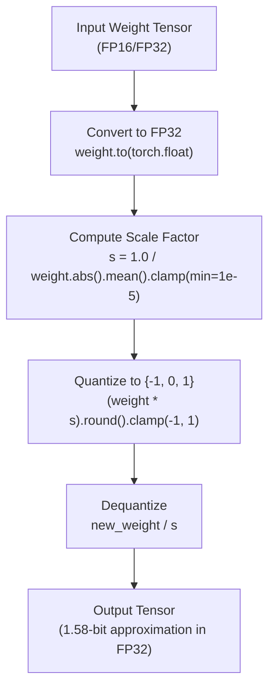
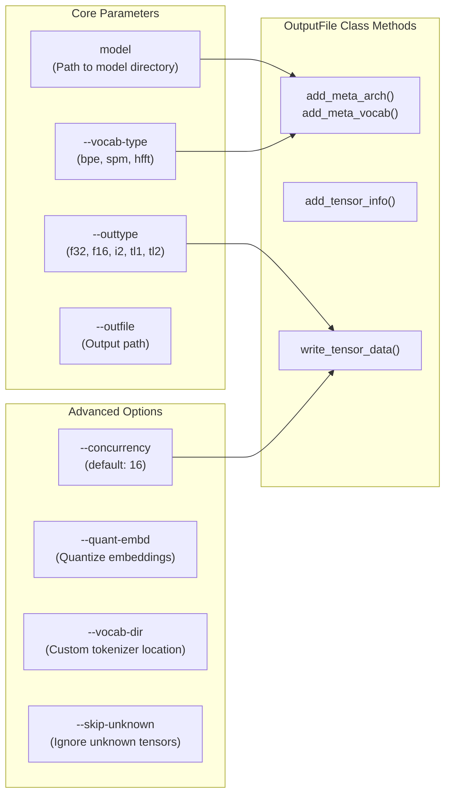
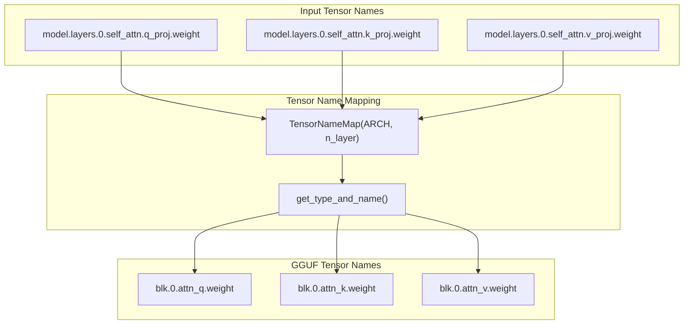
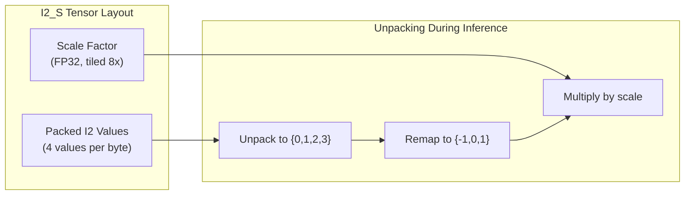
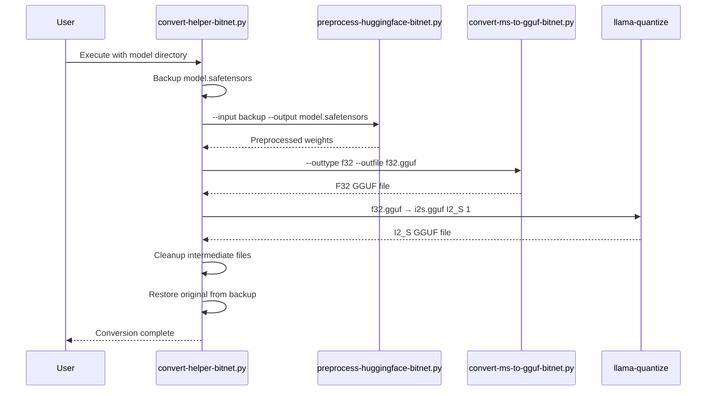

<!-- source: DeepWiki mcp.deepwiki.com · repo microsoft/BitNet · page 5.3 Manual Model Conversion · fetched 2026-10-26 -->

# Manual Model Conversion

<details>
<summary>Relevant source files</summary>

The following files were used as context for generating this wiki page:

- [utils/convert-helper-bitnet.py](utils/convert-helper-bitnet.py)
- [utils/convert-ms-to-gguf-bitnet.py](utils/convert-ms-to-gguf-bitnet.py)
- [utils/convert.py](utils/convert.py)
- [utils/preprocess-huggingface-bitnet.py](utils/preprocess-huggingface-bitnet.py)

</details>


This page documents the manual model conversion process for BitNet models. Manual conversion provides fine-grained control over each stage of the model preparation pipeline, allowing users to customize conversion parameters, inspect intermediate outputs, and debug conversion issues.

For automated model preparation using `setup_env.py`, see [Model Preparation](#2.2). For technical details on the conversion algorithms and data transformations, see [Model Conversion Pipeline](#4.6).

## Overview

Manual conversion is useful when you need to:
- Convert models not available on HuggingFace
- Customize quantization parameters
- Debug conversion failures
- Process models with non-standard architectures
- Generate intermediate F32 GGUF files for inspection

The conversion process transforms models from their source format (safetensors or HuggingFace checkpoints) into GGUF files optimized for BitNet.cpp inference, with optional quantization to I2_S, TL1, or TL2 formats.

## Conversion Workflow Overview

```mermaid
flowchart TB
    subgraph "Source Formats"
        HF["HuggingFace Model<br/>(model.safetensors + config.json)"]
        LOCAL["Local Safetensors<br/>(model.safetensors)"]
    end
    
    subgraph "Preprocessing Stage"
        BACKUP["Backup Original<br/>(model.safetensors.backup)"]
        PREPROC["preprocess-huggingface-bitnet.py<br/>quant_weight_fp16()"]
        QUANT_WEIGHTS["Quantized Safetensors<br/>(1.58-bit weights)"]
    end
    
    subgraph "Conversion Stage"
        CONV_MS["convert-ms-to-gguf-bitnet.py"]
        CONV_HF["convert-hf-to-gguf-bitnet.py"]
        F32_GGUF["F32 GGUF<br/>(ggml-model-f32-bitnet.gguf)"]
    end
    
    subgraph "Quantization Stage"
        LLAMA_QUANT["llama-quantize binary"]
        I2S_OUT["I2_S GGUF<br/>(ggml-model-i2s-bitnet.gguf)"]
        TL1_OUT["TL1 GGUF<br/>(direct conversion)"]
        TL2_OUT["TL2 GGUF<br/>(direct conversion)"]
    end
    
    HF --> BACKUP
    LOCAL --> BACKUP
    BACKUP --> PREPROC
    PREPROC --> QUANT_WEIGHTS
    
    QUANT_WEIGHTS --> CONV_MS
    HF --> CONV_HF
    
    CONV_MS --> F32_GGUF
    CONV_HF --> F32_GGUF
    
    F32_GGUF --> LLAMA_QUANT
    LLAMA_QUANT --> I2S_OUT
    
    CONV_MS -.--outtype tl1.-> TL1_OUT
    CONV_MS -.--outtype tl2.-> TL2_OUT
```

**Diagram: Manual Conversion Pipeline - Complete Workflow**

The conversion process consists of three distinct stages that can be executed independently or as part of an automated workflow.

Sources: [utils/convert-helper-bitnet.py:1-134](), [utils/convert-ms-to-gguf-bitnet.py:1-100](), [utils/preprocess-huggingface-bitnet.py:1-50]()

## Conversion Scripts and Their Roles

| Script | Primary Function | Input Format | Output Format | Key Classes/Functions |
|--------|------------------|--------------|---------------|----------------------|
| `preprocess-huggingface-bitnet.py` | Quantize weights to 1.58-bit | Safetensors | Safetensors | `quant_weight_fp16()`, `quant_model()` |
| `convert-ms-to-gguf-bitnet.py` | Convert Microsoft checkpoints | Safetensors | GGUF | `OutputFile`, `BitNetModel` |
| `convert-hf-to-gguf-bitnet.py` | Convert HuggingFace models | Safetensors/PyTorch | GGUF | `OutputFile`, `LlamaModel` |
| `convert-helper-bitnet.py` | Orchestrate full pipeline | Safetensors | I2_S GGUF | `run_command()`, `main()` |

Sources: [utils/preprocess-huggingface-bitnet.py:5-34](), [utils/convert-ms-to-gguf-bitnet.py:1146-1209](), [utils/convert-helper-bitnet.py:9-134]()

## Step 1: Weight Preprocessing

Weight preprocessing quantizes model weights to the 1.58-bit format expected by BitNet models. This step is required for HuggingFace models but may be skipped if working with pre-quantized checkpoints.

### Using preprocess-huggingface-bitnet.py

```bash
python utils/preprocess-huggingface-bitnet.py \
    --input /path/to/model.safetensors \
    --output /path/to/model_preprocessed.safetensors
```

**Important:** Always create a backup before preprocessing, as this operation modifies weight tensors in place.

### Quantization Algorithm

The `quant_weight_fp16()` function implements the BitNet quantization algorithm:



**Diagram: Weight Quantization Algorithm Flow**

The algorithm ensures weights are distributed approximately as ternary values {-1, 0, 1} while preserving the original scale through the factor `s`.

Sources: [utils/preprocess-huggingface-bitnet.py:5-9]()

### Target Layers

Preprocessing applies only to specific linear projection layers:

- `q_proj.weight` - Query projection
- `k_proj.weight` - Key projection  
- `v_proj.weight` - Value projection
- `o_proj.weight` - Output projection
- `gate_proj.weight` - Gate projection (MLP)
- `up_proj.weight` - Up projection (MLP)
- `down_proj.weight` - Down projection (MLP)

Embedding and normalization layers are not quantized at this stage.

Sources: [utils/preprocess-huggingface-bitnet.py:18-30]()

## Step 2: GGUF Conversion

GGUF conversion transforms the model from safetensors format into the GGUF binary format used by llama.cpp and BitNet.cpp.

### Conversion Script Selection

Use `convert-ms-to-gguf-bitnet.py` for Microsoft-released BitNet models, or `convert-hf-to-gguf-bitnet.py` for standard HuggingFace models. The primary difference lies in tensor name mapping and architecture detection.

### Basic F32 Conversion

```bash
python utils/convert-ms-to-gguf-bitnet.py \
    /path/to/model_directory \
    --vocab-type bpe \
    --outtype f32 \
    --outfile ggml-model-f32.gguf
```

### Direct TL1/TL2 Conversion

For TL1 (ARM) or TL2 (x86) formats, conversion can produce the final quantized format directly:

```bash
# TL1 for ARM platforms
python utils/convert-ms-to-gguf-bitnet.py \
    /path/to/model_directory \
    --vocab-type bpe \
    --outtype tl1 \
    --outfile ggml-model-tl1.gguf

# TL2 for x86 platforms  
python utils/convert-ms-to-gguf-bitnet.py \
    /path/to/model_directory \
    --vocab-type bpe \
    --outtype tl2 \
    --outfile ggml-model-tl2.gguf
```

Sources: [utils/convert-ms-to-gguf-bitnet.py:1500-1610]()

### Conversion Parameters



**Diagram: Conversion Parameters and OutputFile Methods**

Sources: [utils/convert-ms-to-gguf-bitnet.py:1500-1522](), [utils/convert-ms-to-gguf-bitnet.py:1146-1273]()

### Data Type Handling

The conversion process maps NumPy data types to GGUF types through the `GGMLFileType` enumeration:

| Input Type | GGMLFileType | GGUF Data Type | Use Case |
|------------|--------------|----------------|----------|
| FP32 | `AllF32` | `DT_F32` | Unquantized models, debugging |
| FP16 | `MostlyF16` | `DT_F16` | General purpose |
| I2 | `MostlyI2` | `DT_I2` | BitNet weights (requires preprocessing) |
| Q8_0 | `MostlyQ8_0` | `DT_Q8_0` | Activation quantization |

The `type_for_tensor()` method determines the appropriate data type for each tensor based on dimensionality and name.

Sources: [utils/convert-ms-to-gguf-bitnet.py:177-200]()

### Tensor Name Mapping

The `BitNetModel` class (or `LlamaModel` for HuggingFace) performs tensor name mapping through `convert_model_names()`:



**Diagram: Tensor Name Mapping from HuggingFace to GGUF Format**

Sources: [utils/convert-ms-to-gguf-bitnet.py:1302-1361]()

### Weight Preprocessing for TL Formats

When converting to TL1 or TL2 formats, the `preprocess_weights()` function reorganizes weight layout for optimal SIMD processing:

Key transformations:
1. **Bit unpacking** - Separate 2-bit values into individual bits
2. **Group packing** - Pack groups of 4 values for 8-bit representation
3. **SIMD reorganization** - Reorder for optimal vector processing
4. **Tile blocking** - Apply blocking factors from `kcfg.ini`

Sources: [utils/convert-ms-to-gguf-bitnet.py:723-766]()

## Step 3: I2_S Quantization

The I2_S quantization format is applied as a post-processing step using the `llama-quantize` binary. This step is only needed if F32 GGUF was generated in Step 2.

### Using llama-quantize

```bash
./build/bin/llama-quantize \
    ggml-model-f32.gguf \
    ggml-model-i2s.gguf \
    I2_S \
    1
```

**Parameters:**
- Argument 1: Input F32 GGUF file
- Argument 2: Output I2_S GGUF file  
- Argument 3: Quantization type (`I2_S`)
- Argument 4: Number of threads (typically `1` for consistency)

### I2_S Format Structure

I2_S (I2 with Scale) stores 2-bit quantized weights alongside per-tensor scale factors:



**Diagram: I2_S Tensor Storage and Unpacking**

The scale factor is tiled 8 times to facilitate efficient SIMD operations during inference.

Sources: [utils/convert-ms-to-gguf-bitnet.py:1153-1209](), [utils/convert-ms-to-gguf-bitnet.py:768-779]()

## Using the Helper Script

The `convert-helper-bitnet.py` script automates the complete conversion workflow:

```bash
python utils/convert-helper-bitnet.py /path/to/model_directory
```

### Helper Script Workflow



**Diagram: Helper Script Execution Sequence**

### File Management

The helper script implements careful file management:

1. **Backup**: Original `model.safetensors` → `model.safetensors.backup` [utils/convert-helper-bitnet.py:62-66]()
2. **Preprocessing**: Backup → temporary preprocessed file
3. **Conversion**: Preprocessed → F32 GGUF
4. **Quantization**: F32 GGUF → I2_S GGUF  
5. **Cleanup**: Remove preprocessed file, optionally keep F32 GGUF [utils/convert-helper-bitnet.py:104-131]()
6. **Restore**: Restore original from backup

Sources: [utils/convert-helper-bitnet.py:61-131]()

## Advanced Conversion Techniques

### Custom Kernel Configuration

When converting to TL1/TL2, the conversion process reads kernel parameters from `build/kcfg.ini`:

```ini
[gemm_config_m5120_k2560]
bm = 32
kfactor = 8
simd_n_in = 16
simd_n_out = 16
```

These parameters control the weight preprocessing layout. To use custom configurations:

1. Generate or modify `build/kcfg.ini` before conversion
2. Ensure parameters match your target hardware
3. Run conversion with matching `--outtype` (tl1 or tl2)

For details on tuning these parameters, see [Custom Kernel Configuration](#5.2).

Sources: [utils/convert-ms-to-gguf-bitnet.py:730-740]()

### Multi-File Model Handling

For models split across multiple safetensors files:

1. The converter automatically detects patterns like `model-00001-of-00002.safetensors`
2. Use `find_multifile_paths()` to locate all parts [utils/convert-ms-to-gguf-bitnet.py:1384-1399]()
3. Models are merged via `merge_multifile_models()` [utils/convert-ms-to-gguf-bitnet.py:901-921]()

### Vocabulary Handling

Three vocabulary types are supported:

| Type | Class | Tokenizer File | Use Case |
|------|-------|----------------|----------|
| `bpe` | `BpeVocab` | `vocab.json` or `tokenizer.json` | GPT-2 style tokenizers |
| `spm` | `SentencePieceVocab` | `tokenizer.model` | LLaMA-style models |
| `hfft` | `LlamaHfVocab` | `tokenizer.json` | HuggingFace Fast Tokenizers |

Specify with `--vocab-type bpe,spm,hfft` to try in order.

Sources: [utils/convert-ms-to-gguf-bitnet.py:419-686](), [utils/convert-ms-to-gguf-bitnet.py:1425-1474]()

### Embedding Quantization

Add `--quant-embd` flag to quantize embedding layers. This can significantly reduce model size with minimal quality impact. See [Embedding Quantization](#5.4) for detailed analysis.

### Debugging Conversion Issues

**Dump model structure without converting:**

```bash
python utils/convert-ms-to-gguf-bitnet.py /path/to/model --dump
```

**Dump single file:**

```bash
python utils/convert-ms-to-gguf-bitnet.py model.safetensors --dump-single
```

**Skip unknown tensors:**

```bash
python utils/convert-ms-to-gguf-bitnet.py /path/to/model --skip-unknown
```

Sources: [utils/convert-ms-to-gguf-bitnet.py:1492-1498](), [utils/convert-ms-to-gguf-bitnet.py:1506-1507]()

## Conversion Output Files

### Standard Output Naming

| Output Type | Default Filename | Size (relative) | Usage |
|-------------|------------------|-----------------|-------|
| F32 GGUF | `ggml-model-f32-bitnet.gguf` | 100% | Debugging, inspection |
| I2_S GGUF | `ggml-model-i2s-bitnet.gguf` | ~8% | CPU inference (generic) |
| TL1 GGUF | `ggml-model-tl1.gguf` | ~8% | ARM optimized inference |
| TL2 GGUF | `ggml-model-tl2.gguf` | ~8% | x86 optimized inference |

### Verification

After conversion, verify the output:

```bash
# Check file size (should be much smaller for quantized formats)
ls -lh ggml-model-*.gguf

# Test inference with the converted model
./build/bin/llama-cli -m ggml-model-i2s.gguf -p "Hello" -n 10
```

Sources: [utils/convert-helper-bitnet.py:44-45](), [utils/convert-ms-to-gguf-bitnet.py:1476-1489]()

## Troubleshooting

### Common Issues

**Issue: "Cannot find tokenizer.model or vocab.json"**
- Solution: Specify `--vocab-dir` pointing to directory with tokenizer files
- Alternative: Use `--vocab-type` to try different vocabulary loaders

**Issue: "Vocab size mismatch"**
- Solution: Add `--pad-vocab` flag to pad vocabulary to expected size
- Check for missing `added_tokens.json` file

**Issue: Conversion fails with unknown tensor names**
- Solution: Use `--skip-unknown` flag or check model architecture compatibility
- Verify model is actually a BitNet model

**Issue: Out of memory during conversion**
- Solution: Reduce `--concurrency` parameter (default: 16)
- Process on machine with more RAM or use smaller batch sizes

**Issue: I2_S quantization produces incorrect results**
- Ensure preprocessing was applied correctly
- Verify weights are actually in {-1, 0, 1} format before quantization
- Check that scale factors are preserved

Sources: [utils/convert-ms-to-gguf-bitnet.py:1037-1143](), [utils/convert-helper-bitnet.py:101-132]()

### Performance Considerations

- **Concurrency**: Higher values speed up conversion but require more memory [utils/convert-ms-to-gguf-bitnet.py:1516]()
- **Temporary storage**: Ensure sufficient disk space for intermediate F32 GGUF (typically 4x final size)
- **Memory usage**: F32 conversion loads entire model into RAM; consider available memory

### Architecture-Specific Notes

**ARM platforms (TL1):**
- Use `--outtype tl1` for direct conversion
- Kernel configuration loaded from `preset_kernels/` or generated kernels
- Optimized for NEON SIMD instructions

**x86 platforms (TL2):**
- Use `--outtype tl2` for direct conversion  
- Kernel configuration optimized for AVX2
- May require tuning for specific CPU models

Sources: [utils/convert-ms-to-gguf-bitnet.py:723-766]()

---

