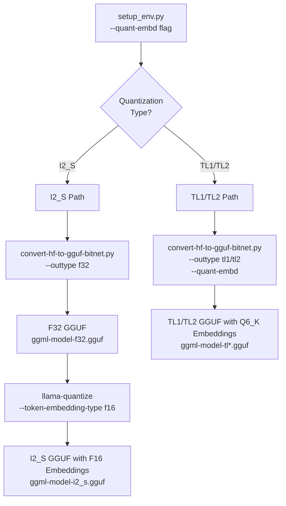
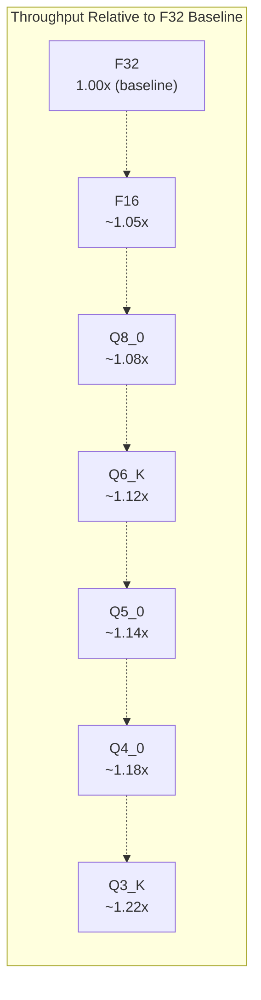
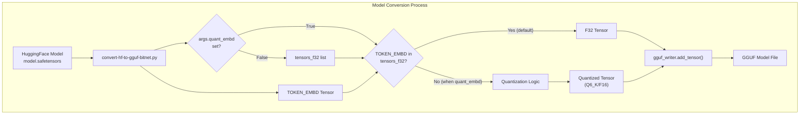

<!-- source: DeepWiki mcp.deepwiki.com · repo microsoft/BitNet · page 5.4 Embedding Quantization · fetched 2026-10-26 -->

# Embedding Quantization

<details>
<summary>Relevant source files</summary>

The following files were used as context for generating this wiki page:

- [run_inference.py](run_inference.py)
- [setup_env.py](setup_env.py)
- [src/README.md](src/README.md)
- [src/assets/embedding_throughput.png](src/assets/embedding_throughput.png)
- [src/assets/fine_tuning_result.png](src/assets/fine_tuning_result.png)
- [utils/convert-hf-to-gguf-bitnet.py](utils/convert-hf-to-gguf-bitnet.py)

</details>


This page provides a detailed guide to embedding layer quantization in BitNet.cpp, including supported formats, usage patterns, performance characteristics, and implementation details. Embedding quantization is an optional optimization that reduces memory footprint and can improve inference speed while preserving model quality.

For general performance optimization strategies, see [Performance Tuning Guide](#5.1). For details about weight quantization schemes (I2_S, TL1, TL2), see [Quantization Schemes](#4.3).

## Overview

Embedding quantization applies lower-precision data formats to the token embedding layer (`token_embd`) of BitNet models. While BitNet models already use 1-bit quantization for weight matrices in attention and feed-forward layers, the embedding layer typically remains in FP32 format by default. Quantizing embeddings provides additional memory savings and can accelerate token processing, particularly during the prompt processing phase.

**Key Characteristics:**

- **Optional Optimization:** Embedding quantization is independent of weight quantization (I2_S/TL1/TL2)
- **Separate from Weight Quantization:** The 1-bit quantized weights are never applied to embeddings; embeddings use standard GGML quantization formats
- **Quality-Speed Tradeoff:** Different quantization levels offer varying balances between model accuracy and performance
- **Recommended Format:** Q6_K provides the best balance for most use cases

Sources: [src/README.md:16-17](), [src/README.md:113-149]()

## Supported Quantization Formats

BitNet.cpp supports multiple quantization formats for embeddings, all leveraging the standard GGML quantization library. The table below compares their characteristics:

| Format | Bits per Weight | Memory Impact | Perplexity Degradation | Use Case |
|--------|----------------|---------------|------------------------|----------|
| **F32** | 32 | Baseline (100%) | None (baseline) | Maximum accuracy, highest memory |
| **F16** | 16 | 50% reduction | Negligible (~0%) | Balanced default, no quality loss |
| **Q8_0** | 8 | 75% reduction | Minimal (<0.1%) | High accuracy with good compression |
| **Q6_K** | 6 (avg) | 81% reduction | Small (~0.2%) | **Recommended**: Best quality/size tradeoff |
| **Q5_0** | 5 | 84% reduction | Moderate (~0.7%) | Acceptable for most tasks |
| **Q4_0** | 4 | 87% reduction | Noticeable (~1.5%) | Aggressive compression |
| **Q3_K** | 3 (avg) | 91% reduction | Significant (~3%) | Not recommended for production |
| **I2_S** | N/A | N/A | Model failure | Incompatible with embeddings |

**Note:** I2_S (1-bit) quantization is explicitly excluded from embeddings due to extreme information loss that causes model failure.

Sources: [src/README.md:118-136](), [utils/convert-hf-to-gguf-bitnet.py:796-797]()

## Usage

### Automatic Setup with setup_env.py

The recommended approach is to enable embedding quantization during the model preparation process using the `--quant-embd` flag:

```bash
python setup_env.py --hf-repo <model_repo> --quant-type i2_s --quant-embd
```

**Workflow Diagram:**



**Implementation Details:**

- **I2_S Path:** When using I2_S quantization with `--quant-embd`, embeddings are quantized to **F16** format (not Q6_K). This occurs via `llama-quantize` with the `--token-embedding-type f16` parameter.
- **TL1/TL2 Path:** When using TL1/TL2 quantization with `--quant-embd`, embeddings are automatically quantized to **Q6_K** format during the single-step conversion process.

Sources: [setup_env.py:109-151](), [setup_env.py:129-146]()

### Manual Conversion with llama-quantize

For advanced users who want explicit control over embedding quantization format:

```bash
# Convert to F32 GGUF first
python utils/convert-hf-to-gguf-bitnet.py models/BitNet-b1.58-2B-4T --outtype f32

# Quantize with custom embedding format
build/bin/llama-quantize \
  --token-embedding-type Q6_K \
  models/BitNet-b1.58-2B-4T/ggml-model-f32.gguf \
  models/BitNet-b1.58-2B-4T/ggml-model-i2_s-embed-q6_k.gguf \
  I2_S 1 1
```

**Supported `--token-embedding-type` Values:**
- `F16` (default for I2_S with `--quant-embd`)
- `Q6_K` (recommended, default for TL formats)
- `Q8_0`, `Q5_0`, `Q4_0`, `Q3_K` (experimental)
- `F32` (no quantization, omit flag entirely)

Sources: [src/README.md:43-46](), [setup_env.py:138-146]()

## Performance Analysis

### Perplexity Comparison

The following data shows perplexity measurements for BitNet-b1.58-2B-4T with TG128 (128 token generation) across multiple benchmarks:

| Embedding Type | Wikitext | PTB | LAMBADA | IMDB | AG NEWS |
|:---:|:---:|:---:|:---:|:---:|:---:|
| **F32** | 17.1090±0.1278 | 33.0858±0.4886 | 43.2850±0.6363 | 29.3016±0.2890 | 36.7686±0.3920 |
| **F16** | 17.1090±0.1278 | 33.0858±0.4886 | 43.2850±0.6363 | 29.3016±0.2890 | 36.7686±0.3920 |
| **Q8_0** | 17.1197±0.1280 | 33.1181±0.4893 | 43.2891±0.6364 | 29.3133±0.2892 | 36.7740±0.3920 |
| **Q6_K** | 17.1487±0.1282 | 33.2203±0.4914 | 43.3046±0.6362 | 29.3491±0.2897 | 36.7972±0.3921 |
| **Q5_0** | 17.2379±0.1288 | 33.2439±0.4907 | 43.4631±0.6379 | 29.5481±0.2920 | 36.8539±0.3924 |
| **Q4_0** | 17.3529±0.1300 | 33.7754±0.5001 | 44.4552±0.6559 | 30.1044±0.2978 | 37.3985±0.3997 |
| **Q3_K** | 17.6434±0.1320 | 34.3914±0.5089 | 45.4591±0.6735 | 30.8476±0.3069 | 39.5692±0.4259 |

**Key Observations:**

- **F16 is lossless:** Identical perplexity to F32 across all benchmarks
- **Q6_K degradation:** <0.2% increase in perplexity on most benchmarks
- **Q4_0 threshold:** Beyond this point, degradation becomes more noticeable (>1%)
- **Q3_K boundary:** Quality degradation is significant (~3% on some benchmarks)

Sources: [src/README.md:118-136]()

### Inference Speed Impact

Token generation throughput (TG128) for different embedding quantization formats:



**Speed vs. Quality Tradeoff:**

The relationship between quantization level and performance is non-linear. Lower bit formats provide diminishing returns while quality degradation accelerates:

- **F16 → Q6_K:** ~7% speedup, <0.2% quality loss
- **Q6_K → Q4_0:** ~6% additional speedup, >1% quality loss
- **Q4_0 → Q3_K:** ~4% additional speedup, >3% quality loss

Sources: [src/README.md:138-147]()

### Memory Footprint Reduction

For a typical BitNet model with a vocabulary size of 32,000 tokens and embedding dimension of 2048:

```
Embedding Matrix Size = 32,000 × 2048 = 65,536,000 parameters

Memory Usage by Format:
- F32: 65,536,000 × 4 bytes = 256 MB
- F16: 65,536,000 × 2 bytes = 128 MB (50% reduction)
- Q6_K: ~49 MB (81% reduction)
- Q4_0: ~33 MB (87% reduction)
```

For models like Llama3-8B-1.58 with larger vocabularies (128,256 tokens), the savings are proportionally larger, making embedding quantization increasingly valuable.

Sources: [src/README.md:16-17]()

## Technical Implementation

### Conversion Pipeline Flow



### Code Implementation Details

**Embedding Exclusion Logic:**

The conversion script explicitly excludes embeddings from the default F32 tensor list when `--quant-embd` is enabled:

[utils/convert-hf-to-gguf-bitnet.py:779-787]()

```python
tensors_f32 = [
    gguf.MODEL_TENSOR.FFN_GATE_INP,
    gguf.MODEL_TENSOR.FFN_GATE_INP,
    gguf.MODEL_TENSOR.POS_EMBD,
    gguf.MODEL_TENSOR.TOKEN_TYPES,
]
if not args.quant_embd:
    tensors_f32.append(gguf.MODEL_TENSOR.TOKEN_EMBD)
extra_f32 = extra_f32 or any(self.match_model_tensor_name(new_name, key, bid) for key in tensors_f32)
```

When `args.quant_embd` is `False` (default), `TOKEN_EMBD` is added to the `tensors_f32` list, forcing it to remain in F32 format. When `True`, the embedding tensor proceeds through the normal quantization pipeline.

**I2_S Exclusion for Embeddings:**

Embeddings are explicitly prevented from using I2_S (1-bit) quantization:

[utils/convert-hf-to-gguf-bitnet.py:795-797]()

```python
suit_i2 = True
if name.endswith('lm_head.weight') or name.endswith('norm.weight') or name.endswith('embed_tokens.weight'):
    suit_i2 = False
```

This ensures that even when weight layers use 1-bit quantization, the embedding layer uses a higher-precision format (typically F16 or Q6_K).

**llama-quantize Integration:**

For the I2_S conversion path, the `llama-quantize` binary handles embedding quantization:

[setup_env.py:138-146]()

```python
if quant_embd:
    run_command(["./build/bin/llama-quantize", 
                 "--token-embedding-type", "f16", 
                 f32_model, i2s_model, "I2_S", "1", "1"], 
                log_step="quantize_to_i2s")
else:
    run_command(["./build/bin/llama-quantize", 
                 f32_model, i2s_model, "I2_S", "1"], 
                log_step="quantize_to_i2s")
```

The additional `"1", "1"` parameters at the end enable pure mode and importance matrix, allowing the `--token-embedding-type` flag to take effect.

Sources: [utils/convert-hf-to-gguf-bitnet.py:779-797](), [setup_env.py:138-146]()

## Recommendations

Based on comprehensive evaluation across multiple dimensions:

### Primary Recommendation: Q6_K

**Use Q6_K for embedding quantization** in production deployments:

✅ **Advantages:**
- Minimal perplexity impact (<0.2% across benchmarks)
- Significant memory savings (81% reduction)
- Measurable inference speedup (~12% faster than F32)
- Well-tested format in GGML ecosystem

❌ **Limitations:**
- Not supported for I2_S path via `setup_env.py` (requires manual conversion)
- Slightly lower precision than Q8_0 for very sensitive tasks

### Alternative Options

**Use F16 when:**
- Zero quality loss is required
- Memory is not constrained
- Using I2_S quantization with `setup_env.py` (default behavior with `--quant-embd`)

**Use Q8_0 when:**
- Maximum quality is needed while still reducing memory
- Working with very large vocabularies where Q6_K may show slight degradation

**Avoid:**
- **Q4_0 and below:** Quality degradation becomes noticeable (>1% perplexity increase)
- **Q3_K:** Significant quality loss (3%+ perplexity increase) makes this unsuitable for most applications
- **I2_S for embeddings:** Causes model failure and is explicitly blocked in the codebase

### Format Selection Table

| Scenario | Recommended Format | Rationale |
|----------|-------------------|-----------|
| Production deployment (general) | Q6_K | Best quality/size/speed balance |
| Maximum accuracy required | F16 | Lossless, standard for I2_S path |
| Extreme memory constraints | Q5_0 | Acceptable quality with aggressive compression |
| Research/experimentation | Q8_0 or Q6_K | Minimal impact on results |
| Using I2_S + setup_env.py | F16 (automatic) | Default behavior, no manual intervention needed |

Sources: [src/README.md:148-149](), [src/README.md:33-46]()

---

