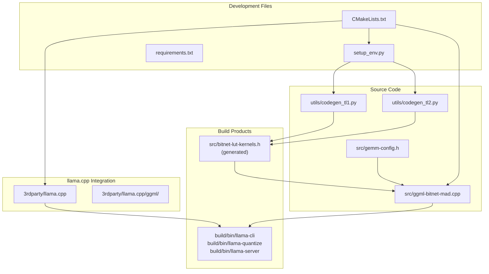
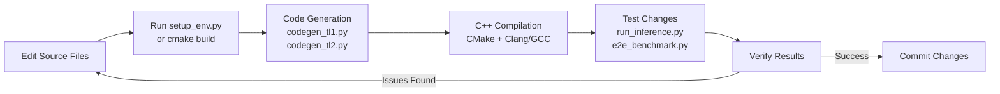
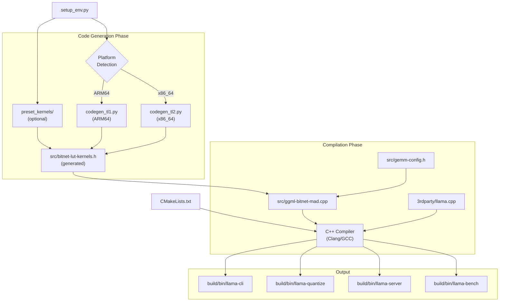
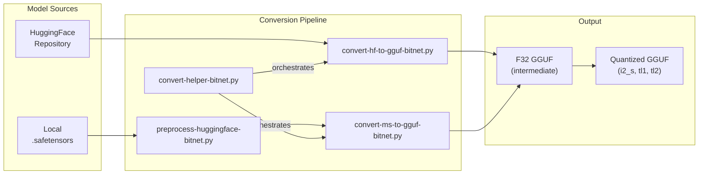

<!-- source: DeepWiki mcp.deepwiki.com · repo microsoft/BitNet · page 6 Development and Contributing · fetched 2026-10-26 -->

# Development and Contributing

<details>
<summary>Relevant source files</summary>

The following files were used as context for generating this wiki page:

- [CMakeLists.txt](CMakeLists.txt)
- [README.md](README.md)
- [run_inference_server.py](run_inference_server.py)

</details>


This page provides information for developers who want to contribute to BitNet.cpp or extend it for their own purposes. BitNet.cpp is an inference framework for 1-bit Large Language Models built on top of llama.cpp. This page covers the development workflow, contribution process, and key architectural concepts developers need to understand.

For detailed build system information, see page 6.1. For guidance on adding support for new models, see page 6.2.

## Repository Structure

BitNet.cpp extends llama.cpp with specialized kernels and utilities for 1-bit quantization. The repository is organized into several directories, each containing specific types of components:

**Repository Layout:**

| Directory | Purpose | Key Files |
|-----------|---------|-----------|
| `3rdparty/llama.cpp/` | llama.cpp submodule | Core inference engine, GGML library |
| `src/` | BitNet kernel implementations | `ggml-bitnet-mad.cpp`, `gemm-config.h` |
| `utils/` | Conversion and code generation | `codegen_tl1.py`, `codegen_tl2.py`, `convert-hf-to-gguf-bitnet.py` |
| Root | User-facing scripts | `setup_env.py`, `run_inference.py`, `run_inference_server.py` |
| `preset_kernels/` | Pre-tuned kernel configurations | Architecture-specific presets |

**Development Environment Components:**



Sources: [CMakeLists.txt:1-79](), [README.md:176-200]()

## Development Workflow Overview

The typical development workflow involves modifying source files, running the build system, and testing the results. Understanding how these pieces fit together is essential for effective development.

**Development Cycle:**



**Common Development Tasks:**

| Task | Files Modified | Build Command | Test Command |
|------|----------------|---------------|--------------|
| Kernel optimization | `src/ggml-bitnet-mad.cpp`, `src/gemm-config.h` | `python setup_env.py -md <model> -q i2_s` | `python utils/e2e_benchmark.py -m <model>` |
| Code generation | `utils/codegen_tl1.py`, `utils/codegen_tl2.py` | Same as above | Same as above |
| Model conversion | `utils/convert-hf-to-gguf-bitnet.py` | `python utils/convert-helper-bitnet.py <model>` | `python run_inference.py -m <gguf>` |
| Build system | `CMakeLists.txt` | `cmake -B build && cmake --build build` | Run any binary |

Sources: [README.md:194-200](), [CMakeLists.txt:1-43]()

## Setting Up Your Development Environment

### Prerequisites

Before contributing, ensure your system meets these requirements:

**Required Software:**

| Tool | Minimum Version | Purpose |
|------|-----------------|---------|
| Python | 3.9 | Scripts and utilities |
| CMake | 3.22 | Build system |
| Clang | 18 | C++ compiler (recommended) |
| GCC | - | Alternative C++ compiler |
| Git | - | Version control with submodules |

**Platform-Specific Requirements:**

- **Windows**: Visual Studio 2022 with specific components:
  - Desktop development with C++
  - C++ CMake Tools for Windows
  - Git for Windows
  - C++ Clang Compiler for Windows
  - MS-Build Support for LLVM-Toolset (clang)
  
- **Linux (Debian/Ubuntu)**: Install Clang using the automatic script:
  ```bash
  bash -c "$(wget -O - https://apt.llvm.org/llvm.sh)"
  ```

Sources: [README.md:161-173]()

### Initial Setup

**Step 1: Fork and Clone**

Clone the repository with the `--recursive` flag to include the llama.cpp submodule:

```bash
git clone --recursive https://github.com/YOUR-USERNAME/BitNet.git
cd BitNet
```

**Step 2: Environment Setup**

Create an isolated Python environment (conda recommended):

```bash
conda create -n bitnet-cpp python=3.9
conda activate bitnet-cpp
pip install -r requirements.txt
```

**Step 3: Verify Build Tools**

On Windows, verify your environment is properly configured:

```bash
clang -v
```

If you see an error, initialize the Visual Studio tools:

- Command Prompt:
  ```bash
  "C:\Program Files\Microsoft Visual Studio\2022\Professional\Common7\Tools\VsDevCmd.bat" -startdir=none -arch=x64 -host_arch=x64
  ```
  
- PowerShell:
  ```bash
  Import-Module "C:\Program Files\Microsoft Visual Studio\2022\Professional\Common7\Tools\Microsoft.VisualStudio.DevShell.dll"
  Enter-VsDevShell 3f0e31ad -SkipAutomaticLocation -DevCmdArguments "-arch=x64 -host_arch=x64"
  ```

Sources: [README.md:181-185](), [README.md:307-340]()

### Test Your Setup

Verify your environment by building a model:

```bash
# Download a test model
huggingface-cli download microsoft/BitNet-b1.58-2B-4T-gguf --local-dir models/BitNet-b1.58-2B-4T

# Build with I2_S quantization
python setup_env.py -md models/BitNet-b1.58-2B-4T -q i2_s

# Test inference
python run_inference.py -m models/BitNet-b1.58-2B-4T/ggml-model-i2_s.gguf -p "Test prompt" -cnv
```

If these commands succeed, your development environment is properly configured.

Sources: [README.md:194-200](), [README.md:220-247]()

## Understanding the Build System

The build system orchestrates code generation, compilation, and linking. Understanding this process is critical for development work that touches the core inference engine.

**Build System Flow:**



**Key Build System Files:**

- `CMakeLists.txt` - Main CMake configuration, sets compile definitions for TL1/TL2
- `setup_env.py` - High-level script that orchestrates code generation and builds
- `utils/codegen_tl1.py` - Generates ARM-specific lookup table kernels
- `utils/codegen_tl2.py` - Generates x86-specific lookup table kernels
- `src/gemm-config.h` - GEMM kernel configuration parameters

The build system uses compile definitions `GGML_BITNET_ARM_TL1` and `GGML_BITNET_X86_TL2` [CMakeLists.txt:28-33]() to conditionally compile platform-specific code paths.

For detailed information on build system internals, see page 6.1.

Sources: [CMakeLists.txt:1-79](), [README.md:194-200]()

## Adding Support for New Models

BitNet.cpp supports various 1-bit model architectures. Adding support for a new model typically involves updating the conversion pipeline.

**Model Support Architecture:**



**Steps to Add Model Support:**

1. **Identify Model Architecture**: Determine if the model uses a supported architecture (LLaMA, Falcon, etc.)
2. **Update Conversion Scripts**: Modify `convert-hf-to-gguf-bitnet.py` or `convert-ms-to-gguf-bitnet.py` to handle new tensor names or layer structures
3. **Test Conversion**: Convert the model and verify the output GGUF structure
4. **Validate Inference**: Run inference tests to ensure correctness
5. **Document Support**: Update README.md with the new model in the supported models table

For detailed guidance on adding new models, see page 6.2.

Sources: [README.md:39-155](), [README.md:297-305]()

## Testing Your Contributions

Thorough testing is required before submitting contributions. Different types of changes require different testing approaches.

### Functional Testing

**Basic Inference Test:**

```bash
# After making changes, rebuild
python setup_env.py -md models/BitNet-b1.58-2B-4T -q i2_s

# Test inference
python run_inference.py -m models/BitNet-b1.58-2B-4T/ggml-model-i2_s.gguf -p "Test prompt" -cnv
```

**Server Mode Test:**

```bash
# Start server
python run_inference_server.py -m models/BitNet-b1.58-2B-4T/ggml-model-i2_s.gguf --host 127.0.0.1 --port 8080

# In another terminal, test with curl
curl http://127.0.0.1:8080/completion -H "Content-Type: application/json" -d '{"prompt":"Test"}'
```

Sources: [README.md:220-247](), [run_inference_server.py:1-65]()

### Performance Testing

For kernel optimizations or performance-related changes, use `e2e_benchmark.py` to measure impact:

```bash
# Benchmark with different configurations
python utils/e2e_benchmark.py -m models/BitNet-b1.58-2B-4T/ggml-model-i2_s.gguf -n 128 -p 512 -t 4
```

**Required Metrics for Performance PRs:**

| Metric | Description | How to Measure |
|--------|-------------|----------------|
| Tokens/second | Inference throughput | Output from `e2e_benchmark.py` |
| Latency | Time to first token | Included in benchmark output |
| Memory usage | Peak memory consumption | System monitoring tools |
| Energy efficiency | Power consumption (if available) | Platform-specific tools |

Include before/after benchmark results in your pull request description.

Sources: [README.md:249-295]()

### Cross-Platform Testing

If your changes affect platform-specific code:

- **ARM changes** (`codegen_tl1.py`, TL1 kernels): Test on ARM hardware (Apple Silicon, AWS Graviton, etc.)
- **x86 changes** (`codegen_tl2.py`, TL2 kernels): Test on x86_64 hardware
- **Cross-platform changes**: Test on both architectures if possible

Sources: [CMakeLists.txt:15-33]()

## Contribution Process

### Creating a Pull Request

**Standard Git Workflow:**

1. **Create a branch** for your feature or fix:
   ```bash
   git checkout -b feature/my-new-feature
   ```

2. **Make your changes** and commit with clear messages:
   ```bash
   git add .
   git commit -m "Add support for new model architecture"
   ```

3. **Push to your fork**:
   ```bash
   git push origin feature/my-new-feature
   ```

4. **Create a Pull Request** on GitHub against the main repository

5. **Address review feedback** by making additional commits

6. **Merge** occurs after approval from maintainers

### Pull Request Guidelines

**PR Description Should Include:**

- Clear description of changes
- Motivation and context
- Testing performed (with results)
- Performance impact (if applicable)
- Breaking changes (if any)
- Related issues or PRs

**Code Quality Requirements:**

- Follow existing code style and conventions
- Add comments for non-obvious logic
- Update documentation for API changes
- Ensure compatibility with llama.cpp submodule
- No unnecessary dependencies

### Contribution Areas

**High-Priority Contribution Areas:**

| Area | Skills Needed | Example Tasks |
|------|---------------|---------------|
| Kernel optimization | C++, SIMD, assembly | Optimize `ggml-bitnet-mad.cpp` for new CPU features |
| Code generation | Python, algorithm design | Improve `codegen_tl1.py` or `codegen_tl2.py` |
| Model support | Python, ML frameworks | Add converters for new architectures |
| Build system | CMake, cross-platform | Improve `CMakeLists.txt`, add new platforms |
| Documentation | Technical writing | Wiki pages, code comments, examples |
| Testing | Various | Add test cases, improve CI/CD |

## Reporting Issues

### Bug Reports

When reporting bugs through GitHub Issues, include:

**Required Information:**

- **Description**: Clear explanation of the issue
- **Steps to reproduce**: Exact commands and inputs
- **Expected behavior**: What should happen
- **Actual behavior**: What actually happens
- **Environment**:
  - OS (Linux/Windows/macOS) and version
  - CPU architecture (ARM/x86_64) and model
  - Python version
  - CMake version
  - Compiler (Clang/GCC/MSVC) and version
- **Logs**: Relevant error messages or output

**Example Bug Report:**

```
### Description
Model conversion fails with KeyError when processing Falcon3-10B

### Steps to Reproduce
1. Download model: huggingface-cli download tiiuae/Falcon3-10B-Instruct-1.58bit
2. Run: python setup_env.py -md models/Falcon3-10B-Instruct-1.58bit -q i2_s
3. Observe error

### Expected Behavior
Model should convert successfully

### Actual Behavior
KeyError: 'model.layers.0.mlp.gate_proj.weight'

### Environment
- OS: Ubuntu 22.04
- CPU: Intel Core i9-12900K
- Python: 3.9.18
- CMake: 3.28.1
- Compiler: Clang 18.0.0
```

### Feature Requests

For feature requests, provide:

- **Use case**: Why is this feature needed?
- **Proposed solution**: How should it work?
- **Alternatives considered**: Other approaches you've thought about
- **Additional context**: Related features, examples from other projects

## Code of Conduct

BitNet.cpp has adopted the Microsoft Open Source Code of Conduct. All contributors are expected to uphold this code. For more information, see the [CODE_OF_CONDUCT.md]() file.

Sources: [CODE_OF_CONDUCT.md:1-9]()

## Security Guidelines

Security vulnerabilities should not be reported through public GitHub issues. Instead, follow the process outlined in [SECURITY.md]() to report them to the Microsoft Security Response Center.

Sources: [SECURITY.md:11-29]()

## License

BitNet.cpp is licensed under the MIT License. By contributing to the project, you agree that your contributions will be licensed under the same terms. See the [LICENSE]() file for details.

Sources: [LICENSE:1-21]()

---

