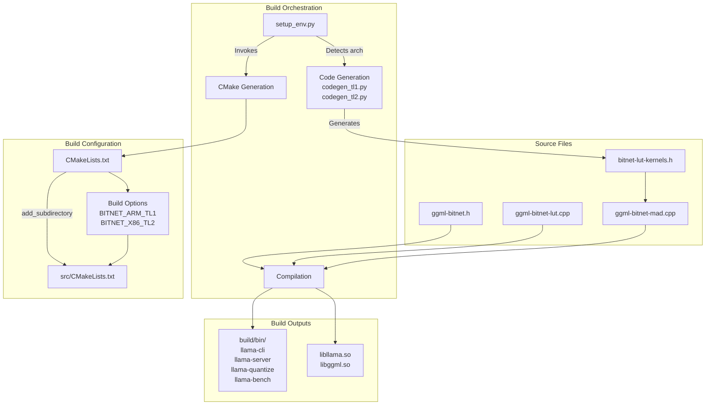
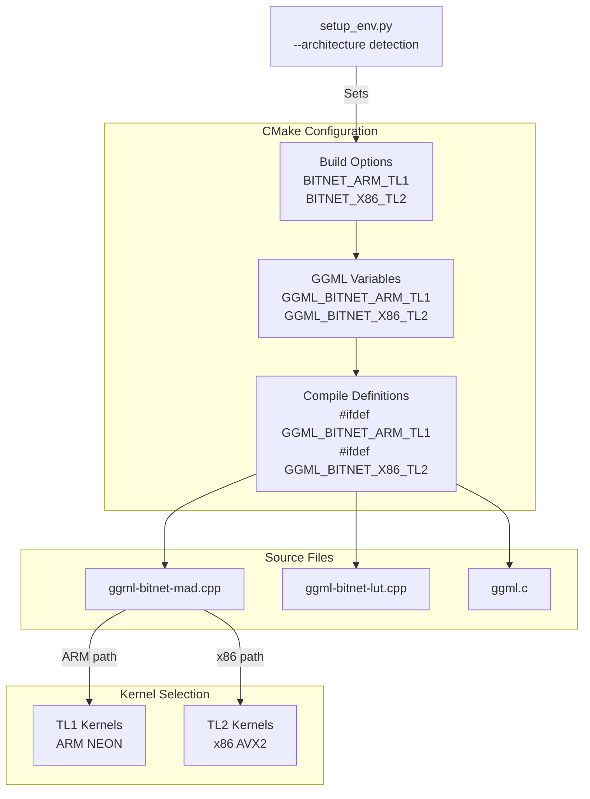
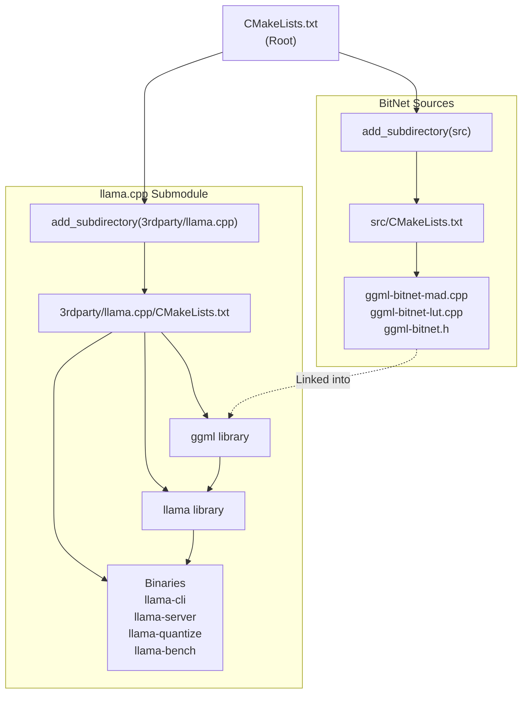
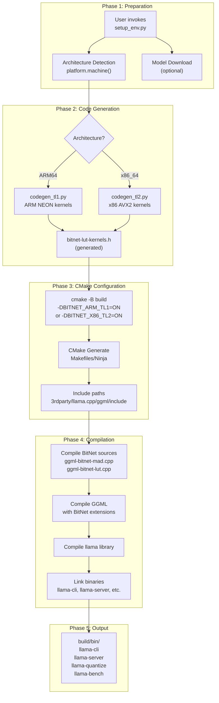

<!-- source: DeepWiki mcp.deepwiki.com · repo microsoft/BitNet · page 6.1 Build System Details · fetched 2026-10-26 -->

# Build System Details

<details>
<summary>Relevant source files</summary>

The following files were used as context for generating this wiki page:

- [.gitmodules](.gitmodules)
- [CMakeLists.txt](CMakeLists.txt)
- [run_inference_server.py](run_inference_server.py)
- [src/CMakeLists.txt](src/CMakeLists.txt)

</details>


This page provides a deep dive into the BitNet.cpp build system, explaining how CMake orchestrates the compilation of BitNet-specific kernels and integrates them with the llama.cpp inference engine. This documentation is designed for developers who need to understand or modify the build process. For general development setup instructions, see [Getting Started](#2.1).

## Overview

BitNet.cpp uses a CMake-based build system that coordinates several components: code generation for architecture-specific kernels, compilation of BitNet extensions, and integration with the llama.cpp submodule. The build system is responsible for:

- Detecting the target architecture and enabling appropriate optimizations
- Propagating compile definitions to the GGML library
- Generating and compiling BitNet-specific kernel implementations
- Building the llama.cpp inference engine with BitNet extensions
- Producing executable binaries (`llama-cli`, `llama-server`, `llama-quantize`, `llama-bench`)



Sources: [CMakeLists.txt:1-79](), [src/CMakeLists.txt:1-11]()

## Root CMakeLists.txt Configuration

The top-level [CMakeLists.txt:1-79]() file defines the project and configures the overall build process. Key aspects include:

### Project Definition and Standards

```cmake
cmake_minimum_required(VERSION 3.14)
project("bitnet.cpp" C CXX)
set(CMAKE_C_STANDARD 11)
set(CMAKE_C_STANDARD_REQUIRED true)
```

The build system requires CMake 3.14 or higher for support of `add_link_options` and implicit target directories. The C standard is set to C11 and enforced as required.

### Build Type Configuration

[CMakeLists.txt:7-10]() automatically sets the build type to `Release` if not specified and not using Xcode or MSVC:

```cmake
if (NOT XCODE AND NOT MSVC AND NOT CMAKE_BUILD_TYPE)
    set(CMAKE_BUILD_TYPE Release CACHE STRING "Build type" FORCE)
    set_property(CACHE CMAKE_BUILD_TYPE PROPERTY STRINGS "Debug" "Release" "MinSizeRel" "RelWithDebInfo")
endif()
```

### Output Directory Configuration

[CMakeLists.txt:12]() sets a unified output directory for all runtime binaries:

```cmake
set(CMAKE_RUNTIME_OUTPUT_DIRECTORY ${CMAKE_BINARY_DIR}/bin)
```

This ensures all executables (`llama-cli`, `llama-server`, etc.) are placed in `build/bin/`, which simplifies binary location for Python scripts like [run_inference_server.py:23]().

Sources: [CMakeLists.txt:1-12]()

## Build Options and Compile Definitions

The build system exposes two primary options that control architecture-specific optimizations:

| Option | Description | Target Architecture | Default |
|--------|-------------|-------------------|---------|
| `BITNET_ARM_TL1` | Enable TL1 (ternary lookup table) kernels for ARM | ARM64 | OFF |
| `BITNET_X86_TL2` | Enable TL2 (ternary lookup table) kernels for x86 | x86_64 | OFF |

These options are defined in [CMakeLists.txt:15-16]():

```cmake
option(BITNET_ARM_TL1    "bitnet.cpp: use tl1 on arm platform"    OFF)
option(BITNET_X86_TL2    "bitnet.cpp: use tl2 on x86 platform"    OFF)
```

### Propagation to GGML

The BitNet options are propagated to GGML-specific variables in [CMakeLists.txt:24-33]():

```cmake
# override ggml options
set(GGML_BITNET_ARM_TL1    ${BITNET_ARM_TL1})
set(GGML_BITNET_X86_TL2    ${BITNET_X86_TL2})

if (GGML_BITNET_ARM_TL1)
    add_compile_definitions(GGML_BITNET_ARM_TL1)
endif()
if (GGML_BITNET_X86_TL2)
    add_compile_definitions(GGML_BITNET_X86_TL2)
endif()
```

This propagation mechanism ensures that:
1. The GGML library receives the correct compile-time flags
2. Preprocessor definitions are available throughout the codebase
3. Architecture-specific code paths in GGML are enabled

Diagram: **Compile Definition Flow**



Sources: [CMakeLists.txt:15-33]()

## llama.cpp Submodule Integration

BitNet.cpp extends llama.cpp through a git submodule located at `3rdparty/llama.cpp`. The submodule configuration in [.gitmodules:1-4]() points to a fork with BitNet-specific modifications:

```
[submodule "3rdparty/llama.cpp"]
    path = 3rdparty/llama.cpp
    url = https://github.com/Eddie-Wang1120/llama.cpp.git
    branch = merge-dev
```

### Build Integration

The llama.cpp submodule is integrated into the build via [CMakeLists.txt:42-43]():

```cmake
set(LLAMA_BUILD_SERVER ON CACHE BOOL "Build llama.cpp server" FORCE)
add_subdirectory(3rdparty/llama.cpp)
```

This configuration:
1. Forces the server component to be built (`LLAMA_BUILD_SERVER ON`)
2. Adds llama.cpp's CMakeLists.txt to the build tree
3. Allows llama.cpp to access BitNet compile definitions set earlier

The BitNet source directory is added first via [CMakeLists.txt:41]():

```cmake
add_subdirectory(src)
```

This ordering ensures BitNet-specific sources are compiled before llama.cpp, allowing the GGML library to link against BitNet kernels.

Diagram: **Build Tree Structure**



Sources: [CMakeLists.txt:41-43](), [.gitmodules:1-4]()

## Source Directory Build Configuration

The `src/` directory contains BitNet-specific implementations that extend GGML. Its [src/CMakeLists.txt:1-11]() file defines the BitNet sources:

```cmake
set(GGML_HEADERS_BITNET ../include/ggml-bitnet.h)
set(GGML_SOURCES_BITNET ggml-bitnet-mad.cpp)
set(GGML_SOURCES_BITNET ggml-bitnet-lut.cpp)

include_directories(3rdparty/llama.cpp/ggml/include)
```

### Compiler Requirements

[src/CMakeLists.txt:7-10]() enforces strict compiler requirements:

```cmake
if (NOT (CMAKE_C_COMPILER_ID MATCHES "Clang" OR CMAKE_C_COMPILER_ID STREQUAL "GNU") OR
    NOT (CMAKE_CXX_COMPILER_ID MATCHES "Clang" OR CMAKE_CXX_COMPILER_ID STREQUAL "GNU"))
    message(FATAL_ERROR "Clang or GCC is required for Bitnet.cpp compilation")
endif()
```

This check ensures that only Clang or GCC compilers are used, as BitNet kernels rely on compiler-specific intrinsics and optimizations.

### Key Source Files

| File | Purpose | Generated |
|------|---------|-----------|
| `ggml-bitnet-mad.cpp` | Matrix multiplication kernels (MAD = Multiply-Add) | No |
| `ggml-bitnet-lut.cpp` | Lookup table implementations | No |
| `ggml-bitnet.h` | Public API header | No |
| `bitnet-lut-kernels.h` | Architecture-specific kernel definitions | Yes (by codegen) |

The `bitnet-lut-kernels.h` file is generated by either `codegen_tl1.py` (ARM) or `codegen_tl2.py` (x86) and included by the MAD implementation.

Sources: [src/CMakeLists.txt:1-11]()

## Build Process Flow

The complete build process involves coordination between Python scripts, CMake, and code generation tools:

Diagram: **End-to-End Build Process**



### Step-by-Step Process

1. **Preparation**: `setup_env.py` detects the system architecture using `platform.machine()` and optionally downloads models.

2. **Code Generation**: Based on architecture, either `codegen_tl1.py` or `codegen_tl2.py` generates `bitnet-lut-kernels.h` with optimized kernel implementations.

3. **CMake Configuration**: `setup_env.py` invokes CMake with appropriate flags:
   ```bash
   cmake -B build -DBITNET_ARM_TL1=ON  # for ARM
   # or
   cmake -B build -DBITNET_X86_TL2=ON  # for x86
   ```

4. **Compilation**: 
   - BitNet sources in `src/` are compiled first
   - GGML library is compiled with BitNet extensions linked in
   - llama library is compiled
   - Final binaries are linked and placed in `build/bin/`

5. **Output**: All runtime binaries are available in a single directory for easy execution.

Sources: [CMakeLists.txt:1-79](), [src/CMakeLists.txt:1-11]()

## Build Outputs

The build system produces several artifacts organized by type:

### Binary Output Structure

[CMakeLists.txt:12]() configures all binaries to output to `${CMAKE_BINARY_DIR}/bin`, resulting in:

```
build/
└── bin/
    ├── llama-cli          # Interactive inference
    ├── llama-server       # HTTP API server
    ├── llama-quantize     # Model quantization tool
    └── llama-bench        # Performance benchmarking
```

### Platform-Specific Binary Names

The Python wrapper scripts account for platform differences when locating binaries. For example, [run_inference_server.py:18-23]() handles Windows executables:

```python
if platform.system() == "Windows":
    server_path = os.path.join(build_dir, "bin", "Release", "llama-server.exe")
    if not os.path.exists(server_path):
        server_path = os.path.join(build_dir, "bin", "llama-server")
else:
    server_path = os.path.join(build_dir, "bin", "llama-server")
```

### Library Outputs

In addition to binaries, the build produces shared libraries:

| Library | Description | Location |
|---------|-------------|----------|
| `libggml.so` (or `.dll`/`.dylib`) | GGML computation library | `build/` |
| `libllama.so` (or `.dll`/`.dylib`) | llama.cpp inference library | `build/` |

These libraries are linked into the final binaries and contain the BitNet kernel implementations.

Sources: [CMakeLists.txt:12](), [run_inference_server.py:18-23]()

## Compiler Flags and Optimizations

### GCC/Clang Permissive Mode

[CMakeLists.txt:35-37]() adds the `-fpermissive` flag for GCC compilers:

```cmake
if (CMAKE_C_COMPILER_ID STREQUAL "GNU" OR CMAKE_CXX_COMPILER_ID STREQUAL "GNU")
    add_compile_options(-fpermissive)
endif()
```

This flag allows certain non-standard C++ constructs used in the GGML codebase, providing compatibility across different GCC versions.

### Threading Support

[CMakeLists.txt:22-39]() configures threading:

```cmake
set(THREADS_PREFER_PTHREAD_FLAG ON)
find_package(Threads REQUIRED)
```

This ensures that the pthreads library is properly linked on Unix-like systems, enabling parallel kernel execution in GGML.

### Standard Requirements

[CMakeLists.txt:19-21]() enforces language standards:

```cmake
set(CMAKE_CXX_STANDARD_REQUIRED true)
set(CMAKE_C_STANDARD 11)
set(CMAKE_C_STANDARD_REQUIRED true)
```

These settings ensure consistent compilation behavior across platforms. The C11 standard is required for atomic operations and other features used by GGML.

Sources: [CMakeLists.txt:19-39]()

## Common Issues and Solutions

### Issue: Build fails with errors in llama.cpp related to std::chrono in log.cpp

**Solution:** This is an issue in recent versions of llama.cpp. Refer to [this commit](https://github.com/tinglou/llama.cpp/commit/4e3db1e3d78cc1bcd22bcb3af54bd2a4628dd323) in the [discussion](https://github.com/abetlen/llama-cpp-python/issues/1942) to fix this issue.

### Issue: 'clang' is not recognized as a command on Windows

**Solution:** Your command line window is not properly initialized for Visual Studio tools. Follow the instructions in the Windows setup section to initialize your environment.

Sources: [README.md:282-312]()

## Next Steps

After setting up your development environment, consider reviewing the following pages for more information:

- [Technical Architecture](#4) - To understand the system's internal structure
- [Kernel Generation System](#4.1) - To learn how optimized kernels are generated
- [Performance Tuning](#5.2) - For tips on optimizing inference performance

---

