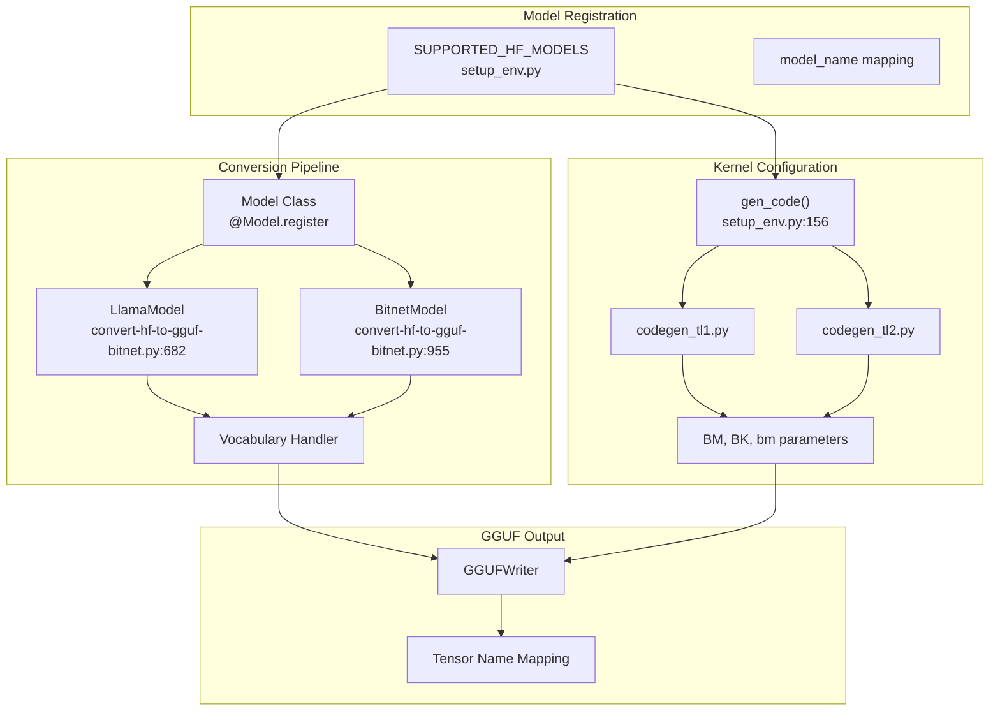
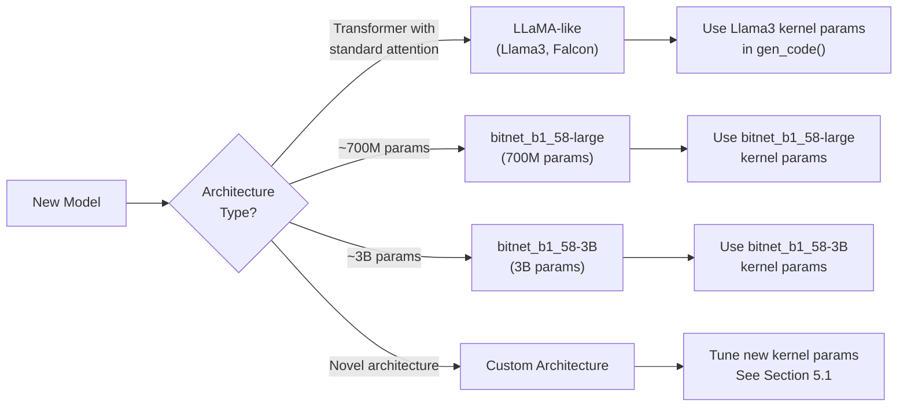
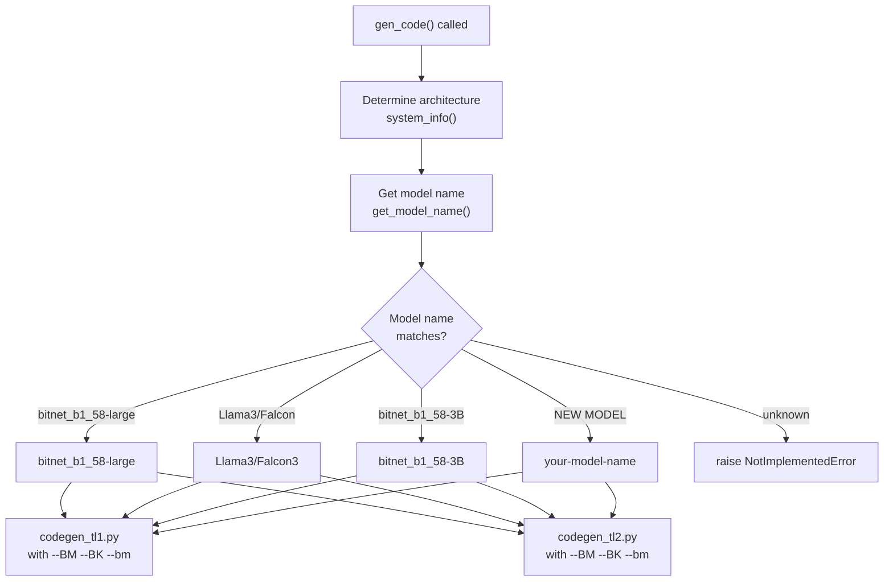
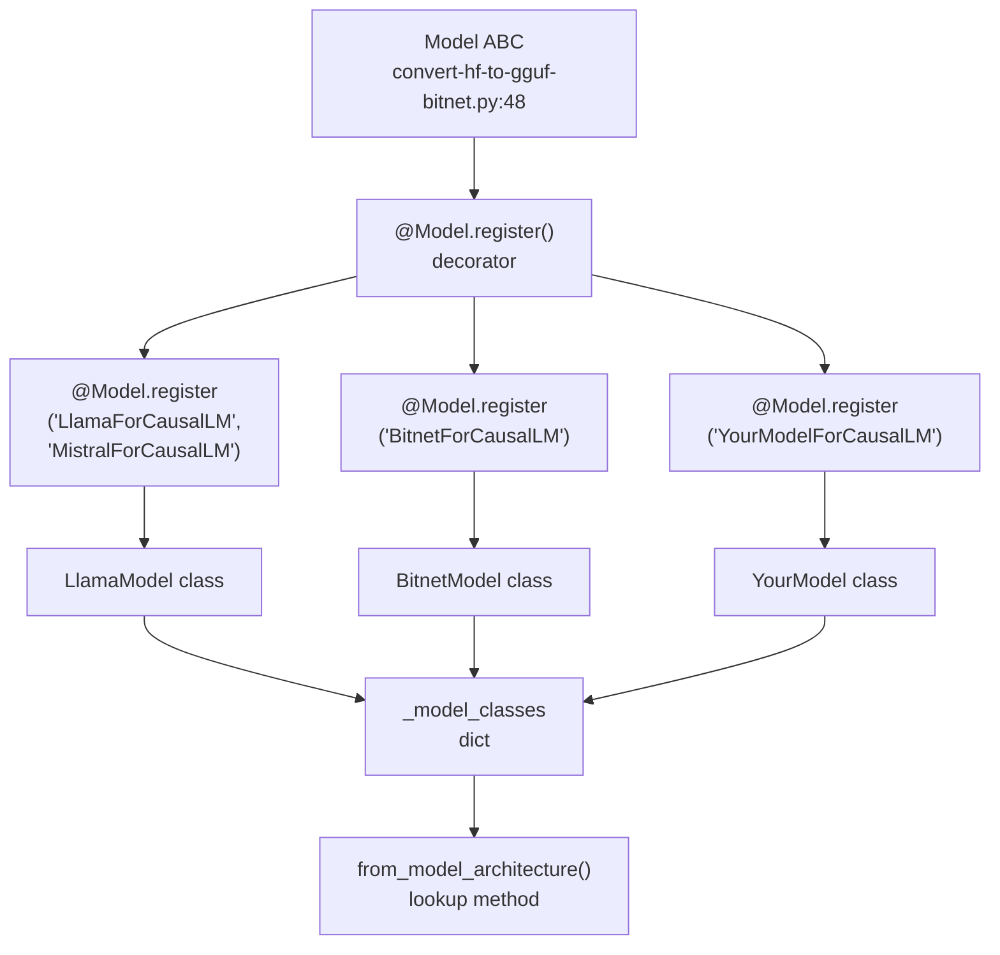
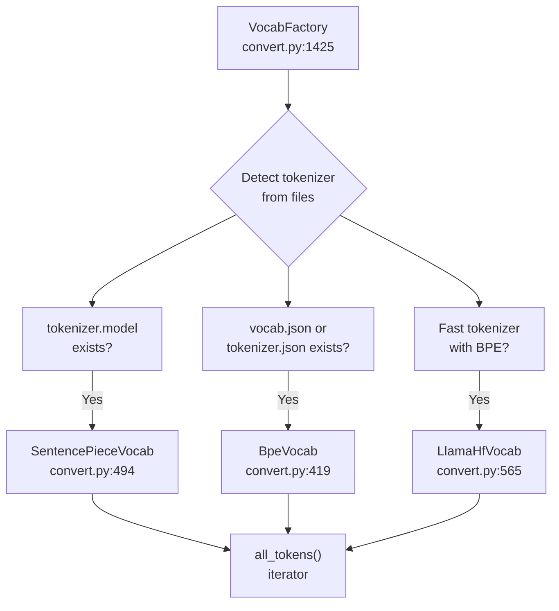
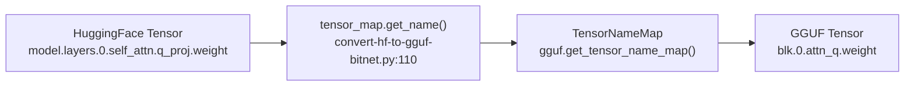
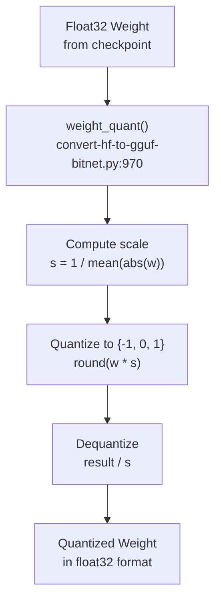
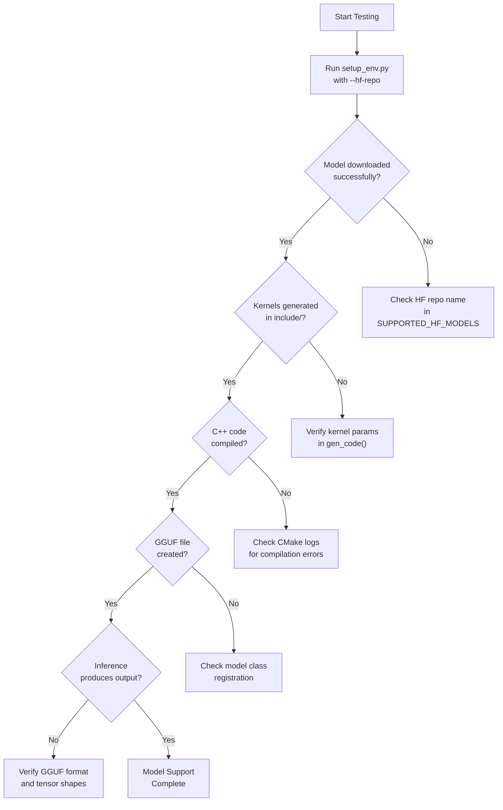

<!-- source: DeepWiki mcp.deepwiki.com · repo microsoft/BitNet · page 6.2 Adding Support for New Models · fetched 2026-10-26 -->

# Adding Support for New Models

<details>
<summary>Relevant source files</summary>

The following files were used as context for generating this wiki page:

- [run_inference.py](run_inference.py)
- [setup_env.py](setup_env.py)
- [utils/convert-hf-to-gguf-bitnet.py](utils/convert-hf-to-gguf-bitnet.py)
- [utils/convert-ms-to-gguf-bitnet.py](utils/convert-ms-to-gguf-bitnet.py)
- [utils/convert.py](utils/convert.py)

</details>


This page guides developers through the process of adding support for new BitNet model architectures to the BitNet.cpp inference framework. It covers model registration, kernel configuration, and conversion pipeline integration.

For information about converting existing supported models, see [Model Preparation](#2.2). For manual conversion techniques, see [Manual Model Conversion](#5.3). For kernel tuning after adding a model, see [Performance Tuning Guide](#5.1).

---

## Overview of Model Support Architecture

BitNet.cpp supports models through a registration and configuration system that connects model metadata, kernel parameters, and conversion logic. The system is designed to handle both standard HuggingFace transformers and specialized BitNet architectures.



**Sources:** [setup_env.py:13-59](), [setup_env.py:156-201](), [utils/convert-hf-to-gguf-bitnet.py:682-914]()

---

## Prerequisites

Before adding a new model, you must determine the following characteristics:

| Property | Description | Example |
|----------|-------------|---------|
| **Model Architecture** | Base architecture type (LLaMA, Mistral, etc.) | `LlamaForCausalLM` |
| **Hidden Dimensions** | Number of layers, embedding size, intermediate size | `n_layer=32, n_embd=2560` |
| **Attention Configuration** | Number of attention heads, KV heads | `n_head=32, n_head_kv=32` |
| **Tokenizer Type** | SentencePiece, BPE, or HuggingFace | `SentencePiece` |
| **Kernel Dimensions** | Optimal block sizes for matrix operations | `BM=256, BK=128, bm=32` |

This information is typically found in the model's `config.json` file in the HuggingFace repository.

**Sources:** [utils/convert-hf-to-gguf-bitnet.py:269-321](), [setup_env.py:159-200]()

---

## Adding Model Metadata

### Step 1: Register in SUPPORTED_HF_MODELS

Add your model to the `SUPPORTED_HF_MODELS` dictionary in `setup_env.py`:

```python
SUPPORTED_HF_MODELS = {
    # Existing models...
    "your-org/your-model-name": {
        "model_name": "your-model-name",
    },
}
```

The dictionary key is the HuggingFace repository identifier (e.g., `"microsoft/BitNet-b1.58-2B-4T"`), and the value contains a `model_name` field used for local directory naming and kernel configuration lookup.

**Sources:** [setup_env.py:13-59]()

### Step 2: Determine Model Category

Identify which existing model category your model falls into:



**Sources:** [setup_env.py:159-200](), [setup_env.py:173-180]()

---

## Configuring Kernel Parameters

### Understanding Kernel Parameters

BitNet.cpp uses architecture-specific kernel parameters to optimize matrix operations. These parameters define tiling and blocking strategies:

| Parameter | Description | Typical Range |
|-----------|-------------|---------------|
| **BM** | Block size for M dimension (rows) | 128, 160, 256 |
| **BK** | Block size for K dimension (cols) | 64, 96, 128 |
| **bm** | Sub-block size for M | 32, 64 |

These parameters must be tuned for each model size and are architecture-dependent (ARM64 uses TL1, x86_64 uses TL2).

**Sources:** [setup_env.py:174-198]()

### Adding Kernel Configuration to gen_code()

Modify the `gen_code()` function to include your model:



Add a new conditional branch in both ARM64 and x86_64 sections:

**ARM64 (TL1):**
```python
elif get_model_name() == "your-model-name":
    run_command([sys.executable, "utils/codegen_tl1.py", 
                 "--model", "your-model-name", 
                 "--BM", "256,128,256", 
                 "--BK", "128,64,128", 
                 "--bm", "32,64,32"], 
                log_step="codegen")
```

**x86_64 (TL2):**
```python
elif get_model_name() == "your-model-name":
    run_command([sys.executable, "utils/codegen_tl2.py", 
                 "--model", "your-model-name", 
                 "--BM", "256,128,256", 
                 "--BK", "96,96,96", 
                 "--bm", "32,32,32"], 
                log_step="codegen")
```

**Sources:** [setup_env.py:156-201](), [setup_env.py:174-180](), [setup_env.py:192-198]()

### Initial Kernel Parameter Selection

For a new model, start with parameters from a model of similar size:

| Model Size | Base Configuration | ARM64 (TL1) | x86_64 (TL2) |
|------------|-------------------|-------------|--------------|
| **~700M params** | bitnet_b1_58-large | `BM=256,128,256` `BK=128,64,128` `bm=32,64,32` | `BM=256,128,256` `BK=96,192,96` `bm=32,32,32` |
| **~3B params** | bitnet_b1_58-3B | `BM=160,320,320` `BK=64,128,64` `bm=32,64,32` | `BM=160,320,320` `BK=96,96,96` `bm=32,32,32` |
| **~8B params** | Llama3-8B | `BM=256,128,256,128` `BK=128,64,128,64` `bm=32,64,32,64` | `BM=256,128,256,128` `BK=96,96,96,96` `bm=32,32,32,32` |

These values represent `BM`, `BK`, and `bm` parameters for different layers in the model. The number of comma-separated values should match the number of layer types in your architecture.

**Sources:** [setup_env.py:174-198]()

---

## Model Class Registration

### When to Create a New Model Class

Create a new model class only if your model has:
- Non-standard tensor naming conventions
- Custom weight quantization logic
- Unique vocabulary handling requirements
- Specialized tensor transformations

Most LLaMA-derived models can use the existing `LlamaModel` class.

**Sources:** [utils/convert-hf-to-gguf-bitnet.py:682-914](), [utils/convert-hf-to-gguf-bitnet.py:955-984]()

### Registering a Model Class

Model classes use the `@Model.register` decorator to associate architecture names with handler classes:



Example registration:

```python
@Model.register("YourModelForCausalLM")
class YourModel(Model):
    model_arch = gguf.MODEL_ARCH.LLAMA  # or custom arch
    
    def set_vocab(self):
        # Vocabulary handling logic
        self._set_vocab_gpt2()
    
    def modify_tensors(self, data_torch: Tensor, name: str, bid: int | None):
        # Custom tensor transformations
        return [(self.map_tensor_name(name), data_torch)]
```

**Sources:** [utils/convert-hf-to-gguf-bitnet.py:225-240](), [utils/convert-hf-to-gguf-bitnet.py:682-684](), [utils/convert-hf-to-gguf-bitnet.py:955-957]()

### Implementing Required Methods

A model class must implement these key methods:

| Method | Purpose | Required? |
|--------|---------|-----------|
| `model_arch` | Property returning GGUF architecture type | Yes |
| `set_vocab()` | Configure vocabulary/tokenizer | Yes |
| `set_gguf_parameters()` | Write model metadata to GGUF | No (can use base) |
| `write_tensors()` | Handle tensor conversion and quantization | No (can use base) |
| `modify_tensors()` | Apply model-specific tensor transformations | No (can use base) |

**Sources:** [utils/convert-hf-to-gguf-bitnet.py:66-69](), [utils/convert-hf-to-gguf-bitnet.py:79-81](), [utils/convert-hf-to-gguf-bitnet.py:116-158]()

---

## Vocabulary and Tokenizer Integration

### Supported Tokenizer Types

BitNet.cpp supports three tokenizer formats:



**Sources:** [utils/convert.py:419-492](), [utils/convert.py:494-562](), [utils/convert.py:565-685]()

### Vocabulary Configuration in Model Class

Set the appropriate vocabulary handler in your model's `set_vocab()` method:

```python
def set_vocab(self):
    # For SentencePiece models
    self._set_vocab_sentencepiece()
    
    # For GPT-2 BPE models  
    self._set_vocab_gpt2()
    
    # For LLaMA HF models (fallback chain)
    try:
        self._set_vocab_sentencepiece()
    except FileNotFoundError:
        try:
            self._set_vocab_llama_hf()
        except (FileNotFoundError, TypeError):
            self._set_vocab_gpt2()
```

**Sources:** [utils/convert-hf-to-gguf-bitnet.py:686-694](), [utils/convert-hf-to-gguf-bitnet.py:79-81](), [utils/convert-hf-to-gguf-bitnet.py:366-374]()

---

## Tensor Transformation Pipeline

### Tensor Name Mapping

The conversion process maps model-specific tensor names to GGUF standard names:



**Sources:** [utils/convert-hf-to-gguf-bitnet.py:110-114](), [utils/convert-hf-to-gguf-bitnet.py:62-64]()

### Handling Custom Tensor Transformations

Override `modify_tensors()` for model-specific transformations:

```python
def modify_tensors(self, data_torch: Tensor, name: str, bid: int | None):
    n_head = self.hparams["num_attention_heads"]
    n_kv_head = self.hparams.get("num_key_value_heads")
    
    # Apply permutation for attention weights
    if name.endswith("q_proj.weight"):
        data_torch = LlamaModel.permute(data_torch, n_head, n_head)
    if name.endswith("k_proj.weight"):
        data_torch = LlamaModel.permute(data_torch, n_head, n_kv_head)
    
    return [(self.map_tensor_name(name), data_torch)]
```

**Sources:** [utils/convert-hf-to-gguf-bitnet.py:871-914](), [utils/convert-hf-to-gguf-bitnet.py:861-867]()

### Weight Quantization for BitNet Models

BitNet models require 1-bit weight quantization. The `BitnetModel` class implements this:



**Sources:** [utils/convert-hf-to-gguf-bitnet.py:970-975](), [utils/convert-hf-to-gguf-bitnet.py:977-984]()

---

## Testing Your New Model

### Step-by-Step Validation



### Test Command Sequence

```bash
# 1. Setup and convert
python setup_env.py --hf-repo "your-org/your-model-name" -q i2_s

# 2. Verify generated files exist
ls include/bitnet-lut-kernels.h
ls build/bin/llama-cli

# 3. Test inference
python run_inference.py \
  -m models/your-model-name/ggml-model-i2_s.gguf \
  -p "Test prompt" \
  -n 50

# 4. Benchmark performance
python e2e_benchmark.py \
  --model-path models/your-model-name/ggml-model-i2_s.gguf
```

**Sources:** [setup_env.py:218-222](), [run_inference.py:16-37]()

---

## Common Issues and Solutions

### Issue: NotImplementedError in gen_code()

**Symptom:** `raise NotImplementedError()` when running `setup_env.py`

**Cause:** Model name not found in `gen_code()` function

**Solution:** Add your model to both ARM64 and x86_64 sections of `gen_code()`:

```python
# In gen_code() function
elif get_model_name() == "your-model-name":
    run_command([...], log_step="codegen")
```

**Sources:** [setup_env.py:182](), [setup_env.py:200]()

### Issue: Tensor Name Mapping Errors

**Symptom:** `ValueError: Unexpected tensor name` during conversion

**Cause:** Model uses non-standard tensor naming

**Solution:** Check if your model's architecture is registered:

```python
# Verify architecture type in config.json
"architectures": ["YourModelForCausalLM"]

# Ensure it's registered
@Model.register("YourModelForCausalLM")
class YourModel(Model):
    ...
```

**Sources:** [utils/convert-hf-to-gguf-bitnet.py:225-240]()

### Issue: Vocabulary Size Mismatch

**Symptom:** `ValueError: Vocab size mismatch`

**Cause:** Model's `vocab_size` in config.json doesn't match tokenizer

**Solution:** Use `--pad-vocab` flag or verify tokenizer files:

```bash
python setup_env.py --hf-repo "your-org/your-model" --pad-vocab
```

**Sources:** [utils/convert.py:1037-1069]()

### Issue: Kernel Compilation Errors

**Symptom:** C++ compilation fails during `setup_env.py`

**Cause:** Incompatible kernel parameters causing invalid code generation

**Solution:** Verify kernel parameters are valid for your model size:
- Ensure `BM`, `BK`, `bm` values are powers of 2 or common factors
- Check that parameter counts match number of layer types
- Start with parameters from a similar-sized model

**Sources:** [setup_env.py:156-201]()

---

## Performance Optimization

After successfully adding model support, optimize performance by:

1. **Tune kernel parameters** using `tune_gemm_config.py` (see [Performance Tuning Guide](#5.1))
2. **Create preset kernels** by saving tuned configurations to `preset_kernels/your-model-name/`
3. **Enable pre-tuned kernels** with `--use-pretuned` flag

Kernel tuning can improve inference throughput by 2-3x for specific hardware configurations.

**Sources:** [setup_env.py:162-172](), [setup_env.py:184-190]()

---

## Summary Checklist

Use this checklist to verify complete model support:

- [ ] Model added to `SUPPORTED_HF_MODELS` dictionary
- [ ] Kernel parameters configured in `gen_code()` for ARM64 (TL1)
- [ ] Kernel parameters configured in `gen_code()` for x86_64 (TL2)
- [ ] Model class registered (if custom architecture required)
- [ ] Vocabulary handler implemented in `set_vocab()`
- [ ] Test conversion completes without errors
- [ ] Test inference produces correct output
- [ ] Performance benchmarks show reasonable throughput
- [ ] Documentation updated in README or wiki (optional)

**Sources:** [setup_env.py:13-59](), [setup_env.py:156-201](), [utils/convert-hf-to-gguf-bitnet.py:682-914]()