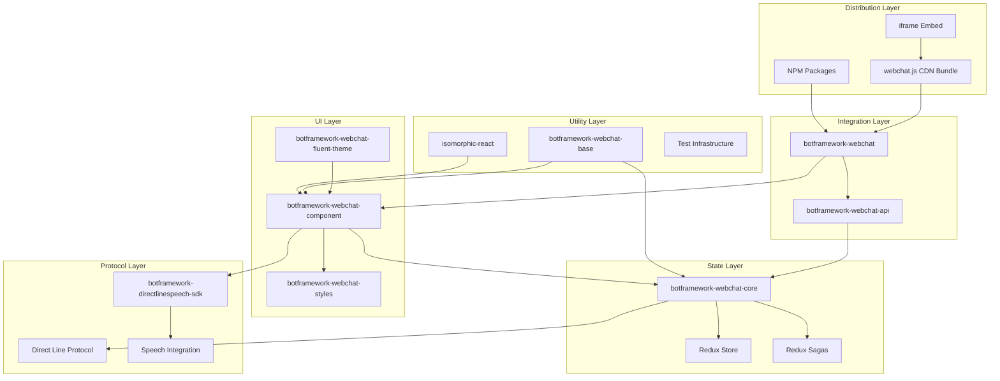
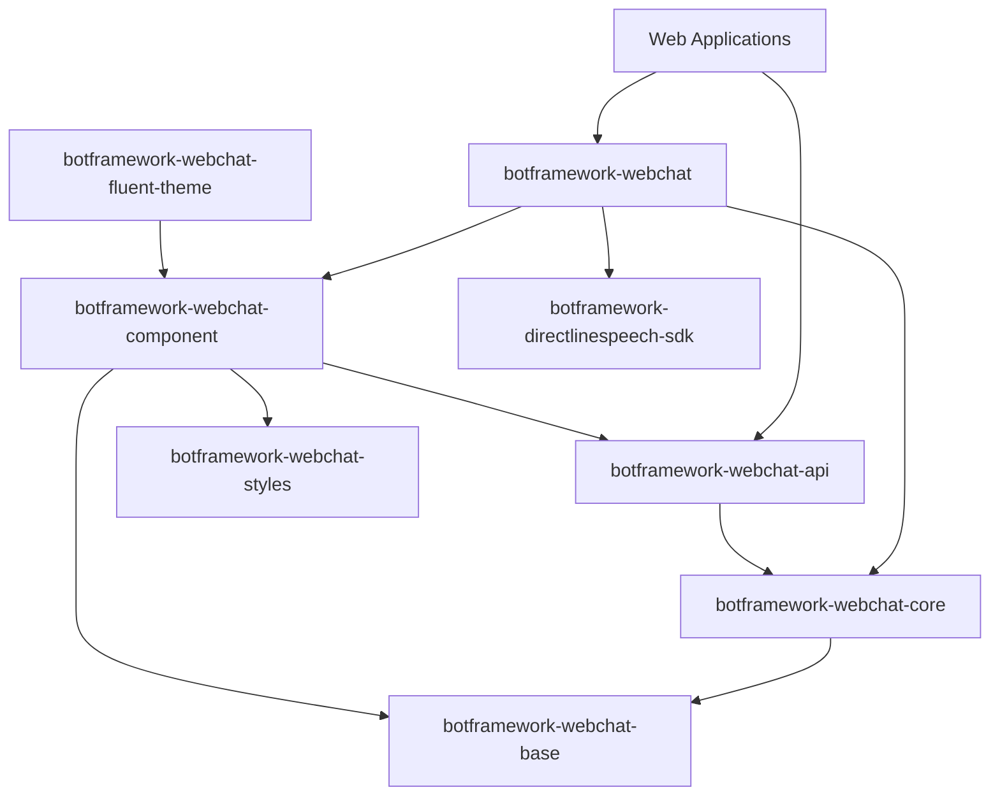
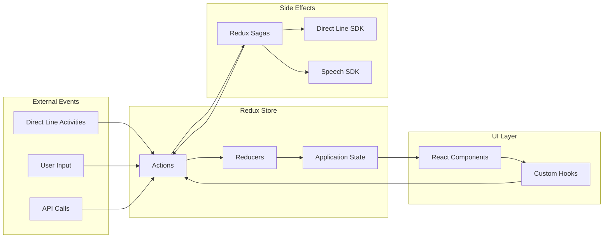
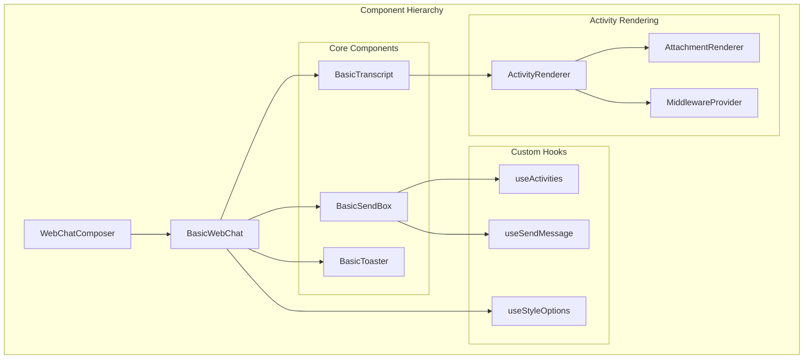
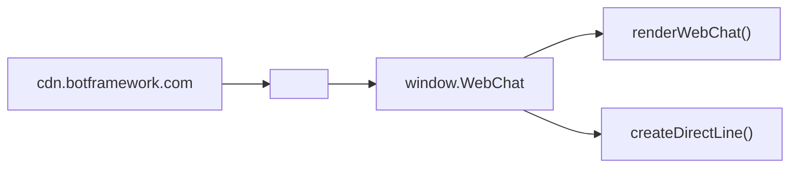
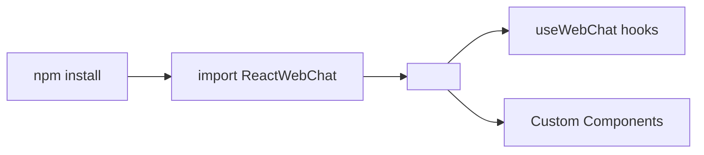
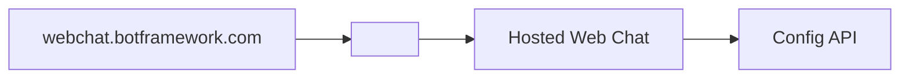
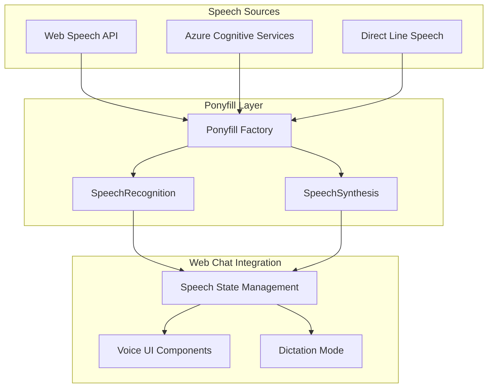
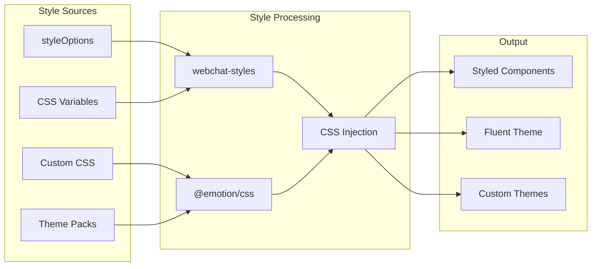

<!-- source: DeepWiki mcp.deepwiki.com · repo microsoft/BotFramework-WebChat · page 1 Overview · fetched 2026-10-26 -->

# Overview

Relevant source files

The following files were used as context for generating this wiki page:

- [CHANGELOG.md](CHANGELOG.md)
- [README.md](README.md)
- [package-lock.json](package-lock.json)
- [package.json](package.json)
- [packages/api/package.json](packages/api/package.json)
- [packages/bundle/package.json](packages/bundle/package.json)
- [packages/component/package.json](packages/component/package.json)
- [packages/core/package.json](packages/core/package.json)
- [packages/directlinespeech/package.json](packages/directlinespeech/package.json)
- [packages/embed/servicingPlan.json](packages/embed/servicingPlan.json)
- [packages/playground/package.json](packages/playground/package.json)
- [samples/index.html](samples/index.html)

## Purpose and Scope

BotFramework-WebChat is a highly-customizable web-based chat client for the Microsoft Bot Framework v4 SDK. This system enables developers to embed conversational AI experiences into web applications through multiple integration methods, from simple CDN inclusion to full React component customization.

This document covers the overall architecture, package structure, and core systems of the Web Chat codebase. For specific integration patterns, see [Integration Guide](#5). For detailed feature documentation, see [Key Features](#4). For development workflows, see [Development](#6).

## High-Level Architecture

The Web Chat system is architected as a modular monorepo with distinct layers handling different concerns:

Sources: [package.json:17-34](), [README.md:1-391](), [packages/bundle/package.json:61-68](), [packages/component/package.json:71-75]()

## Package Structure

The monorepo is organized using npm workspaces with packages serving distinct architectural roles:

| Package | Purpose | Key Dependencies |
|---------|---------|------------------|
| `botframework-webchat` | Main distribution bundle | component, core, api |
| `botframework-webchat-api` | Public API surface | core |
| `botframework-webchat-component` | React UI components | api, core, styles |
| `botframework-webchat-core` | State management | Redux, redux-saga |
| `botframework-webchat-styles` | CSS framework | - |
| `botframework-directlinespeech-sdk` | Speech channel | microsoft-cognitiveservices-speech-sdk |
| `botframework-webchat-fluent-theme` | Fluent UI theme pack | component |

The dependency hierarchy follows a strict layering where higher-level packages depend on lower-level ones but not vice versa.

Sources: [package.json:17-34](), [packages/bundle/package.json:116-143](), [packages/component/package.json:141-168](), [packages/core/package.json:110-119]()

## Core Systems

### State Management Architecture

Web Chat uses Redux with redux-saga for state management, providing a unidirectional data flow:

Sources: [packages/core/package.json:110-119](), [CHANGELOG.md:261-288]()

### Component Architecture

The UI is built with React components following a provider pattern for context and hooks for state access:

Sources: [packages/component/package.json:141-168](), [CHANGELOG.md:246-250]()

## Integration Methods

Web Chat supports three primary integration patterns:

### CDN Integration

Direct inclusion via script tag with global `WebChat` object:

### React Integration

Import as ES modules or CommonJS for full customization:

### iframe Embed

Hosted solution with minimal configuration:

Sources: [README.md:152-289](), [packages/embed/hostDevServer.mjs:1-38](), [packages/embed/servicingPlan.json:1-600]()

## Key Feature Systems

### Speech Integration

Web Chat provides multiple speech engines through a ponyfill architecture:

Sources: [packages/directlinespeech/package.json:112-123](), [CHANGELOG.md:358-372](), [README.md:356-372]()

### Theming and Customization

The styling system supports multiple customization levels:

Sources: [CHANGELOG.md:49-78](), [packages/component/package.json:141-168](), [README.md:290-306]()

---

