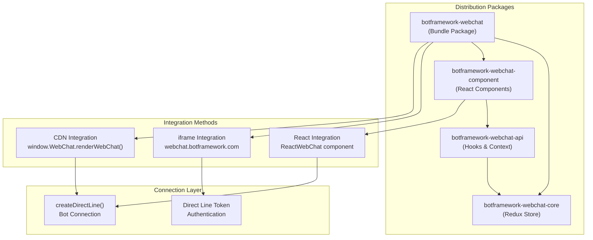
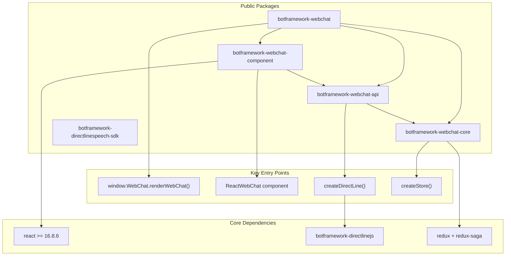
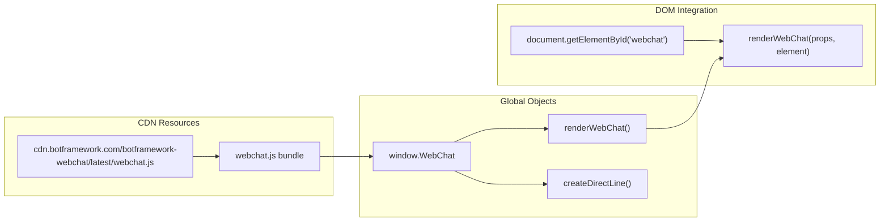
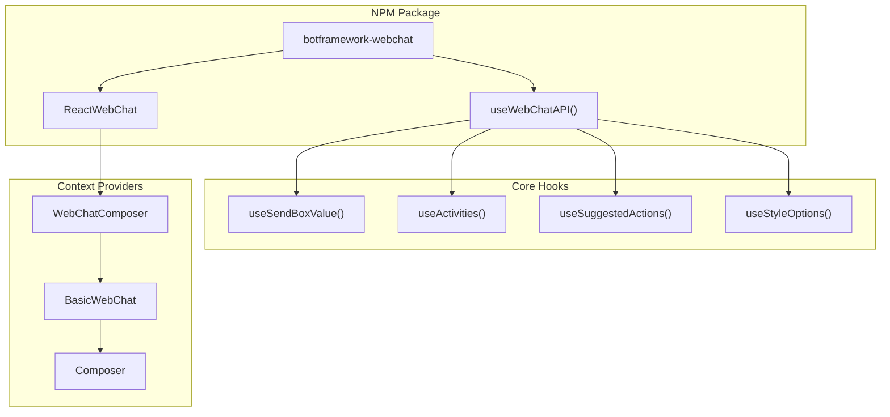
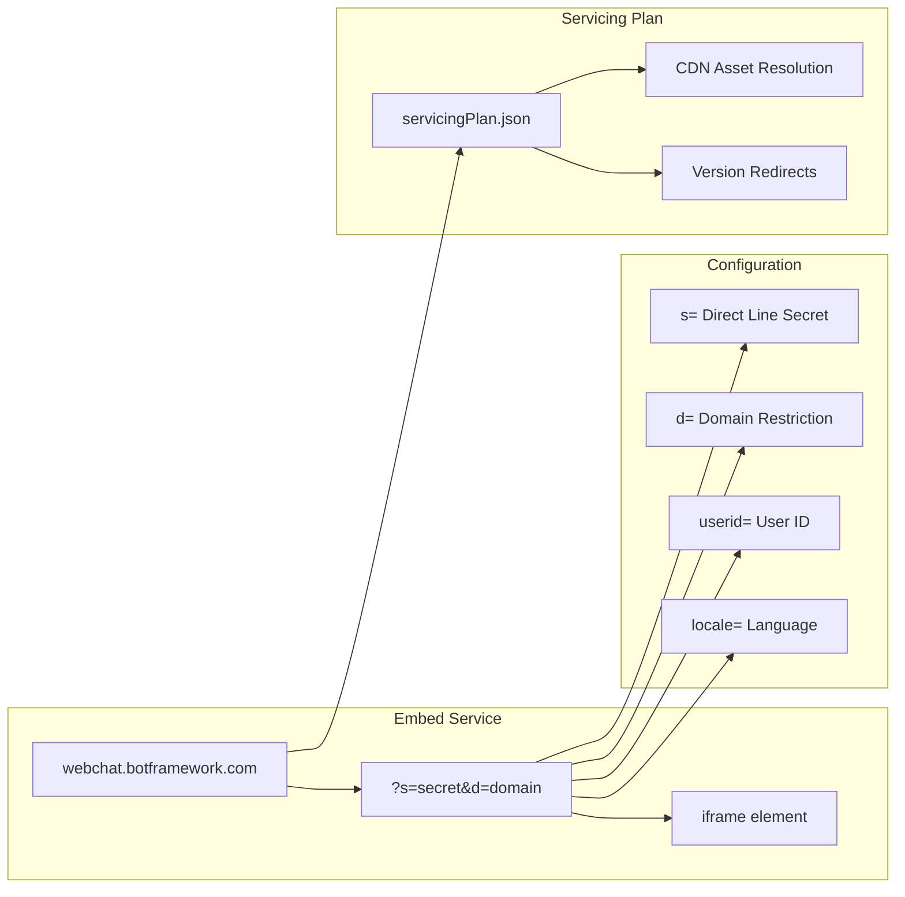
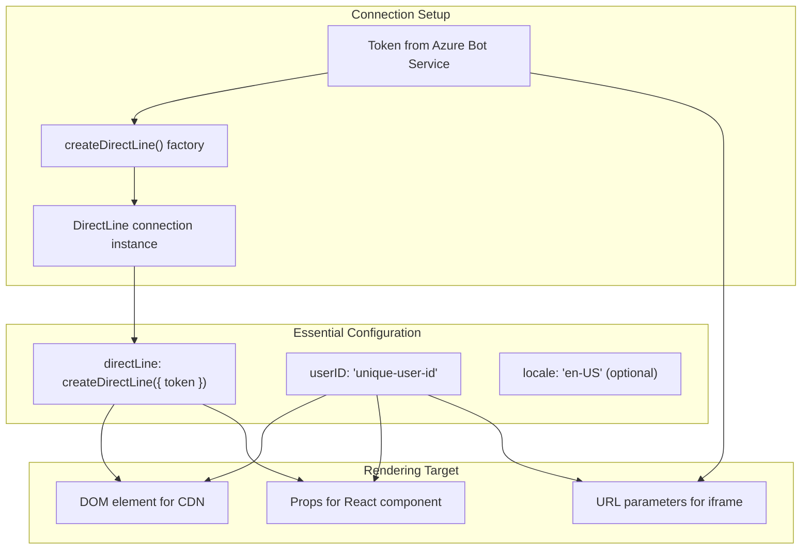

<!-- source: DeepWiki mcp.deepwiki.com · repo microsoft/BotFramework-WebChat · page 2 Getting Started · fetched 2026-10-26 -->

# Getting Started

Relevant source files

The following files were used as context for generating this wiki page:

- [CHANGELOG.md](CHANGELOG.md)
- [README.md](README.md)
- [package-lock.json](package-lock.json)
- [package.json](package.json)
- [packages/api/package.json](packages/api/package.json)
- [packages/bundle/package.json](packages/bundle/package.json)
- [packages/component/package.json](packages/component/package.json)
- [packages/core/package.json](packages/core/package.json)
- [packages/directlinespeech/package.json](packages/directlinespeech/package.json)
- [packages/embed/servicingPlan.json](packages/embed/servicingPlan.json)
- [packages/playground/package.json](packages/playground/package.json)
- [samples/index.html](samples/index.html)

This document covers the basic setup and integration methods for BotFramework-WebChat, a highly-customizable web-based chat client for Azure Bot Services. It explains the three primary integration approaches and fundamental configuration requirements.

For detailed API documentation and advanced customization options, see [Integration Guide](#5). For information about theming and styling customization, see [Theming and Styling](#4.3).

## Integration Methods Overview

BotFramework-WebChat provides three distinct integration approaches to accommodate different development environments and technical requirements. Each method offers varying levels of customization and complexity.

### Integration Architecture

Sources: [README.md:172-224](), [packages/bundle/package.json:1-157](), [packages/component/package.json:1-156]()

### Package Dependency Structure

Sources: [packages/bundle/package.json:97-126](), [packages/component/package.json:123-151](), [packages/core/package.json:101-111]()

## Method 1: JavaScript/CDN Integration

The CDN integration method provides the simplest setup for adding Web Chat to existing web pages without build tools or React dependencies.

### Basic CDN Setup

**Required Configuration:**
- Direct Line token or secret
- Target DOM element
- Basic HTML structure

**Key Functions:**
- `window.WebChat.renderWebChat(props, element)` - Main rendering function
- `window.WebChat.createDirectLine({ token })` - Connection factory

Sources: [README.md:180-223](), [packages/bundle/package.json:5-6]()

## Method 2: React Integration

React integration offers full component customization and programmatic control through hooks and context providers.

### React Component Architecture

**Required Props:**
- `directLine` - Created via `createDirectLine()`
- `userID` - Unique user identifier
- Optional: `styleOptions`, `store`, `locale`

**Key Components:**
- `ReactWebChat` - Main component export
- `WebChatComposer` - Context provider wrapper
- `BasicWebChat` - Core chat interface

Sources: [README.md:242-251](), [packages/component/package.json:1-156](), [packages/api/package.json:1-132]()

## Method 3: iframe Integration

The iframe method provides the simplest integration with minimal configuration through URL parameters.

### iframe Service Architecture

**URL Parameters:**
- `s` - Direct Line secret (required)
- `d` - Domain restriction
- `userid` - User identifier
- `locale` - Language code

**Version Management:**
- Controlled via [servicingPlan.json](packages/embed/servicingPlan.json:1-600)()
- Automatic CDN asset resolution
- Version deprecation handling

Sources: [packages/embed/servicingPlan.json:1-600](), [README.md:157-160]()

## Prerequisites and Requirements

### Authentication Requirements

All integration methods require authentication through Azure Bot Service Direct Line channel:

| Requirement | Description | Security Level |
|-------------|-------------|----------------|
| Direct Line Secret | Bot channel secret from Azure Portal | High Risk - Server Only |
| Direct Line Token | Generated from secret via REST API | Recommended - Client Safe |
| User ID | Unique identifier per user session | Required for state management |

**Token Generation Process:**
1. Obtain Direct Line secret from Azure Bot Service
2. Call Direct Line API to generate token
3. Pass token to Web Chat via `createDirectLine({ token })`

### Browser Compatibility

- **Modern Browsers:** Latest 2 versions of Chrome, Edge, Firefox
- **Legacy Support:** Internet Explorer 11 (limited, deprecated as of 4.16.0)
- **Required Features:** ES5 support, WebSocket support, fetch API

### Network Requirements

- **CDN Access:** `cdn.botframework.com` for script resources
- **Bot Communication:** Direct Line endpoint connectivity
- **Optional:** Cognitive Services endpoints for speech features

Sources: [README.md:153-165](), [README.md:322-333](), [CHANGELOG.md:84-86]()

## Basic Configuration

### Minimum Required Props

### Style Options Structure

Web Chat supports extensive customization through the `styleOptions` object:

| Category | Key Options | Purpose |
|----------|-------------|---------|
| Colors | `accent`, `primaryFont`, `backgroundColor` | Visual theming |
| Layout | `bubbleMaxWidth`, `avatarSize`, `transcriptOverlayButtonBackground` | Sizing and spacing |
| Features | `hideUploadButton`, `sendTypingIndicator` | Functionality toggles |
| Speech | `speechRecognitionContinuous`, `voiceSelector` | Speech integration |

Sources: [README.md:208-225](), [README.md:290-305](), [CHANGELOG.md:42-43]()

---

