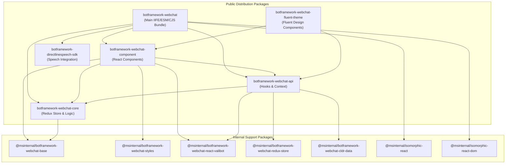
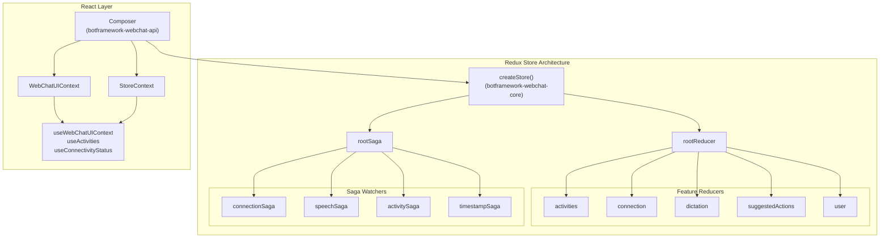
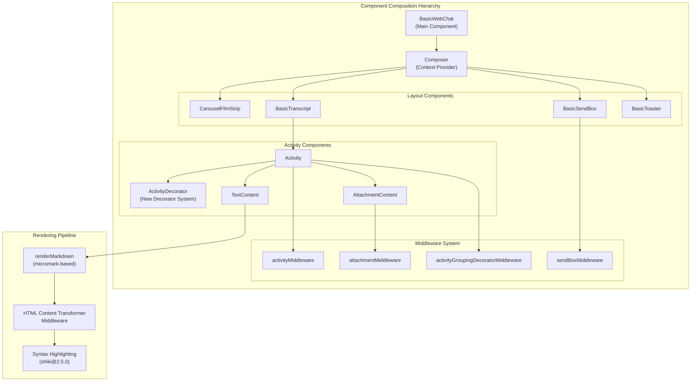
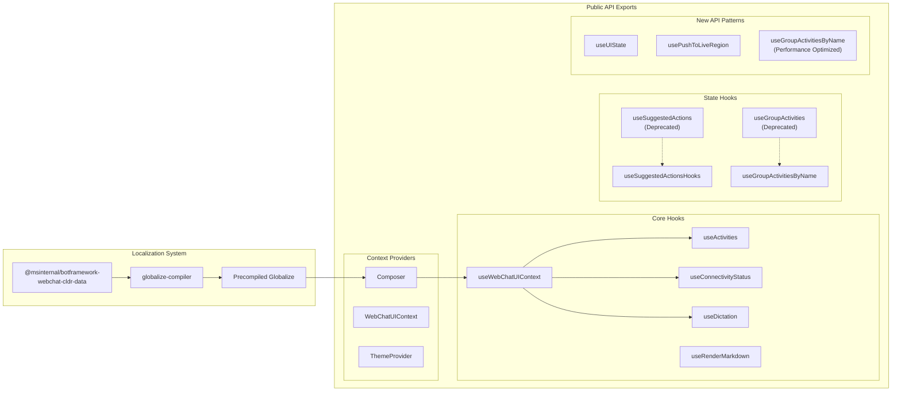
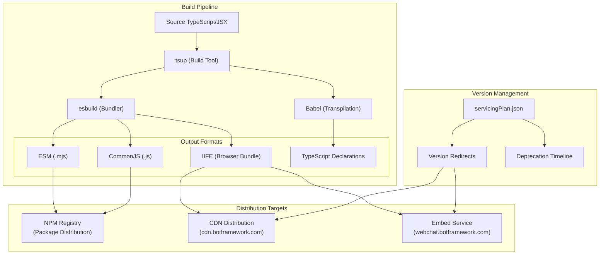
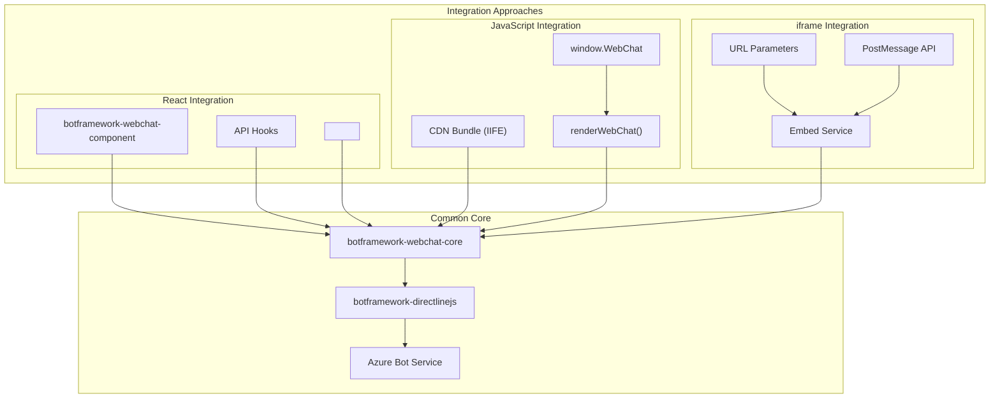

<!-- source: DeepWiki mcp.deepwiki.com · repo microsoft/BotFramework-WebChat · page 3 Core Architecture · fetched 2026-10-26 -->

# Core Architecture

Relevant source files

The following files were used as context for generating this wiki page:

- [CHANGELOG.md](CHANGELOG.md)
- [package-lock.json](package-lock.json)
- [package.json](package.json)
- [packages/api/package.json](packages/api/package.json)
- [packages/bundle/package.json](packages/bundle/package.json)
- [packages/component/package.json](packages/component/package.json)
- [packages/core/package.json](packages/core/package.json)
- [packages/directlinespeech/package.json](packages/directlinespeech/package.json)
- [packages/embed/servicingPlan.json](packages/embed/servicingPlan.json)
- [packages/playground/package.json](packages/playground/package.json)

This document provides a comprehensive overview of the internal architecture of BotFramework-WebChat, including package dependencies, state management patterns, component hierarchies, and core design principles. It covers the monorepo structure, Redux-based state management, React component composition, and the public API surface.

For integration approaches and usage patterns, see [Integration Guide](#5). For specific feature implementations, see [Key Features](#4). For build system details, see [Build System](#6.1).

## Monorepo Package Structure

BotFramework-WebChat is organized as a monorepo with multiple interdependent packages that form distinct architectural layers.

**Sources:** [package.json:17-36](), [packages/bundle/package.json:61-70](), [packages/component/package.json:71-77](), [packages/core/package.json:75-77](), [packages/api/package.json:72-77]()

### Package Responsibilities

| Package | Primary Responsibility | Key Exports |
|---------|----------------------|-------------|
| `botframework-webchat-core` | Redux store, sagas, actions, reducers | `createStore`, actions, selectors |
| `botframework-webchat-api` | React hooks, context providers, localization | `useWebChatUIContext`, `Composer` |
| `botframework-webchat-component` | React components, UI rendering | `BasicWebChat`, `Composer` |
| `botframework-webchat` | Distribution bundle, public API | `renderWebChat`, `createDirectLine` |
| `botframework-directlinespeech-sdk` | Speech recognition/synthesis | `createDirectLineSpeechAdapter` |

## Core State Management Architecture

The state management layer is built on Redux with Redux-Saga for side effects, providing a predictable state container for the entire WebChat application.

**Sources:** [packages/core/package.json:101-111](), [CHANGELOG.md:238](), [CHANGELOG.md:99-102]()

### State Architecture Patterns

The core implements several key architectural patterns:

- **Redux Store**: Central state container using `redux@5.0.1` and `redux-saga@1.3.0`
- **Saga-based Side Effects**: Asynchronous operations handled through generator-based sagas
- **Feature-based Organization**: State sliced by domain (activities, connection, dictation, etc.)
- **Immutable Updates**: State updates using `simple-update-in@2.2.0` for immutable operations
- **Hooks Integration**: Modern React patterns with hooks backend introduced in recent versions

## Component System Architecture

The component layer provides a hierarchical React component structure with composition patterns and middleware support.

**Sources:** [packages/component/package.json:123-151](), [CHANGELOG.md:31-34](), [CHANGELOG.md:78-81](), [CHANGELOG.md:85](), [CHANGELOG.md:37-41]()

### Component Design Patterns

Key architectural patterns in the component system:

- **Chain of Responsibility**: Middleware pattern using `react-chain-of-responsibility@0.3.0`
- **Decorator Pattern**: Enhanced styling through `ActivityDecorator` and decorator middleware
- **Composition over Inheritance**: Component composition with configurable middleware
- **Markdown Processing**: Migration from `markdown-it` to `micromark@4.0.2` with extension support
- **Syntax Highlighting**: Integrated code highlighting with `shiki@2.5.0`

## Public API Surface

The API layer exposes React hooks, context providers, and utility functions as the primary interface for consuming applications.

**Sources:** [packages/api/package.json:115-127](), [CHANGELOG.md:35-36](), [CHANGELOG.md:280-282](), [CHANGELOG.md:99-102](), [CHANGELOG.md:57](), [CHANGELOG.md:62]()

### API Evolution Patterns

The API layer demonstrates several evolutionary patterns:

- **Hook Migration**: Transition from Redux-direct access to React hooks backend
- **Deprecation Strategy**: Gradual deprecation with clear migration paths and timeline
- **Performance Optimization**: New hooks like `useGroupActivitiesByName` for improved performance
- **Accessibility Focus**: New `usePushToLiveRegion` for centralized screen reader announcements
- **State Abstraction**: New `useUIState` replacing specific state hooks like `useDisabled`

## Build and Distribution Architecture

The build system uses modern tooling to produce multiple output formats for different consumption patterns.

**Sources:** [packages/bundle/package.json:48-49](), [packages/embed/servicingPlan.json:1-634](), [CHANGELOG.md:121](), [package.json:17-36]()

### Build System Characteristics

- **Modern Toolchain**: Uses `tsup@8.5.0` with `esbuild@0.25.8` for fast builds
- **Multi-format Output**: Produces ESM, CommonJS, and IIFE bundles simultaneously  
- **Workspace Management**: Migrated from Lerna to npm workspaces for simplified dependency management
- **Version Servicing**: Sophisticated version management with automatic deprecation timelines
- **CDN Integration**: Direct integration with Azure CDN for global distribution

## Integration Patterns

The architecture supports three primary integration approaches, each with distinct characteristics and use cases.

**Sources:** [packages/bundle/package.json:5-17](), [packages/component/package.json:5-17](), [packages/embed/servicingPlan.json:578-586]()

This architecture enables WebChat to serve diverse integration scenarios while maintaining a consistent core implementation and state management system across all deployment methods.

---

