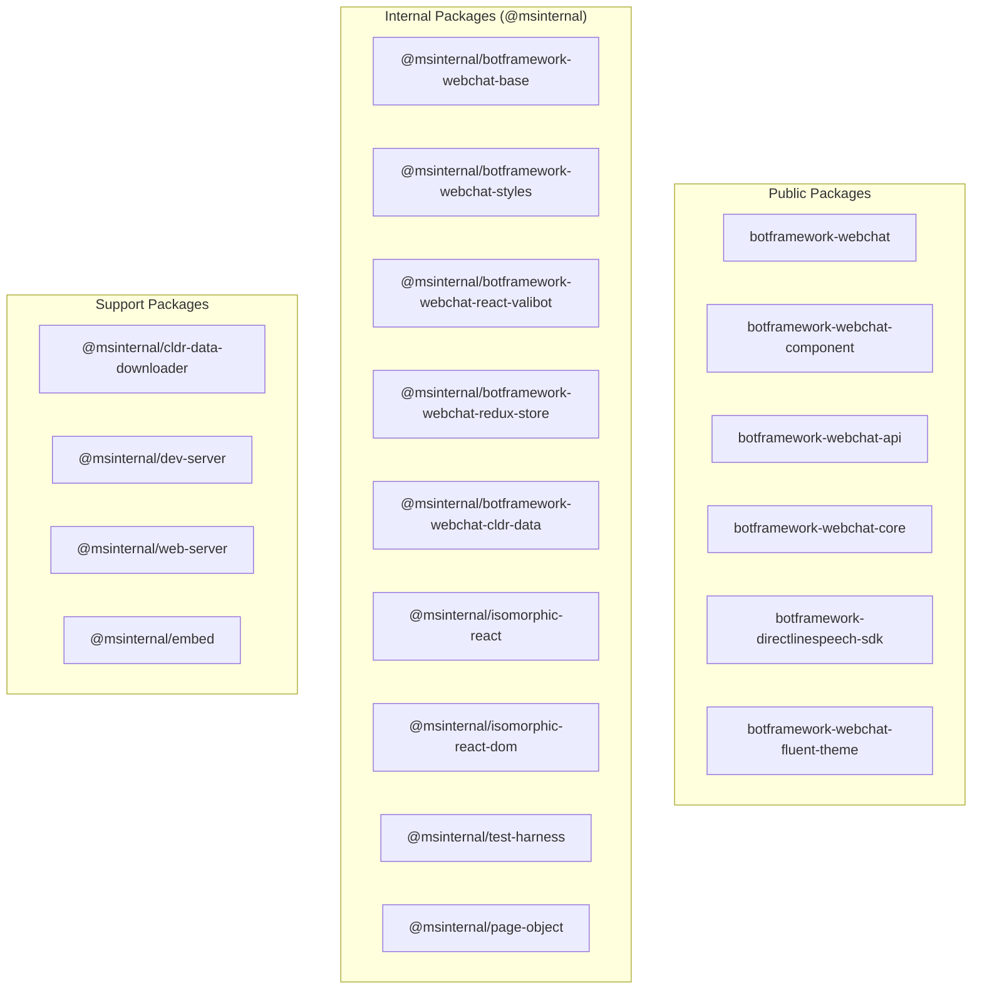
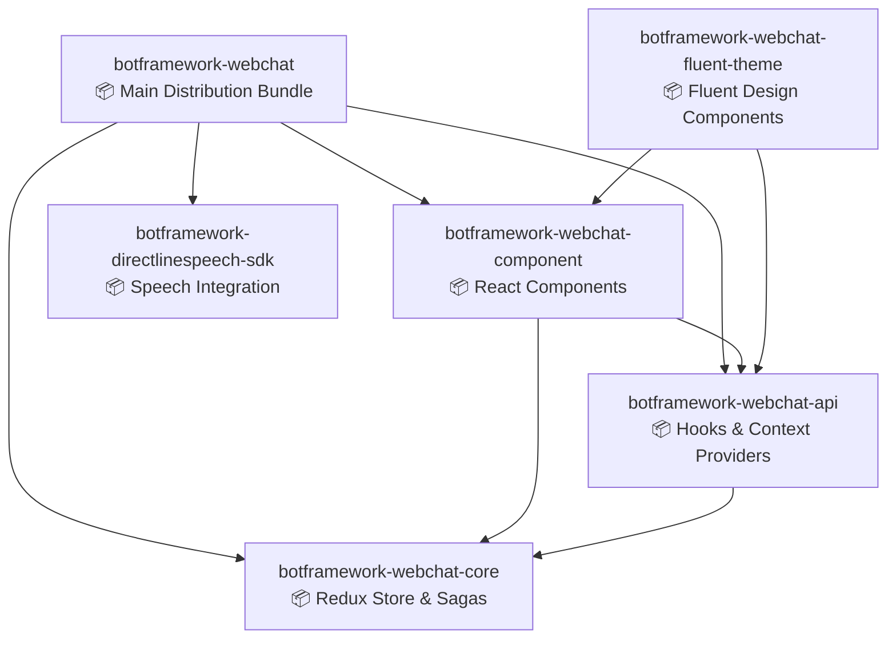
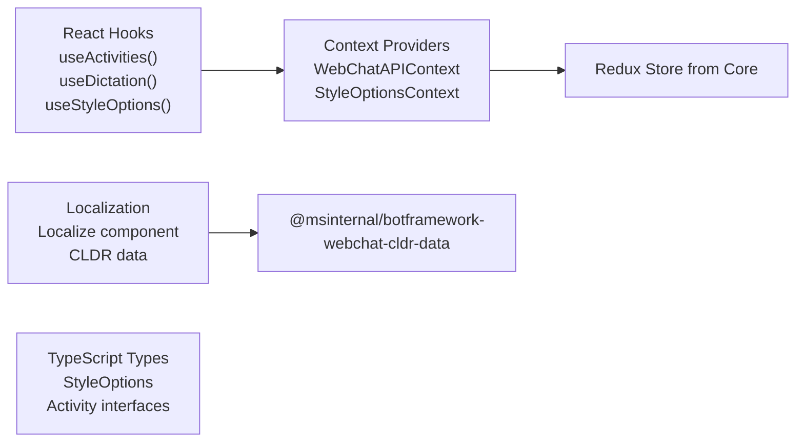
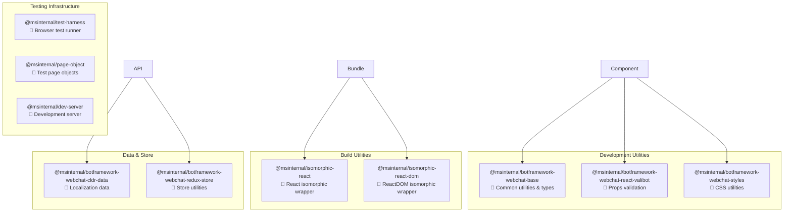
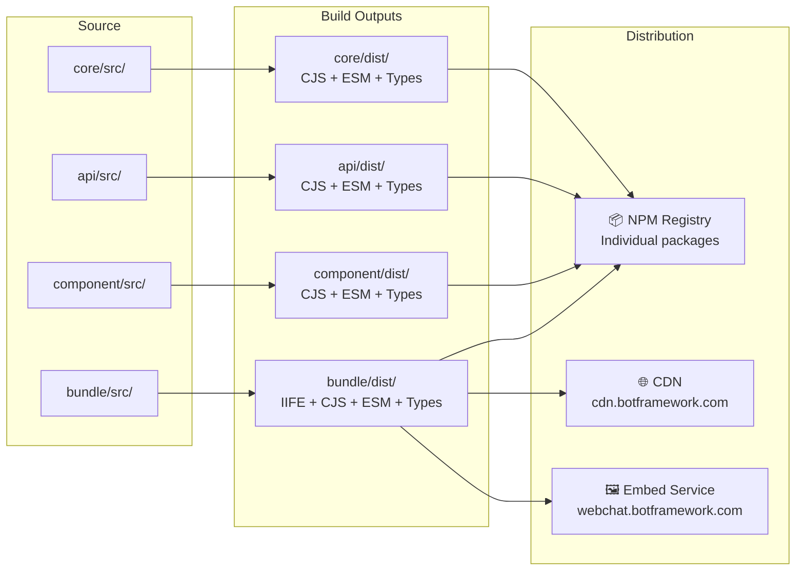

<!-- source: DeepWiki mcp.deepwiki.com · repo microsoft/BotFramework-WebChat · page 3.1 Package Structure · fetched 2026-10-26 -->

# Package Structure

<details>
<summary>Relevant source files</summary>

The following files were used as context for generating this wiki page:

- [CHANGELOG.md](CHANGELOG.md)
- [package-lock.json](package-lock.json)
- [package.json](package.json)
- [packages/api/package.json](packages/api/package.json)
- [packages/bundle/package.json](packages/bundle/package.json)
- [packages/component/package.json](packages/component/package.json)
- [packages/core/package.json](packages/core/package.json)
- [packages/directlinespeech/package.json](packages/directlinespeech/package.json)
- [packages/embed/package.json](packages/embed/package.json)
- [packages/embed/servicingPlan.json](packages/embed/servicingPlan.json)
- [packages/isomorphic-react-dom/package.json](packages/isomorphic-react-dom/package.json)
- [packages/isomorphic-react/package.json](packages/isomorphic-react/package.json)
- [packages/playground/package.json](packages/playground/package.json)

</details>


This document provides a detailed breakdown of the monorepo package organization, dependencies, and how the various packages work together to create the final WebChat distributions. This covers the internal architecture and build relationships between packages.

For information about integrating WebChat into applications, see [Integration Guide](#5). For details about the build system and tooling, see [Build System](#6.1).

## Overview

BotFramework-WebChat is organized as a monorepo using npm workspaces with a clear separation between **public packages** (published to npm) and **internal packages** (prefixed with `@msinternal`, used only for development and build processes). The architecture follows a layered dependency model where higher-level packages depend on lower-level ones.



Sources: [package.json:17-35](), [packages/bundle/package.json:61-70](), [packages/component/package.json:71-77](), [packages/api/package.json:72-77]()

## Public Package Hierarchy

The public packages form a clear dependency hierarchy where each layer builds upon the previous one:



Sources: [packages/bundle/package.json:61-70](), [packages/component/package.json:71-77](), [packages/api/package.json:72-77]()

### Core Package Layer

| Package | Purpose | Key Exports |
|---------|---------|-------------|
| `botframework-webchat-core` | Redux store, sagas, and state management logic | Store creation, actions, selectors, middleware |
| `botframework-directlinespeech-sdk` | Direct Line Speech protocol implementation | Speech adapters, cognitive services integration |

The `core` package provides the foundational state management using Redux and Redux-Saga. It exports `createStore`, various action creators, and selectors for managing conversation state, dictation, and Direct Line connections.

Sources: [packages/core/package.json:1-112](), [packages/directlinespeech/package.json:1-115]()

### API Package Layer

The `botframework-webchat-api` package sits above core and provides React-specific interfaces:

- **Hooks**: `useActivities`, `useDictation`, `useStyleOptions`, etc.
- **Context Providers**: `WebChatAPIContext`, `StyleOptionsContext`
- **Localization**: CLDR data integration and `Localize` component
- **Type Definitions**: TypeScript interfaces for all public APIs



Sources: [packages/api/package.json:72-77](), [packages/api/package.json:115-127]()

### Component Package Layer

The `botframework-webchat-component` package contains all React UI components and depends on both `api` and `core`:

**Key Component Categories:**
- **Activity Renderers**: `BasicActivity`, `ActivityComposer`, `CarouselFilmStrip`
- **Input Components**: `BasicSendBox`, `BasicSendBoxToolbar`, `DictationButton`
- **Layout Components**: `BasicTranscript`, `BasicWebChat`, `Composer`
- **Middleware System**: Activity, attachment, and grouping middleware

Sources: [packages/component/package.json:71-77](), [packages/component/package.json:123-151]()

### Bundle Package Layer

The `botframework-webchat` package is the main distribution that combines all lower layers and provides multiple output formats:

**Export Formats:**
- **IIFE**: `webchat-es5.js` for CDN/script tag usage
- **ES Modules**: `botframework-webchat.mjs` for modern bundlers
- **CommonJS**: `botframework-webchat.js` for Node.js/older bundlers

**Key Bundle Exports:**
- `renderWebChat()` - Main rendering function
- `createDirectLine()` - Connection factory
- `createStore()` - Store factory with defaults
- React components for direct usage

Sources: [packages/bundle/package.json:7-17](), [packages/bundle/package.json:97-126]()

## Internal Package Architecture

Internal packages support the build process and provide shared utilities:



### Key Internal Packages

| Package | Purpose | Used By |
|---------|---------|---------|
| `@msinternal/botframework-webchat-base` | Common TypeScript types and utilities | component, bundle |
| `@msinternal/botframework-webchat-styles` | CSS processing and style utilities | component |
| `@msinternal/isomorphic-react` | Provides React from window or require | bundle |
| `@msinternal/botframework-webchat-cldr-data` | Precompiled CLDR localization data | api |
| `@msinternal/test-harness` | Selenium-based browser testing | Testing only |

Sources: [packages/component/package.json:71-77](), [packages/bundle/package.json:61-70](), [packages/api/package.json:72-77]()

## Package Build Outputs and Distribution

Each package produces specific outputs for different consumption patterns:



### Build Tool Configuration

All packages use `tsup` for building with TypeScript support:

- **TypeScript Compilation**: `.d.ts` files for both CJS and ESM
- **Multiple Formats**: CommonJS, ES Modules, and IIFE where applicable
- **Tree Shaking**: ES Module exports support dead code elimination
- **Source Maps**: Generated for debugging

The bundle package additionally includes specialized webpack configuration for the IIFE build that will be hosted on CDN.

Sources: [packages/bundle/package.json:47-59](), [packages/component/package.json:57-69](), [packages/core/package.json:58-70](), [packages/api/package.json:57-70]()

## Dependency Management Strategy

The monorepo uses a sophisticated dependency management system with local dependencies:

### Local Dependencies

Local dependencies are managed through the `localDependencies` field in each `package.json` and are automatically updated during the version bump process:

```json
"localDependencies": {
  "botframework-webchat-core": "production",
  "@msinternal/botframework-webchat-base": "development"
}
```

- **`"production"`**: Package is included in the published dependencies
- **`"development"`**: Package is included in devDependencies only

### Pinned Dependencies

Critical external dependencies are pinned to specific versions to ensure compatibility:

```json
"pinDependencies": {
  "react": ["16.8.6", "using react@16.8.6 to make sure this is the minimum supported version"],
  "typescript": ["~5.8.3", "@typescript-eslint/parser@8.38.0 does not support typescript@5.9.2 yet"]
}
```

This approach ensures that breaking changes in external dependencies don't unexpectedly break the build.

Sources: [packages/bundle/package.json:61-96](), [packages/component/package.json:71-101](), [packages/api/package.json:72-91](), [package.json:95-144]()

---

