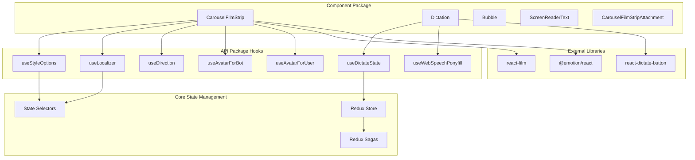
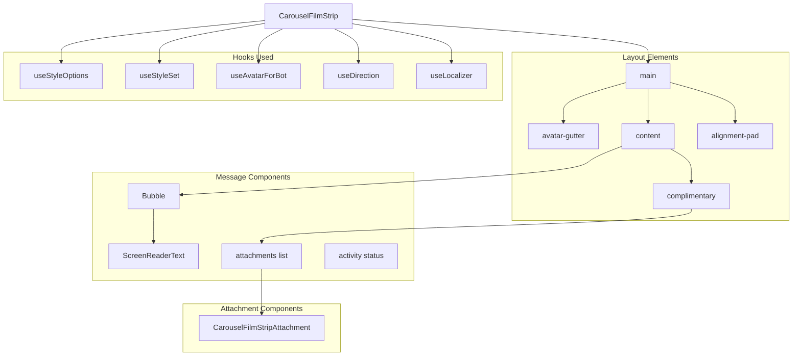
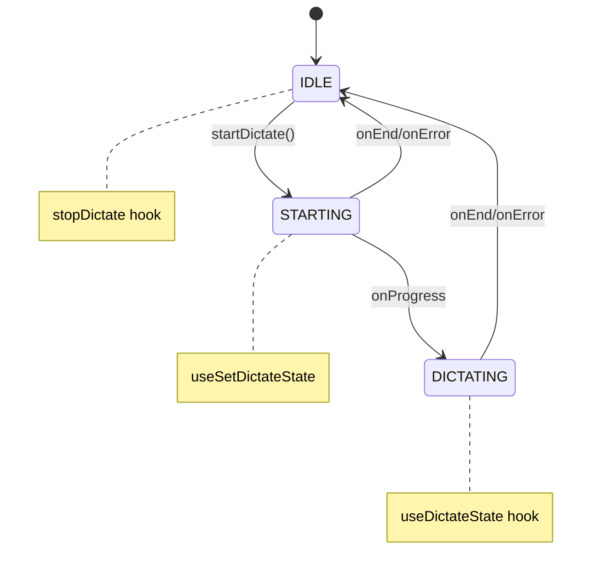
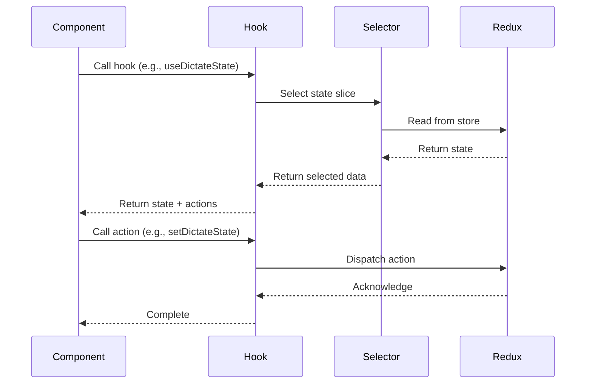
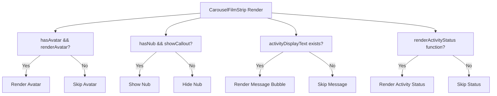
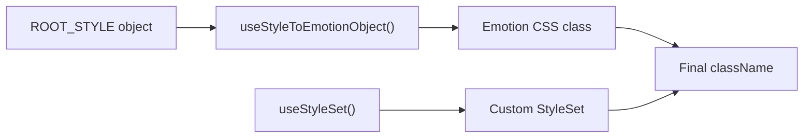
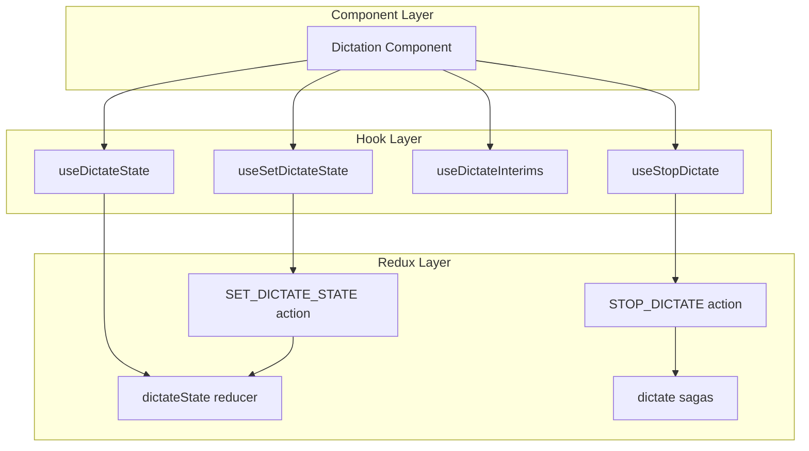

<!-- source: DeepWiki mcp.deepwiki.com · repo microsoft/BotFramework-WebChat · page 3.2 Component System · fetched 2026-10-26 -->

# Component System

<details>
<summary>Relevant source files</summary>

The following files were used as context for generating this wiki page:

- [__tests__/__image_snapshots__/chrome-docker/disabled-ui-js-tests-the-ui-of-disabled-web-chat-change-default-disabled-button-color-1-snap.png](__tests__/__image_snapshots__/chrome-docker/disabled-ui-js-tests-the-ui-of-disabled-web-chat-change-default-disabled-button-color-1-snap.png)
- [packages/component/src/Activity/CarouselFilmStrip.js](packages/component/src/Activity/CarouselFilmStrip.js)
- [packages/component/src/Dictation.js](packages/component/src/Dictation.js)
- [packages/core/src/reducers/sendTypingIndicator.js](packages/core/src/reducers/sendTypingIndicator.js)
- [packages/core/src/reducers/shouldSpeakIncomingActivity.js](packages/core/src/reducers/shouldSpeakIncomingActivity.js)
- [packages/core/src/sagas/speakActivityAndStartDictateOnIncomingActivityFromOthersSaga.js](packages/core/src/sagas/speakActivityAndStartDictateOnIncomingActivityFromOthersSaga.js)
- [packages/core/src/sagas/startDictateOnSpeakCompleteSaga.js](packages/core/src/sagas/startDictateOnSpeakCompleteSaga.js)
- [packages/core/src/sagas/submitSendBoxSaga.js](packages/core/src/sagas/submitSendBoxSaga.js)

</details>


This document covers the React component architecture within BotFramework-WebChat, including the composition patterns, hook-based API integration, and key UI components. The component system sits at the interface layer between the state management core and the rendered user interface.

For information about the Redux state management that powers these components, see [State Management](#3.3). For details about the public hooks and context providers, see [Public APIs](#3.4).

## Component Architecture Overview

The WebChat component system follows a functional React architecture built around hooks and composition. Components are organized into logical groupings and use a consistent pattern of accessing state and functionality through hooks provided by the API package.

**Component Architecture Pattern**


Sources: [packages/component/src/Activity/CarouselFilmStrip.js:1-267](), [packages/component/src/Dictation.js:1-121]()

## Key Components

### CarouselFilmStrip

The `CarouselFilmStrip` component is responsible for rendering chat activities with attachment carousels. It handles complex layout logic including avatar positioning, speech bubbles, and horizontal scrolling for multiple attachments.

**CarouselFilmStrip Component Structure**


The component handles several key responsibilities:
- **Avatar Management**: Uses `useAvatarForBot` and `useAvatarForUser` hooks to determine avatar display
- **RTL Support**: Adapts layout based on `useDirection` hook
- **Accessibility**: Includes screen reader text and ARIA roles
- **Responsive Layout**: Adjusts bubble positioning and nub alignment based on style options

Sources: [packages/component/src/Activity/CarouselFilmStrip.js:98-234]()

### Dictation Component

The `Dictation` component manages speech recognition functionality and integrates with the WebChat state system to handle voice input.

**Dictation State Flow**


Key integration points:
- **State Management**: Uses `useDictateState` and `useSetDictateState` for Redux integration
- **Speech Recognition**: Wraps `react-dictate-button` with WebChat-specific logic
- **Typing Indicators**: Emits typing indicators during dictation via `useEmitTypingIndicator`
- **Send Box Integration**: Updates send box value via `useSendBoxValue` hook

Sources: [packages/component/src/Dictation.js:31-111]()

## Hook-based API Pattern

Components in WebChat follow a consistent pattern of accessing functionality through hooks rather than prop drilling or direct Redux connections. This creates a clean separation between component concerns and state management.

**Hook Categories and Usage**
| Hook Category | Examples | Purpose |
|---------------|----------|---------|
| State Access | `useDictateState`, `useSendBoxValue` | Read/write Redux state |
| Configuration | `useStyleOptions`, `useDirection` | Access configuration values |
| Localization | `useLocalizer`, `useLanguage` | Internationalization support |
| UI State | `useUIState`, `useAvatarForBot` | UI-specific state management |
| Actions | `useStopDictate`, `useSubmitSendBox` | Trigger state changes |

**Hook Integration Pattern**


Sources: [packages/component/src/Dictation.js:13-25](), [packages/component/src/Activity/CarouselFilmStrip.js:17]()

## Component Composition Patterns

### Render Props Pattern

WebChat components use render props extensively to allow customization while maintaining core functionality. The `CarouselFilmStrip` demonstrates this pattern:

```javascript
// From CarouselFilmStrip props
renderAttachment: PropTypes.func.isRequired,
renderAvatar: PropTypes.oneOfType([PropTypes.oneOf([false]), PropTypes.func]),
renderActivityStatus: PropTypes.oneOfType([PropTypes.oneOf([false]), PropTypes.func])
```

### Conditional Rendering Logic

Components implement sophisticated conditional rendering based on configuration and state:

**CarouselFilmStrip Conditional Rendering**


Sources: [packages/component/src/Activity/CarouselFilmStrip.js:140-151](), [packages/component/src/Activity/CarouselFilmStrip.js:175-231]()

### Style Integration Pattern

Components use the `useStyleToEmotionObject` hook to integrate with the theming system while maintaining CSS-in-JS patterns:

**Style System Integration**


Sources: [packages/component/src/Activity/CarouselFilmStrip.js:19-96](), [packages/component/src/Activity/CarouselFilmStrip.js:113]()

## State Integration

Components integrate with the Redux-based state management system through carefully designed hooks that abstract away the complexity of direct Redux usage.

**Dictation State Integration Example**


This pattern allows components to remain focused on rendering while accessing complex state management functionality through a clean, typed interface.

Sources: [packages/component/src/Dictation.js:31-46](), [packages/core/src/sagas/speakActivityAndStartDictateOnIncomingActivityFromOthersSaga.js:1-49](), [packages/core/src/sagas/startDictateOnSpeakCompleteSaga.js:1-23]()

---

