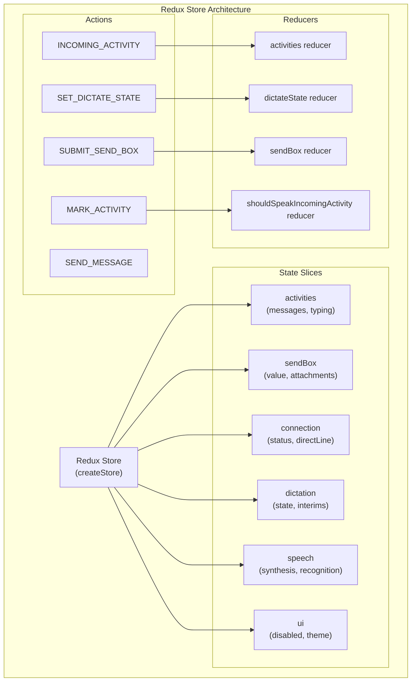
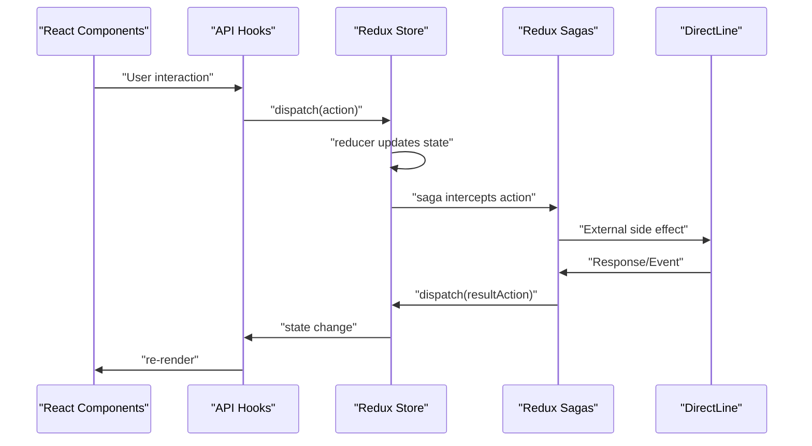
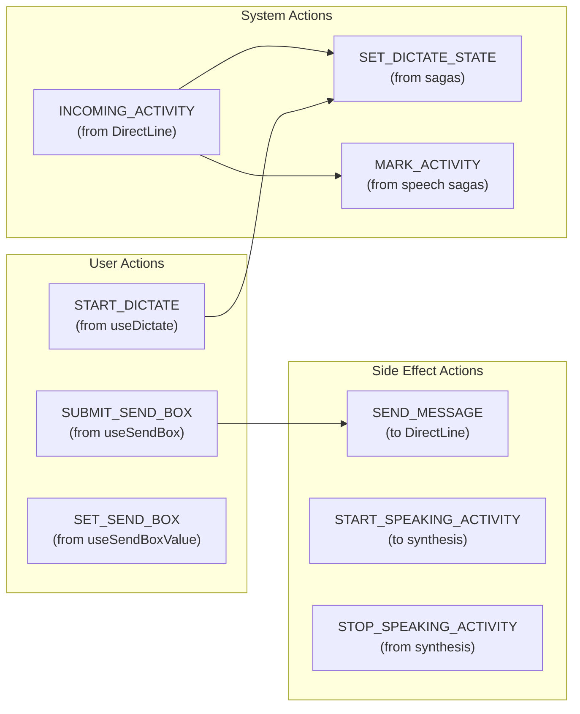
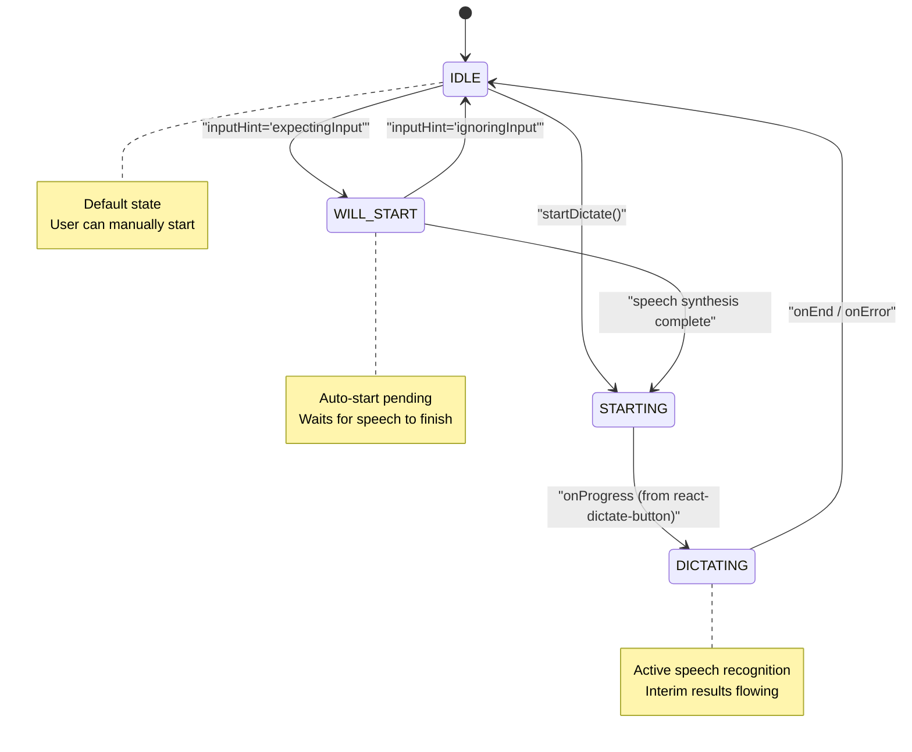
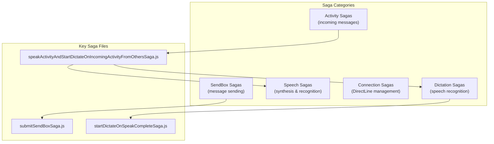
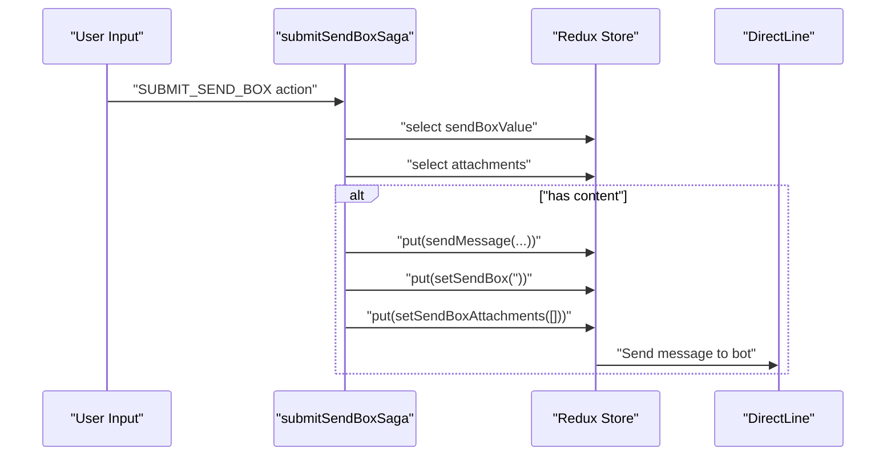
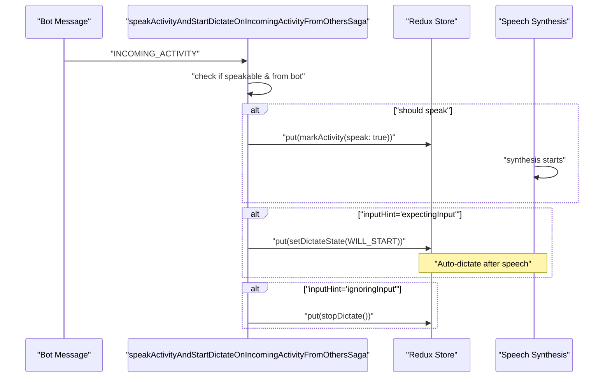
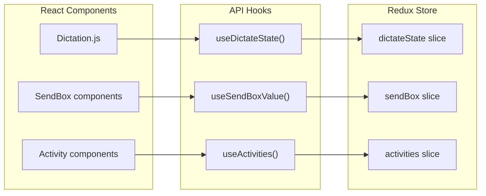

<!-- source: DeepWiki mcp.deepwiki.com · repo microsoft/BotFramework-WebChat · page 3.3 State Management · fetched 2026-10-26 -->

# State Management

Relevant source files

The following files were used as context for generating this wiki page:

- [CHANGELOG.md](CHANGELOG.md)
- [__tests__/__image_snapshots__/chrome-docker/disabled-ui-js-tests-the-ui-of-disabled-web-chat-change-default-disabled-button-color-1-snap.png](__tests__/__image_snapshots__/chrome-docker/disabled-ui-js-tests-the-ui-of-disabled-web-chat-change-default-disabled-button-color-1-snap.png)
- [package-lock.json](package-lock.json)
- [package.json](package.json)
- [packages/api/package.json](packages/api/package.json)
- [packages/bundle/package.json](packages/bundle/package.json)
- [packages/component/package.json](packages/component/package.json)
- [packages/component/src/Dictation.js](packages/component/src/Dictation.js)
- [packages/core/package.json](packages/core/package.json)
- [packages/core/src/reducers/sendTypingIndicator.js](packages/core/src/reducers/sendTypingIndicator.js)
- [packages/core/src/reducers/shouldSpeakIncomingActivity.js](packages/core/src/reducers/shouldSpeakIncomingActivity.js)
- [packages/core/src/sagas/speakActivityAndStartDictateOnIncomingActivityFromOthersSaga.js](packages/core/src/sagas/speakActivityAndStartDictateOnIncomingActivityFromOthersSaga.js)
- [packages/core/src/sagas/startDictateOnSpeakCompleteSaga.js](packages/core/src/sagas/startDictateOnSpeakCompleteSaga.js)
- [packages/core/src/sagas/submitSendBoxSaga.js](packages/core/src/sagas/submitSendBoxSaga.js)
- [packages/directlinespeech/package.json](packages/directlinespeech/package.json)
- [packages/embed/servicingPlan.json](packages/embed/servicingPlan.json)
- [packages/playground/package.json](packages/playground/package.json)

## Purpose and Scope

This document covers the Redux-based state management architecture of BotFramework-WebChat, including the store structure, action/reducer patterns, saga-based side effects, and specialized state management for dictation and speech features. The state management system coordinates user interactions, bot communications, and UI state across the entire chat interface.

For component-level state and React context providers, see [Public APIs](#3.4). For overall architectural patterns, see [Core Architecture](#3).

## Redux Store Architecture

The state management system is built around a centralized Redux store located in the `botframework-webchat-core` package. The store manages application state through a traditional Redux pattern with actions, reducers, and sagas for side effects.

### Store Structure

Sources: [packages/core/package.json:101-111](), [packages/core/src/reducers/sendTypingIndicator.js:1-16](), [packages/core/src/reducers/shouldSpeakIncomingActivity.js:1-19]()

### Core State Types

The Redux store manages several key state domains:

| State Domain | Purpose | Key Reducers |
|--------------|---------|--------------|
| `activities` | Chat messages, typing indicators, activity status | `activities`, `activityStatuses` |
| `sendBox` | Send box content and attachments | `sendBoxValue`, `sendBoxAttachments` |
| `dictateState` | Speech recognition state | `dictateState`, `dictateInterims` |
| `connection` | DirectLine connection status | `connectionState`, `directLine` |
| `speech` | Speech synthesis settings | `shouldSpeakIncomingActivity` |
| `ui` | UI state and configuration | `disabled`, `uiState` |

Sources: [packages/core/src/sagas/submitSendBoxSaga.js:7-8](), [packages/core/src/reducers/shouldSpeakIncomingActivity.js:4-18]()

## State Flow and Actions

### Action Dispatch Flow

Sources: [packages/component/src/Dictation.js:31-121](), [packages/core/src/sagas/submitSendBoxSaga.js:11-30]()

### Key Action Types

The state management system uses typed actions for all state mutations:

Sources: [packages/core/src/sagas/speakActivityAndStartDictateOnIncomingActivityFromOthersSaga.js:3-6](), [packages/core/src/sagas/submitSendBoxSaga.js:3-6]()

## Dictation and Speech State Management

### Dictation State Machine

The dictation system implements a finite state machine with specific transitions:

Sources: [packages/component/src/Dictation.js:28-29](), [packages/core/src/sagas/speakActivityAndStartDictateOnIncomingActivityFromOthersSaga.js:34-42](), [packages/core/src/sagas/startDictateOnSpeakCompleteSaga.js:11-17]()

### Speech Recognition Integration

The dictation system integrates with Web Speech API through several key components:

| Component | Purpose | File Location |
|-----------|---------|---------------|
| `Dictation` | Main dictation orchestrator | `packages/component/src/Dictation.js` |
| `useDictateState` | State access hook | `botframework-webchat-api` |
| `useSetDictateState` | State mutation hook | `botframework-webchat-api/internal` |
| `DictateComposer` | Speech recognition wrapper | `react-dictate-button` |

Sources: [packages/component/src/Dictation.js:1-11](), [packages/component/src/Dictation.js:98-110]()

## Saga-based Side Effects

### Saga Architecture

Redux-Saga handles all asynchronous operations and complex state orchestration:

Sources: [packages/core/src/sagas/speakActivityAndStartDictateOnIncomingActivityFromOthersSaga.js:1-49](), [packages/core/src/sagas/submitSendBoxSaga.js:1-31](), [packages/core/src/sagas/startDictateOnSpeakCompleteSaga.js:1-24]()

### Critical Saga Workflows

#### Message Submission Flow

The `submitSendBoxSaga` handles user message sending:

Sources: [packages/core/src/sagas/submitSendBoxSaga.js:11-25]()

#### Speech-Triggered Dictation

The `speakActivityAndStartDictateOnIncomingActivityFromOthersSaga` coordinates speech and dictation:

Sources: [packages/core/src/sagas/speakActivityAndStartDictateOnIncomingActivityFromOthersSaga.js:13-44]()

## State Selectors and React Integration

### Selector Pattern

The state management system provides typed selectors for accessing store state:

| Selector Category | Examples | Usage |
|------------------|----------|--------|
| Activity Selectors | `activitiesOf()`, `dictateStateSelector` | Filter and access activities |
| SendBox Selectors | `sendBoxValueSelector`, `sendBoxAttachmentsSelector` | Access send box state |
| Speech Selectors | `shouldSpeakIncomingActivitySelector` | Control speech behavior |
| Connection Selectors | `connectionStateSelector` | Monitor DirectLine status |

### Hook Integration Bridge

React hooks bridge Redux state to components through the API layer:

Sources: [packages/component/src/Dictation.js:13-25](), [packages/component/src/Dictation.js:38-46]()

The state management system provides a robust foundation for coordinating complex interactions between user input, bot responses, speech recognition, synthesis, and UI updates while maintaining predictable state transitions and side effect handling.

---

