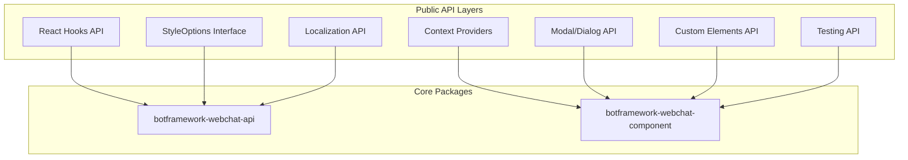
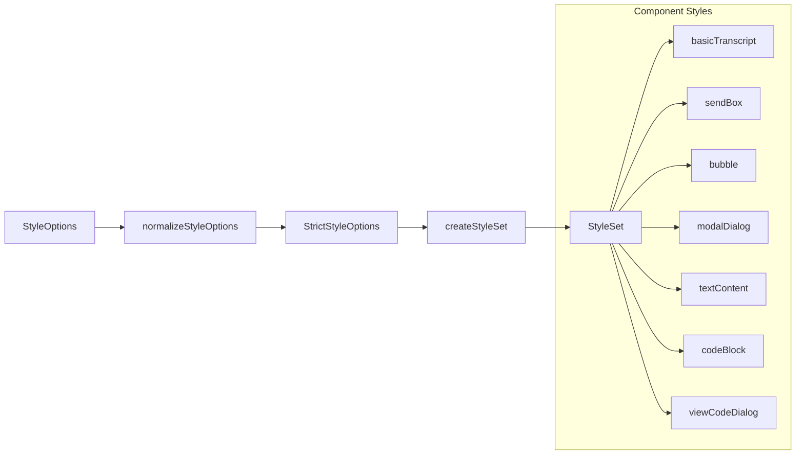
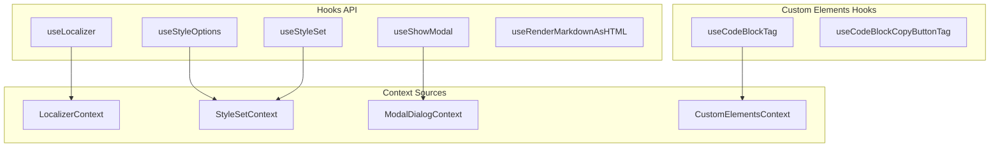
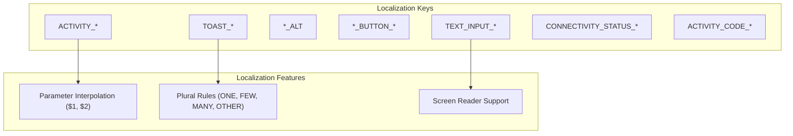
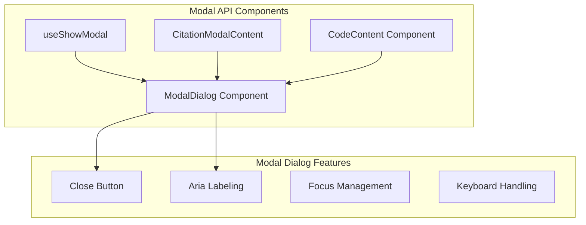
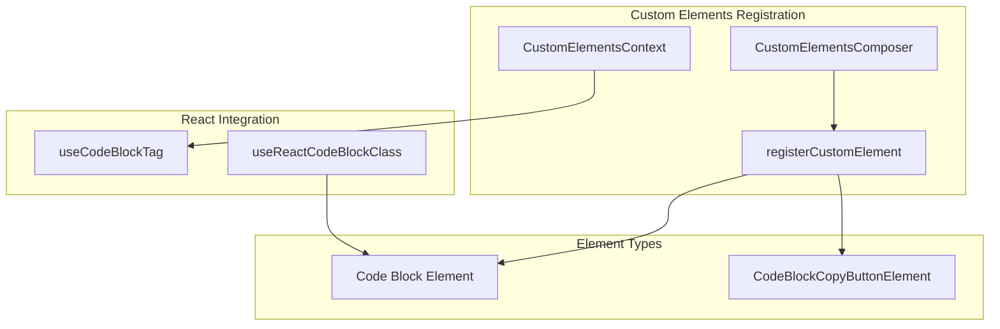

<!-- source: DeepWiki mcp.deepwiki.com · repo microsoft/BotFramework-WebChat · page 3.4 Public APIs · fetched 2026-10-26 -->

# Public APIs

<details>
<summary>Relevant source files</summary>

The following files were used as context for generating this wiki page:

- [README.md](README.md)
- [__tests__/__image_snapshots__/html/citation-show-modal-width-desktop-js-citation-modal-dialog-should-show-60-on-desktop-2-snap.png](__tests__/__image_snapshots__/html/citation-show-modal-width-desktop-js-citation-modal-dialog-should-show-60-on-desktop-2-snap.png)
- [__tests__/__image_snapshots__/html/default-citation-modal-js-markdown-render-html-when-unset-should-render-sanitized-html-in-citation-modal-1-snap.png](__tests__/__image_snapshots__/html/default-citation-modal-js-markdown-render-html-when-unset-should-render-sanitized-html-in-citation-modal-1-snap.png)
- [__tests__/html2/activity/behavior.copyCode.html](__tests__/html2/activity/behavior.copyCode.html)
- [__tests__/html2/activity/viewCodeButton.html](__tests__/html2/activity/viewCodeButton.html)
- [__tests__/html2/activity/viewCodeButton.html.snap-1.png](__tests__/html2/activity/viewCodeButton.html.snap-1.png)
- [__tests__/html2/activity/viewCodeButton.html.snap-2.png](__tests__/html2/activity/viewCodeButton.html.snap-2.png)
- [__tests__/html2/activity/viewCodeButton.html.snap-3.png](__tests__/html2/activity/viewCodeButton.html.snap-3.png)
- [__tests__/html2/markdown/codeBlockCopyButton/behavior.html](__tests__/html2/markdown/codeBlockCopyButton/behavior.html)
- [packages/api/src/localization/en-US.json](packages/api/src/localization/en-US.json)
- [packages/component/src/Attachment/Text/private/ActivityViewCodeButton.tsx](packages/component/src/Attachment/Text/private/ActivityViewCodeButton.tsx)
- [packages/component/src/Attachment/Text/private/CodeContent.tsx](packages/component/src/Attachment/Text/private/CodeContent.tsx)
- [packages/component/src/Attachment/Text/private/MarkdownTextContent.tsx](packages/component/src/Attachment/Text/private/MarkdownTextContent.tsx)
- [packages/component/src/Styles/StyleSet/ModalDialog.ts](packages/component/src/Styles/StyleSet/ModalDialog.ts)
- [packages/component/src/Styles/StyleSet/TextContent.ts](packages/component/src/Styles/StyleSet/TextContent.ts)
- [packages/component/src/Styles/StyleSet/ViewCodeDialog.ts](packages/component/src/Styles/StyleSet/ViewCodeDialog.ts)
- [packages/component/src/Styles/createStyleSet.ts](packages/component/src/Styles/createStyleSet.ts)
- [packages/component/src/providers/CustomElements/CustomElementsComposer.tsx](packages/component/src/providers/CustomElements/CustomElementsComposer.tsx)
- [packages/component/src/providers/ModalDialog/private/Popover.tsx](packages/component/src/providers/ModalDialog/private/Popover.tsx)
- [packages/component/src/testIds.ts](packages/component/src/testIds.ts)
- [samples/index.html](samples/index.html)

</details>


This document covers the public APIs exposed by BotFramework-WebChat for state management, customization, and extension. These APIs provide the primary integration points for developers to access WebChat's functionality through React hooks, context providers, and configuration interfaces.

For information about integrating Web Chat into applications, see [Integration Guide](#5). For details about the internal component architecture, see [Component System](#3.2).

## API Architecture Overview

The public API system provides multiple layers of interaction with WebChat's functionality:



Sources: [packages/api/src/localization/en-US.json:1-194](), [packages/component/src/Styles/createStyleSet.ts:1-120](), [packages/component/src/testIds.ts:1-17]()

## Style System API

The style system transforms `StyleOptions` configuration into CSS-in-JS style objects through the `createStyleSet` function. This provides type-safe styling with computed values.

#### Style System Data Flow



### StyleSet Components

The `createStyleSet` function generates styles for major UI components:

| Style Object | Component Target | CSS Classes |
|--------------|------------------|-------------|
| `basicTranscript` | Chat history container | `webchat__basic-transcript` |
| `sendBox` | Message input area | `webchat__send-box` |
| `bubble` | Message bubbles | `webchat__bubble` |
| `modalDialog` | Modal dialogs | `webchat__modal-dialog` |
| `textContent` | Text message content | `webchat__text-content` |
| `viewCodeDialog` | Code viewing modal | `webchat__view-code-dialog` |

### StyleOptions Configuration

Key configuration categories available through `StyleOptions`:

| Category | Example Properties | Purpose |
|----------|-------------------|---------|
| Layout | `rootHeight`, `rootWidth` | Container dimensions |
| Typography | `primaryFont`, `monospaceFont` | Font configuration |
| Colors | `accent`, `backgroundColor`, `subtle` | Color theme |
| Spacing | `paddingRegular`, `bubbleMaxWidth` | Layout spacing |
| Features | `markdownRenderHTML`, `feedbackActionsPlacement` | Feature toggles |

Sources: [packages/component/src/Styles/createStyleSet.ts:59-119](), [packages/component/src/Styles/StyleSet/ModalDialog.ts:1-136](), [packages/component/src/Styles/StyleSet/ViewCodeDialog.ts:1-71](), [packages/component/src/Styles/StyleSet/TextContent.ts:1-45]()

## Hooks API

WebChat provides React hooks for accessing state, triggering actions, and customizing behavior. The hooks are organized around specific functional areas:

#### Core WebChat Hooks System



### Primary Hooks

| Hook | Usage | Return Type |
|------|-------|-------------|
| `useLocalizer` | Access localized strings | `(key: string, ...args: string[]) => string` |
| `useStyleOptions` | Access style configuration | `[StyleOptions]` |
| `useStyleSet` | Access computed CSS styles | `[StyleSet]` |
| `useShowModal` | Display modal dialogs | `(render: () => ReactNode, options: ModalOptions) => void` |
| `useRenderMarkdownAsHTML` | Render markdown to HTML | `(purpose: string) => (markdown: string) => string` |

### Custom Elements Hooks

| Hook | Purpose | Return Type |
|------|---------|-------------|
| `useCodeBlockTag` | Get code block custom element tag | `[string, React.ComponentType]` |
| `useCodeBlockCopyButtonTag` | Get copy button custom element tag | `string` |

Sources: [packages/component/src/Attachment/Text/private/MarkdownTextContent.tsx:31-32](), [packages/component/src/providers/CustomElements/useCodeBlockTagName.tsx:1-10](), [packages/component/src/providers/ModalDialog/useShowModal.tsx:1-20]()

## Localization API

The localization system provides multi-language support through JSON-based language files accessed via the `useLocalizer` hook. It supports parameter interpolation for dynamic content.

#### Localization String Categories



### Key Localization Categories

| Category | Example Keys | Usage Context |
|----------|--------------|---------------|
| Activities | `ACTIVITY_BOT_SAID_ALT`, `ACTIVITY_YOU_SAID_ALT` | Screen reader activity announcements |
| Code Features | `ACTIVITY_CODE_ALT`, `ACTIVITY_CODE_CAUTION`, `VIEW_CODE_BUTTON_TEXT` | Code block interactions |
| Copy Features | `COPY_BUTTON_TEXT`, `COPY_BUTTON_COPIED_TEXT` | Copy button states |
| Buttons | `CLOSE_BUTTON_ALT`, `TEXT_INPUT_SEND_BUTTON_ALT` | Button accessibility labels |
| File Attachments | `ATTACHMENT_AUDIO`, `FILE_CONTENT_DOWNLOADABLE_ALT` | File type descriptions |
| Connectivity | `CONNECTIVITY_STATUS_ALT_CONNECTED`, `CONNECTIVITY_STATUS_ALT_FATAL` | Connection status messages |

### Parameter Interpolation

The `useLocalizer` hook supports parameter substitution:

```typescript
// Example usage from localization strings
localize('ACTIVITY_CODE_ALT', title) // "Code sample: {title}"
localize('SEND_BOX_ATTACHMENT_BAR_DELETE_BUTTON_ALT', filename) // "Delete attachment {filename}"
```

Sources: [packages/api/src/localization/en-US.json:13-14](), [packages/api/src/localization/en-US.json:76-77](), [packages/api/src/localization/en-US.json:186](), [packages/component/src/Attachment/Text/private/ActivityViewCodeButton.tsx:48]()

## Modal and Dialog API

WebChat provides a modal system for displaying custom content using the `useShowModal` hook and modal dialog components.

#### Modal System Architecture



### Modal API Usage

The `useShowModal` hook provides a way to display custom content in modal dialogs:

| Parameter | Type | Purpose |
|-----------|------|---------|
| `render` | `() => ReactNode` | Function returning modal content |
| `options` | `ModalOptions` | Configuration object |
| `options.className` | `string` | CSS class for styling |
| `options['aria-label']` | `string` | Accessibility label |

### Built-in Modal Types

| Modal Type | Trigger | Content Component |
|------------|---------|-------------------|
| Citation Modal | Citation link click | `CitationModalContent` |
| View Code Modal | "Code" button click | `CodeContent` |
| Custom Modal | `useShowModal` call | User-provided component |

### Modal Dialog Components

The modal system includes several reusable components:

- **ModalDialog**: Base dialog wrapper with close button and ARIA support
- **CitationModalContent**: Displays citation information with markdown rendering
- **CodeContent**: Displays code with syntax highlighting and copy functionality

Sources: [packages/component/src/providers/ModalDialog/useShowModal.tsx:1-20](), [packages/component/src/providers/ModalDialog/private/Popover.tsx:19-61](), [packages/component/src/Attachment/Text/private/CodeContent.tsx:21-37](), [packages/component/src/Attachment/Text/private/ActivityViewCodeButton.tsx:35-51]()

## Custom Elements API

WebChat uses custom HTML elements for advanced functionality like code blocks with copy buttons. The custom elements system provides extensible components.

#### Custom Elements System



### Custom Element Components

| Element | Tag Name Pattern | Purpose |
|---------|------------------|---------|
| Code Block | `webchat-{hash}--code-block` | Syntax-highlighted code display |
| Copy Button | `webchat-{hash}--code-block-copy-button` | Copy code functionality |

### Custom Elements Registration

The `CustomElementsComposer` automatically registers custom elements with unique namespaced tag names:

- **Hash-based namespacing**: Each instance gets unique tag names like `webchat-a1b2c--code-block`
- **Attribute observation**: Custom elements observe attributes for reactive updates
- **React integration**: Custom elements are accessible through React hooks

### Code Block Integration

The code block system demonstrates custom element usage:

1. **Registration**: `CustomElementsComposer` registers `CodeBlockCopyButtonElement`
2. **React wrapper**: `useReactCodeBlockClass` creates React component wrapper
3. **Hook access**: `useCodeBlockTag` provides access to registered tag names
4. **Usage**: Components use custom elements for enhanced functionality

Sources: [packages/component/src/providers/CustomElements/CustomElementsComposer.tsx:12-48](), [packages/component/src/providers/CustomElements/customElements/CodeBlockCopyButton.tsx:1-10](), [packages/component/src/providers/CustomElements/useCodeBlockTagName.tsx:1-10]()

## Configuration and Defaults

Web Chat provides comprehensive default configuration through the `DEFAULT_OPTIONS` object:

### Default Value Categories

| Category | Key Defaults | Rationale |
|----------|--------------|-----------|
| Colors | `accent: '#0063B1'`, `subtle: '#767676'` | Microsoft brand colors, WCAG compliance |
| Typography | `primaryFont: ['Calibri', 'Helvetica Neue', 'Arial']` | Cross-platform font stack |
| Layout | `avatarSize: 40`, `bubbleMaxWidth: 480` | Optimal readability on mobile/desktop |
| Timeouts | `sendTimeout: 20000`, `slowConnectionAfter: 15000` | Network resilience |
| Accessibility | `internalLiveRegionFadeAfter: 1000` | Screen reader optimization |

**Sources:** [packages/api/src/defaultStyleOptions.ts:8-319]()

## Testing Integration

The API package provides test identifiers through the `testIds` object for automated testing:

```typescript
const testIds = {
  sendBoxTextBox: 'send box text area',
  sendBoxAttachmentBar: 'send box attachment bar',
  typingIndicator: 'typing indicator',
  feedbackButton: 'feedback button'
}
```

These identifiers enable reliable element selection in end-to-end tests and are used throughout the test suite.

**Sources:** [packages/component/src/testIds.ts:1-15]()

---

