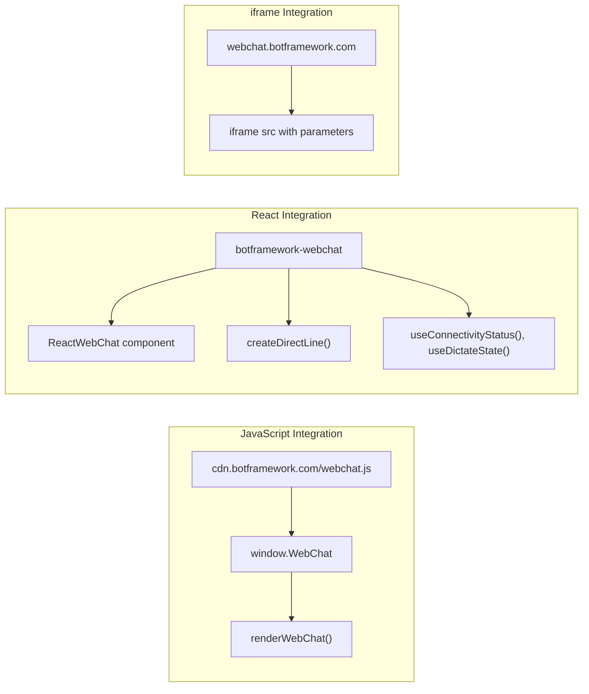
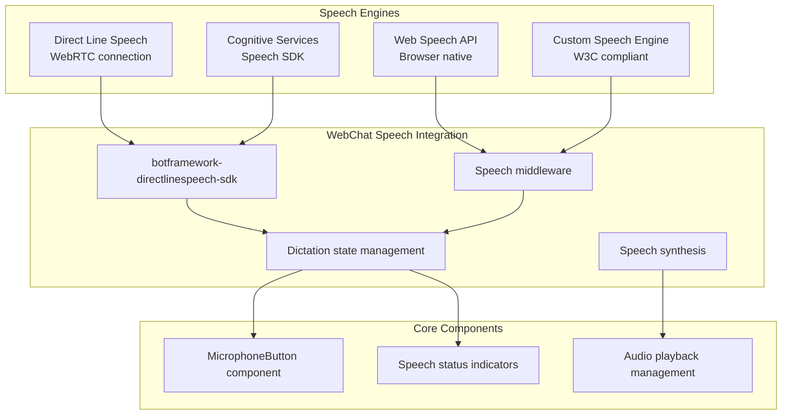
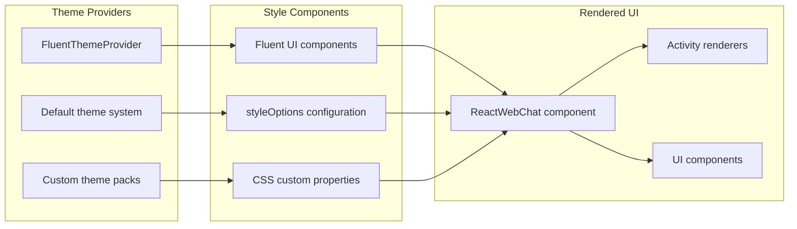
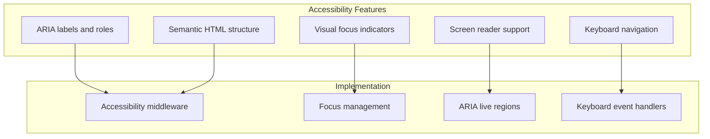

<!-- source: DeepWiki mcp.deepwiki.com · repo microsoft/BotFramework-WebChat · page 4 Key Features · fetched 2026-10-26 -->

# Key Features

Relevant source files

The following files were used as context for generating this wiki page:

- [README.md](README.md)
- [samples/index.html](samples/index.html)

This document provides an overview of the major features and capabilities of Bot Framework WebChat. It covers the core functionality that makes WebChat a comprehensive, enterprise-ready chat client for Bot Framework applications.

For detailed implementation guides on specific integration approaches, see [Integration Guide](#5). For deep technical architecture details, see [Core Architecture](#3).

## Overview

Bot Framework WebChat is a highly customizable web-based client that provides rich conversational experiences through multiple integration methods. The system supports enterprise requirements including accessibility, internationalization, security, and extensive customization capabilities.

### Feature-to-Package Mapping

```mermaid
graph TB
    subgraph "Core Features"
        SpeechFeatures["Speech Recognition & Synthesis"]
        MarkdownRendering["Markdown & HTML Rendering"]
        ThemingSystem["Theming & Styling"]
        Localization["Internationalization"]
        AccessibilityFeatures["Accessibility Support"]
        AdaptiveCards["Adaptive Cards"]
        Security["Content Security Policy"]
        LiveStreaming["Live Streaming Responses"]
    end
    
    subgraph "Package Implementation"
        CorePackage["botframework-webchat-core<br/>Redux store, actions, sagas"]
        ComponentPackage["botframework-webchat-component<br/>React UI components"]
        APIPackage["botframework-webchat-api<br/>Hooks and context"]
        SpeechPackage["botframework-directlinespeech-sdk<br/>Speech integration"]
        FluentPackage["botframework-webchat-fluent-theme<br/>Fluent UI components"]
        StylesPackage["@msinternal/botframework-webchat-styles<br/>CSS and styling"]
        CLDRPackage["@msinternal/botframework-webchat-cldr-data<br/>Locale data"]
    end
    
    SpeechFeatures --> SpeechPackage
    SpeechFeatures --> CorePackage
    MarkdownRendering --> ComponentPackage
    ThemingSystem --> StylesPackage
    ThemingSystem --> FluentPackage
    Localization --> CLDRPackage
    Localization --> APIPackage
    AccessibilityFeatures --> ComponentPackage
    AdaptiveCards --> ComponentPackage
    Security --> ComponentPackage
    LiveStreaming --> CorePackage
```

Sources: [README.md:1-391]()

## Integration Methods

WebChat supports three primary integration approaches, each offering different levels of customization and complexity:

### Integration Capabilities Matrix

| Feature | CDN Bundle | React Package | iframe Embed |
|---------|:----------:|:-------------:|:------------:|
| Change colors | ✓ | ✓ | Limited |
| Change sizes | ✓ | ✓ | Limited |
| Update/replace CSS styles | ✓ | ✓ | ✗ |
| Listen to events | ✓ | ✓ | Limited |
| Interact with hosting webpage | ✓ | ✓ | Limited |
| Custom render activities | ✗ | ✓ | ✗ |
| Custom render attachments | ✗ | ✓ | ✗ |
| Add new UI components | ✗ | ✓ | ✗ |
| Recompose the whole UI | ✗ | ✓ | ✗ |

Sources: [README.md:294-305]()

### Integration Architecture

Sources: [README.md:172-289]()

## Speech Capabilities

WebChat provides comprehensive speech functionality through multiple engines and integration methods. For detailed implementation, see [Speech Integration](#4.1).

### Speech Engine Support

- **Direct Line Speech**: Preferred integration with Azure Bot Service speech channel
- **Cognitive Services Speech Services**: Direct integration with Azure Cognitive Services
- **Web Speech API**: Browser-native speech recognition and synthesis
- **Custom Speech Engines**: Support for W3C Web Speech API compliant engines

Sources: [README.md:356-373]()

## Content Rendering

### Markdown and HTML Support

WebChat includes a sophisticated content rendering system that handles markdown, HTML-in-markdown, and various attachment types. For detailed information, see [Markdown Rendering](#4.2).

Key features:
- **Micromark-based parsing**: Standards-compliant markdown processing
- **HTML-in-Markdown**: Secure HTML rendering within markdown content
- **Content sanitization**: Security-focused HTML sanitization
- **Accessibility enhancement**: Automatic accessibility improvements

### Adaptive Cards Integration

- **Schema support**: Up to Adaptive Cards 1.6 schema
- **Configurable parser**: `adaptiveCardsParserMaxVersion` style option
- **Custom styling**: Integration with WebChat theming system
- **Action handling**: Bot Framework-specific action processing

Sources: [README.md:73-108]()

## Theming and Customization

WebChat provides extensive theming capabilities through multiple approaches. For comprehensive theming documentation, see [Theming and Styling](#4.3).

### Theme Pack System

- **Default theme**: Built-in styling system
- **Fluent UI theme pack**: `botframework-webchat-fluent-theme` package
- **Custom theme packs**: Extensible theme packaging system
- **Style options**: Programmatic styling configuration

### Fluent Theme Integration

Sources: [README.md:48-78]()

## Internationalization

WebChat supports comprehensive internationalization through CLDR data and localization strings. For implementation details, see [Localization](#4.4).

### Localization Features

- **40+ languages**: Pre-built localization strings
- **CLDR data integration**: Standardized locale formatting
- **RTL support**: Right-to-left language support
- **Dynamic locale switching**: Runtime locale changes

## Accessibility

WebChat implements comprehensive accessibility features to ensure inclusive user experiences. For detailed accessibility information, see [Accessibility](#4.5).

### Accessibility Features

- **ARIA compliance**: Comprehensive ARIA labeling and roles
- **Keyboard navigation**: Full keyboard accessibility
- **Screen reader support**: Optimized screen reader experience
- **Visual indicators**: Keyboard focus indicators and high contrast support
- **Semantic markup**: Proper HTML semantics throughout

Sources: [README.md:109-125](), [README.md:334-336]()

## Security Features

### Content Security Policy

WebChat supports Content Security Policy (CSP) to enhance security and protect conversations:

- **CSP compliance**: Compatible with strict CSP configurations
- **Script security**: Secure script loading and execution
- **Content sanitization**: HTML and markdown content sanitization
- **Token-based authentication**: Secure Direct Line token handling

Sources: [README.md:14]()

## Advanced Features

### Live Streaming Responses

Recent addition supporting real-time streaming of bot responses:

- **Real-time updates**: Live streaming of bot response content
- **Informative messages**: Support for informative message types in live streams
- **Progressive rendering**: Incremental content display during streaming

### File Upload Experience

Enhanced file upload capabilities:

- **Message confirmation**: Users can add messages before uploading files
- **Upload preview**: File preview before sending
- **Configurable behavior**: `sendAttachmentOn` style option controls upload timing

### Redux DevTools Integration

Development support for debugging and inspection:

- **Store inspection**: View WebChat's internal Redux state
- **Action monitoring**: Track dispatched actions and state changes
- **Development builds**: Available in NPM development builds

Sources: [README.md:26-47](), [README.md:258-289]()

## Module Exports and Distribution

### ES Modules Support

WebChat provides modern module support:

- **Named exports**: ES Module named export support
- **CommonJS compatibility**: Backward compatibility with CommonJS
- **Multiple formats**: IIFE, ESM, and CJS bundle formats

### Package Distribution

- **CDN availability**: Global CDN distribution via `cdn.botframework.com`
- **NPM packages**: Published to NPM registry with versioning
- **Daily builds**: Development builds available from GitHub releases

Sources: [README.md:40-43](), [README.md:376-381]()

---

