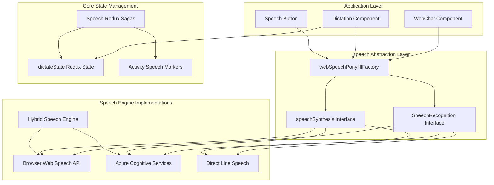
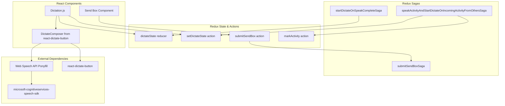
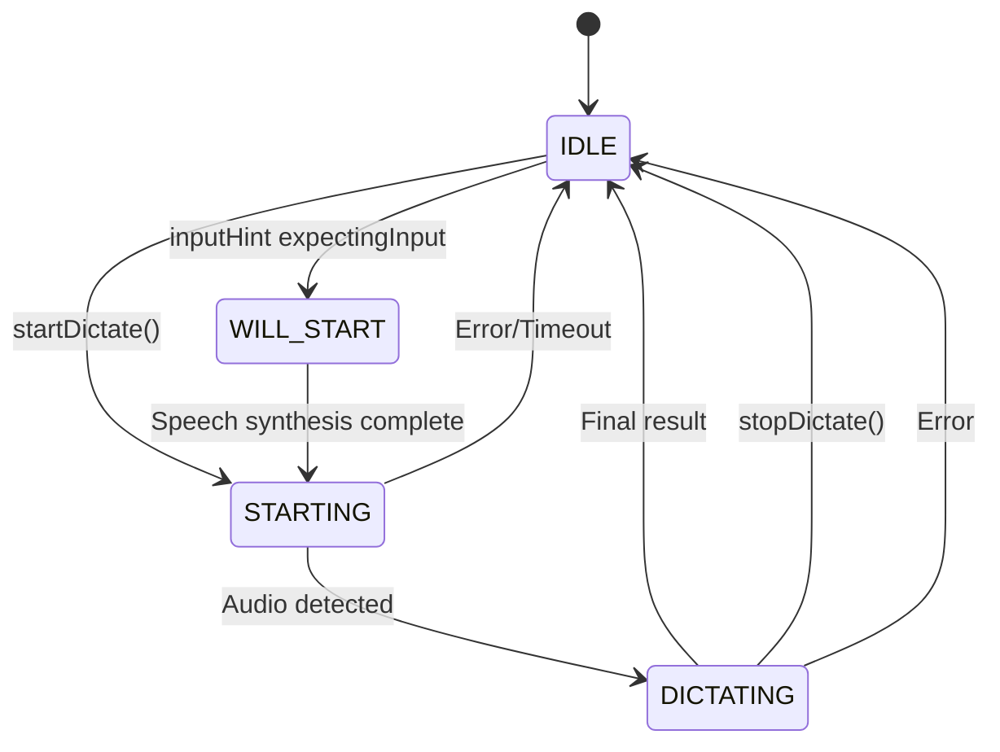

<!-- source: DeepWiki mcp.deepwiki.com · repo microsoft/BotFramework-WebChat · page 4.1 Speech Integration · fetched 2026-10-26 -->

# Speech Integration

<details>
<summary>Relevant source files</summary>

The following files were used as context for generating this wiki page:

- [__tests__/__image_snapshots__/chrome-docker/disabled-ui-js-tests-the-ui-of-disabled-web-chat-change-default-disabled-button-color-1-snap.png](__tests__/__image_snapshots__/chrome-docker/disabled-ui-js-tests-the-ui-of-disabled-web-chat-change-default-disabled-button-color-1-snap.png)
- [packages/bundle/src/createCognitiveServicesSpeechServicesPonyfillFactory.spec.js](packages/bundle/src/createCognitiveServicesSpeechServicesPonyfillFactory.spec.js)
- [packages/bundle/src/createCognitiveServicesSpeechServicesPonyfillFactory.ts](packages/bundle/src/createCognitiveServicesSpeechServicesPonyfillFactory.ts)
- [packages/component/src/Dictation.js](packages/component/src/Dictation.js)
- [packages/core/src/reducers/sendTypingIndicator.js](packages/core/src/reducers/sendTypingIndicator.js)
- [packages/core/src/reducers/shouldSpeakIncomingActivity.js](packages/core/src/reducers/shouldSpeakIncomingActivity.js)
- [packages/core/src/sagas/speakActivityAndStartDictateOnIncomingActivityFromOthersSaga.js](packages/core/src/sagas/speakActivityAndStartDictateOnIncomingActivityFromOthersSaga.js)
- [packages/core/src/sagas/startDictateOnSpeakCompleteSaga.js](packages/core/src/sagas/startDictateOnSpeakCompleteSaga.js)
- [packages/core/src/sagas/submitSendBoxSaga.js](packages/core/src/sagas/submitSendBoxSaga.js)
- [packages/embed/README.md](packages/embed/README.md)
- [samples/03.speech/b.cognitive-speech-services-js/index.html](samples/03.speech/b.cognitive-speech-services-js/index.html)
- [samples/03.speech/c.cognitive-speech-services-with-lexical-result/index.html](samples/03.speech/c.cognitive-speech-services-with-lexical-result/index.html)
- [samples/03.speech/d.cognitive-speech-services-speech-recognition-only/index.html](samples/03.speech/d.cognitive-speech-services-speech-recognition-only/index.html)
- [samples/03.speech/e.select-voice/index.html](samples/03.speech/e.select-voice/index.html)
- [samples/03.speech/g.hybrid-speech/index.html](samples/03.speech/g.hybrid-speech/index.html)
- [samples/README.md](samples/README.md)

</details>


This document covers WebChat's comprehensive speech capabilities, including speech recognition (speech-to-text), text-to-speech synthesis, and integration with Azure Cognitive Services and Direct Line Speech. The speech system enables voice-based interactions through multiple speech engines and provides extensive customization options for audio input/output.

For information about general API integration patterns, see [Public APIs](#3.4). For styling speech UI components, see [Theming and Styling](#4.3).

## Architecture Overview

WebChat's speech integration follows a ponyfill-based architecture that abstracts different speech engines behind the W3C Web Speech API standard. This allows seamless switching between browser-native speech, Azure Cognitive Services, and hybrid implementations.

### Speech System Architecture



Sources: [packages/component/src/Dictation.js:1-122](), [packages/bundle/src/createCognitiveServicesSpeechServicesPonyfillFactory.ts:1-83](), [samples/03.speech/g.hybrid-speech/index.html:1-124]()

### Speech Component Integration Flow



Sources: [packages/component/src/Dictation.js:7-111](), [packages/core/src/sagas/speakActivityAndStartDictateOnIncomingActivityFromOthersSaga.js:1-50](), [packages/core/src/sagas/startDictateOnSpeakCompleteSaga.js:1-24]()

## Speech Recognition (Dictation)

Speech recognition in WebChat is implemented through the `Dictation` component, which provides continuous speech-to-text conversion with interim results and automatic submission.

### Core Dictation Component

The main dictation functionality is handled by the `Dictation` component at [packages/component/src/Dictation.js:31-122](). This component:

- Manages dictation state transitions (`IDLE`, `STARTING`, `DICTATING`)
- Handles interim speech results and final transcription
- Integrates with typing indicators
- Supports continuous speech recognition
- Provides error handling and cleanup

Key hooks and state management:
- `useDictateState()` - Current dictation state
- `useDictateInterims()` - Interim speech recognition results  
- `useSetDictateState()` - State transitions
- `useWebSpeechPonyfill()` - Speech engine abstraction

### Speech Recognition Flow

| State | Description | Triggers |
|-------|-------------|----------|
| `IDLE` | No speech recognition active | Default state, after errors, manual stop |
| `STARTING` | Initializing speech recognition | User clicks microphone, `inputHint: 'expectingInput'` |
| `DICTATING` | Active speech recognition with audio input | Audio detected, interim results available |

### Speech Recognition Configuration

The dictation system supports several configuration options through style options:

```javascript
// Speech recognition settings
const styleOptions = {
  speechRecognitionContinuous: true,  // Continuous vs single-shot recognition
  speechLanguage: 'en-US'            // Recognition language
};
```

Sources: [packages/component/src/Dictation.js:37-46](), [packages/core/src/constants/DictateState.js]()

## Text-to-Speech Synthesis

WebChat automatically speaks bot responses when speech is enabled. The synthesis system supports voice selection, SSML processing, and activity-based speech control.

### Activity Speech Processing

Speech synthesis is triggered by incoming bot activities through the `speakActivityAndStartDictateOnIncomingActivityFromOthersSaga` at [packages/core/src/sagas/speakActivityAndStartDictateOnIncomingActivityFromOthersSaga.js:13-49]():

1. **Activity Filtering**: Only bot activities (not user activities) are considered for speech
2. **Speech Content Detection**: Activities with `speak`, `text`, or attachment `speak` properties
3. **Input Hint Processing**: 
   - `expectingInput`: Starts dictation after speech completes
   - `ignoringInput`: Stops any active dictation
4. **Activity Marking**: Eligible activities are marked with `speak: true`

### Voice Selection

Voice selection is configurable through the `selectVoice` option:

```javascript
const selectVoice = (voices, activity) => {
  // Select voice based on activity locale
  if (activity.locale === 'zh-HK') {
    return voices.find(({ name }) => /TracyRUS/iu.test(name));
  }
  return voices.find(({ name }) => /JessaNeural/iu.test(name)) ||
         voices.find(({ name }) => /Jessa/iu.test(name));
};
```

Sources: [packages/core/src/sagas/speakActivityAndStartDictateOnIncomingActivityFromOthersSaga.js:20-44](), [samples/03.speech/e.select-voice/index.html:89-95]()

## Azure Cognitive Services Integration

WebChat provides first-class integration with Azure Cognitive Services Speech Services through the `createCognitiveServicesSpeechServicesPonyfillFactory`.

### Cognitive Services Factory

The factory at [packages/bundle/src/createCognitiveServicesSpeechServicesPonyfillFactory.ts:10-82]() provides:

- **Authentication**: Token-based or subscription key authentication
- **Audio Configuration**: Custom audio input devices and configurations  
- **Regional Endpoints**: Support for different Azure regions
- **Advanced Features**: LUIS grammar support, custom endpoints, telemetry

### Factory Configuration Options

| Option | Type | Description |
|--------|------|-------------|
| `credentials` | `CognitiveServicesCredentials` | Authentication (token/key + region) |
| `audioInputDeviceId` | `string` | Specific microphone device ID |
| `audioConfig` | `AudioConfig` | Custom audio configuration |
| `speechRecognitionEndpointId` | `string` | Custom speech recognition endpoint |
| `speechSynthesisDeploymentId` | `string` | Custom neural voice deployment |
| `textNormalization` | `'lexical' \| 'display'` | Text normalization mode |
| `enableTelemetry` | `boolean` | Enable usage telemetry |

### Credentials Management

The factory supports dynamic credential refresh for long-running sessions:

```javascript
// Token refresh function
const fetchSpeechServicesCredentials = () => {
  return fetch('/api/token/speech', { method: 'POST' })
    .then(res => res.json())
    .then(({ region, token }) => ({ 
      authorizationToken: `Bearer ${token}`, 
      region 
    }));
};

const webSpeechPonyfillFactory = await createCognitiveServicesSpeechServicesPonyfillFactory({
  credentials: fetchSpeechServicesCredentials
});
```

Sources: [packages/bundle/src/createCognitiveServicesSpeechServicesPonyfillFactory.ts:21-32](), [samples/03.speech/b.cognitive-speech-services-js/index.html:33-84]()

## Direct Line Speech

Direct Line Speech provides a streamlined speech channel that combines Azure Bot Service with Speech Services for optimized voice interactions.

### Direct Line Speech Features

- **Optimized Audio Pipeline**: Direct audio streaming to bot without client-side processing
- **Custom Wake Words**: Support for custom activation phrases
- **Lower Latency**: Reduced audio processing latency compared to standard Direct Line
- **Integrated Recognition**: Built-in speech recognition without separate Speech Services setup

### Integration Example

Direct Line Speech is typically integrated through the embed service or specialized samples:

```javascript
// Direct Line Speech connection (conceptual)
const directLineSpeech = createDirectLineSpeech({
  subscriptionKey: 'your-speech-subscription-key',
  region: 'westus2',
  botId: 'your-bot-id'
});
```

Sources: [samples/01.getting-started/d.es5-direct-line-speech/](), [samples/03.speech/a.direct-line-speech/]()

## Hybrid Speech Implementations

WebChat supports hybrid speech configurations that combine different engines for recognition and synthesis.

### Hybrid Configuration Example

```javascript
async function createHybridPonyfillFactory({ credentials }) {
  const speechServicesPonyfillFactory = 
    await createCognitiveServicesSpeechServicesPonyfillFactory({
      credentials
    });
    
  const webSpeechPonyfillFactory = 
    await createBrowserWebSpeechPonyfillFactory();
    
  return options => {
    const speechServicesPonyfill = speechServicesPonyfillFactory(options);
    const webSpeechPonyfill = webSpeechPonyfillFactory(options);
    
    // Browser speech for recognition, Cognitive Services for synthesis
    return {
      SpeechGrammarList: webSpeechPonyfill.SpeechGrammarList,
      SpeechRecognition: webSpeechPonyfill.SpeechRecognition,
      speechSynthesis: speechServicesPonyfill.speechSynthesis,
      SpeechSynthesisUtterance: speechServicesPonyfill.SpeechSynthesisUtterance
    };
  };
}
```

This approach allows leveraging browser-native speech recognition (lower latency, offline capable) while using high-quality cloud synthesis.

Sources: [samples/03.speech/g.hybrid-speech/index.html:80-106]()

## Speech State Management

### Redux State Structure

The speech system maintains several pieces of state in Redux:

- **`dictateState`**: Current dictation state (`IDLE`, `STARTING`, `DICTATING`)
- **`dictateInterims`**: Array of interim speech recognition results
- **`shouldSpeakIncomingActivity`**: Boolean flag controlling TTS for bot responses
- **`sendTypingIndicator`**: Controls typing indicator during speech input

### State Transitions



### Key Redux Actions

| Action | Purpose | Payload |
|--------|---------|---------|
| `setDictateState` | Update dictation state | `{ state: DictateState }` |
| `startDictate` | Begin speech recognition | None |
| `stopDictate` | End speech recognition | None |
| `markActivity` | Mark activity for speech | `{ activity, key, value }` |
| `submitSendBox` | Submit transcribed text | `{ channelData, method }` |

Sources: [packages/core/src/reducers/dictateState.js](), [packages/core/src/actions/setDictateState.js](), [packages/core/src/sagas/startDictateOnSpeakCompleteSaga.js:11-18]()

## Audio Device Management

WebChat supports selecting specific audio input devices for speech recognition when using Cognitive Services.

### Device Selection

```javascript
const webSpeechPonyfillFactory = await createCognitiveServicesSpeechServicesPonyfillFactory({
  audioInputDeviceId: 'specific-microphone-device-id',
  credentials: fetchCredentials
});
```

The factory validates device availability and falls back gracefully when devices are unavailable. Device selection requires HTTPS or localhost for security.

### Environment Requirements

| Requirement | Reason |
|-------------|--------|
| HTTPS or localhost | Required for `navigator.mediaDevices.getUserMedia()` |
| Microphone permissions | Required for audio input access |
| Modern browser | Web Audio API support |

Sources: [packages/bundle/src/createCognitiveServicesSpeechServicesPonyfillFactory.ts:33-39](), [packages/bundle/src/createCognitiveServicesSpeechServicesPonyfillFactory.spec.js:100-124]()

## Sample Implementations

WebChat provides extensive speech samples demonstrating various configurations:

### Available Speech Samples

| Sample | Description | Key Features |
|--------|-------------|--------------|
| `03.speech/a.direct-line-speech` | Direct Line Speech integration | Optimized speech channel |
| `03.speech/b.cognitive-speech-services-js` | Full Cognitive Services integration | Recognition + synthesis |
| `03.speech/c.cognitive-speech-services-with-lexical-result` | Lexical text normalization | Raw recognition results |
| `03.speech/d.cognitive-speech-services-speech-recognition-only` | Recognition-only setup | No synthesis |
| `03.speech/e.select-voice` | Custom voice selection | Locale-based voices |
| `03.speech/f.web-browser-speech` | Browser-native speech | No cloud dependencies |
| `03.speech/g.hybrid-speech` | Mixed speech engines | Browser + cloud hybrid |
| `03.speech/h.select-audio-input-device` | Audio device selection | Microphone management |
| `03.speech/i.initial-silence-timeout` | Timeout configuration | Recognition timing |

Each sample provides complete working examples with authentication, configuration, and integration patterns.

Sources: [samples/README.md:37-46]()

---

