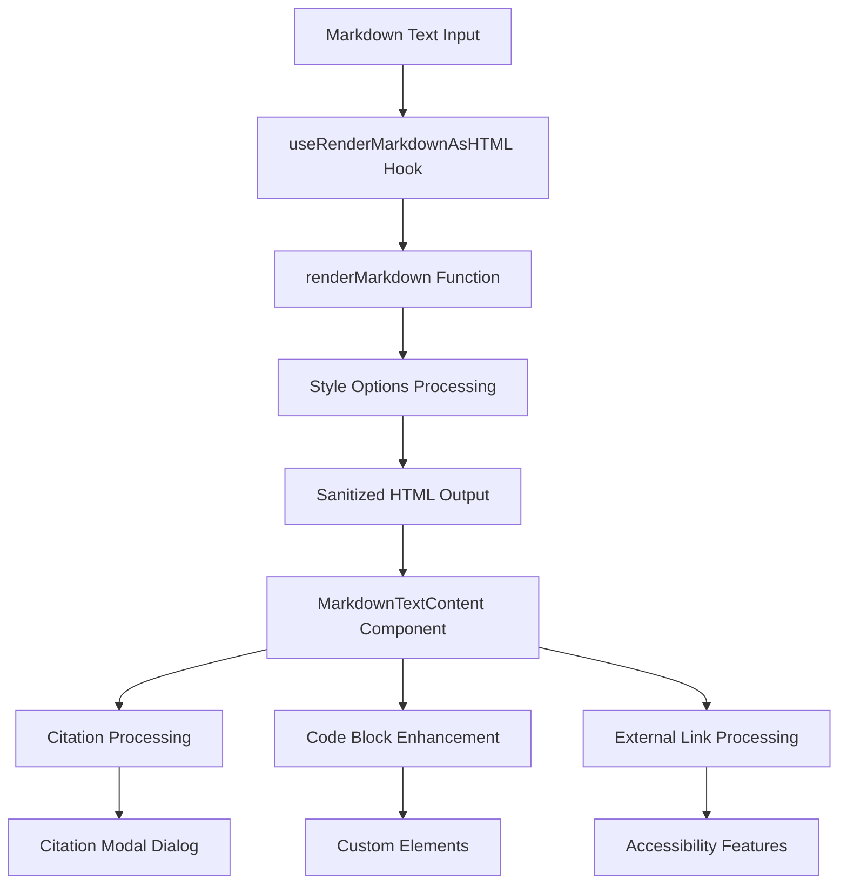
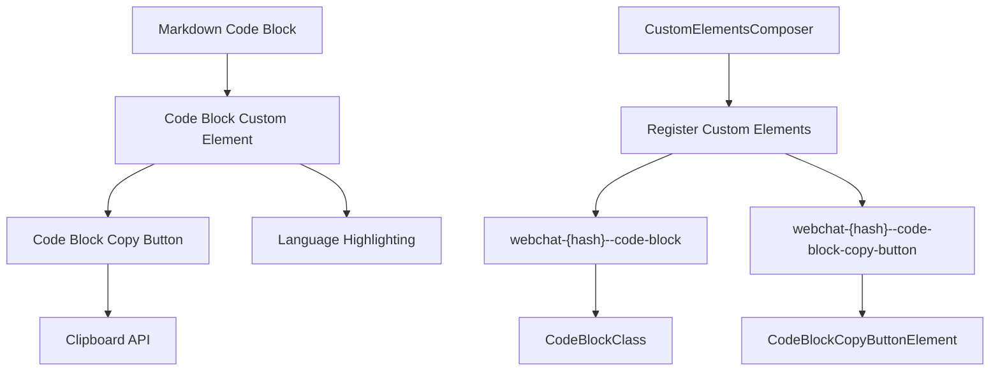
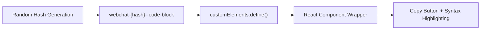
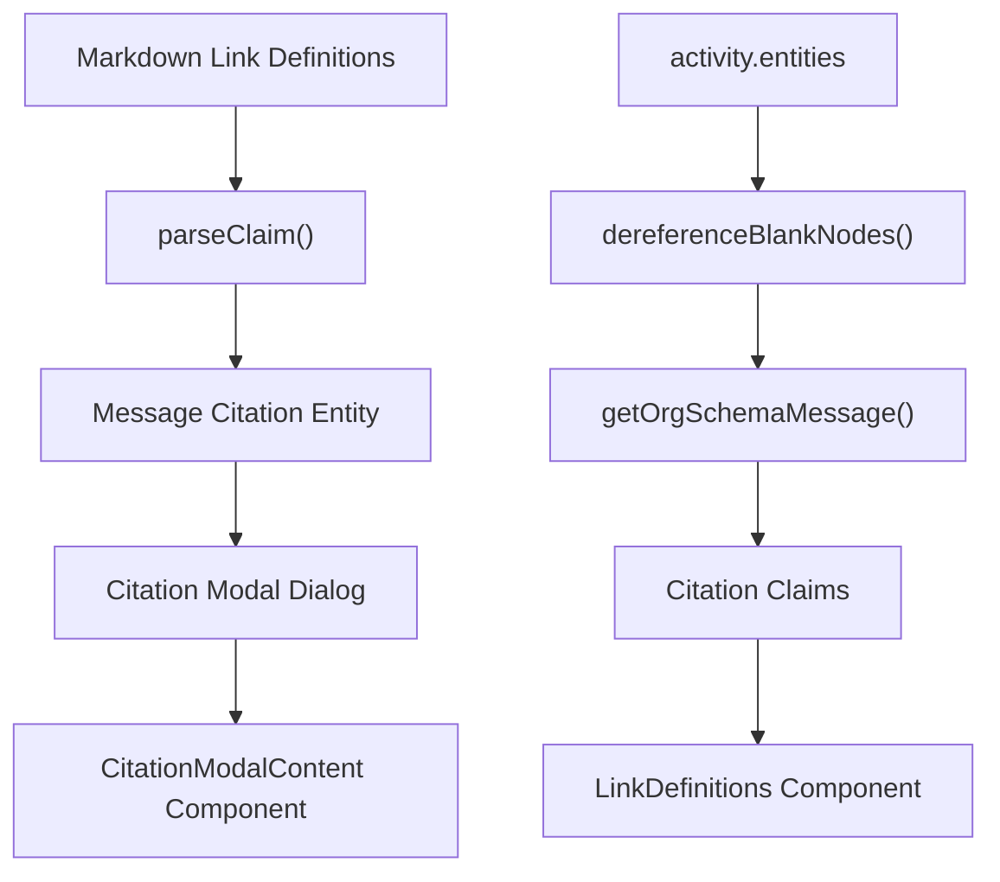
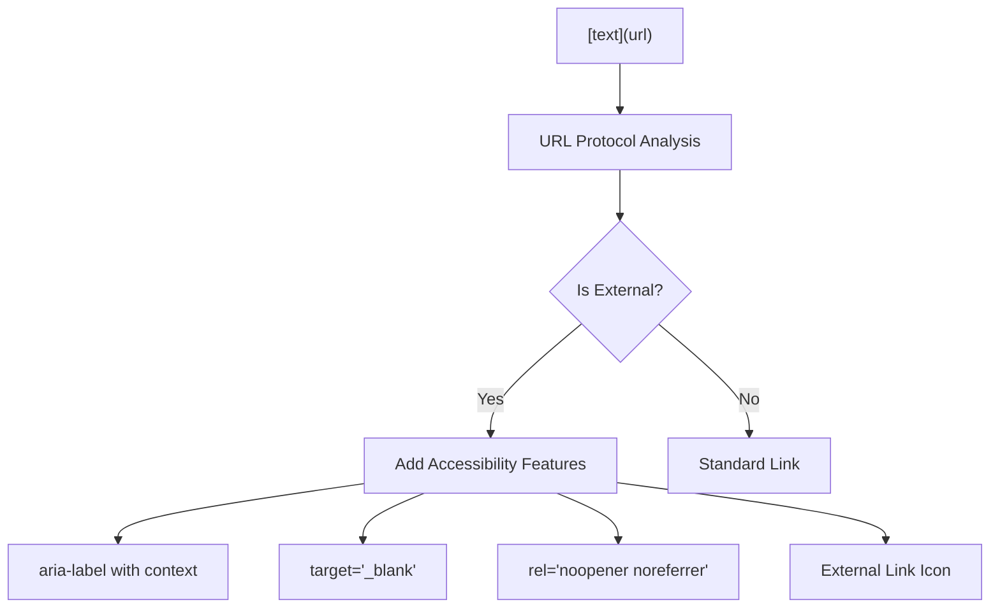
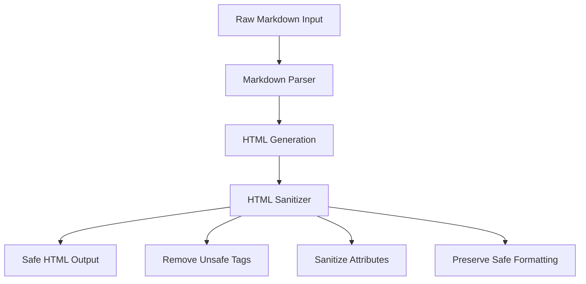
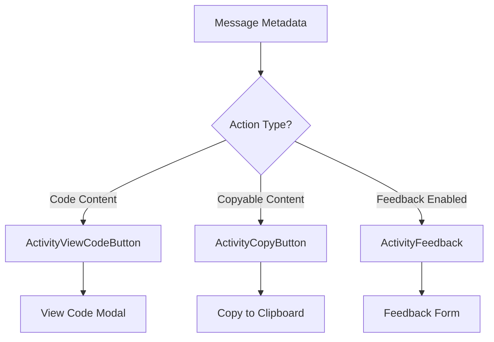

<!-- source: DeepWiki mcp.deepwiki.com · repo microsoft/BotFramework-WebChat · page 4.2 Markdown Rendering · fetched 2026-10-26 -->

# Markdown Rendering

Relevant source files

The following files were used as context for generating this wiki page:

- [__tests__/__image_snapshots__/html/citation-show-modal-width-desktop-js-citation-modal-dialog-should-show-60-on-desktop-2-snap.png](__tests__/__image_snapshots__/html/citation-show-modal-width-desktop-js-citation-modal-dialog-should-show-60-on-desktop-2-snap.png)
- [__tests__/__image_snapshots__/html/default-citation-modal-js-markdown-render-html-when-unset-should-render-sanitized-html-in-citation-modal-1-snap.png](__tests__/__image_snapshots__/html/default-citation-modal-js-markdown-render-html-when-unset-should-render-sanitized-html-in-citation-modal-1-snap.png)
- [__tests__/__image_snapshots__/html/markdown-rel-js-markdown-must-have-rel-noopener-noreferrer-1-snap.png](__tests__/__image_snapshots__/html/markdown-rel-js-markdown-must-have-rel-noopener-noreferrer-1-snap.png)
- [__tests__/hooks/useRenderMarkdownAsHTML.js](__tests__/hooks/useRenderMarkdownAsHTML.js)
- [__tests__/html2/activity/behavior.copyCode.html](__tests__/html2/activity/behavior.copyCode.html)
- [__tests__/html2/activity/viewCodeButton.html](__tests__/html2/activity/viewCodeButton.html)
- [__tests__/html2/activity/viewCodeButton.html.snap-1.png](__tests__/html2/activity/viewCodeButton.html.snap-1.png)
- [__tests__/html2/activity/viewCodeButton.html.snap-2.png](__tests__/html2/activity/viewCodeButton.html.snap-2.png)
- [__tests__/html2/activity/viewCodeButton.html.snap-3.png](__tests__/html2/activity/viewCodeButton.html.snap-3.png)
- [__tests__/html2/markdown/codeBlockCopyButton/behavior.html](__tests__/html2/markdown/codeBlockCopyButton/behavior.html)
- [packages/api/src/localization/en-US.json](packages/api/src/localization/en-US.json)
- [packages/bundle/src/__tests__/renderMarkdown.spec.js](packages/bundle/src/__tests__/renderMarkdown.spec.js)
- [packages/component/src/Attachment/Text/private/ActivityViewCodeButton.tsx](packages/component/src/Attachment/Text/private/ActivityViewCodeButton.tsx)
- [packages/component/src/Attachment/Text/private/CodeContent.tsx](packages/component/src/Attachment/Text/private/CodeContent.tsx)
- [packages/component/src/Attachment/Text/private/MarkdownTextContent.tsx](packages/component/src/Attachment/Text/private/MarkdownTextContent.tsx)
- [packages/component/src/Styles/StyleSet/ModalDialog.ts](packages/component/src/Styles/StyleSet/ModalDialog.ts)
- [packages/component/src/Styles/StyleSet/TextContent.ts](packages/component/src/Styles/StyleSet/TextContent.ts)
- [packages/component/src/Styles/StyleSet/ViewCodeDialog.ts](packages/component/src/Styles/StyleSet/ViewCodeDialog.ts)
- [packages/component/src/Styles/createStyleSet.ts](packages/component/src/Styles/createStyleSet.ts)
- [packages/component/src/providers/CustomElements/CustomElementsComposer.tsx](packages/component/src/providers/CustomElements/CustomElementsComposer.tsx)
- [packages/component/src/providers/ModalDialog/private/Popover.tsx](packages/component/src/providers/ModalDialog/private/Popover.tsx)
- [packages/component/src/testIds.ts](packages/component/src/testIds.ts)

This document covers how WebChat processes and renders markdown content in chat messages, including text formatting, code blocks, citations, and HTML sanitization. For information about theming and styling the rendered markdown, see [Theming and Styling](#4.3).

## Overview

WebChat's markdown rendering system converts markdown text into sanitized HTML with enhanced features including code block copy functionality, citation modals, and accessibility improvements for external links. The system is built around a core rendering function that can be customized via props, with specialized handling for interactive elements.

## Core Rendering Pipeline

The markdown rendering process flows through several key components that transform markdown text into interactive HTML elements.

### Rendering Flow

Sources: [packages/component/src/Attachment/Text/private/MarkdownTextContent.tsx:70-85](), [packages/bundle/src/__tests__/renderMarkdown.spec.js:16-20]()

### Core Components

| Component | Purpose | Key Features |
|-----------|---------|--------------|
| `MarkdownTextContent` | Main markdown rendering component | Citations, code view, activity actions |
| `useRenderMarkdownAsHTML` | Hook for accessing render function | Configurable via props, returns HTML string |
| `renderMarkdown` | Core rendering function | Style options, HTML sanitization, accessibility |

The `MarkdownTextContent` component serves as the primary entry point for markdown rendering within activities. It receives markdown text and uses the `useRenderMarkdownAsHTML` hook to convert it to HTML, then processes special elements like citations and code blocks.

Sources: [packages/component/src/Attachment/Text/private/MarkdownTextContent.tsx:57-86]()

## Code Block Processing

WebChat enhances code blocks with interactive features through a custom elements system that provides copy functionality and language-specific styling.

### Code Block Architecture

Sources: [packages/component/src/providers/CustomElements/CustomElementsComposer.tsx:37-48](), [packages/component/src/testIds.ts:2]()

### Custom Elements Registration

The system uses dynamically generated tag names to avoid conflicts:

Each WebChat instance generates a unique hash to ensure custom element tag names don't collide between multiple instances on the same page.

Sources: [packages/component/src/providers/CustomElements/CustomElementsComposer.tsx:13-36]()

## Citation System

WebChat supports interactive citations that can display additional information in modal dialogs when clicked.

### Citation Processing Flow

Sources: [packages/component/src/Attachment/Text/private/MarkdownTextContent.tsx:87-157]()

### Citation Data Structure

Citations are processed through several data transformations:

| Stage | Data Type | Purpose |
|-------|-----------|---------|
| `markdownDefinitions` | `Definition[]` | Raw markdown link definitions |
| `entries` | `Entry[]` | Processed citation entries with claims |
| `messageThing` | `OrgSchemaMessage` | Structured message metadata |
| `graph` | Dereferenced entities | JSON-LD entity graph |

The system supports both inline citations (with `cite:` protocol URLs) and structured citations with metadata from the activity's entities.

Sources: [packages/component/src/Attachment/Text/private/MarkdownTextContent.tsx:34-40](), [packages/component/src/Attachment/Text/private/MarkdownTextContent.tsx:102-157]()

## Link Processing and Accessibility

External links in markdown receive enhanced accessibility features and visual indicators.

### External Link Enhancement

Sources: [packages/bundle/src/__tests__/renderMarkdown.spec.js:71-86](), [__tests__/hooks/useRenderMarkdownAsHTML.js:50-62]()

### Supported Link Protocols

The system handles various link protocols with appropriate processing:

| Protocol | Treatment | Security Features |
|----------|-----------|-------------------|
| `https://` | External link with icon | `target="_blank"`, `rel="noopener noreferrer"` |
| `http://` | External link with icon | `target="_blank"`, `rel="noopener noreferrer"` |
| `sip:` | Direct link | `target="_blank"` |
| `tel:` | Direct link | `target="_blank"` |
| `cite:` | Citation modal trigger | No navigation |

Sources: [packages/bundle/src/__tests__/renderMarkdown.spec.js:88-102]()

## HTML Sanitization

The markdown rendering process includes HTML sanitization to prevent XSS attacks while preserving safe formatting.

### Sanitization Features

The sanitization process ensures that only safe HTML elements and attributes are included in the final output, while preserving the intended formatting and functionality.

Sources: [packages/bundle/src/__tests__/renderMarkdown.spec.js:56-69]()

## Configuration and Customization

Markdown rendering behavior can be customized through style options and render options.

### Style Options

| Option | Purpose | Default |
|--------|---------|---------|
| `markdownRespectCRLF` | Handle CRLF line endings | `true` |

### Render Options

| Option | Purpose | Usage |
|--------|---------|-------|
| `codeBlockCopyButtonAltCopied` | Copy button "copied" state text | Accessibility |
| `codeBlockCopyButtonAltCopy` | Copy button default text | Accessibility |
| `externalLinkAlt` | External link accessibility text | Screen readers |

Sources: [packages/bundle/src/__tests__/renderMarkdown.spec.js:7-14](), [packages/api/src/localization/en-US.json:76-89]()

## Activity Actions Integration

Markdown content can trigger various activity-level actions based on message metadata and content type.

### Activity Action Flow

Activity actions are determined by analyzing the message's schema.org entities and keywords, enabling features like code viewing for software source code content and copy functionality for approved content.

Sources: [packages/component/src/Attachment/Text/private/MarkdownTextContent.tsx:245-264]()

---

