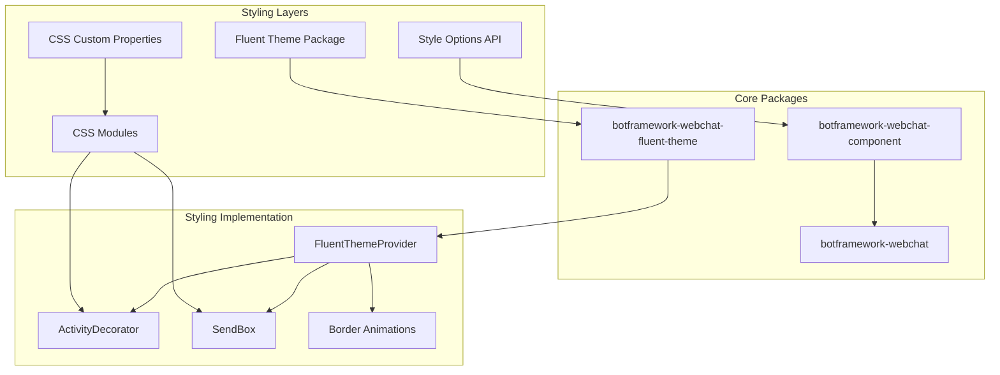
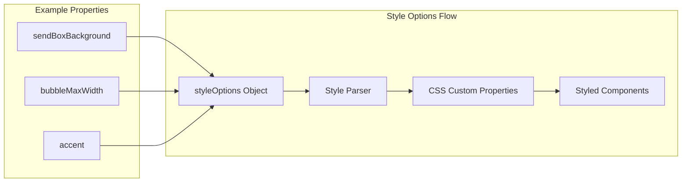
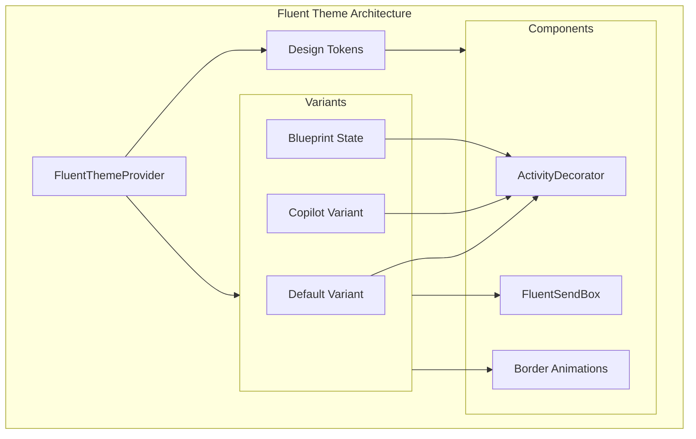
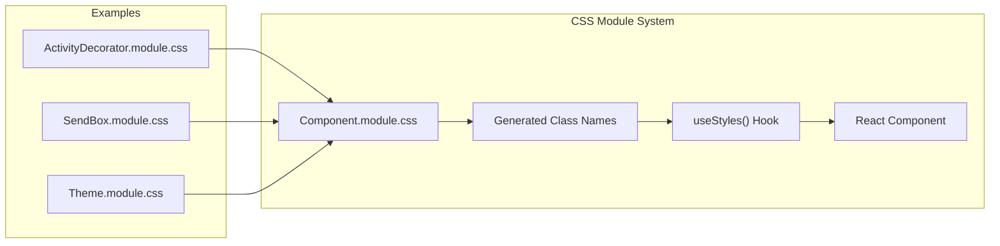
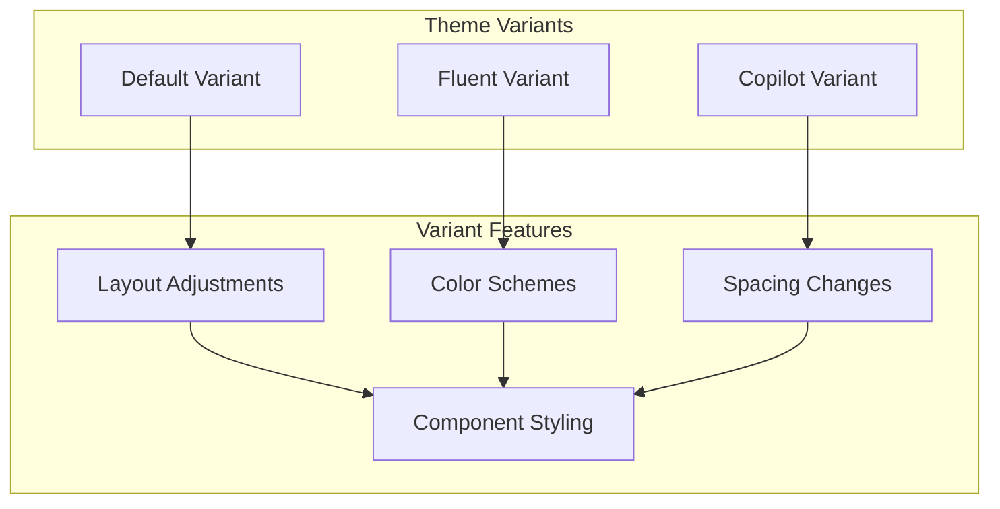
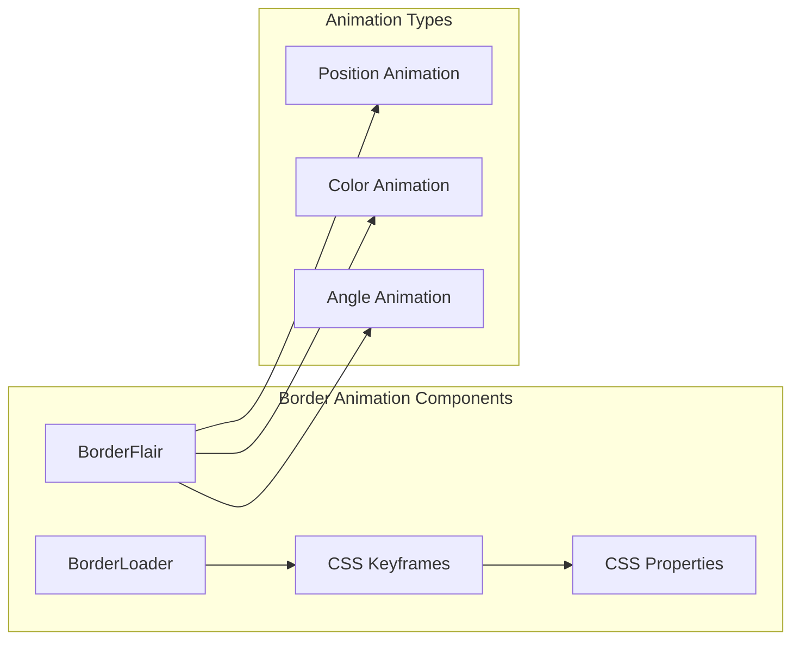
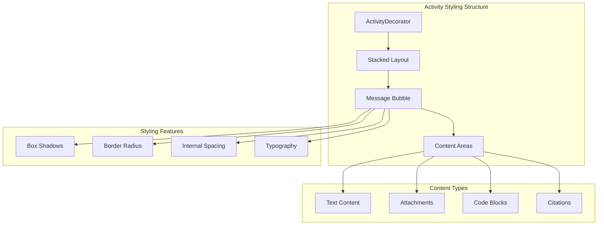
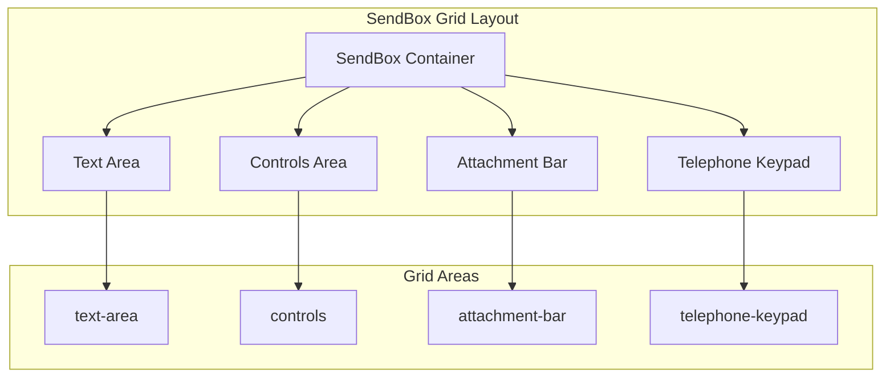
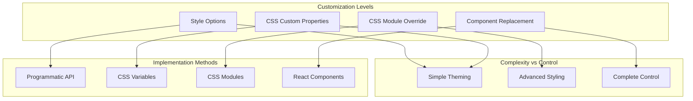

<!-- source: DeepWiki mcp.deepwiki.com · repo microsoft/BotFramework-WebChat · page 4.3 Theming and Styling · fetched 2026-10-26 -->

# Theming and Styling

<details>
<summary>Relevant source files</summary>

The following files were used as context for generating this wiki page:

- [__tests__/__image_snapshots__/chrome-docker/input-js-text-area-input-background-color-1-snap.png](__tests__/__image_snapshots__/chrome-docker/input-js-text-area-input-background-color-1-snap.png)
- [__tests__/__image_snapshots__/chrome-docker/input-js-text-box-input-background-color-1-snap.png](__tests__/__image_snapshots__/chrome-docker/input-js-text-box-input-background-color-1-snap.png)
- [__tests__/__image_snapshots__/chrome-docker/input-js-textarea-input-multiple-lines-1-snap.png](__tests__/__image_snapshots__/chrome-docker/input-js-textarea-input-multiple-lines-1-snap.png)
- [__tests__/__image_snapshots__/chrome-docker/input-js-textarea-input-resize-after-delete-1-snap.png](__tests__/__image_snapshots__/chrome-docker/input-js-textarea-input-resize-after-delete-1-snap.png)
- [__tests__/__image_snapshots__/chrome-docker/input-js-textarea-input-scroll-1-snap.png](__tests__/__image_snapshots__/chrome-docker/input-js-textarea-input-scroll-1-snap.png)
- [__tests__/__image_snapshots__/chrome-docker/input-js-textarea-input-shift-enter-1-snap.png](__tests__/__image_snapshots__/chrome-docker/input-js-textarea-input-shift-enter-1-snap.png)
- [__tests__/__image_snapshots__/chrome-docker/input-js-textarea-input-with-whitespace-1-snap.png](__tests__/__image_snapshots__/chrome-docker/input-js-textarea-input-with-whitespace-1-snap.png)
- [__tests__/__image_snapshots__/chrome-docker/input-js-textarea-long-text-1-snap.png](__tests__/__image_snapshots__/chrome-docker/input-js-textarea-long-text-1-snap.png)
- [__tests__/__image_snapshots__/chrome-docker/input-js-textarea-send-on-enter-1-snap.png](__tests__/__image_snapshots__/chrome-docker/input-js-textarea-send-on-enter-1-snap.png)
- [__tests__/__image_snapshots__/html/transcript-navigation-page-up-down-js-fluent-theme-applied-performs-transcript-navigation-7-snap.png](__tests__/__image_snapshots__/html/transcript-navigation-page-up-down-js-fluent-theme-applied-performs-transcript-navigation-7-snap.png)
- [__tests__/__image_snapshots__/html/with-builtin-decorator-js-fluent-theme-applied-with-decorators-1-snap.png](__tests__/__image_snapshots__/html/with-builtin-decorator-js-fluent-theme-applied-with-decorators-1-snap.png)
- [__tests__/html/chatAdapter.directLineAppServiceExtension.js](__tests__/html/chatAdapter.directLineAppServiceExtension.js)
- [__tests__/html/fluentTheme/transcript.navigation.pageUpDown.html](__tests__/html/fluentTheme/transcript.navigation.pageUpDown.html)
- [__tests__/html/suggestedActions.layout.html](__tests__/html/suggestedActions.layout.html)
- [__tests__/html2/fluentTheme/completion.html](__tests__/html2/fluentTheme/completion.html)
- [__tests__/html2/fluentTheme/completion.html.snap-1.png](__tests__/html2/fluentTheme/completion.html.snap-1.png)
- [__tests__/html2/fluentTheme/completion.html.snap-2.png](__tests__/html2/fluentTheme/completion.html.snap-2.png)
- [__tests__/html2/fluentTheme/completion.html.snap-3.png](__tests__/html2/fluentTheme/completion.html.snap-3.png)
- [__tests__/html2/fluentTheme/completion.html.snap-4.png](__tests__/html2/fluentTheme/completion.html.snap-4.png)
- [__tests__/input.js](__tests__/input.js)
- [packages/component/src/ActivityStatus/OthersActivityStatus.tsx](packages/component/src/ActivityStatus/OthersActivityStatus.tsx)
- [packages/component/src/Styles/StyleSet/ActivityCopyButton.ts](packages/component/src/Styles/StyleSet/ActivityCopyButton.ts)
- [packages/component/src/Styles/StyleSet/SendStatus.ts](packages/component/src/Styles/StyleSet/SendStatus.ts)
- [packages/component/src/Styles/StyleSet/ThumbButton.ts](packages/component/src/Styles/StyleSet/ThumbButton.ts)
- [packages/component/src/decorator/private/BorderFlair.module.css](packages/component/src/decorator/private/BorderFlair.module.css)
- [packages/component/src/decorator/private/BorderLoader.module.css](packages/component/src/decorator/private/BorderLoader.module.css)
- [packages/component/src/decorator/private/BorderLoader.tsx](packages/component/src/decorator/private/BorderLoader.tsx)
- [packages/core/src/types/external/OrgSchema/CreativeWork.ts](packages/core/src/types/external/OrgSchema/CreativeWork.ts)
- [packages/fluent-theme/src/bundle.ts](packages/fluent-theme/src/bundle.ts)
- [packages/fluent-theme/src/components/activity/ActivityDecorator.module.css](packages/fluent-theme/src/components/activity/ActivityDecorator.module.css)
- [packages/fluent-theme/src/components/activity/ActivityLoader.module.css](packages/fluent-theme/src/components/activity/ActivityLoader.module.css)
- [packages/fluent-theme/src/components/activity/ActivityLoader.tsx](packages/fluent-theme/src/components/activity/ActivityLoader.tsx)
- [packages/fluent-theme/src/components/preChatActivity/PreChatMessageActivity.tsx](packages/fluent-theme/src/components/preChatActivity/PreChatMessageActivity.tsx)
- [packages/fluent-theme/src/components/preChatActivity/StarterPromptsCardAction.tsx](packages/fluent-theme/src/components/preChatActivity/StarterPromptsCardAction.tsx)
- [packages/fluent-theme/src/components/sendBox/SendBox.module.css](packages/fluent-theme/src/components/sendBox/SendBox.module.css)
- [packages/fluent-theme/src/components/sendBox/SendBox.tsx](packages/fluent-theme/src/components/sendBox/SendBox.tsx)
- [packages/fluent-theme/src/components/theme/Theme.module.css](packages/fluent-theme/src/components/theme/Theme.module.css)
- [packages/fluent-theme/src/index.ts](packages/fluent-theme/src/index.ts)

</details>


This document covers the theming and styling system in BotFramework-WebChat, including the built-in style options, the Fluent Design System integration, CSS architecture, and customization approaches. For information about component composition and rendering, see [Component System](#3.2).

WebChat provides multiple approaches to styling and theming:
- **Style Options**: Programmatic styling through configuration objects
- **Fluent Theme**: Microsoft Fluent Design System integration package
- **CSS Custom Properties**: Direct CSS variable overrides
- **Custom Components**: Complete component replacement

## Architecture Overview

The styling system is built on a modular architecture that separates styling concerns across packages and supports multiple theming approaches.



**Sources**: [packages/fluent-theme/src/index.ts:1-19](), [packages/fluent-theme/src/components/theme/Theme.module.css:1-733]()

## Style Options System

Style options provide a programmatic API for customizing WebChat's appearance without writing CSS. The system uses CSS custom properties internally to apply styling.



### Key Style Options

| Category | Properties | CSS Variables |
|----------|------------|---------------|
| Colors | `accent`, `subtle`, `timestamp` | `--webchat__color--accent` |
| Typography | `fontFamily`, `fontSize` | `--webchat__font--primary` |
| Layout | `bubbleMaxWidth`, `paddingRegular` | `--webchat__max-width--bubble` |
| SendBox | `sendBoxBackground`, `sendBoxTextColor` | `--webchat__sendbox--padding` |

**Sources**: [packages/fluent-theme/src/components/theme/Theme.module.css:192-216]()

## Fluent Theme Package

The `botframework-webchat-fluent-theme` package provides integration with Microsoft's Fluent Design System, offering modern styling with consistent design tokens.

### FluentThemeProvider

The `FluentThemeProvider` component wraps WebChat to apply Fluent Design styling:



### Design Tokens

Fluent theme uses comprehensive design tokens for consistent styling:

**Color Tokens**:
- `--webchat-colorNeutralForeground1`: Primary text color
- `--webchat-colorBrandBackground`: Brand accent color
- `--webchat-colorNeutralBackground1`: Surface background

**Typography Tokens**:
- `--webchat-fontFamilyBase`: Primary font family
- `--webchat-fontSizeBase300`: Medium font size (14px)
- `--webchat-lineHeightBase300`: Corresponding line height

**Spacing Tokens**:
- `--webchat-spacingHorizontalM`: Medium horizontal spacing (12px)
- `--webchat-spacingVerticalS`: Small vertical spacing (8px)

**Sources**: [packages/fluent-theme/src/components/theme/Theme.module.css:4-182]()

## CSS Module Architecture

WebChat uses CSS Modules for component styling, providing scoped CSS classes and preventing style conflicts.



### Component Styling Pattern

Each component follows a consistent CSS Module pattern:

1. **CSS Module File**: `Component.module.css` with scoped styles
2. **React Hook**: `useStyles(styles)` to access class names
3. **Variant Support**: `useVariantClassName()` for theme variants
4. **Global Selectors**: `:global()` for targeting child components

**Sources**: [packages/fluent-theme/src/components/sendBox/SendBox.tsx:57-58](), [packages/fluent-theme/src/components/sendBox/SendBox.module.css:1-181]()

## Theme Variants

WebChat supports multiple visual variants to match different UI contexts:

### Variant Types



### Copilot Variant

The Copilot variant provides specialized styling for Microsoft Copilot integration:

- **Modified Layout**: Reduced padding and adjusted margins
- **Hidden Elements**: Text counters hidden unless error state
- **Bot Messages**: Full-width layout with custom styling
- **Color Scheme**: Copilot-specific color palette

**Sources**: [packages/fluent-theme/src/components/activity/ActivityDecorator.module.css:36-104](), [packages/fluent-theme/src/components/sendBox/SendBox.module.css:13-18]()

## Animation System

WebChat includes sophisticated animation systems for visual feedback and loading states.

### Border Animations

The border animation system provides dynamic visual feedback:



### Animation Implementation

**Border Flair**: Uses CSS custom properties for animated gradients
- `--webchat-decorator-borderFlair-animated-angle`: Rotating gradient angle
- `--webchat-decorator-borderFlair-animated-color1/2/3`: Color transitions
- Multiple keyframe animations for complex effects

**Border Loader**: Simple position-based animation
- `borderAnimation-position`: Sliding loader effect
- Linear gradient background with animated positioning

**Sources**: [packages/component/src/decorator/private/BorderFlair.module.css:1-565](), [packages/component/src/decorator/private/BorderLoader.module.css:1-45]()

## Activity Styling

Activity components use a sophisticated styling system that supports multiple layout modes and content types.

### Activity Decorator

The `ActivityDecorator` component provides the main styling container for activities:



### Message Bubble Styling

Message bubbles use CSS custom properties for flexible theming:

- `--webchat__bubble--background-color`: Dynamic background color
- `--webchat__bubble--border-radius`: Configurable border radius
- `--webchat__bubble--max-width`: Maximum bubble width
- `--webchat__bubble--min-height`: Minimum bubble height
- `--webchat__bubble--box-shadow`: Elevation shadow

**Sources**: [packages/fluent-theme/src/components/activity/ActivityDecorator.module.css:1-500]()

## SendBox Styling

The SendBox component demonstrates advanced CSS Grid layout and state-based styling.

### SendBox Layout



### Focus and Animation States

The SendBox includes sophisticated focus and animation states:

- **Focus Border**: Animated bottom border on focus
- **Attachment State**: Dynamic grid template adjustment
- **Error States**: Visual feedback for validation errors
- **Character Counter**: Optional character limit display

**Sources**: [packages/fluent-theme/src/components/sendBox/SendBox.module.css:20-181](), [packages/fluent-theme/src/components/sendBox/SendBox.tsx:190-257]()

## Customization Approaches

WebChat provides multiple levels of customization to meet different styling requirements.

### Customization Hierarchy



### CSS Custom Property Override

Direct CSS custom property override provides fine-grained control:

```css
.webchat__css-custom-properties {
  --webchat__color--accent: #0078d4;
  --webchat__font--primary: 'Segoe UI', sans-serif;
  --webchat__max-width--bubble: 70%;
}
```

### Fluent Theme Integration

The Fluent theme package demonstrates complete styling integration:

1. **Theme Provider**: Wraps WebChat with theme context
2. **Design Tokens**: Comprehensive token system
3. **Component Variants**: Multiple visual modes
4. **Animation Support**: Built-in animations and transitions

**Sources**: [packages/fluent-theme/src/index.ts:1-19](), [packages/fluent-theme/src/bundle.ts:1-13]()

---

