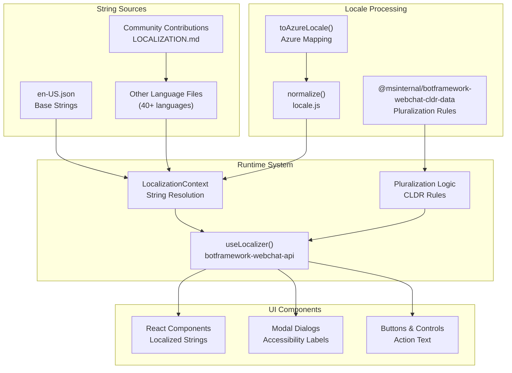
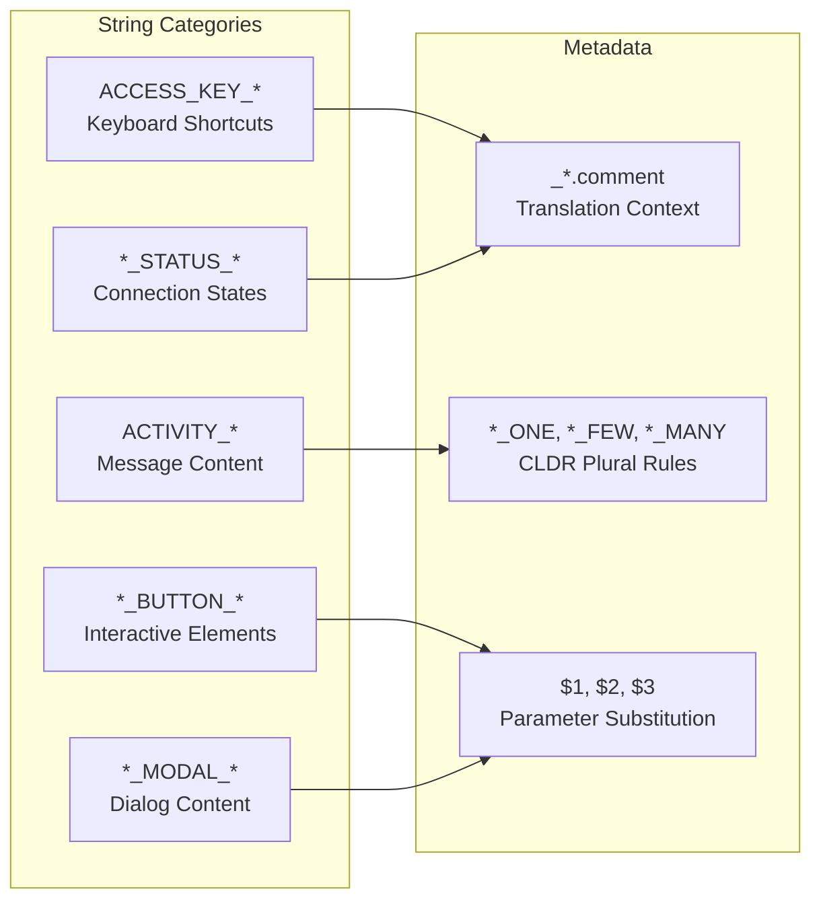
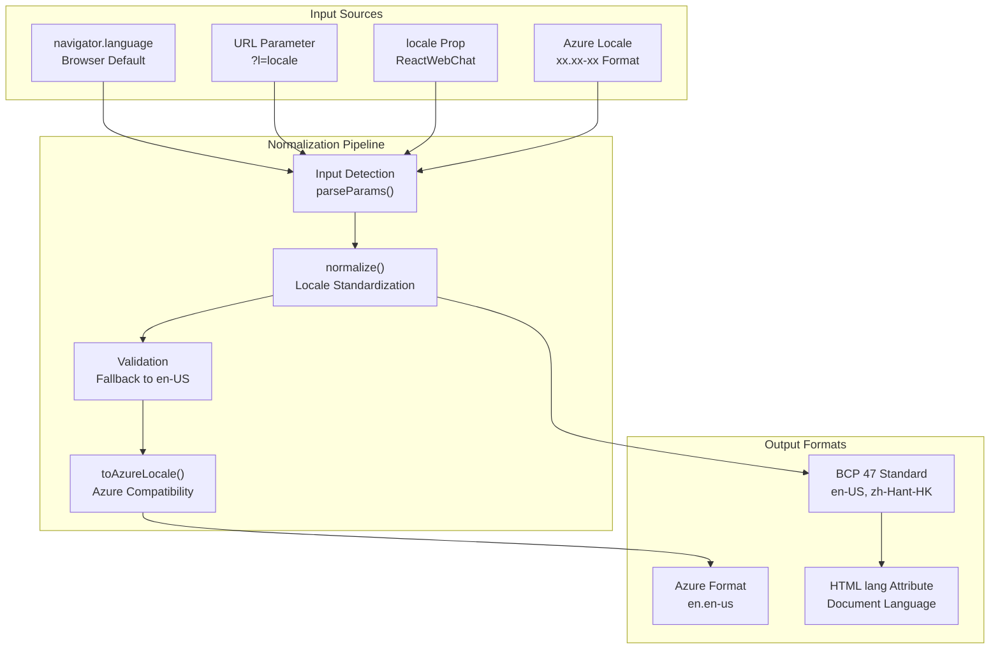
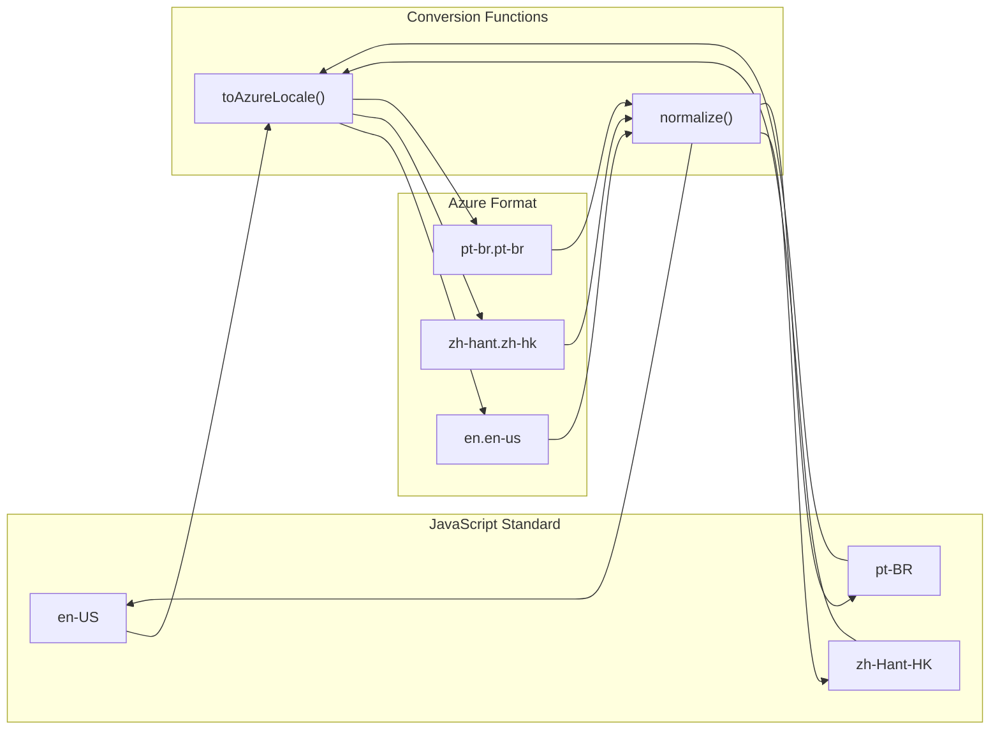
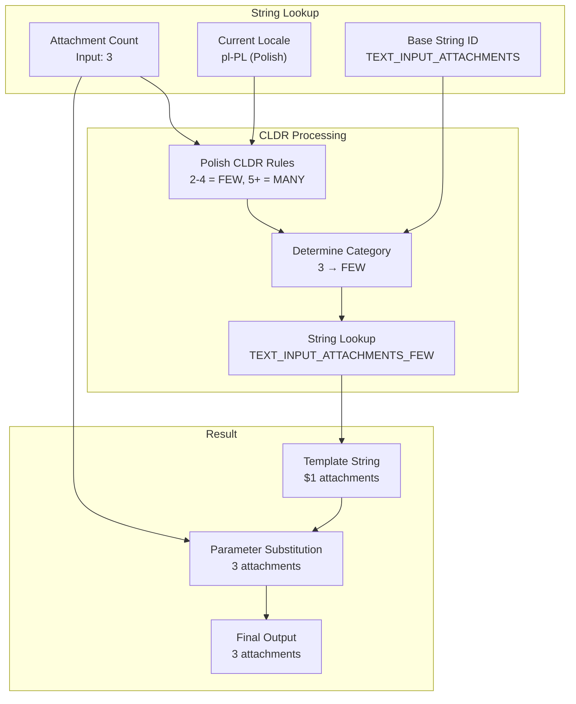
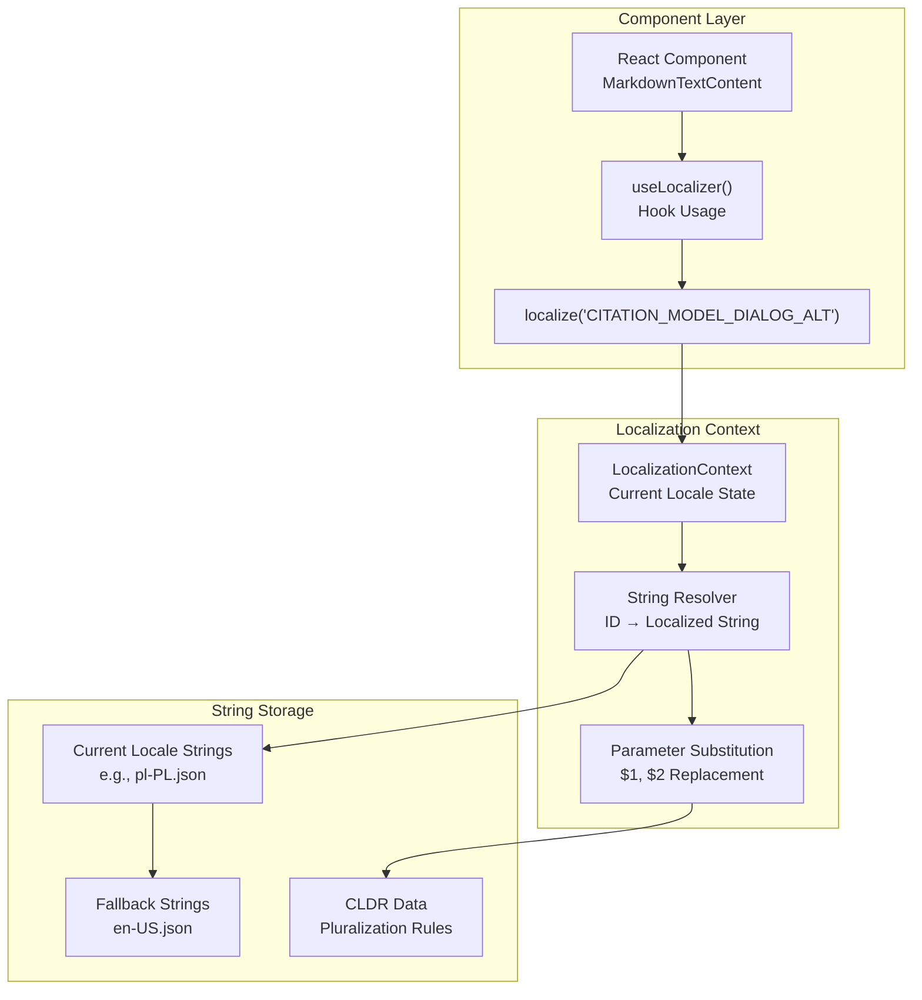
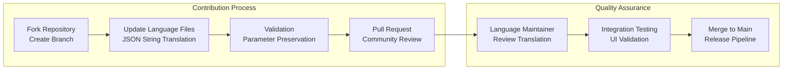
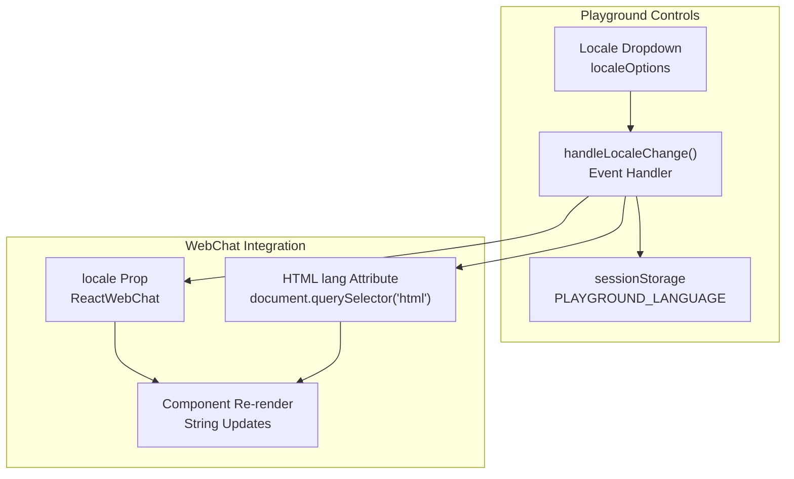

<!-- source: DeepWiki mcp.deepwiki.com · repo microsoft/BotFramework-WebChat · page 4.4 Localization · fetched 2026-10-26 -->

# Localization

<details>
<summary>Relevant source files</summary>

The following files were used as context for generating this wiki page:

- [LOCALIZATION.md](LOCALIZATION.md)
- [__tests__/__image_snapshots__/html/citation-show-modal-width-desktop-js-citation-modal-dialog-should-show-60-on-desktop-2-snap.png](__tests__/__image_snapshots__/html/citation-show-modal-width-desktop-js-citation-modal-dialog-should-show-60-on-desktop-2-snap.png)
- [__tests__/__image_snapshots__/html/default-citation-modal-js-markdown-render-html-when-unset-should-render-sanitized-html-in-citation-modal-1-snap.png](__tests__/__image_snapshots__/html/default-citation-modal-js-markdown-render-html-when-unset-should-render-sanitized-html-in-citation-modal-1-snap.png)
- [__tests__/html2/activity/behavior.copyCode.html](__tests__/html2/activity/behavior.copyCode.html)
- [__tests__/html2/activity/viewCodeButton.html](__tests__/html2/activity/viewCodeButton.html)
- [__tests__/html2/activity/viewCodeButton.html.snap-1.png](__tests__/html2/activity/viewCodeButton.html.snap-1.png)
- [__tests__/html2/activity/viewCodeButton.html.snap-2.png](__tests__/html2/activity/viewCodeButton.html.snap-2.png)
- [__tests__/html2/activity/viewCodeButton.html.snap-3.png](__tests__/html2/activity/viewCodeButton.html.snap-3.png)
- [__tests__/html2/markdown/codeBlockCopyButton/behavior.html](__tests__/html2/markdown/codeBlockCopyButton/behavior.html)
- [packages/api/src/localization/en-US.json](packages/api/src/localization/en-US.json)
- [packages/component/src/Attachment/Text/private/ActivityViewCodeButton.tsx](packages/component/src/Attachment/Text/private/ActivityViewCodeButton.tsx)
- [packages/component/src/Attachment/Text/private/CodeContent.tsx](packages/component/src/Attachment/Text/private/CodeContent.tsx)
- [packages/component/src/Attachment/Text/private/MarkdownTextContent.tsx](packages/component/src/Attachment/Text/private/MarkdownTextContent.tsx)
- [packages/component/src/Styles/StyleSet/ModalDialog.ts](packages/component/src/Styles/StyleSet/ModalDialog.ts)
- [packages/component/src/Styles/StyleSet/TextContent.ts](packages/component/src/Styles/StyleSet/TextContent.ts)
- [packages/component/src/Styles/StyleSet/ViewCodeDialog.ts](packages/component/src/Styles/StyleSet/ViewCodeDialog.ts)
- [packages/component/src/Styles/createStyleSet.ts](packages/component/src/Styles/createStyleSet.ts)
- [packages/component/src/providers/CustomElements/CustomElementsComposer.tsx](packages/component/src/providers/CustomElements/CustomElementsComposer.tsx)
- [packages/component/src/providers/ModalDialog/private/Popover.tsx](packages/component/src/providers/ModalDialog/private/Popover.tsx)
- [packages/component/src/testIds.ts](packages/component/src/testIds.ts)
- [packages/embed/hostDevServer.mjs](packages/embed/hostDevServer.mjs)
- [packages/embed/src/index.js](packages/embed/src/index.js)
- [packages/embed/src/locale.js](packages/embed/src/locale.js)
- [packages/embed/src/locale.spec.js](packages/embed/src/locale.spec.js)
- [packages/embed/webpack.config.js](packages/embed/webpack.config.js)
- [packages/playground/src/App.js](packages/playground/src/App.js)

</details>


This document covers the internationalization and localization system in BotFramework-WebChat, including string management, locale handling, CLDR data integration, and multi-language support. The system supports 40+ languages with proper pluralization rules, right-to-left (RTL) text support, and Azure Bot Framework locale compatibility.

For information about theming and visual styling, see [Theming and Styling](#4.3). For accessibility features including screen reader support, see [Accessibility](#4.5).

## Localization Architecture

The WebChat localization system follows a structured approach with JSON-based string files, locale normalization, and runtime string resolution through React hooks.



**Sources:** [packages/api/src/localization/en-US.json:1-193](), [packages/embed/src/locale.js:1-113](), [LOCALIZATION.md:1-36]()

## String Management System

WebChat uses a structured JSON format for managing localization strings with unique identifiers, contextual comments, and pluralization support.

### String File Structure

The base English localization file defines the canonical set of string identifiers used throughout the application:



**Example String Definitions:**
- `ACTIVITY_BOT_SAID_ALT`: Screen reader text with parameter substitution
- `TEXT_INPUT_ATTACHMENTS_ONE` through `TEXT_INPUT_ATTACHMENTS_OTHER`: Pluralization variants
- `CONNECTIVITY_STATUS_ALT_CONNECTING`: Connection state descriptions

**Sources:** [packages/api/src/localization/en-US.json:7-193]()

### String ID Conventions

| Prefix | Purpose | Example |
|--------|---------|---------|
| `ACCESS_KEY_` | Keyboard shortcuts and access keys | `ACCESS_KEY_ALT` |
| `ACTIVITY_` | Message and activity content | `ACTIVITY_BOT_SAID_ALT` |
| `*_BUTTON_*` | Button labels and tooltips | `TEXT_INPUT_SEND_BUTTON_ALT` |
| `CONNECTIVITY_STATUS_` | Connection state indicators | `CONNECTIVITY_STATUS_ALT_CONNECTED` |
| `TOAST_` | Notification messages | `TOAST_ALT_ERROR` |
| `TRANSCRIPT_` | Chat history and accessibility | `TRANSCRIPT_ARIA_LABEL_ALT` |

**Sources:** [packages/api/src/localization/en-US.json:3-193]()

## Locale Handling and Normalization

The locale system handles various input formats and normalizes them to standard BCP 47 language tags with fallback logic.



**Sources:** [packages/embed/src/locale.js:52-69](), [packages/embed/src/index.js:106-107](), [packages/playground/src/App.js:69-71]()

### Locale Normalization Logic

The `normalize()` function handles various input formats and converts them to standard language codes:

| Input Format | Output | Notes |
|-------------|--------|-------|
| `en` | `en-US` | Default region assignment |
| `zh-hans.zh-cn` | `zh-Hans` | Azure format conversion |
| `zh-hant.zh-hk` | `zh-Hant-HK` | Regional variant preservation |
| `*` | `en-US` | Fallback for invalid input |

**Sources:** [packages/embed/src/locale.js:32-68](), [packages/embed/src/locale.spec.js:91-101]()

### Azure Locale Compatibility

WebChat maintains compatibility with Azure Bot Framework locale formats through bidirectional conversion:



**Sources:** [packages/embed/src/locale.js:71-111](), [packages/embed/src/locale.spec.js:103-171]()

## Pluralization and CLDR Integration

WebChat integrates with Unicode CLDR (Common Locale Data Repository) data to handle complex pluralization rules across different languages.

### CLDR Pluralization Categories

The system supports all CLDR plural categories with language-specific rules:

| Category | Usage | Example Languages |
|----------|-------|-------------------|
| `ONE` | Singular form | Most languages for count = 1 |
| `TWO` | Dual form | Arabic, Hebrew |
| `FEW` | Small quantities | Polish (2-4), Russian (2-4) |
| `MANY` | Large quantities | Polish (5+), Russian (5+) |
| `OTHER` | Default/fallback | All other cases |

**Example Pluralization Implementation:**


**Sources:** [packages/api/src/localization/en-US.json:135-144](), [packages/component/src/Attachment/Text/private/MarkdownTextContent.tsx:1-270]()

### CLDR Data Package

The `@msinternal/botframework-webchat-cldr-data` package provides:

- Unicode CLDR pluralization rules for all supported languages
- Date and number formatting data
- Language-specific formatting preferences
- Regional variations and cultural adaptations

**Sources:** [packages/api/src/localization/en-US.json:1-2]()

## Usage in Components

Components access localized strings through the `useLocalizer` hook, which provides string lookup with parameter substitution and pluralization.

### String Resolution Flow



**Example Component Usage:**
```typescript
// Citation modal dialog
const localize = useLocalizer();
const dialogLabel = localize('CITATION_MODEL_DIALOG_ALT');

// Button with parameter substitution  
const deleteButtonLabel = localize('SEND_BOX_ATTACHMENT_BAR_DELETE_BUTTON_ALT', fileName);

// Pluralized attachment count
const attachmentText = localize('TEXT_INPUT_ATTACHMENTS', count);
```

**Sources:** [packages/component/src/Attachment/Text/private/MarkdownTextContent.tsx:69-76](), [packages/component/src/Attachment/Text/private/ActivityViewCodeButton.tsx:33-48]()

### Common Localization Patterns

| Pattern | Use Case | Example |
|---------|----------|---------|
| Simple lookup | Static labels | `localize('CLOSE_BUTTON_ALT')` |
| Parameter substitution | Dynamic content | `localize('ACTIVITY_BOT_SAID_ALT', botInitials)` |
| Conditional localization | Context-dependent | `altText \|\| title \|\| citationModalDialogLabel` |
| Accessibility labels | Screen readers | `aria-label={localize('TRANSCRIPT_ARIA_LABEL_ALT')}` |

**Sources:** [packages/component/src/Attachment/Text/private/MarkdownTextContent.tsx:94-96](), [packages/component/src/providers/ModalDialog/private/Popover.tsx:20-25]()

## Contributing Translations

The project welcomes community contributions for translations through a structured process documented in `LOCALIZATION.md`.

### Language Maintainers

Each supported language has designated maintainers who review and approve translation changes:

| Language Code | Maintainers | Status |
|---------------|-------------|--------|
| `es-es` | @SantiEspada, @ckgrafico, @renrous | Active |
| `fr-fr` | @meulta, @tao1 | Active |
| `ja-jp` | @bigplants, @corinagum | Active |
| `zh-hans` | @Antimoney | Active |
| `hu-hu` | (none listed) | Needs maintainer |
| `lv-lv` | (none listed) | Needs maintainer |

**Sources:** [LOCALIZATION.md:7-35]()

### Translation Workflow



**Translation Guidelines:**
- Preserve parameter placeholders (`$1`, `$2`, `$3`)
- Maintain contextual meaning from comment fields
- Follow CLDR pluralization rules for target language
- Test UI integration with translated strings
- Ensure accessibility compliance for screen readers

**Sources:** [LOCALIZATION.md:1-5]()

## RTL (Right-to-Left) Language Support

WebChat includes built-in support for RTL languages with automatic text direction detection and layout adjustments.

### RTL Integration Points

| Component | RTL Consideration | Implementation |
|-----------|-------------------|----------------|
| Carousel navigation | Button direction reversal | Directional flipper logic |
| Chat bubbles | Message alignment | CSS logical properties |
| Suggested actions | Button order | Flex direction adjustment |
| Text input | Cursor and text flow | Native browser RTL support |

**Supported RTL Languages:**
- Arabic (`ar-EG`, `ar-JO`)
- Hebrew (`he-IL`)

**Sources:** [packages/api/src/localization/en-US.json:62-64](), [packages/api/src/localization/en-US.json:119-122]()

## Playground Locale Testing

The playground application provides comprehensive locale testing capabilities for development and validation.

### Locale Selection Interface

The playground includes a dropdown for testing different locales with real-time language switching:



**Sources:** [packages/playground/src/App.js:234-241](), [packages/playground/src/App.js:437]()

---

