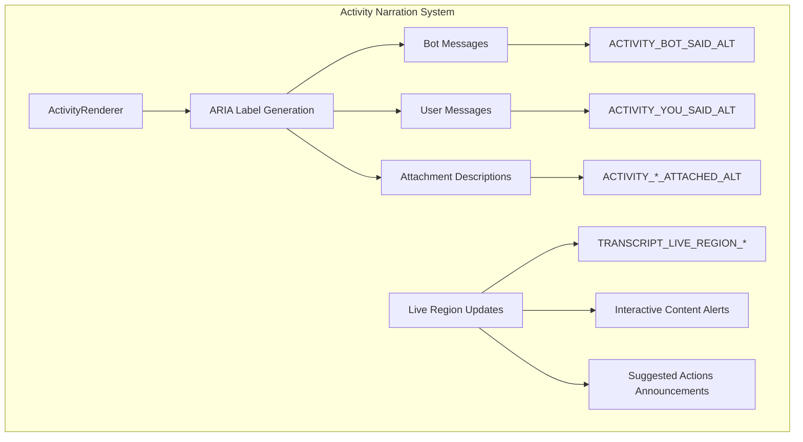
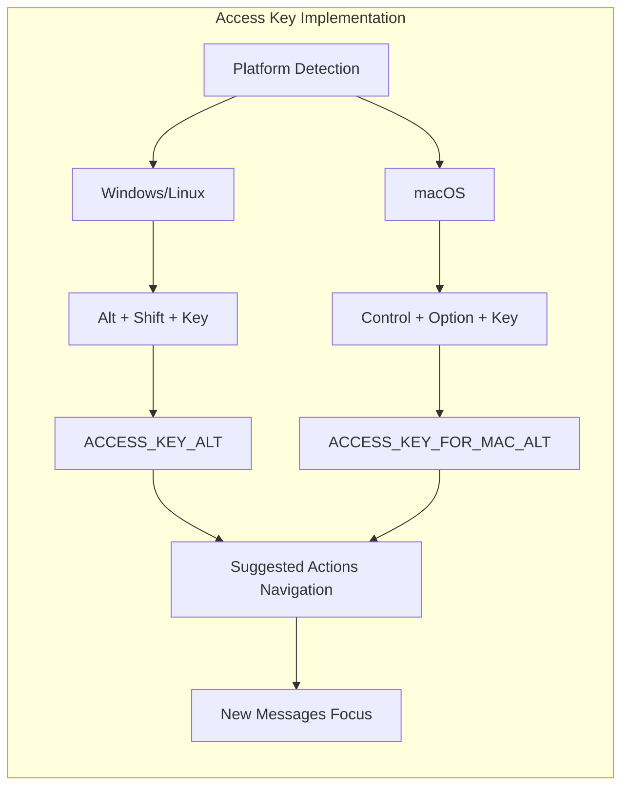
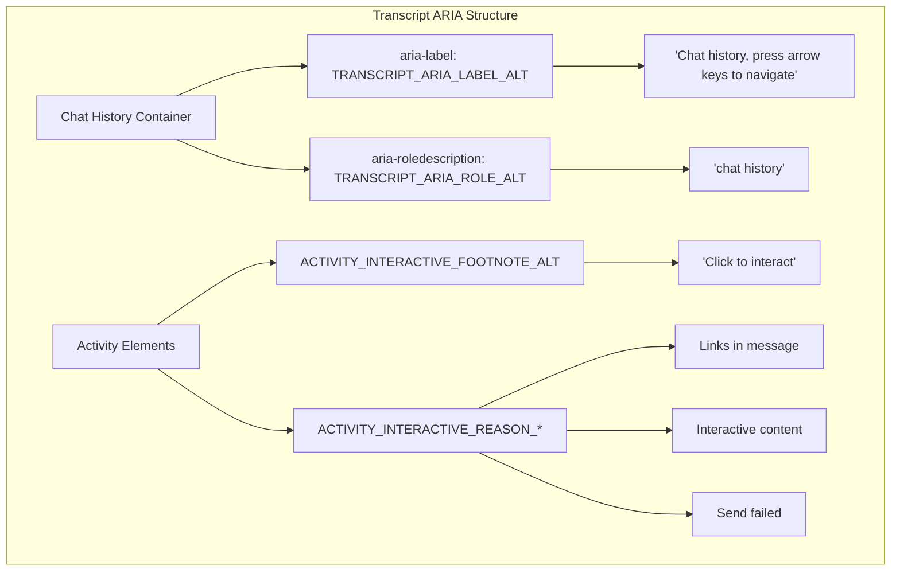
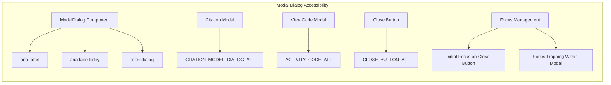
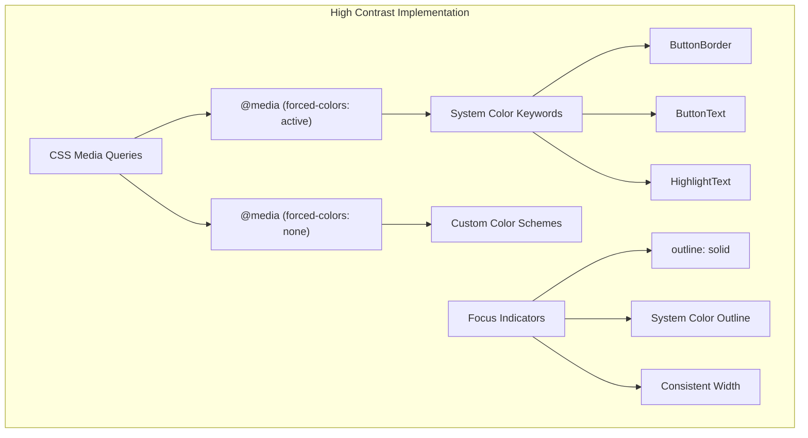
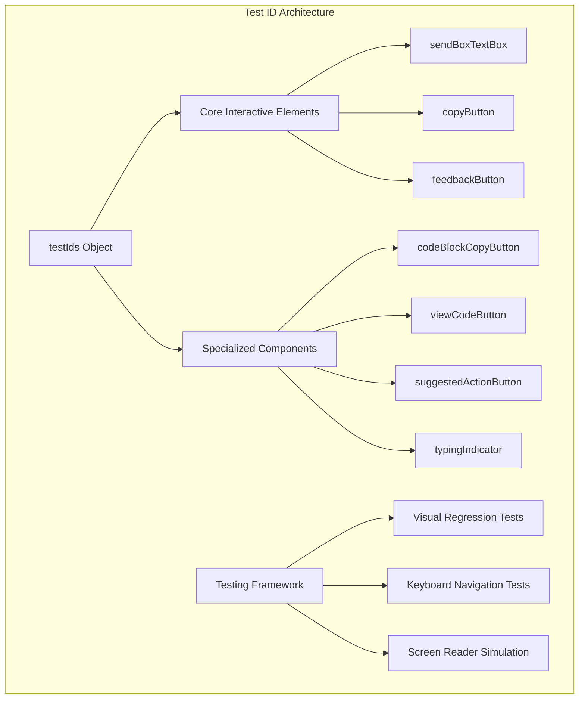

<!-- source: DeepWiki mcp.deepwiki.com · repo microsoft/BotFramework-WebChat · page 4.5 Accessibility · fetched 2026-10-26 -->

# Accessibility

Relevant source files

The following files were used as context for generating this wiki page:

- [__tests__/__image_snapshots__/html/citation-show-modal-width-desktop-js-citation-modal-dialog-should-show-60-on-desktop-2-snap.png](__tests__/__image_snapshots__/html/citation-show-modal-width-desktop-js-citation-modal-dialog-should-show-60-on-desktop-2-snap.png)
- [__tests__/__image_snapshots__/html/default-citation-modal-js-markdown-render-html-when-unset-should-render-sanitized-html-in-citation-modal-1-snap.png](__tests__/__image_snapshots__/html/default-citation-modal-js-markdown-render-html-when-unset-should-render-sanitized-html-in-citation-modal-1-snap.png)
- [__tests__/__image_snapshots__/html/with-builtin-decorator-js-fluent-theme-applied-with-decorators-1-snap.png](__tests__/__image_snapshots__/html/with-builtin-decorator-js-fluent-theme-applied-with-decorators-1-snap.png)
- [__tests__/html/chatAdapter.directLineAppServiceExtension.js](__tests__/html/chatAdapter.directLineAppServiceExtension.js)
- [__tests__/html2/activity/behavior.copyCode.html](__tests__/html2/activity/behavior.copyCode.html)
- [__tests__/html2/activity/viewCodeButton.html](__tests__/html2/activity/viewCodeButton.html)
- [__tests__/html2/activity/viewCodeButton.html.snap-1.png](__tests__/html2/activity/viewCodeButton.html.snap-1.png)
- [__tests__/html2/activity/viewCodeButton.html.snap-2.png](__tests__/html2/activity/viewCodeButton.html.snap-2.png)
- [__tests__/html2/activity/viewCodeButton.html.snap-3.png](__tests__/html2/activity/viewCodeButton.html.snap-3.png)
- [__tests__/html2/markdown/codeBlockCopyButton/behavior.html](__tests__/html2/markdown/codeBlockCopyButton/behavior.html)
- [packages/api/src/localization/en-US.json](packages/api/src/localization/en-US.json)
- [packages/component/src/Attachment/Text/private/ActivityViewCodeButton.tsx](packages/component/src/Attachment/Text/private/ActivityViewCodeButton.tsx)
- [packages/component/src/Attachment/Text/private/CodeContent.tsx](packages/component/src/Attachment/Text/private/CodeContent.tsx)
- [packages/component/src/Attachment/Text/private/MarkdownTextContent.tsx](packages/component/src/Attachment/Text/private/MarkdownTextContent.tsx)
- [packages/component/src/Styles/StyleSet/ModalDialog.ts](packages/component/src/Styles/StyleSet/ModalDialog.ts)
- [packages/component/src/Styles/StyleSet/TextContent.ts](packages/component/src/Styles/StyleSet/TextContent.ts)
- [packages/component/src/Styles/StyleSet/ViewCodeDialog.ts](packages/component/src/Styles/StyleSet/ViewCodeDialog.ts)
- [packages/component/src/Styles/createStyleSet.ts](packages/component/src/Styles/createStyleSet.ts)
- [packages/component/src/decorator/private/BorderFlair.module.css](packages/component/src/decorator/private/BorderFlair.module.css)
- [packages/component/src/decorator/private/BorderLoader.module.css](packages/component/src/decorator/private/BorderLoader.module.css)
- [packages/component/src/decorator/private/BorderLoader.tsx](packages/component/src/decorator/private/BorderLoader.tsx)
- [packages/component/src/providers/CustomElements/CustomElementsComposer.tsx](packages/component/src/providers/CustomElements/CustomElementsComposer.tsx)
- [packages/component/src/providers/ModalDialog/private/Popover.tsx](packages/component/src/providers/ModalDialog/private/Popover.tsx)
- [packages/component/src/testIds.ts](packages/component/src/testIds.ts)
- [packages/core/src/types/external/OrgSchema/CreativeWork.ts](packages/core/src/types/external/OrgSchema/CreativeWork.ts)
- [packages/fluent-theme/src/components/activity/ActivityDecorator.module.css](packages/fluent-theme/src/components/activity/ActivityDecorator.module.css)
- [packages/fluent-theme/src/components/activity/ActivityLoader.module.css](packages/fluent-theme/src/components/activity/ActivityLoader.module.css)
- [packages/fluent-theme/src/components/activity/ActivityLoader.tsx](packages/fluent-theme/src/components/activity/ActivityLoader.tsx)
- [packages/fluent-theme/src/components/preChatActivity/PreChatMessageActivity.tsx](packages/fluent-theme/src/components/preChatActivity/PreChatMessageActivity.tsx)
- [packages/fluent-theme/src/components/preChatActivity/StarterPromptsCardAction.tsx](packages/fluent-theme/src/components/preChatActivity/StarterPromptsCardAction.tsx)

This document covers the accessibility features and implementation patterns in BotFramework-WebChat, including screen reader support, keyboard navigation, ARIA labeling, and compliance guidelines. The system implements comprehensive accessibility features to ensure compatibility with assistive technologies and adherence to web accessibility standards.

For information about internationalization and language support, see [Localization](#4.4). For theming and visual customization that affects accessibility, see [Theming and Styling](#4.3).

## Screen Reader Support

WebChat provides extensive screen reader support through structured ARIA labels, live regions, and descriptive text for all interactive elements.

### Activity Narration

The system provides detailed narration patterns for chat activities, distinguishing between user and bot messages with contextual information.

**Sources**: [packages/api/src/localization/en-US.json:7-27]()

### Live Region Management

WebChat implements live regions to announce new messages and interactive content to screen readers without requiring focus changes.

| Live Region Type | Localization Key | Purpose |
|------------------|------------------|---------|
| New Messages | `TRANSCRIPT_LIVE_REGION_*` | Announces incoming messages and their interactive status |
| Interactive Content | `TRANSCRIPT_LIVE_REGION_INTERACTIVE_*` | Alerts users to interactive elements and links |
| Suggested Actions | `TRANSCRIPT_LIVE_REGION_SUGGESTED_ACTIONS_*` | Announces available suggested actions with access keys |
| Send Failures | `TRANSCRIPT_LIVE_REGION_SEND_FAILED_ALT` | Notifies users of message send failures |

**Sources**: [packages/api/src/localization/en-US.json:164-177]()

## Keyboard Navigation

The chat interface supports comprehensive keyboard navigation with standardized access patterns and focus management.

### Access Key System

WebChat implements platform-specific access key patterns to provide consistent keyboard shortcuts across different operating systems.

**Sources**: [packages/api/src/localization/en-US.json:3-6](), [packages/api/src/localization/en-US.json:173-174]()

### Focus Management Patterns

| Component | Focus Pattern | Test ID |
|-----------|---------------|---------|
| Send Box | `TEXT_INPUT_ALT` | `sendBoxTextBox` |
| Copy Buttons | `COPY_BUTTON_TEXT` | `codeBlockCopyButton` |
| View Code Buttons | `VIEW_CODE_BUTTON_TEXT` | `viewCodeButton` |
| Suggested Actions | `SUGGESTED_ACTIONS_LABEL_ALT` | `suggestedActionButton` |
| Upload Button | `TEXT_INPUT_UPLOAD_BUTTON_ALT` | N/A |

**Sources**: [packages/api/src/localization/en-US.json:125-131](), [packages/component/src/testIds.ts:1-16]()

## ARIA Labels and Roles

WebChat implements comprehensive ARIA labeling for all interactive elements and structural components.

### Transcript and Chat History

The main chat transcript uses specific ARIA roles and labels to provide context for screen reader navigation.

**Sources**: [packages/api/src/localization/en-US.json:164-167](), [packages/api/src/localization/en-US.json:18-25]()

### Modal Dialogs and Overlays

Modal dialogs implement proper ARIA attributes for accessibility compliance.

**Sources**: [packages/api/src/localization/en-US.json:65-67](), [packages/component/src/providers/ModalDialog/private/Popover.tsx:32-41]()

## Visual Accessibility Features

WebChat includes comprehensive visual accessibility features including high contrast support and focus indicators.

### High Contrast Mode Support

The Fluent theme provides explicit support for Windows High Contrast mode through CSS media queries.

**Sources**: [packages/fluent-theme/src/components/activity/ActivityDecorator.module.css:233-398](), [packages/component/src/Styles/StyleSet/ModalDialog.ts:58-63]()

### Focus Visible Styles

Focus indicators are implemented consistently across all interactive elements using the `:focus-visible` pseudo-class.

| Element Type | Focus Style Pattern | Example Location |
|--------------|-------------------|------------------|
| Buttons | `outline: var(--webchat-strokeWidthThick) solid var(--webchat-colorStrokeFocus2)` | Citation buttons |
| Links | `text-decoration: underline 1px double var(--webchat-colorStrokeFocus2)` | Markdown links |
| Modal Close | `borderColor: 'black'` in light theme | Modal dialog close button |
| Code Blocks | `border-radius: var(--webchat-borderRadiusSmall)` | Collapsible content summary |

**Sources**: [packages/fluent-theme/src/components/activity/ActivityDecorator.module.css:233-237](), [packages/fluent-theme/src/components/activity/ActivityDecorator.module.css:308-311]()

## Input and Interaction Accessibility

All input methods and interactive elements include proper accessibility attributes and feedback mechanisms.

### Send Box Accessibility

```mermaid
graph LR
    subgraph "Send Box Accessibility Features"
        TextInput["Text Input"] --> InputLabel["TEXT_INPUT_ALT"]
        TextInput --> Placeholder["TEXT_INPUT_PLACEHOLDER"]
        TextInput --> LengthValidation["TEXT_INPUT_LENGTH_EXCEEDED_ALT"]
        
        SendButton["Send Button"] --> SendLabel["TEXT_INPUT_SEND_BUTTON_ALT"]
        SendButton --> EmptyState["SEND_BOX_IS_EMPTY_TOOLTIP_ALT"]
        
        SpeechButton["Speech Button"] --> SpeechOpen["SPEECH_INPUT_MICROPHONE_BUTTON_OPEN_ALT"]
        SpeechButton --> SpeechClose["SPEECH_INPUT_MICROPHONE_BUTTON_CLOSE_ALT"]
        
        UploadButton["Upload Button"] --> UploadLabel["TEXT_INPUT_UPLOAD_BUTTON_ALT"]
        AttachmentBar["Attachment Bar"] --> AttachmentLabels["Attachment Descriptions"]
    end
```

**Sources**: [packages/api/src/localization/en-US.json:125-144](), [packages/api/src/localization/en-US.json:103-111]()

### Speech Input Accessibility

Speech input features include state announcements and proper labeling for screen readers.

| Speech State | Localization Key | Screen Reader Announcement |
|--------------|------------------|---------------------------|
| Starting | `SPEECH_INPUT_STARTING` | "Starting…" |
| Listening | `SPEECH_INPUT_LISTENING` | "Listening…" |
| Microphone On | `SPEECH_INPUT_MICROPHONE_BUTTON_OPEN_ALT` | "Microphone on" |
| Microphone Off | `SPEECH_INPUT_MICROPHONE_BUTTON_CLOSE_ALT` | "Microphone off" |

**Sources**: [packages/api/src/localization/en-US.json:113-118]()

## Testing Infrastructure

WebChat includes comprehensive accessibility testing infrastructure with test IDs and automated testing capabilities.

### Test ID System

The system provides consistent test IDs for automated accessibility testing and quality assurance.

**Sources**: [packages/component/src/testIds.ts:1-16](), [__tests__/html2/activity/viewCodeButton.html:118-123]()

### Accessibility Test Patterns

The codebase includes specific test patterns for validating accessibility features:

| Test Type | Example | Purpose |
|-----------|---------|---------|
| Focus Management | View Code Button Focus | Validates proper focus handling in modal dialogs |
| Copy Functionality | Code Block Copy Tests | Ensures clipboard operations work with assistive technology |
| Keyboard Navigation | Shift+Tab Navigation | Validates proper tab order and keyboard shortcuts |
| ARIA Announcements | Live Region Tests | Confirms screen reader announcements work correctly |

**Sources**: [__tests__/html2/activity/viewCodeButton.html:117-136](), [__tests__/html2/markdown/codeBlockCopyButton/behavior.html:75-84]()

## Compliance and Standards

WebChat implements accessibility features designed to meet WCAG guidelines and assistive technology compatibility requirements. The system provides comprehensive keyboard navigation, screen reader support, and visual accessibility features that enable users with disabilities to fully interact with chat interfaces.

The accessibility implementation spans across multiple architectural layers, from low-level ARIA attribute management to high-level interaction patterns, ensuring that accessibility is built into the core design rather than added as an afterthought.

**Sources**: [packages/api/src/localization/en-US.json:1-193](), [packages/fluent-theme/src/components/activity/ActivityDecorator.module.css:233-500](), [packages/component/src/Styles/StyleSet/ModalDialog.ts:58-128]()

---

