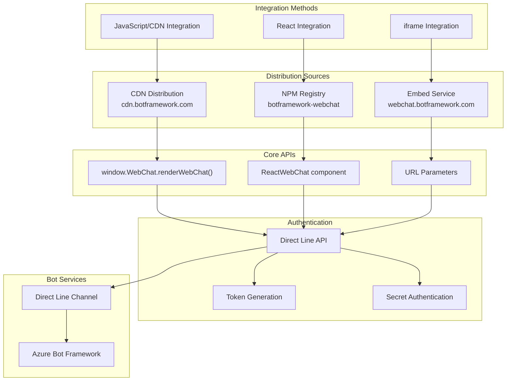
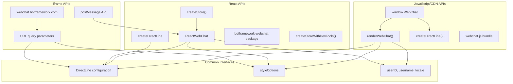
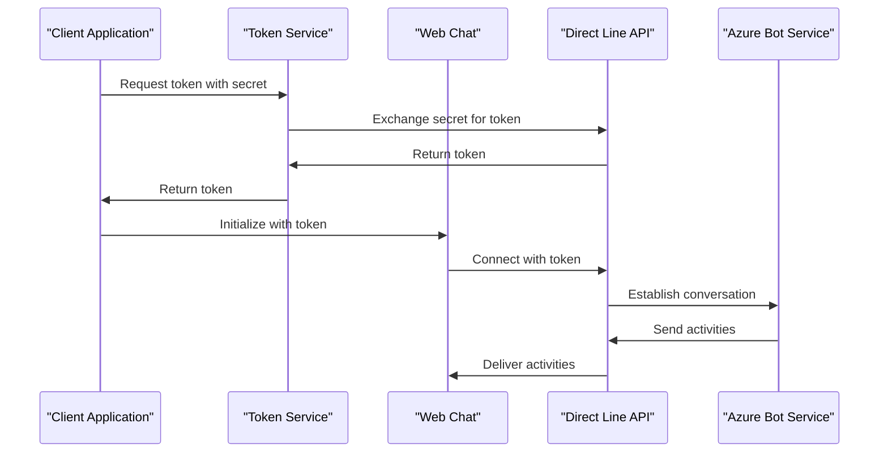

<!-- source: DeepWiki mcp.deepwiki.com · repo microsoft/BotFramework-WebChat · page 5 Integration Guide · fetched 2026-10-26 -->

# Integration Guide

<details>
<summary>Relevant source files</summary>

The following files were used as context for generating this wiki page:

- [README.md](README.md)
- [samples/index.html](samples/index.html)

</details>


This document provides an overview of the three primary methods for integrating Bot Framework Web Chat into applications: JavaScript/CDN integration, React component integration, and iframe embedding. Each method offers different levels of customization and is suited for different technical requirements and use cases.

For detailed implementation guides for each method, see [React Integration](#5.1), [JavaScript/CDN Integration](#5.2), and [iframe Embed](#5.3). For information about customizing the Web Chat UI after integration, see [Key Features](#4).

## Integration Methods Overview

Bot Framework Web Chat supports three distinct integration approaches, each targeting different development scenarios and providing varying levels of customization capability.

### Integration Methods Comparison

| Integration Method | Package Source | Customization Level | Use Case |
|-------------------|----------------|-------------------|----------|
| JavaScript/CDN | `https://cdn.botframework.com/botframework-webchat/latest/webchat.js` | Moderate | Static websites, quick integration |
| React Components | `npm install botframework-webchat` | Full | React applications, custom components |
| iframe Embed | `webchat.botframework.com` | Limited | Third-party websites, sandboxed deployment |

### Integration Architecture



Sources: [README.md:152-257]()

### Code Entity Mapping



Sources: [README.md:208-218](), [README.md:243-251]()

## Authentication Flow

All integration methods require authentication with the Direct Line channel through either a secret or token-based approach. The recommended approach is token-based authentication for security reasons.



Sources: [README.md:154-170]()

## Quick Start Examples

### JavaScript/CDN Integration

The JavaScript integration method uses a global `window.WebChat` object provided by the CDN bundle:

```html
<script crossorigin="anonymous" 
        src="https://cdn.botframework.com/botframework-webchat/latest/webchat.js">
</script>
<script>
  window.WebChat.renderWebChat({
    directLine: window.WebChat.createDirectLine({
      token: 'YOUR_DIRECT_LINE_TOKEN'
    }),
    userID: 'YOUR_USER_ID'
  }, document.getElementById('webchat'));
</script>
```

### React Integration

The React integration method uses NPM packages and provides full component customization:

```jsx
import ReactWebChat, { createDirectLine } from 'botframework-webchat';

const directLine = createDirectLine({ token: 'YOUR_DIRECT_LINE_TOKEN' });
return <ReactWebChat directLine={directLine} userID="YOUR_USER_ID" />;
```

### iframe Integration

The iframe integration method embeds Web Chat through a hosted service with URL parameters for configuration.

Sources: [README.md:172-257]()

## Common Configuration Options

All integration methods support core configuration options for authentication, user identification, and basic styling:

| Configuration | Description | JavaScript | React | iframe |
|--------------|-------------|------------|-------|--------|
| `directLine` | DirectLine connection object | ✓ | ✓ | via URL params |
| `userID` | User identifier | ✓ | ✓ | via URL params |
| `username` | Display name | ✓ | ✓ | via URL params |
| `locale` | Localization setting | ✓ | ✓ | via URL params |
| `styleOptions` | Styling configuration | ✓ | ✓ | limited |
| `store` | Redux store | ✓ | ✓ | ✗ |

Sources: [README.md:225-228]()

## Security Considerations

The Bot Framework Web Chat supports Content Security Policy (CSP) and follows security best practices. Token-based authentication is strongly recommended over direct secret usage in client applications.

Key security recommendations:
- Use token-based authentication instead of embedding secrets
- Implement proper token refresh mechanisms
- Enable CSP headers for additional security
- Validate user inputs and sanitize content

For detailed security information, see the Content Security Policy documentation referenced in the repository.

Sources: [README.md:14](), [README.md:164]()

---

