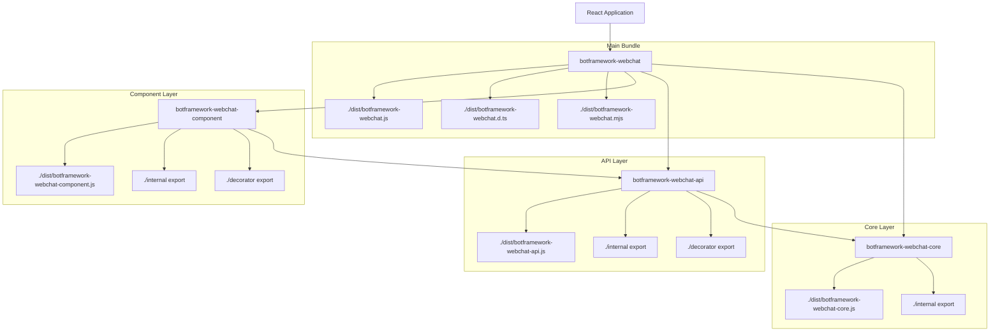
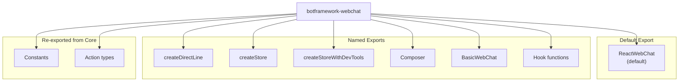
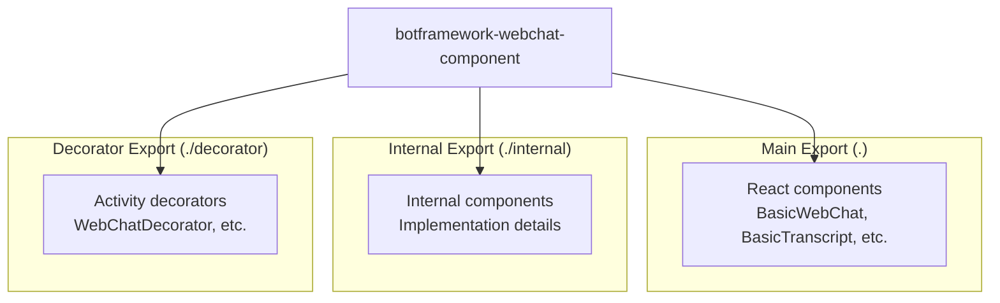
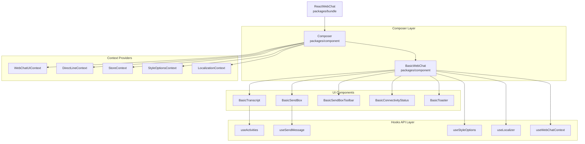
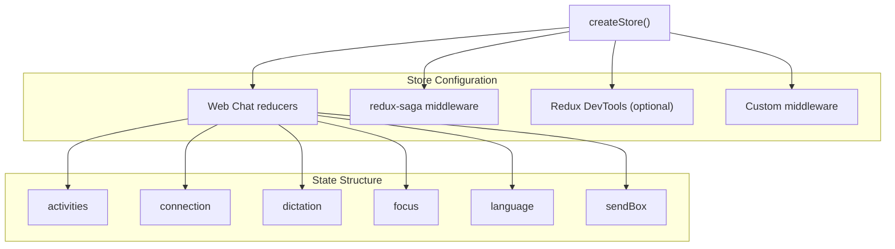
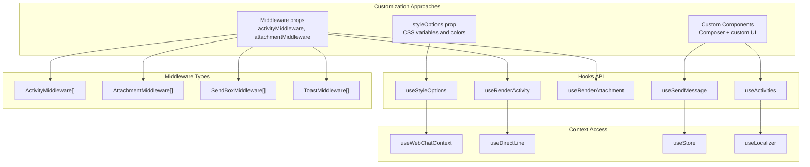
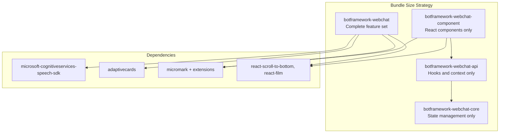

<!-- source: DeepWiki mcp.deepwiki.com · repo microsoft/BotFramework-WebChat · page 5.1 React Integration · fetched 2026-10-26 -->

# React Integration

<details>
<summary>Relevant source files</summary>

The following files were used as context for generating this wiki page:

- [CHANGELOG.md](CHANGELOG.md)
- [README.md](README.md)
- [package-lock.json](package-lock.json)
- [package.json](package.json)
- [packages/api/package.json](packages/api/package.json)
- [packages/bundle/package.json](packages/bundle/package.json)
- [packages/component/package.json](packages/component/package.json)
- [packages/core/package.json](packages/core/package.json)
- [packages/directlinespeech/package.json](packages/directlinespeech/package.json)
- [packages/embed/servicingPlan.json](packages/embed/servicingPlan.json)
- [packages/playground/package.json](packages/playground/package.json)
- [samples/index.html](samples/index.html)

</details>


This document covers how to integrate BotFramework-WebChat into React applications using the `botframework-webchat` NPM package. It details the React-specific APIs, component architecture, and integration patterns.

For vanilla JavaScript integration using CDN bundles, see [JavaScript/CDN Integration](#5.2). For iframe embedding, see [iframe Embed](#5.3).

## Package Architecture

React integration centers around the `botframework-webchat` bundle package, which aggregates core packages and provides both ES Module and CommonJS exports. The architecture follows a layered dependency structure where each package has specific responsibilities.

#### Package Dependency Graph



#### Export Structure and Entry Points

| Package | Main Export | Type Definitions | ES Module | Internal | Decorator |
|---------|-------------|------------------|-----------|----------|-----------|
| `botframework-webchat` | `./dist/botframework-webchat.js` | `./dist/botframework-webchat.d.ts` | `./dist/botframework-webchat.mjs` | ❌ | ❌ |
| `botframework-webchat-component` | `./dist/botframework-webchat-component.js` | `./dist/botframework-webchat-component.d.ts` | `./dist/botframework-webchat-component.mjs` | ✅ | ✅ |
| `botframework-webchat-api` | `./dist/botframework-webchat-api.js` | `./dist/botframework-webchat-api.d.ts` | `./dist/botframework-webchat-api.mjs` | ✅ | ✅ |
| `botframework-webchat-core` | `./dist/botframework-webchat-core.js` | `./dist/botframework-webchat-core.d.ts` | `./dist/botframework-webchat-core.mjs` | ✅ | ❌ |

**Sources:** [packages/bundle/package.json:5-18](), [packages/component/package.json:5-37](), [packages/api/package.json:5-37](), [packages/core/package.json:5-27]()

## Installation and Setup

### NPM Installation

Install the main bundle package which includes all dependencies:

```bash
npm install botframework-webchat
```

The package provides multiple export formats and requires React as a peer dependency:

```json
{
  "peerDependencies": {
    "react": ">= 16.8.6",
    "react-dom": ">= 16.8.6"
  }
}
```

Version selection follows semantic versioning. Use tilde range (`~`) for minor updates and caret range (`^`) for major updates:

```bash
# Minor updates (recommended)
npm install botframework-webchat@~4.18.0

# Major updates (may contain breaking changes)  
npm install botframework-webchat@^4.18.0
```

**Sources:** [README.md:239-240](), [packages/bundle/package.json:153-156](), [CHANGELOG.md:23-24]()

### Basic React Component

The main integration uses the default export `ReactWebChat` component from the bundle package:

```jsx
import ReactWebChat, { createDirectLine } from 'botframework-webchat';
import React, { useMemo } from 'react';

export default function ChatBot() {
  const directLine = useMemo(() => 
    createDirectLine({ token: 'YOUR_DIRECT_LINE_TOKEN' }), []
  );

  return (
    <ReactWebChat 
      directLine={directLine} 
      userID="YOUR_USER_ID"
      username="Web Chat User"
      locale="en-US"
    />
  );
}
```

The `ReactWebChat` component accepts these core props:

| Prop | Type | Required | Description |
|------|------|----------|-------------|
| `directLine` | `DirectLine` | ✅ | Connection to Bot Framework Direct Line |
| `userID` | `string` | ❌ | User identifier (should be unique per user) |
| `username` | `string` | ❌ | Display name for the user |
| `locale` | `string` | ❌ | Localization locale code |

**Sources:** [README.md:242-251](), [README.md:225-227]()

### Module Exports and Import Patterns

The bundle package provides both default and named exports for different integration patterns:

#### Bundle Package Exports



#### Component Package Sub-exports



**Sources:** [packages/bundle/package.json:7-18](), [packages/component/package.json:7-37](), [packages/api/package.json:7-37]()

## React Component Architecture

### Component Hierarchy and Context Flow

Web Chat follows a composer pattern where the `Composer` component provides context and the `BasicWebChat` component renders the UI. This separation allows for flexible customization and testing.

#### Core Component Structure



#### React Component Dependencies

The component package dependencies show the relationship between UI components and core functionality:

| Dependency | Version | Purpose |
|------------|---------|---------|
| `botframework-webchat-api` | `0.0.0-0` | Hooks and context providers |
| `botframework-webchat-core` | `0.0.0-0` | Redux store and state management |
| `react-redux` | `7.2.9` | Redux-React integration |
| `react-scroll-to-bottom` | `4.2.1-main.53844f5` | Transcript scrolling |
| `react-film` | `4.0.0` | Carousel components |

**Sources:** [packages/component/package.json:123-151](), [packages/api/package.json:115-127]()

### Props and Configuration

The `ReactWebChat` component accepts props that configure both connection and UI behavior. Props are passed through the `Composer` to appropriate context providers.

#### Core Props

| Prop | Type | Required | Default | Description |
|------|------|----------|---------|-------------|
| `directLine` | `DirectLine` | ✅ | - | Bot Framework Direct Line connection |
| `store` | `Store` | ❌ | Auto-created | Redux store instance |
| `styleOptions` | `StyleOptions` | ❌ | `{}` | UI styling configuration |
| `userID` | `string` | ❌ | Random | Unique user identifier |
| `username` | `string` | ❌ | `'Web Chat User'` | Display name for user |
| `locale` | `string` | ❌ | `'en-US'` | Localization locale |

#### Advanced Props

| Prop | Type | Description |
|------|------|-------------|
| `activityMiddleware` | `ActivityMiddleware[]` | Custom activity renderers |
| `attachmentMiddleware` | `AttachmentMiddleware[]` | Custom attachment renderers |
| `activityStatusMiddleware` | `ActivityStatusMiddleware[]` | Custom status indicators |
| `sendBoxMiddleware` | `SendBoxMiddleware[]` | Send box customizations |
| `toastMiddleware` | `ToastMiddleware[]` | Notification customizations |

#### Experimental Props

| Prop | Type | Description |
|------|------|-------------|
| `uiState` | `UIState` | UI state control (replaces deprecated `disabled`) |
| `feedbackActionsPlacement` | `'activity-actions' \| 'activity-status'` | Feedback button placement |

**Sources:** [README.md:225-227](), [CHANGELOG.md:62-63](), [CHANGELOG.md:86-89]()

## Advanced Integration Patterns

### Custom Store Configuration

For advanced scenarios, create a custom Redux store to add middleware or initial state. The `createStore` function creates a pre-configured store with Web Chat's reducers and sagas.

```jsx
import ReactWebChat, { createStore, createDirectLine } from 'botframework-webchat';
import React, { useMemo } from 'react';

export default function AdvancedChatBot() {
  const directLine = useMemo(() => createDirectLine({ token: 'TOKEN' }), []);
  
  // Create store with custom initial state
  const store = useMemo(() => createStore({}, ({ dispatch }) => next => action => {
    // Add custom middleware logic
    console.log('Action:', action);
    return next(action);
  }), []);

  return (
    <ReactWebChat
      directLine={directLine}
      store={store}
      userID="user-123"
    />
  );
}
```

The store creation follows this pattern in the core package:



**Sources:** [packages/core/package.json:101-111](), [packages/bundle/package.json:97-125]()

### Redux DevTools Integration

Web Chat includes experimental Redux DevTools support via `createStoreWithDevTools`. This enables state inspection and time-travel debugging in development.

```jsx
import ReactWebChat, { createDirectLine, createStoreWithDevTools } from 'botframework-webchat';
import React, { useMemo } from 'react';

export default function DebugChatBot() {
  const directLine = useMemo(() => createDirectLine({ token: 'TOKEN' }), []);
  const store = useMemo(() => createStoreWithDevTools(), []);

  return <ReactWebChat directLine={directLine} store={store} userID="debug-user" />;
}
```

#### Redux DevTools Dependencies

The core package includes Redux DevTools extension support:

| Package | Version | Purpose |
|---------|---------|---------|
| `@redux-devtools/extension` | `3.3.0` | DevTools browser extension integration |
| `redux` | `5.0.1` | Core Redux library |
| `redux-saga` | `1.3.0` | Side effect management |

#### DevTools Limitations

- **Time-traveling**: May break UI state since many states are in React context
- **Action dispatching**: Not officially supported; use hooks API instead  
- **State coverage**: Only Redux state is visible, not React component state
- **Real-time UIs**: Time-sensitive components ignore time-travel

**Sources:** [README.md:264-281](), [README.md:282-288](), [packages/core/package.json:103](), [CHANGELOG.md:117]()

### Component Customization Patterns

Web Chat provides three main customization approaches: style options, middleware functions, and complete component replacement. Each approach offers different levels of control and complexity.

#### Customization Architecture



#### Style Options Configuration

Style options provide CSS variable control without component replacement:

| Category | Properties | Example |
|----------|------------|---------|
| Colors | `accent`, `subtle`, `primaryFont` | Brand colors |
| Layout | `bubbleMaxWidth`, `bubbleMinHeight` | Message sizing |
| Typography | `primaryFont`, `monospaceFont` | Font families |
| Features | `hideUploadButton`, `speechRecognitionContinuous` | Feature toggles |

#### Middleware Function Signatures

Middleware functions follow a chain-of-responsibility pattern:

```typescript
type ActivityMiddleware = () => (next: Function) => (args: ActivityMiddlewareArgs) => React.ReactNode;
type AttachmentMiddleware = () => (next: Function) => (args: AttachmentMiddlewareArgs) => React.ReactNode;
```

**Sources:** [packages/component/package.json:123-151](), [packages/api/package.json:115-127](), [CHANGELOG.md:37-41]()

## TypeScript Support

Web Chat provides comprehensive TypeScript definitions with dual module format support (CommonJS and ES Modules). Each package exports both `.d.ts` and `.d.mts` files for maximum compatibility.

### Type Definition Structure

```mermaid
graph TD
    subgraph "Type Definition Files"
        BundleTypes["./dist/botframework-webchat.d.ts"]
        BundleTypesESM["./dist/botframework-webchat.d.mts"]
        ComponentTypes["./dist/botframework-webchat-component.d.ts"]
        ComponentTypesESM["./dist/botframework-webchat-component.d.mts"]
        APITypes["./dist/botframework-webchat-api.d.ts"]
        APITypesESM["./dist/botframework-webchat-api.d.mts"]
        CoreTypes["./dist/botframework-webchat-core.d.ts"]
        CoreTypesESM["./dist/botframework-webchat-core.d.mts"]
    end
    
    subgraph "Sub-module Types"
        ComponentInternal["./dist/botframework-webchat-component.internal.d.ts"]
        ComponentDecorator["./dist/botframework-webchat-component.decorator.d.ts"]
        APIInternal["./dist/botframework-webchat-api.internal.d.ts"]
        APIDecorator["./dist/botframework-webchat-api.decorator.d.ts"]
        CoreInternal["./dist/botframework-webchat-core.internal.d.ts"]
    end
    
    subgraph "Export Resolution"
        RequireTypes["require() → .d.ts"]
        ImportTypes["import → .d.mts"]
    end
    
    BundleTypes --> RequireTypes
    BundleTypesESM --> ImportTypes
    ComponentTypes --> ComponentInternal
    ComponentTypes --> ComponentDecorator
    APITypes --> APIInternal
    APITypes --> APIDecorator
    CoreTypes --> CoreInternal
```



### TypeScript Configuration

Web Chat packages use relaxed TypeScript configuration for maximum compatibility:

| Option | Value | Purpose |
|--------|--------|---------|
| `allowSyntheticDefaultImports` | `true` | Enable default imports from CJS modules |
| `jsx` | `react` | JSX compilation target |
| `skipLibCheck` | `true` | Skip type checking of external `.d.ts` files |
| `strict` | `false` | Relaxed strictness for broad compatibility |
| `resolveJsonModule` | `true` | Import JSON files with types |

### TypeScript Version Compatibility

The packages pin TypeScript to a specific version to ensure consistent compilation:

```json
{
  "pinDependencies": {
    "typescript": [
      "~5.8.3",
      "@typescript-eslint/parser@8.38.0 does not support typescript@5.9.2 yet"
    ]
  }
}
```

**Sources:** [packages/bundle/package.json:6-18](), [packages/component/package.json:6-37](), [packages/api/package.json:6-37](), [packages/bundle/package.json:37-45](), [packages/bundle/package.json:88-91]()

### TypeScript Configuration

The packages support TypeScript with the following compiler options:

| Option | Value | Purpose |
|--------|--------|---------|
| `allowSyntheticDefaultImports` | `true` | Enable default imports from modules without default export |
| `jsx` | `react` | JSX compilation target |
| `skipLibCheck` | `true` | Skip type checking of declaration files |
| `strict` | `false` | Relaxed strictness for compatibility |

**Sources:** [packages/bundle/package.json:37-45](), [packages/core/package.json:37-45]()

## React Version Compatibility

Web Chat requires React 16.8.6 minimum for hooks support. The monorepo development uses React 16.8.6 as the baseline to ensure compatibility across all supported versions.

### Version Requirements

| Component | Minimum Version | Reason |
|-----------|----------------|---------|
| React | `16.8.6` | Hooks API support |
| React DOM | `16.8.6` | Consistent with React version |
| Node.js | `>= 12.0.0` | Core package requirement |

### Peer Dependencies

All packages declare React as a peer dependency to avoid version conflicts:

```json
{
  "peerDependencies": {
    "react": ">= 16.8.6",
    "react-dom": ">= 16.8.6"
  }
}
```

### Development Dependencies

The monorepo pins React to 16.8.6 for development to test against the minimum supported version:

```json
{
  "pinDependencies": {
    "react": [
      "16.8.6",
      "using react@16.8.6 to make sure this is the minimum supported version"
    ],
    "react-dom": [
      "16.8.6", 
      "using react-dom@16.8.6 to make sure this is the minimum supported version"
    ]
  }
}
```

### Upgrade Path

For applications that cannot upgrade React immediately:

1. Use Web Chat 4.5.x (class component-based)
2. Consider the hybrid React sample for dual-hosting scenarios
3. Plan React upgrade to unlock latest Web Chat features

**Sources:** [README.md:136-140](), [packages/bundle/package.json:153-156](), [package.json:128-135](), [packages/core/package.json:72-74]()

## Performance Considerations

### Bundle Size and Code Splitting

Web Chat provides different bundle formats and package granularity for optimization:

#### Bundle Formats Available

| Format | File | Size Optimization | Use Case |
|--------|------|------------------|----------|
| ES Module | `./dist/botframework-webchat.mjs` | Tree-shaking support | Modern bundlers |
| CommonJS | `./dist/botframework-webchat.js` | Traditional module format | Node.js, older bundlers |
| IIFE | CDN bundle | Minified for direct browser use | Script tag integration |

#### Package Granularity



### Memory Management

React integration includes automatic resource cleanup:

#### Automatic Cleanup

- **Redux subscriptions**: Unsubscribed on component unmount
- **DirectLine connections**: Closed when component unmounts  
- **Event listeners**: Removed during cleanup phase
- **Timers and intervals**: Cleared on unmount
- **Speech recognition**: Stopped and cleaned up

#### Performance Optimizations

- **Memoization**: Uses `memoize-one` for expensive computations
- **Virtual scrolling**: Via `react-scroll-to-bottom` for large transcripts
- **Component lazy loading**: Activity renderers loaded on demand
- **Redux DevTools**: Only enabled in development builds

**Sources:** [packages/bundle/package.json:97-125](), [packages/component/package.json:124-150](), [CHANGELOG.md:32-33](), [CHANGELOG.md:517-518]()

## Troubleshooting

### Common Integration Issues

| Issue | Cause | Solution |
|-------|--------|----------|
| `TypeError: Cannot read property 'hooks' of null` | React version mismatch | Upgrade to React 16.8.6+ |
| `Module not found: botframework-webchat` | Missing installation | Run `npm install botframework-webchat` |
| `Warning: Multiple versions of React` | Dependency conflicts | Use `npm ls react` to identify conflicts |

### Redux DevTools Limitations

When using Redux DevTools, note these limitations:
- Time-traveling may break UI state
- Many UI states are stored in React context, not Redux
- Dispatching actions directly is not officially supported

**Sources:** [README.md:282-288]()

---

