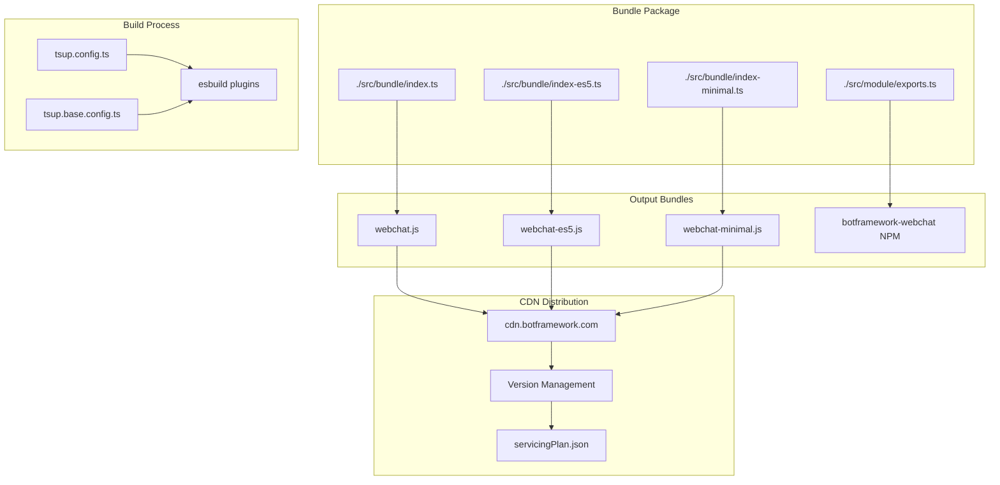
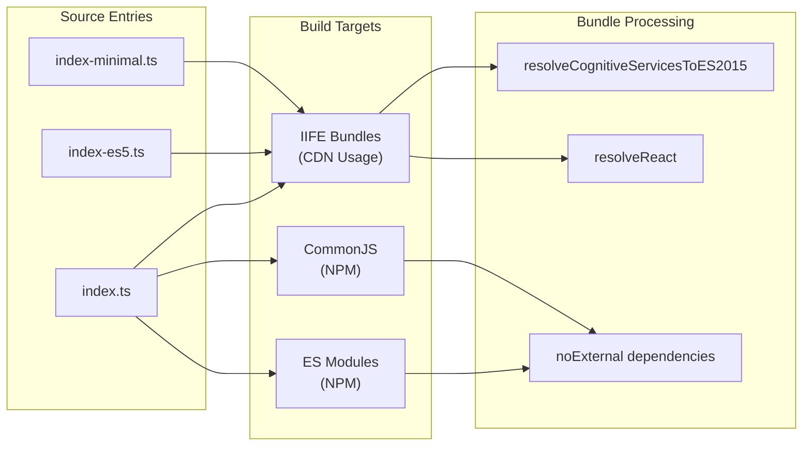
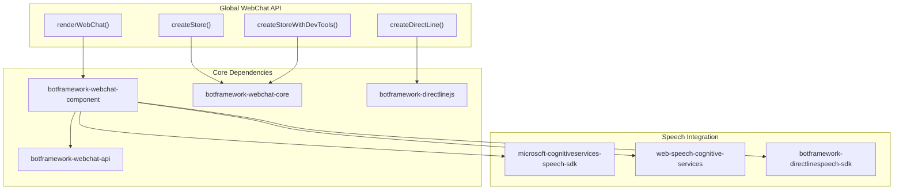
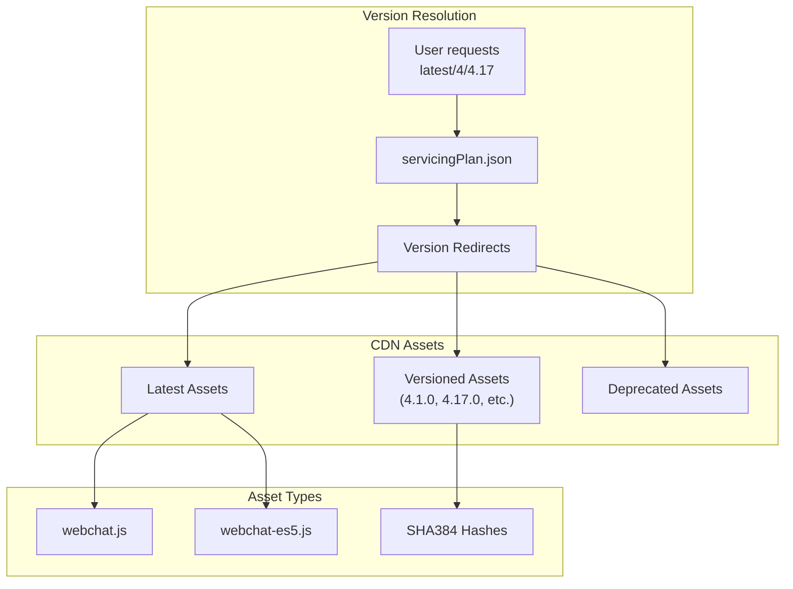
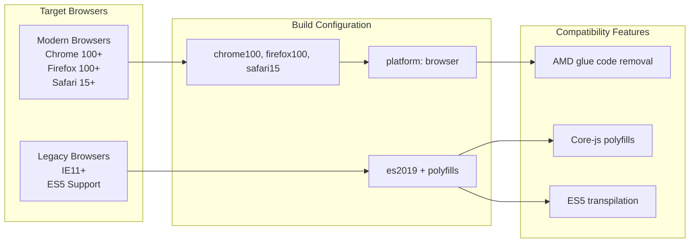
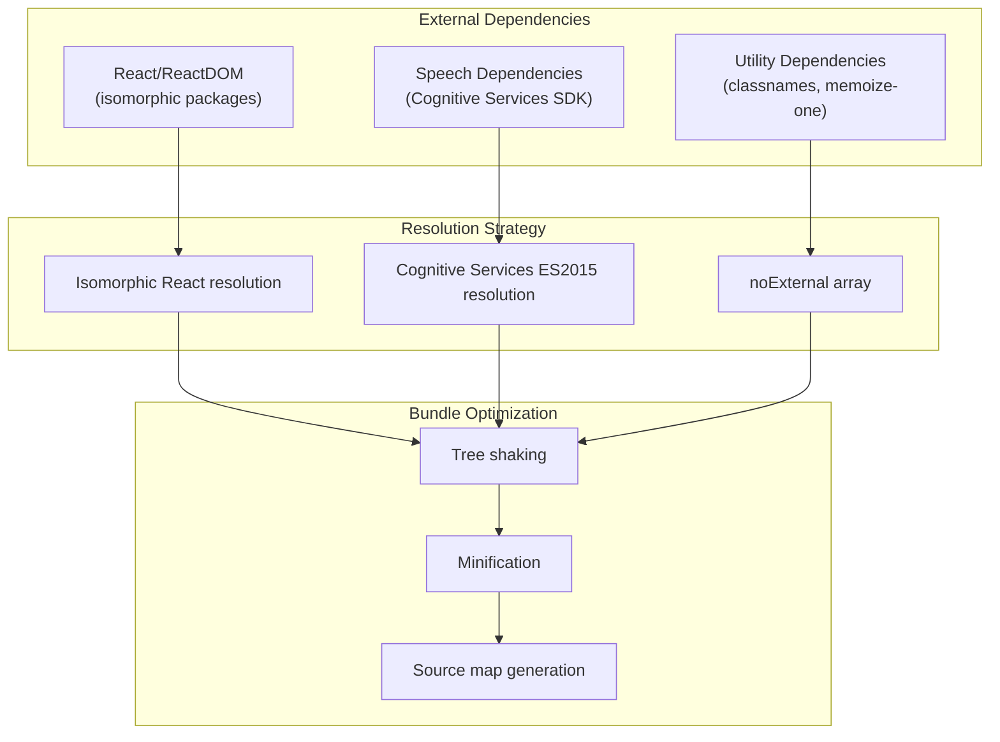

<!-- source: DeepWiki mcp.deepwiki.com · repo microsoft/BotFramework-WebChat · page 5.2 JavaScript/CDN Integration · fetched 2026-10-26 -->

# JavaScript/CDN Integration

<details>
<summary>Relevant source files</summary>

The following files were used as context for generating this wiki page:

- [CHANGELOG.md](CHANGELOG.md)
- [README.md](README.md)
- [package-lock.json](package-lock.json)
- [package.json](package.json)
- [packages/api/package.json](packages/api/package.json)
- [packages/bundle/package.json](packages/bundle/package.json)
- [packages/component/package.json](packages/component/package.json)
- [packages/core/package.json](packages/core/package.json)
- [packages/directlinespeech/package.json](packages/directlinespeech/package.json)
- [packages/embed/servicingPlan.json](packages/embed/servicingPlan.json)
- [packages/playground/package.json](packages/playground/package.json)
- [samples/index.html](samples/index.html)

</details>


This document covers how to integrate Web Chat using vanilla JavaScript and CDN-hosted bundles. This integration method provides a simple way to add Web Chat to existing websites without requiring a build process or React dependencies.

For React-based integration, see [React Integration](#5.1). For the simplest embed option using iframe, see [iframe Embed](#5.3).

## Bundle Architecture

Web Chat provides pre-built JavaScript bundles that can be loaded directly from a CDN. These bundles are created by the bundle package, which consolidates all necessary dependencies into standalone files.



Sources: [packages/bundle/tsup.config.ts:1-88](), [packages/bundle/package.json:1-174](), [tsup.base.config.ts:1-99]()

## Bundle Variants

Web Chat provides three main bundle variants, each optimized for different use cases:

| Bundle | File | Target Audience | Features |
|--------|------|----------------|----------|
| Full Bundle | `webchat.js` | Modern browsers | Complete feature set including speech, adaptive cards |
| ES5 Bundle | `webchat-es5.js` | Legacy browsers (IE11+) | ES5-compatible, reduced feature set |
| Minimal Bundle | `webchat-minimal.js` | Size-conscious applications | Core messaging features only |

The build process creates both IIFE (Immediately Invoked Function Expression) bundles for CDN usage and module formats for NPM distribution:



Sources: [packages/bundle/tsup.config.ts:57-88](), [packages/bundle/tsup.config.ts:26-55]()

## CDN Integration Process

### Basic Integration

The simplest way to integrate Web Chat is by including the CDN script and calling the render function:

```javascript
// Load from CDN
window.WebChat.renderWebChat({
  directLine: window.WebChat.createDirectLine({ token: 'YOUR_TOKEN' }),
  userID: 'YOUR_USER_ID'
}, document.getElementById('webchat'));
```

### Global API Surface

When loaded via CDN, Web Chat exposes a global `WebChat` object with the following key functions:



Sources: [packages/bundle/src/bundle/index.ts](), [packages/bundle/package.json:116-144]()

## Version Management and CDN Distribution

Web Chat uses a sophisticated version management system for CDN distribution:



The service plan defines version mappings and deprecation schedules:

| Version Pattern | Redirect Target | Status |
|----------------|----------------|---------|
| `*` | `4` | Active |
| `4` | `4.17` | Current |
| `4.17` | `4.17.0` | Stable |
| `4.15.x` | Deprecated | Auto-upgrade scheduled |

Sources: [packages/embed/servicingPlan.json:1-580]()

## Browser Compatibility and Build Targets

The build system targets different browser capabilities through esbuild configuration:



The build process specifically handles AMD compatibility issues by removing AMD glue code to prevent conflicts with RequireJS environments:

Sources: [tsup.base.config.ts:45-57](), [packages/bundle/tsup.config.ts:76-77]()

## Dependency Resolution and Bundling

Web Chat's bundle includes numerous dependencies that are resolved and inlined during the build process:



Specific dependency handling includes redirecting `microsoft-cognitiveservices-speech-sdk` imports to ES2015 distributions and ensuring React dependencies are properly resolved through isomorphic packages.

Sources: [packages/bundle/tsup.config.ts:5-25](), [packages/bundle/tsup.config.ts:42-54]()

---

