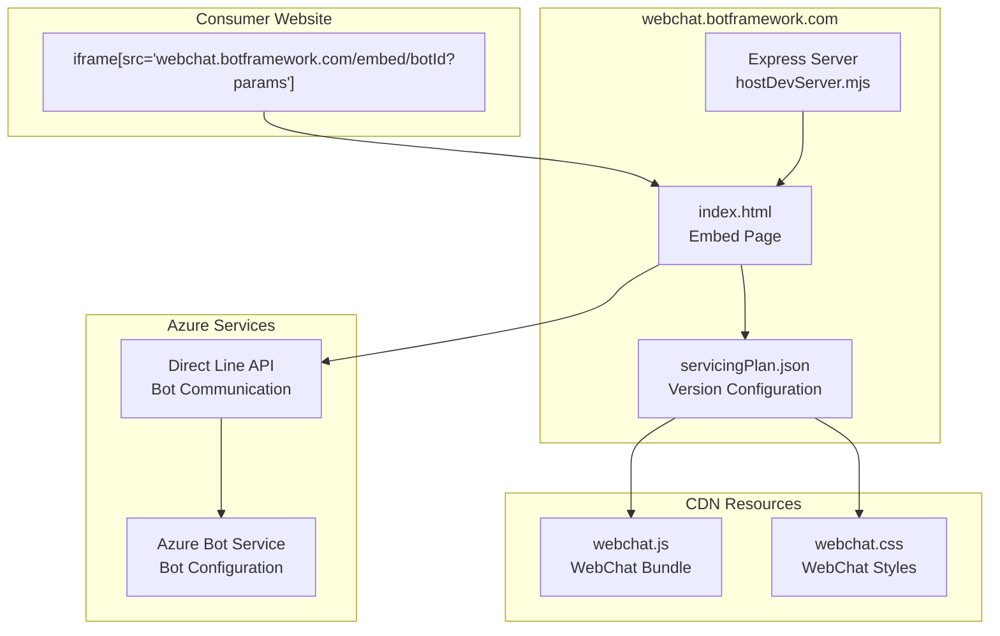
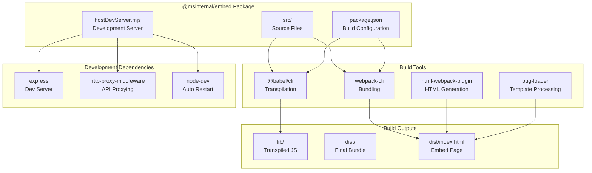
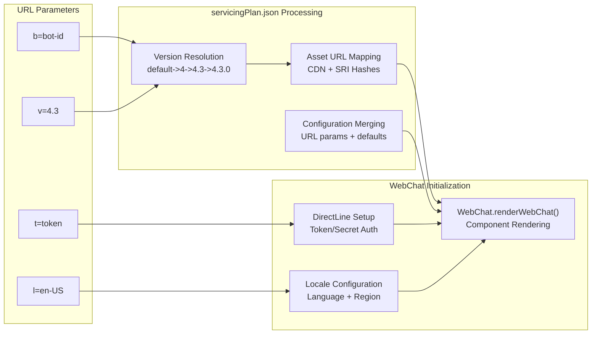
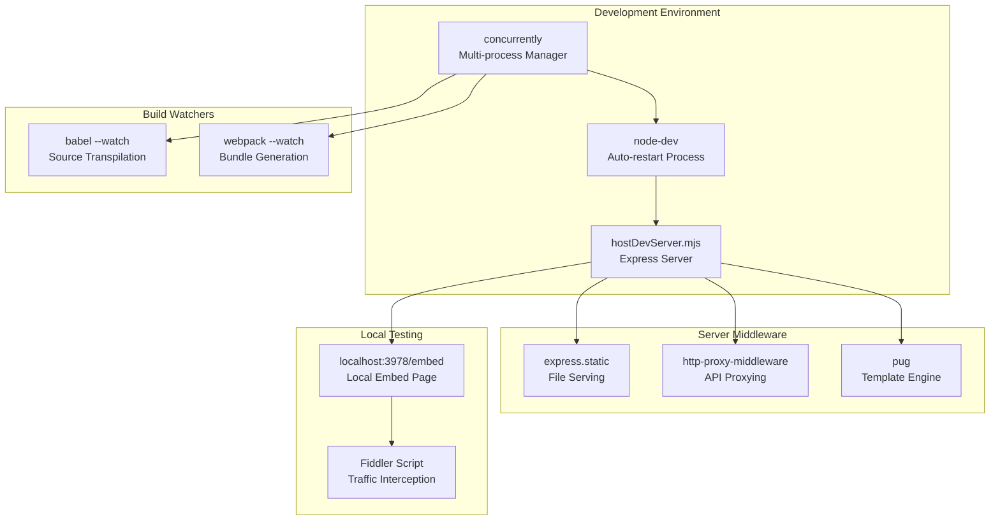
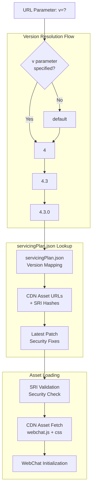

<!-- source: DeepWiki mcp.deepwiki.com · repo microsoft/BotFramework-WebChat · page 5.3 iframe Embed · fetched 2026-10-26 -->

# iframe Embed

<details>
<summary>Relevant source files</summary>

The following files were used as context for generating this wiki page:

- [packages/embed/README.md](packages/embed/README.md)
- [packages/embed/package.json](packages/embed/package.json)
- [packages/isomorphic-react-dom/package.json](packages/isomorphic-react-dom/package.json)
- [packages/isomorphic-react/package.json](packages/isomorphic-react/package.json)

</details>


## Purpose and Scope

This document covers the iframe embed system in BotFramework-WebChat, which provides the simplest integration method for connecting websites to Azure Bot Services through an `<iframe>` element. The iframe embed is hosted at `https://webchat.botframework.com/` and offers automated configuration, version management, and a consistent experience matching the Azure Portal's "Test in Web Chat" functionality.

For information about other integration approaches, see [React Integration](#5.1) and [JavaScript/CDN Integration](#5.2). For details about the underlying build and deployment infrastructure, see [Build System](#6.1) and [Deployment and Distribution](#7).

## System Overview

The iframe embed system consists of a standalone web application that automatically configures and serves WebChat instances based on URL parameters. It eliminates the need for developers to manage WebChat versions, configurations, or Direct Line tokens manually.

### Key Features

- **Zero Configuration**: Automatically reads bot configurations from Azure Bot Services
- **Version Management**: Serves the latest compatible WebChat version based on specified major/minor versions
- **Security**: Supports both secret-based and token-based authentication
- **Consistency**: Provides the same experience as Azure Portal's "Test in Web Chat" blade
- **Simplicity**: Requires only an iframe element with appropriate URL parameters

## Architecture

### iframe Embed Architecture



Sources: [packages/embed/README.md:1-187](), [packages/embed/package.json:18-32]()

### Package Structure and Build Process



Sources: [packages/embed/package.json:1-60](), [packages/embed/README.md:44-52]()

## URL Parameters and Configuration

The iframe embed system supports comprehensive configuration through URL parameters, enabling flexible bot integration without code changes.

### Supported URL Parameters

| Parameter | Purpose | Example | Notes |
|-----------|---------|---------|-------|
| `b` | Bot ID | `?b=your-bot-id` | Identifies the target bot |
| `s` | Site Secret | `?s=your-site-secret` | Authentication via secret (not recommended for production) |
| `t` | Site Token | `?t=your-site-token` | Authentication via token (recommended) |
| `v` | Version | `?v=4.3` | Specifies WebChat version (major, minor, or patch) |
| `l` | Language | `?l=ja.ja-jp` or `?l=zh-HK` | Sets localization and internationalization |
| `userid` | User ID | `?userid=dl_12345` | Custom user identifier for activities |
| `username` | Username | `?username=WW` | Display name (v3 compatibility only) |

### Configuration Flow



Sources: [packages/embed/README.md:163-174](), [packages/embed/README.md:54-58]()

## Development Workflow

### Build System

The embed package uses a dual-build system combining Babel for transpilation and Webpack for bundling.

#### Build Scripts

| Script | Purpose | Implementation |
|--------|---------|---------------|
| `build:babel` | Transpile source files | `babel src --out-dir lib --verbose` |
| `build:webpack` | Bundle application | `webpack-cli` |
| `start:server` | Development server | `node-dev hostDevServer.mjs` |
| `start:babel` | Watch mode transpilation | `babel --watch` |
| `start:webpack` | Watch mode bundling | `webpack --watch` |

### Development Server Architecture



Sources: [packages/embed/package.json:27-32](), [packages/embed/README.md:72-116]()

## Versioning and Servicing

### Version Resolution System

The iframe embed implements a sophisticated version resolution system that automatically serves the most appropriate WebChat version based on user preferences and security requirements.

#### Version Selection Logic



Sources: [packages/embed/README.md:127-154](), [packages/embed/README.md:54-70]()

### Supported Version Patterns

| Version Pattern | Resolution | Example | Security Updates |
|-----------------|------------|---------|------------------|
| `default` | Latest stable major | `4.3.0` | Automatic |
| `4` | Latest minor in v4 | `4.3.0` | Automatic |
| `4.3` | Latest patch in v4.3 | `4.3.0` | Automatic |
| `4.3.0` | Not supported | N/A | Manual upgrade required |

### Subresource Integrity

The system uses SHA384 hashes for all CDN assets to ensure integrity and prevent tampering.

```bash
# Generate SRI hash for assets
curl https://cdn.botframework.com/botframework-webchat/4.3.0/webchat.js | openssl dgst -sha384 -binary | openssl base64 -A
```

Sources: [packages/embed/README.md:60-70]()

## Local Testing and Development

### Fiddler Integration

The embed system provides detailed instructions for local testing using Fiddler to intercept production traffic and serve local development builds.

#### Embed Page Testing

```javascript
// FiddlerScript OnBeforeRequest function
if (oSession.uriContains('https://webchat.botframework.com/embed/your-bot-id/')) {
  oSession['x-replywithfile'] = 
    'C:\\Users\\JohnDoe\\Source\\Repos\\BotFramework-WebChat\\packages\\embed\\dist\\index.html';
  oSession['ui-backcolor'] = 'Yellow';
}
```

#### Azure Portal Integration Testing

```javascript
// FiddlerScript OnPeekAtResponseHeaders function
if (oSession.uriContains('https://webchat.botframework.com/embed/your-bot-id?features=webchatpreview&t=')) {
  oSession['ui-backcolor'] = 'Yellow';
  oSession.oResponse.headers.HTTPResponseCode = 302;
  oSession.oResponse.headers.HTTPResponseStatus = '302 Moved';
  oSession.oResponse.headers.Add(
    'location',
    oSession.PathAndQuery.replace('your-bot-id?', 'your-bot-id/?b=your-bot-id&v=4.3&')
  );
}
```

Sources: [packages/embed/README.md:79-116]()

## Security Considerations

### Authentication Methods

The iframe embed supports two authentication approaches with different security implications:

| Method | Parameter | Security Level | Recommended Use |
|--------|-----------|----------------|-----------------|
| Site Secret | `?s=secret` | Lower | Development only |
| Site Token | `?t=token` | Higher | Production |

### Production Security Requirements

- **Token-based authentication**: Strongly recommended over secrets
- **Subresource Integrity**: All CDN assets include SHA384 hashes
- **HTTPS enforcement**: All communications use TLS
- **Cross-origin isolation**: iframe provides security boundary

Sources: [packages/embed/README.md:30-40]()

---

