<!-- source: DeepWiki mcp.deepwiki.com · repo microsoft/BotFramework-WebChat · page 6 Development · fetched 2026-10-26 -->

# Development

Relevant source files

The following files were used as context for generating this wiki page:

- [.github/CONTRIBUTING.md](.github/CONTRIBUTING.md)
- [.github/PULL_REQUEST_TEMPLATE.md](.github/PULL_REQUEST_TEMPLATE.md)
- [__tests__/README.md](__tests__/README.md)
- [__tests__/__image_snapshots__/html/accessibility-live-region-activity-status-send-failed-contrast-js-live-region-should-render-send-failed-retry-correctly-in-high-contrast-mode-1-snap.png](__tests__/__image_snapshots__/html/accessibility-live-region-activity-status-send-failed-contrast-js-live-region-should-render-send-failed-retry-correctly-in-high-contrast-mode-1-snap.png)
- [__tests__/html/accessibility.liveRegion.activityStatus.sendFailed.contrast.html](__tests__/html/accessibility.liveRegion.activityStatus.sendFailed.contrast.html)
- [__tests__/html/accessibility.liveRegion.activityStatus.sendFailed.contrast.js](__tests__/html/accessibility.liveRegion.activityStatus.sendFailed.contrast.js)
- [docs/media/running-test.png](docs/media/running-test.png)
- [packages/component/src/Utils/InlineMarkdown.js](packages/component/src/Utils/InlineMarkdown.js)
- [packages/component/src/Utils/createCustomEvent.js](packages/component/src/Utils/createCustomEvent.js)
- [packages/test/harness/src/browser/globals/run.js](packages/test/harness/src/browser/globals/run.js)
- [packages/test/harness/src/host/dev/index.js](packages/test/harness/src/host/dev/index.js)
- [packages/test/harness/src/host/jest/runHTML.js](packages/test/harness/src/host/jest/runHTML.js)

This document provides an overview of the development workflows, tooling, and contribution processes for the BotFramework-WebChat monorepo. It covers the essential information needed to set up a development environment, understand the development lifecycle, and contribute to the project.

For detailed information about specific development topics:
- Build system configuration and package building: see [Build System](#6.1)
- Testing infrastructure and test execution: see [Testing Infrastructure](#6.2) 
- Sample applications and examples: see [Sample Applications](#6.3)
- Contribution guidelines and code standards: see [Contributing Guidelines](#6.4)

## Development Environment Setup

The development environment requires specific tools and follows a particular setup process to ensure consistency across all contributors.

### Required Tools

Based on the contributing guide, developers need:
- Node.js LTS
- ChromeDriver (extracted to project root)
- Docker Desktop  
- Windows Subsystem for Linux 2 (for Windows users)

### Setup Process

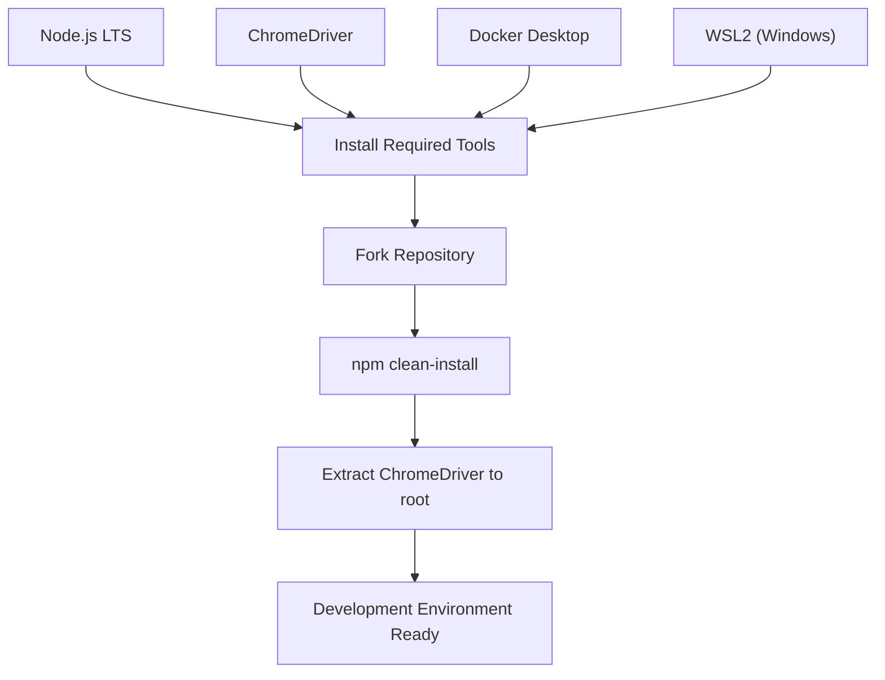

Sources: [.github/CONTRIBUTING.md:20-41]()

## Development Workflow

The development workflow centers around continuous building and testing, with support for both one-off and continuous builds.

### Build and Development Flow

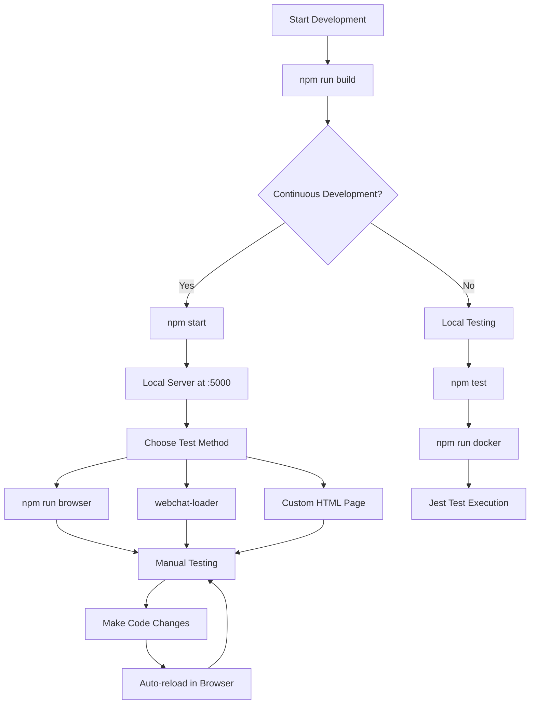

Sources: [.github/CONTRIBUTING.md:44-95]()

### Development Server Endpoints

When running `npm start`, the development server provides these endpoints:

| Endpoint | Description | File Location |
|----------|-------------|---------------|
| `http://localhost:5000/webchat.js` | Main bundle | `/packages/bundle/dist/webchat.js` |
| `http://localhost:5000/webchat-es5.js` | ES5 compatible bundle | `/packages/bundle/dist/webchat-es5.js` |
| `http://localhost:5000/webchat-minimal.js` | Minimal bundle | `/packages/bundle/dist/webchat-minimal.js` |

Sources: [.github/CONTRIBUTING.md:54-57]()

## Key Development Tools and Systems

The development infrastructure uses several key tools and systems that developers need to understand.

### Build System Architecture

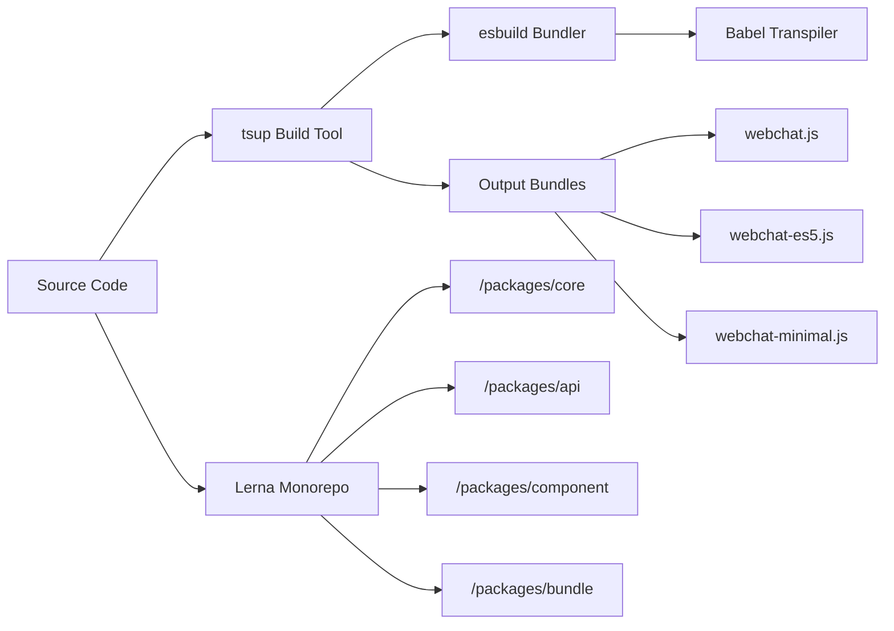

Sources: [.github/CONTRIBUTING.md:44-57]()

### Test Infrastructure Components

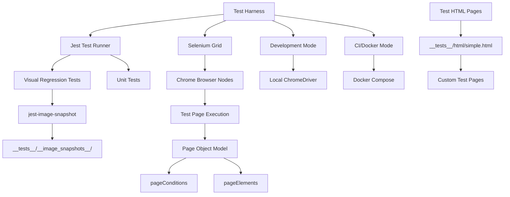

Sources: [.github/CONTRIBUTING.md:112-144](), [packages/test/harness/src/host/dev/index.js:1-97](), [packages/test/harness/src/host/jest/runHTML.js:1-113]()

## Testing Approach

The project uses a comprehensive testing strategy that emphasizes visual regression testing and end-to-end scenarios.

### Test Development Workflow

The testing approach follows a test-driven development model:

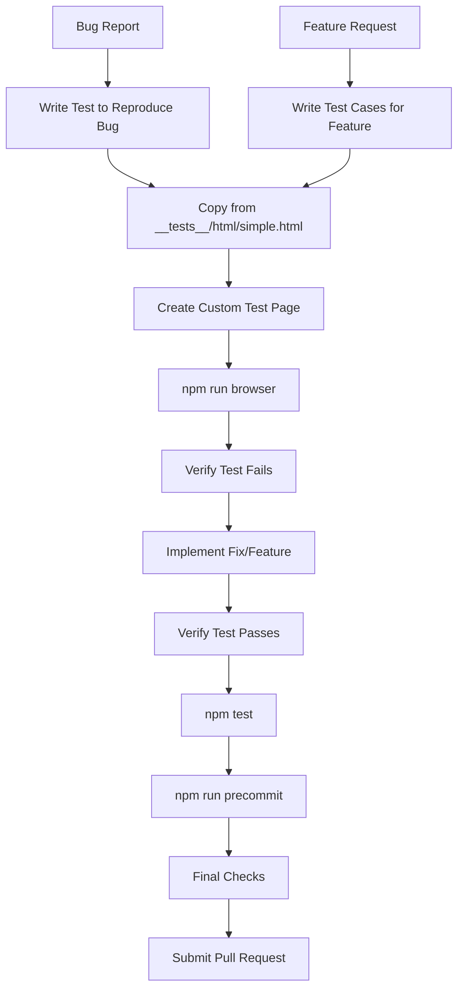

Sources: [.github/CONTRIBUTING.md:104-136](), [.github/CONTRIBUTING.md:272-307]()

### Test Execution Environment

The test system supports both local development and CI environments:

#### Development Testing

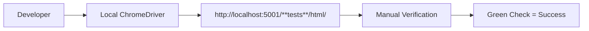

Sources: [.github/CONTRIBUTING.md:118-134]()

#### CI/Automated Testing

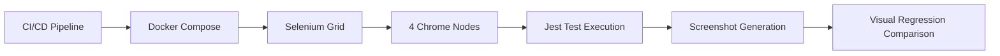

Sources: [.github/CONTRIBUTING.md:138-144]()

## Test Harness Architecture

The test infrastructure is built around a sophisticated test harness that supports both development and CI environments.

### Test Harness Components

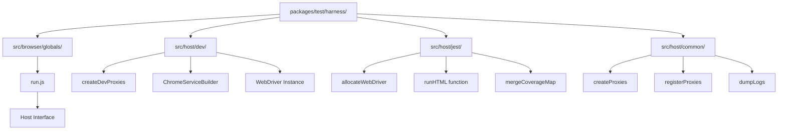

Sources: [packages/test/harness/src/browser/globals/run.js:1-67](), [packages/test/harness/src/host/dev/index.js:1-97](), [packages/test/harness/src/host/jest/runHTML.js:1-113]()

### Test Page Execution Flow

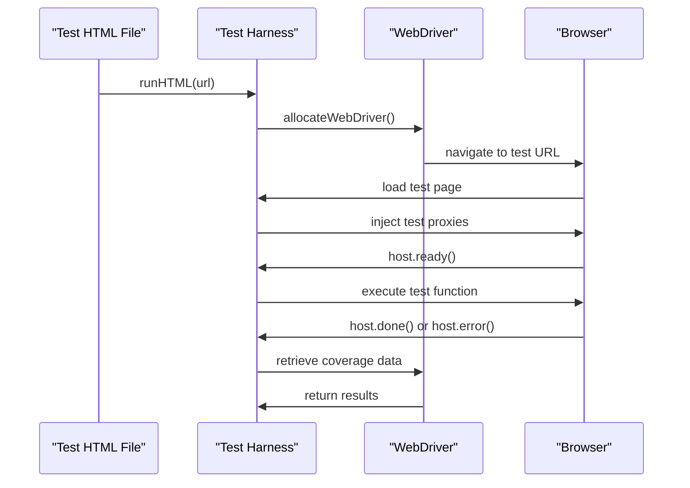

Sources: [packages/test/harness/src/host/jest/runHTML.js:44-113](), [packages/test/harness/src/browser/globals/run.js:30-66]()

## Contributing Process

The contribution process is designed to maintain code quality and consistency across the project.

### Pull Request Workflow

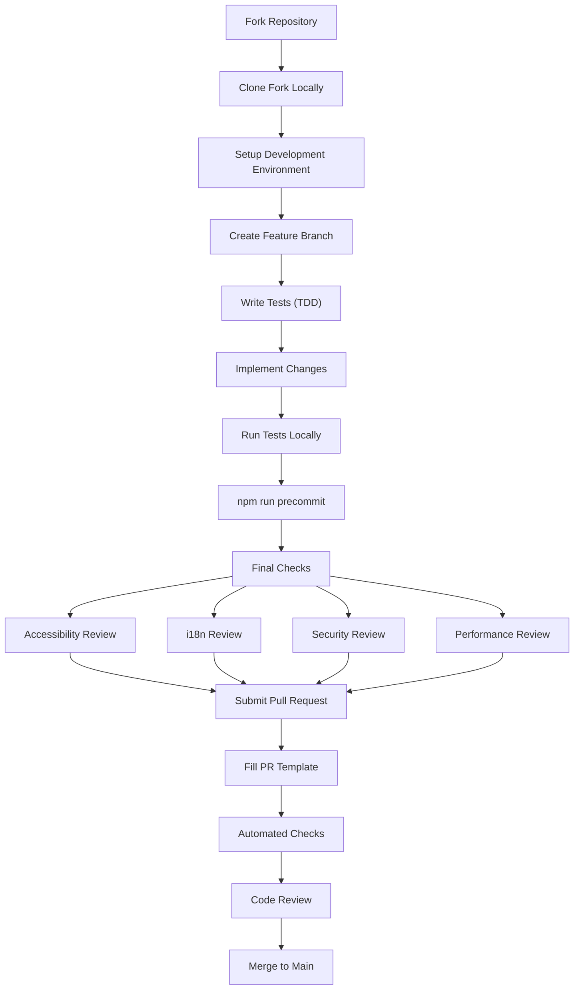

Sources: [.github/CONTRIBUTING.md:97-307](), [.github/PULL_REQUEST_TEMPLATE.md:1-43]()

### Code Quality Gates

The project enforces several quality gates that must pass before code can be merged:

| Quality Gate | Tool/Process | Requirements |
|--------------|--------------|--------------|
| Static Analysis | ESLint | Zero linting errors |
| Type Safety | TypeScript | Type checking passes |
| Test Coverage | Jest | Maintain coverage levels |
| Visual Regression | jest-image-snapshot | No visual changes without approval |
| Accessibility | Manual review | WCAG compliance maintained |
| Internationalization | Manual review | All strings localized |
| Security | Manual review | No security vulnerabilities |
| Performance | Manual review | No significant performance degradation |

Sources: [.github/CONTRIBUTING.md:188-252](), [.github/PULL_REQUEST_TEMPLATE.md:32-42]()

## Development Best Practices

The project follows specific development practices to ensure consistency and quality.

### Test-Driven Development

The project strongly emphasizes test-driven development:

1. **Bug Fixes**: Write a test that reproduces the bug before fixing it
2. **New Features**: Write comprehensive test cases covering happy and unhappy paths  
3. **Visual Components**: Use visual regression tests for pixel-perfect verification
4. **Utilities**: Write unit tests for utility functions

Sources: [.github/CONTRIBUTING.md:104-117]()

### Code Organization

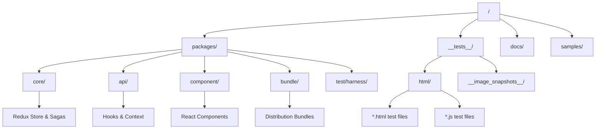

Sources: [.github/CONTRIBUTING.md:90-95]()

### Static Analysis and Code Standards

The project uses several tools to maintain code quality:

- **ESLint**: Code quality and style enforcement with `eslint-disable-next-line` for exceptions
- **TypeScript**: Type safety and better IDE support
- **CSS BEM Methodology**: Consistent CSS naming with `webchat__` namespace
- **Security Practices**: No external URLs, secure by default approach

Key code standards include:
- Alphabetical sorting of imports, members, and variables
- CSS BEM methodology with `webchat__` namespace prefix
- No console logging except for deprecation notes, warnings, and errors
- Minimal `z-index` usage within new stacking contexts
- No global pollution (taborder, excessive z-index usage)

Sources: [.github/CONTRIBUTING.md:188-252](), [packages/component/src/Utils/InlineMarkdown.js:72-77]()

This development documentation provides the foundation for working with the BotFramework-WebChat codebase. For detailed information about specific aspects of development, refer to the dedicated pages for build systems, testing infrastructure, sample applications, and contributing guidelines.

---

