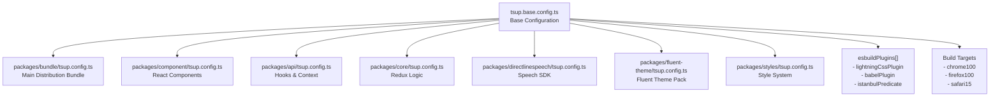
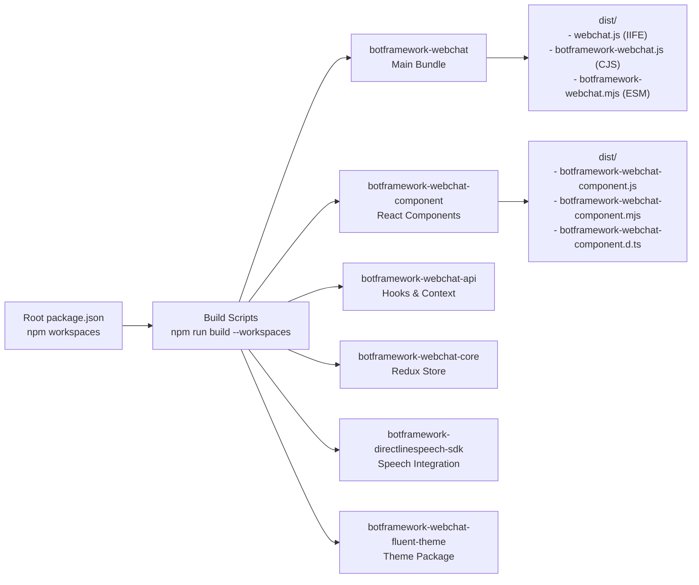
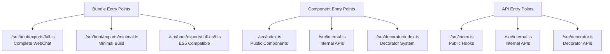
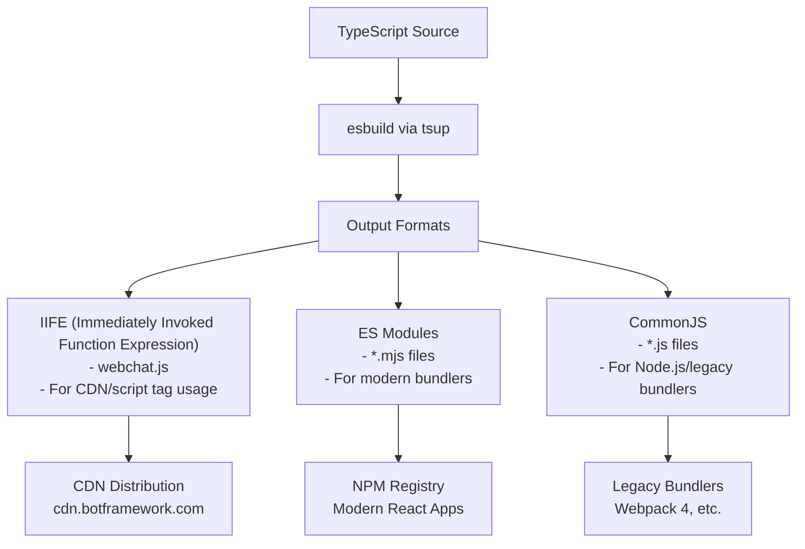
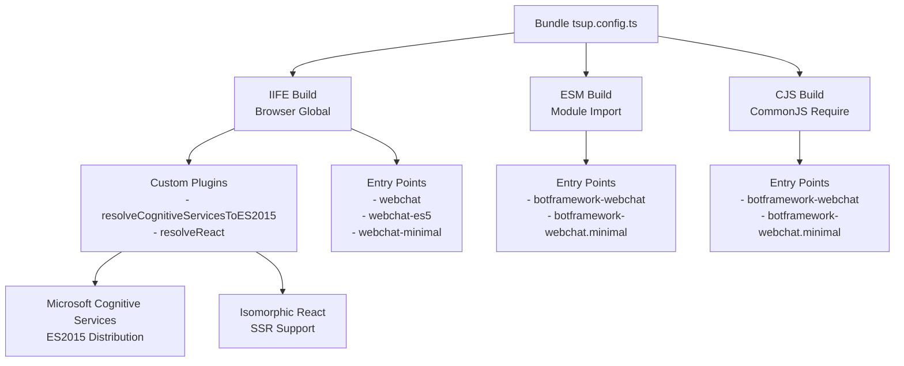
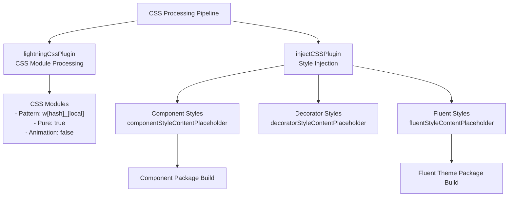
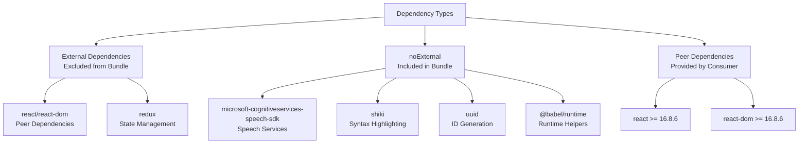

<!-- source: DeepWiki mcp.deepwiki.com · repo microsoft/BotFramework-WebChat · page 6.1 Build System · fetched 2026-10-26 -->

# Build System

Relevant source files

The following files were used as context for generating this wiki page:

- [CHANGELOG.md](CHANGELOG.md)
- [__tests__/html/sendAttachmentOn/speech.js](__tests__/html/sendAttachmentOn/speech.js)
- [package-lock.json](package-lock.json)
- [package.json](package.json)
- [packages/api/decorator.js](packages/api/decorator.js)
- [packages/api/internal.js](packages/api/internal.js)
- [packages/api/package.json](packages/api/package.json)
- [packages/api/tsup.config.ts](packages/api/tsup.config.ts)
- [packages/base/tsup.config.ts](packages/base/tsup.config.ts)
- [packages/base/utils.js](packages/base/utils.js)
- [packages/bundle/package.json](packages/bundle/package.json)
- [packages/bundle/tsup.config.ts](packages/bundle/tsup.config.ts)
- [packages/component/decorator.js](packages/component/decorator.js)
- [packages/component/internal.js](packages/component/internal.js)
- [packages/component/package.json](packages/component/package.json)
- [packages/component/tsup.config.ts](packages/component/tsup.config.ts)
- [packages/core/package.json](packages/core/package.json)
- [packages/core/tsup.config.ts](packages/core/tsup.config.ts)
- [packages/directlinespeech/package.json](packages/directlinespeech/package.json)
- [packages/directlinespeech/tsup.config.ts](packages/directlinespeech/tsup.config.ts)
- [packages/embed/servicingPlan.json](packages/embed/servicingPlan.json)
- [packages/fluent-theme/tsup.config.ts](packages/fluent-theme/tsup.config.ts)
- [packages/playground/package.json](packages/playground/package.json)
- [packages/styles/tsup.config.ts](packages/styles/tsup.config.ts)
- [tsup.base.config.ts](tsup.base.config.ts)

## Purpose and Scope

This document covers the build system architecture of BotFramework-WebChat, including the tooling, configuration, and build processes used to compile and bundle the monorepo packages. It focuses on the `tsup` build configuration, package compilation workflows, and output format generation.

For information about development workflows and testing, see [Testing Infrastructure](#6.2). For deployment and distribution processes, see [Deployment and Distribution](#7).

## Build Tool Architecture

BotFramework-WebChat uses `tsup` as its primary build tool, which provides TypeScript compilation and bundling via `esbuild`. The build system follows a hierarchical configuration pattern with a shared base configuration extended by individual packages.

### Core Build Configuration

Sources: [tsup.base.config.ts:1-106](), [packages/bundle/tsup.config.ts:1-92](), [packages/component/tsup.config.ts:1-34]()

### Build Configuration Hierarchy

The build system uses a base configuration that defines common settings, which individual packages extend with specific requirements:

| Configuration | Purpose | Output Formats |
|---------------|---------|----------------|
| `tsup.base.config.ts` | Shared build settings, plugins, target browsers | ESM, CJS |
| `packages/bundle/tsup.config.ts` | Main distribution bundle with IIFE format | IIFE, ESM, CJS |
| `packages/component/tsup.config.ts` | React components with CSS injection | ESM, CJS |
| `packages/api/tsup.config.ts` | API hooks with globalize bundling | ESM, CJS |
| `packages/fluent-theme/tsup.config.ts` | Theme package with UMD resolution | CJS, ESM, IIFE |

Sources: [tsup.base.config.ts:35-106](), [packages/bundle/tsup.config.ts:30-91](), [packages/fluent-theme/tsup.config.ts:49-103]()

## Package Build Workflows

### Monorepo Build Orchestration

The build system uses npm workspaces to manage the monorepo structure and coordinate builds across packages:

Sources: [package.json:17-36](), [package.json:41](), [packages/component/package.json:7-37](), [packages/bundle/package.json:7-17]()

### Entry Point Configuration

Each package defines multiple entry points to support different import patterns and use cases:

Sources: [packages/bundle/tsup.config.ts:32-36](), [packages/component/tsup.config.ts:9-13](), [packages/api/tsup.config.ts:6-11]()

## Output Format Generation

### Multi-Format Build Strategy

The build system generates multiple output formats to support different integration methods and environments:

Sources: [packages/bundle/tsup.config.ts:61-91](), [tsup.base.config.ts:96](), [packages/component/tsup.config.ts:21-33]()

### Build Target Configuration

The base configuration defines browser support targets and build optimizations:

| Setting | Value | Purpose |
|---------|-------|---------|
| `target` | `['chrome100', 'firefox100', 'safari15']` | Modern browser support |
| `minify` | `env === 'production' \|\| env === 'test'` | Code optimization |
| `sourcemap` | `true` | Debug support |
| `splitting` | `true` | Code splitting for ESM |
| `platform` | `'browser'` | Browser-targeted builds |

Sources: [tsup.base.config.ts:99-104](), [tsup.base.config.ts:35-45]()

## Specialized Build Configurations

### Bundle Package Build Pipeline

The main bundle package uses a complex build configuration to support multiple integration methods:

Sources: [packages/bundle/tsup.config.ts:5-28](), [packages/bundle/tsup.config.ts:61-91](), [packages/bundle/tsup.config.ts:45]()

### CSS and Asset Processing

The build system includes specialized handling for CSS modules and static assets:

Sources: [tsup.base.config.ts:22-33](), [packages/component/tsup.config.ts:14-18](), [packages/fluent-theme/tsup.config.ts:54-57]()

### Development and Production Environments

The build system adapts its behavior based on the environment:

| Environment | Babel Plugin | Minification | Source Maps | CSS Plugin |
|-------------|--------------|--------------|-------------|------------|
| `development` | None | No | Yes | lightningCss only |
| `production` | None | Yes | Yes | lightningCss only |
| `test` | Istanbul coverage | Yes | Yes | lightningCss + babel |

Sources: [tsup.base.config.ts:7-9](), [tsup.base.config.ts:58-95](), [tsup.base.config.ts:99]()

## Dependency Resolution and Bundling

### External Dependency Handling

The build system uses selective bundling strategies to handle different types of dependencies:

Sources: [packages/bundle/tsup.config.ts:46-58](), [packages/component/package.json:152-156](), [packages/api/package.json:128-131]()

### Local Package Dependencies

The monorepo uses a `localDependencies` system to manage internal package references:

| Package | Local Dependencies | Type |
|---------|-------------------|------|
| `bundle` | `botframework-webchat-api`, `botframework-webchat-component`, `botframework-webchat-core` | production |
| `component` | `botframework-webchat-api`, `botframework-webchat-core` | production |
| `api` | `botframework-webchat-core` | production |
| `component` | `@msinternal/botframework-webchat-styles` | development |

Sources: [packages/bundle/package.json:61-70](), [packages/component/package.json:71-77](), [packages/api/package.json:72-77]()

---

